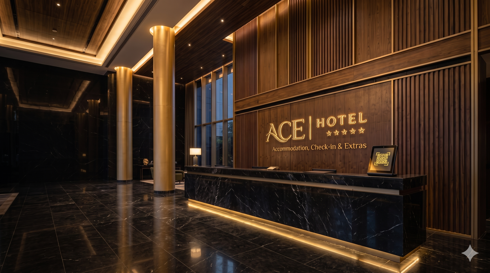
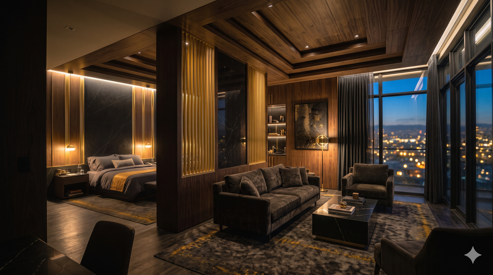
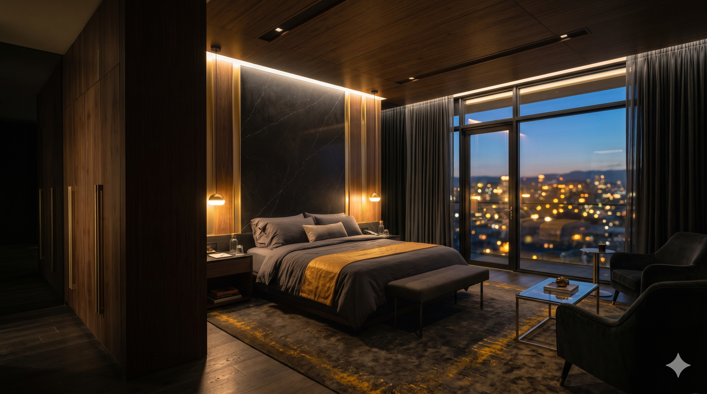
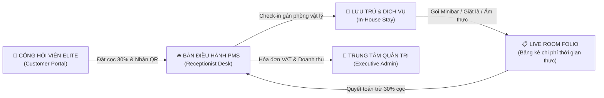
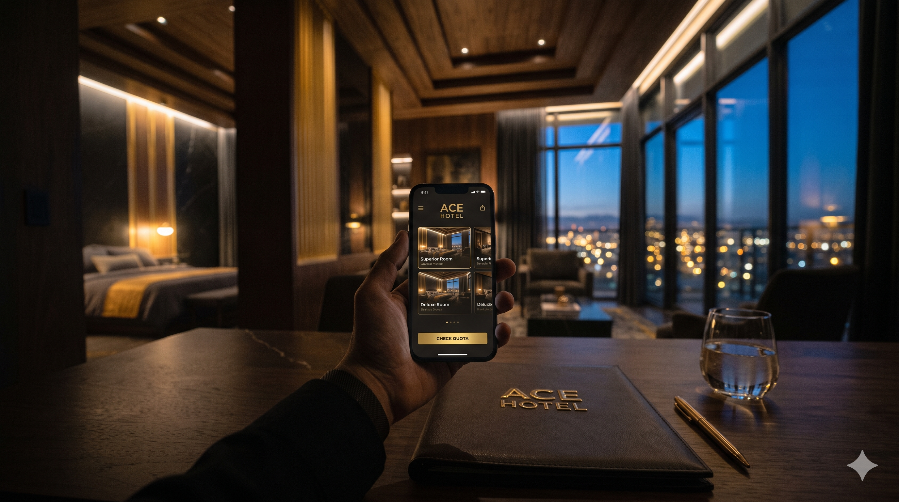
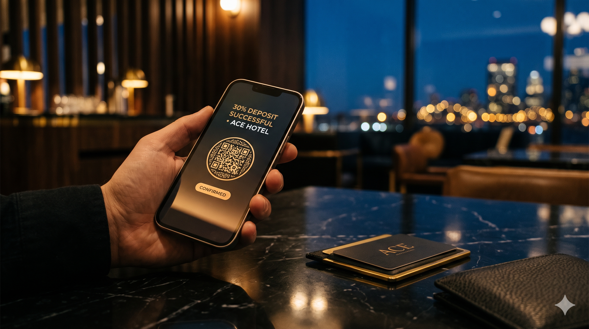
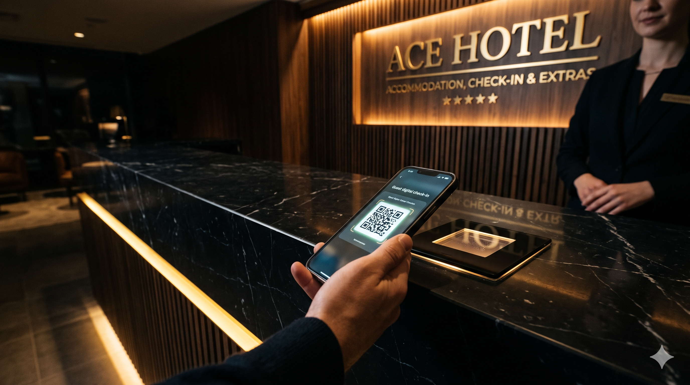

<div align="center">

  

  <br />

  # ✦ ACE HOTEL FLAGSHIP ✦
  ### **5★ Luxury Property Management System (PMS) & Next-Gen Booking Portal**

  <p align="center">
    <i>"Nơi kiến trúc Đen Obsidian & Vàng Champagne hội tụ cùng trải nghiệm vận hành số hóa hoàn hảo."</i>
  </p>

  <!-- Badges -->
  <p align="center">
    
    
    
    
    
    
    
  </p>

  <p align="center">
    <a href="#-tổng-quan-kiến-trúc"><b>Tổng Quan</b></a> •
    <a href="#-bộ-3-phân-hệ-vận-hành-toàn-diện"><b>3 Phân Hệ</b></a> •
    <a href="#-quy-chuẩn-nghiệp-vụ-5-sao"><b>Quy Chuẩn 5 Sao</b></a> •
    <a href="#-tài-khoản-trải-nghiệm-demo"><b>Tài Khoản Demo</b></a> •
    <a href="#-hướng-dẫn-khởi-chạy-1-click"><b>Hướng Dẫn Chạy</b></a>
  </p>

  <hr style="border: 0; height: 1px; background: linear-gradient(90deg, transparent, #FDBF2D, transparent); margin: 2rem 0;" />
</div>

<br />

## 🌟 Trưng Bày Không Gian Nghỉ Dưỡng Flagship

<div align="center">
  <table>
    <tr>
      <td width="33.3%" align="center">
        <br />
        <b>Đại Sảnh Obsidian Grand Lobby</b><br />
        <sub>Không gian đón tiếp chuẩn 5 sao với ánh sáng Ambient Gold</sub>
      </td>
      <td width="33.3%" align="center">
        <br />
        <b>Presidential Suite Hoàng Gia</b><br />
        <sub>Tầm nhìn Panorama, bồn sục Jacuzzi & đặc quyền VIP</sub>
      </td>
      <td width="33.3%" align="center">
        <br />
        <b>Deluxe King Ban Công</b><br />
        <sub>Nội thất gỗ óc chó cao cấp & hệ thống Smart-Room 24/7</sub>
      </td>
    </tr>
  </table>
</div>

<br />

---

## 💎 Điểm Nhấn Kiến Trúc & Công Nghệ Độc Bản

| Biểu Tượng | Trọng Tâm Đột Phá | Mô Tả Kỹ Thuật Đẳng Cấp Thượng Lưu |
| :---: | :--- | :--- |
| 🛡️ | **Cam Kết 0% Overbooking** | Thuật toán kiểm soát tồn kho gián tiếp thời gian thực kết hợp Khóa bi quan CSDL `@Lock(LockModeType.PESSIMISTIC_WRITE)` trên tầng Service, loại trừ 100% rủi ro gán trùng phòng giữa Online & Quầy Lễ Tân. |
| ⚡ | **Check-in Không Chạm 3 Giây** | Trình tạo mã QR Offline chuẩn SVG vector nguyên bản (`qr-generator.js`). Khách hàng nhận ngay Thẻ lưu trú điện tử trên điện thoại, lễ tân quét nhận phòng tức thì trong 3 giây. |
| 💰 | **Live Room Folio & Quyết Toán `++`** | Quản lý bảng kê chi phí thời gian thực. Tự động áp dụng $5\%$ Phí dịch vụ (SVC), $10\%$ Thuế GTGT (VAT), tự động khấu trừ chuẩn xác $30\%$ tiền cọc đã thanh toán online với số nguyên `BIGINT`. |
| 🎨 | **Obsidian & Champagne Gold UI** | Hệ thống Design System lấy cảm hứng từ Porsche Design & Mews Luxury PMS. Hỗ trợ Dark/Light Theme chống giật mắt (Anti-FOUC), kèm hệ thống Custom Scrollbar mạ vàng hoàng gia siêu mảnh (8px/5px). |
| 📜 | **Bảo Chứng Minh Bạch Hóa Đơn VAT** | Xuất phiếu in hóa đơn VAT (VAT Invoice Print) sắc nét, đồng bộ mã vạch và số ký hiệu điện tử cho mọi giao dịch quyết toán lưu trú. |

<br />

---

## 🏛️ Bộ 3 Phân Hệ Vận Hành Toàn Diện (The 3 Core Portals)



### 1. 👑 Cổng Hội Viên Danh Dự — Customer Elite Portal (`/customer/dashboard`)
* **Thẻ VIP Elite Hero mạ vàng**: Hiển thị mã hội viên dập nổi viền vàng lá kép, vệt quét ánh sáng Holographic Metallic Luster và chip EMV vi mạch sang trọng.
* **Sổ Phiếu Đặt Phòng Điện Tử**: Theo dõi trạng thái đặt chỗ trực quan (`Chờ nhận phòng`, `Đang lưu trú`, `Đã trả phòng`, `Đã hủy`).
* **Mã QR Check-in Tức Thì**: Mã hóa tự động thông tin lưu trú, hỗ trợ phóng to toàn màn hình để lễ tân quét mã không chạm.
* **Bảng Kê Chi Phí Trực Tuyến (Live Folio)**: Khách hàng xem bóc tách chi phí phòng, dịch vụ phát sinh và số dư cần thanh toán mọi lúc ngay trên điện thoại di động.
* **Modal Hồ Sơ & Mật Khẩu Chuyên Nghiệp**: Hỗ trợ đổi thông tin cá nhân (ràng buộc $\ge 18$ tuổi), đổi mật khẩu với Live Match Indicator thời gian thực.

### 2. 🛎️ Bàn Điều Hành Lễ Tân — Receptionist Cockpit (`/staff/dashboard`)
* **Sơ đồ 12 Phòng Vật Lý Trực Quan**: Phân chia theo tầng, giám sát trực tiếp 4 trạng thái phòng theo mã màu tiêu chuẩn quốc tế:
  * 🟢 **AVAILABLE**: Phòng sạch sẵn sàng đón khách.
  * 🔴 **OCCUPIED**: Phòng đang có khách lưu trú.
  * 🟡 **DIRTY**: Phòng cần buồng phòng dọn dẹp, nghiệm thu.
  * 🟣 **MAINTENANCE**: Phòng đang bảo trì trang thiết bị.
* **Thủ Tục Nhận Phòng (Check-in)**: Quét mã QR hoặc tìm kiếm nhanh bằng SĐT/Mã đơn. Gán phòng vật lý sạch đúng hạng phòng đã đặt.
* **Tiếp Nhận Khách Vãng Lai (Walk-in)**: Tiếp nhận khách nhận phòng tức thì với **0đ tiền cọc**, thu toàn bộ chi phí khi trả phòng.
* **Quản Trị Room Folio**: Thêm/xóa dịch vụ phòng (Ẩm thực, Minibar, Giặt là, Concierge) với tính năng Price Snapshot đóng băng đơn giá tại thời điểm gọi.
* **Thủ Tục Trả Phòng & In Hóa Đơn (Check-out)**: Tự động cộng phụ thu trả trễ, áp dụng $5\%$ SVC + $10\%$ VAT, khấu trừ $30\%$ cọc và xuất hóa đơn in VAT.

### 3. 👔 Trung Tâm Quản Trị Cấp Cao — Executive Admin (`/admin/dashboard`)
* **Báo Cáo Tài Chính & Doanh Thu `++`**: Thống kê doanh thu hôm nay, doanh thu lũy kế tháng, doanh thu phòng gốc và doanh thu dịch vụ gia tăng.
* **Chỉ Số Vận Hành Khách Sạn Cao Cấp**: Tính toán tự động tỷ lệ lấp đầy phòng (Occupancy Rate $OR\%$), giá bán phòng bình quân (ADR) và doanh thu trên mỗi phòng sẵn có (RevPAR).
* **Quản Trị Danh Mục & Biểu Giá (Catalog)**: Thiết lập giá ngày thường (T2–T5) và giá cuối tuần (T6–CN), sức chứa tối đa và tiện ích của từng hạng phòng.

<br />

---

## 🔄 Quy Trình Trải Nghiệm Khép Kín 3 Bước

<div align="center">
  <table>
    <tr>
      <td width="33.3%" align="center">
        <br /><br />
        <b>BƯỚC 01 • TRA CỨU & ĐẶT CỌC</b><br />
        <sub>Tra cứu tồn kho Quota khả dụng, xác nhận đặt phòng và cọc giữ chỗ 30% trực tuyến.</sub>
      </td>
      <td width="33.3%" align="center">
        <br /><br />
        <b>BƯỚC 02 • CHECK-IN KHÔNG CHẠM</b><br />
        <sub>Xuất trình thẻ lưu trú QR trên smartphone, quầy lễ tân quét nhận phòng sạch trong 3 giây.</sub>
      </td>
      <td width="33.3%" align="center">
        <br /><br />
        <b>BƯỚC 03 • NGHỈ DƯỠNG & QUYẾT TOÁN</b><br />
        <sub>Tận hưởng tiện ích 5 sao, tra cứu Live Folio và quyết toán tự động khấu trừ cọc khi rời đi.</sub>
      </td>
    </tr>
  </table>
</div>

<br />

---

## 📐 Quy Chuẩn Nghiệp Vụ Cốt Lõi (Core Business Rules)

```text
[BR1] TỒN KHO QUOTA (0% OVERBOOKING)
AvailableQuota = SellableRooms - ActiveOverlappingBookings (trong khoảng [CheckIn, CheckOut))

[BR2] PHÒNG VẬT LÝ SẠCH
Lễ tân chỉ được gán các phòng có Status = 'AVAILABLE' thuộc đúng RoomType. Áp dụng Khóa bi quan.

[BR3] BIỂU GIÁ ĐỘNG
- Thứ 2 đến Thứ 5: Áp dụng pricePerNight (Giá ngày thường)
- Thứ 6, Thứ 7, Chủ Nhật: Áp dụng weekendPricePerNight (Giá cuối tuần)

[BR4] CHÍNH SÁCH TIỀN CỌC
- Khách đặt trực tuyến (Online): Bắt buộc đặt cọc 30% tổng tiền dự toán ++.
- Khách vãng lai (Walk-in): 0đ tiền cọc ban đầu, thanh toán 100% khi trả phòng.

[BR5] PRICE SNAPSHOT (ROOM FOLIO)
Đơn giá dịch vụ được đóng băng cố định tại thời điểm nhân viên ghi nhận vào service_orders.

[BR6] QUYẾT TOÁN TÀI CHÍNH CHUẨN XÁC
Subtotal        = Tiền phòng + Phí dịch vụ + Phụ thu nhận sớm + Phụ thu trả trễ
Service Charge  = Math.round(Subtotal * 0.05)         (5% SVC)
VAT Amount      = Math.round((Subtotal + SVC) * 0.10) (10% VAT)
Grand Total     = Subtotal + Service Charge + VAT Amount
Balance Due     = Math.max(0, Grand Total - DepositAmount)

[BR7] VÒNG ĐỜI TRẠNG THÁI PHÒNG
AVAILABLE  ──(Check-in)──>  OCCUPIED  ──(Check-out)──>  DIRTY  ──(1-Click Clean)──>  AVAILABLE
```

<br />

---

## 🔑 Tài Khoản Trải Nghiệm Demo Chuẩn

Hệ thống được cấu hình sẵn 3 tài khoản chuẩn mực đại diện cho 3 phân hệ tương ứng:

| Vai Trò | Tên Đăng Nhập | Mật Khẩu | Quyền Hạn (Role) | Cổng Truy Cập Chính |
| :--- | :---: | :---: | :---: | :--- |
| **👑 Khách Hàng (Customer)** | `khach` | `Khach@2026` | `ROLE_CUSTOMER` | `http://localhost:8080/customer/dashboard` |
| **🛎️ Lễ Tân (Receptionist)** | `letan` | `Letan@2026` | `ROLE_RECEPTIONIST` | `http://localhost:8080/staff/dashboard` |
| **👔 Quản Trị Viên (Admin)** | `admin` | `Admin@2026` | `ROLE_ADMIN` | `http://localhost:8080/admin/dashboard` |

> *Ghi chú: Mật khẩu mặc định tuân thủ tiêu chuẩn mật khẩu mạnh 5 sao (Tối thiểu 8 ký tự, có chữ hoa, số và ký tự đặc biệt).*

<br />

---

## 📁 Cấu Trúc Dự Án (Project Structure)

```text
D:\ACE\
├── 📂 ace-hotel/                    # Mã nguồn chính Spring Boot 3.5.0 (Java 21)
│   ├── 📂 src/main/java/com/ace/hotel/
│   │   ├── 📂 config/               # Bảo mật Spring Security, Auth Handlers, Demo Seeder
│   │   ├── 📂 controller/           # Web Controllers (Public, Customer, Staff, Admin)
│   │   ├── 📂 dto/                  # Data Transfer Objects (Dashboards, Booking, Profile)
│   │   ├── 📂 entity/               # JPA Entities (Booking, Room, RoomType, Invoice, User)
│   │   ├── 📂 repository/           # Spring Data JPA Repositories (Pessimistic Locking)
│   │   ├── 📂 service/              # Logic nghiệp vụ (Pricing, CheckIn, CheckOut, Folio)
│   │   └── 📂 util/                 # Tiện ích dùng chung (ValidationUtils)
│   ├── 📂 src/main/resources/
│   │   ├── 📂 static/               # CSS Design System (base, components, tokens), JS, Fonts
│   │   ├── 📂 templates/            # Thymeleaf HTML Templates theo phân hệ
│   │   ├── 📄 application.properties # Cấu hình H2 Database, Timezone VN, Thymeleaf Cache
│   │   ├── 📄 schema.sql            # Khởi tạo lược đồ quan hệ CSDL
│   │   └── 📄 sample-data.sql       # Nạp dữ liệu mẫu ban đầu
│   └── 📄 pom.xml                   # Quản lý phụ thuộc Maven
│
├── 📂 ace-hotel-plan/               # Kế hoạch chi tiết 11 phần & Bộ nhận diện thương hiệu
│   └── 📂 assets/                   # Logo ACE và biểu tượng Vector nguyên bản
│
└── 📂 docs/                         # Toàn bộ hồ sơ phân tích thiết kế môn học 502050
    ├── 01-project-brief.md .. 14-kiem-thu-nghiep-vu-va-ma-tran-truy-vet.md
    └── 📂 assets/                   # Wireframe, ERD, Sơ đồ ca sử dụng
```

<br />

---

## 🚀 Hướng Dẫn Khởi Chạy 1-Click (Quickstart Guide)

### Yêu Cầu Môi Trường
- **Java Development Kit (JDK)**: Phiên bản **21 LTS** trở lên.
- **Maven**: Đã tích hợp sẵn Maven Wrapper trong thư mục dự án.

### 1. Khởi chạy ứng dụng
Mở terminal tại thư mục `ace-hotel/` và thực thi:

```bash
# Trên hệ điều hành Windows:
cd ace-hotel
mvnw.cmd spring-boot:run

# Trên hệ điều hành Linux / macOS:
cd ace-hotel
./mvnw spring-boot:run
```

### 2. Truy cập hệ thống
Sau khi màn hình console xuất hiện thông báo `Started AceHotelApplication`:
- **Trang chủ quảng bá**: Truy cập [http://localhost:8080](http://localhost:8080)
- **Bàn làm việc Lễ tân PMS**: Truy cập [http://localhost:8080/staff/dashboard](http://localhost:8080/staff/dashboard)
- **Bảng điều khiển Quản trị**: Truy cập [http://localhost:8080/admin/dashboard](http://localhost:8080/admin/dashboard)
- **Giao diện H2 Console**: Truy cập [http://localhost:8080/h2-console](http://localhost:8080/h2-console) (JDBC URL: `jdbc:h2:file:./data/ace_hotel_db`, User: `sa`, Password để trống).

### 3. Chạy kiểm thử tự động (Automated Smoke Test)
```bash
mvnw.cmd test -Dtest=BugFixSmokeTest
```
*(Xác minh 100% các bài kiểm thử tích hợp: Check-in, Check-out, Live Folio, Profile, Gamification Tier).*

<br />

---

<div align="center">
  <p><b>ACE HOTEL FLAGSHIP • ACCOMMODATION, CHECK-IN & EXTRAS</b></p>
  <p><i>Design System: Obsidian Titanium & Champagne Gold • Handcrafted with Precision</i></p>
  <sub>Copyright © 2026 ACE Hotel. All Rights Reserved.</sub>
</div>
