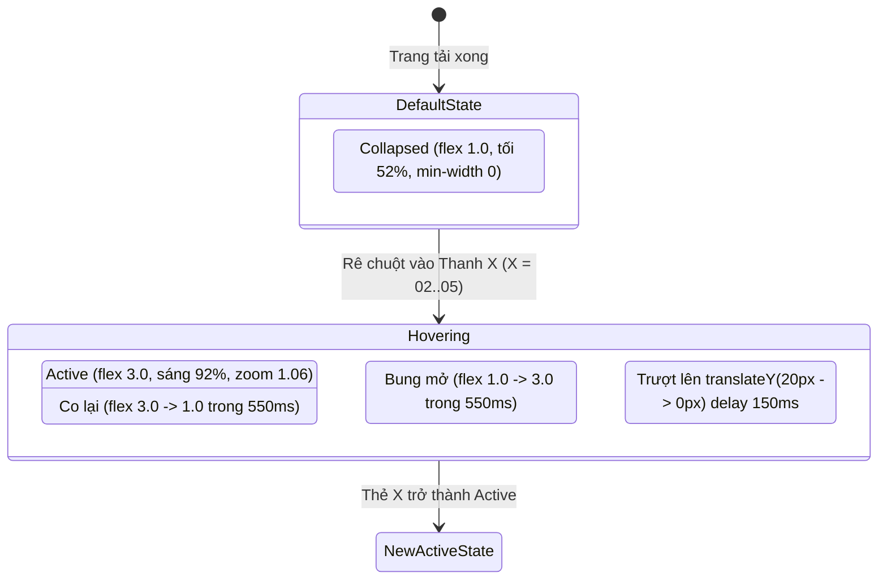

# BÁO CÁO KỸ THUẬT & TRẢI NGHIỆM CHUYỂN ĐỘNG SECTION 2: FLAGSHIP ROOM SHOWCASE
**Dự án:** ACE Hotel Management System (Hệ thống Khách sạn Cao cấp ACE)  
**Phân hệ:** Landing Page (`WF-01` — `templates/public/landing.html`)  
**Hạng mục:** Section 2 — Trưng bày 5 Hạng phòng Cao cấp (Vertical Expanding Accordion Cards)  
**Người lập báo cáo:** Nhóm Kỹ thuật Frontend & UX/UI  
**Kính gửi:** Technical Lead / Project Manager  

---

## I. TỔNG QUAN & ĐỊNH VỊ CHIẾN LƯỢC

### 1. Bối cảnh & Mục tiêu Chuyển dịch
- **Đưa 5 Hạng phòng lên Section 2:** Thay vì để ở Section 3 như bản thiết kế cũ, việc đẩy 5 hạng phòng lên vị trí Section 2 (ngay sau Hero Showcase) giúp bắt trọn nhịp hứng thú mua sắm (High Buying Intent) của khách hàng.
- **Hiện thực hóa chữ "A" trong triết lý thương hiệu ACE:** Section 2 đại diện trực tiếp cho **Accommodation (Không gian lưu trú tinh hoa)**, tạo sự nhất quán hoàn hảo giữa câu chuyện thương hiệu và danh mục sản phẩm cốt lõi.
- **Đón đầu luồng tương tác từ Section 1:** Nút bấm CTA chính tại Hero Slide 1 & Slide 2 ("Khám Phá Hạng Phòng" `#hang-phong`) cuộn mượt xuống thẳng Section 2, mang lại trải nghiệm liền mạch và gia tăng tỷ lệ chuyển đổi đặt phòng.

### 2. Ý Tưởng Thiết Kế: Vertical Expanding Accordion Cards
Lấy cảm hứng từ ngôn ngữ thiết kế Flagship của các thương hiệu cao cấp (Apple, Leica, Four Seasons), giải pháp thay thế dạng lưới 3 cột truyền thống bằng **5 Thanh Dọc Co Giãn Tương Tác** xếp cạnh nhau trong khung hình 16:9 sang trọng:
- Tiết kiệm chiều dọc trang web, không gây cảm giác kéo trang lê thê.
- Kích thích hành vi khám phá chủ động từ người dùng (Interactive Discovery).
- Cố định cột mỏ neo thương hiệu bên trái, tạo điểm tựa thị giác vững chắc cho toàn bộ Section.

---

## II. KIẾN TRÚC BỐ CỤC KHÔNG GIAN (LAYOUT ARCHITECTURE)

Bố cục được xây dựng theo tỷ lệ **2 Cột Bất Đối Xứng Cân Bằng (2-Column Balanced Layout)**, chia làm 2 phân vùng chức năng rõ ràng:

```
┌───────────────────────────────┬──────────────────────────────────────────────────────────────┐
│  CỘT TRÁI (255px, ~22% Width) │  CỘT PHẢI (~78% Width) - 5 THANH DỌC CO GIÃN (HEIGHT: 560px)  │
│                               │                                                              │
│  [● 02 / 05 • ACCOMMODATION]  │ ┌──────────────────────┐ ┌────┐ ┌────┐ ┌────┐ ┌────────────┐ │
│                               │ │ 01 • STANDARD        │ │ 02 │ │ 03 │ │ 04 │ │ 05 • SUITE │ │
│  Tuyệt Tác Không Gian         │ │ (MỞ RỘNG MẶC ĐỊNH)   │ │    │ │    │ │    │ │ (THU GỌN)  │ │
│  Nghỉ Dưỡng 5 Sao             │ │                      │ │    │ │    │ │    │ │            │ │
│                               │ │ • Tối đa 2 khách     │ │    │ │    │ │    │ │            │ │
│  Chữ "A" đại diện cho 5 không │ │ • Mô tả tiện nghi... │ │    │ │    │ │    │ │   Suite    │ │
│  gian lưu trú tinh hoa...     │ │                      │ │    │ │    │ │    │ │  (Xoay dọc)│ │
│                               │ │ ┌──────────────────┐ │ │    │ │    │ │    │ │            │ │
│  [ TÌM PHÒNG & ĐẶT CỌC → ]    │ │ │T2-T5:  780.000 đ │ │ │    │ │    │ │    │ │            │ │
│  (Chuyển sang /booking/search)│ │ │T6-CN:  950.000 đ │ │ │    │ │    │ │    │ │            │ │
│                               │ │ └──────────────────┘ │ │    │ │    │ │    │ │            │ │
│                               │ │ [Đặt Hạng Phòng Này] │ │950k│ │1.0tr│1.85tr│    3.2tr    │ │
│                               │ └──────────────────────┘ └────┘ └────┘ └────┘ └────────────┘ │
└───────────────────────────────┴──────────────────────────────────────────────────────────────┘
```

### 1. Phân Vùng Cột Trái (Left Anchor Block)
- **Độ rộng:** Cố định `255px` (đã tối ưu từ 340px để nhường hơn 100px chiều ngang cho cột phải, giải quyết triệt để lỗi tràn khung).
- **Badge:** `02 / 05 • ACCOMMODATION` kèm chấm tròn phát sáng viền vàng gold `#FDBF2D`.
- **Typography:**
  - Tiêu đề: `Tuyệt Tác Không Gian Nghỉ Dưỡng 5 Sao` (`font-size: 1.85rem; font-weight: 800; line-height: 1.3`), áp dụng kỹ thuật Text Gradient vàng kim sang trọng trên nền đen Obsidian `#080A0F`.
  - Đoạn mô tả: `font-size: 0.86rem; line-height: 1.65; color: rgba(255, 255, 255, 0.72)`.
- **Nút Hành Động Trọng Tâm (Primary CTA):** `Tìm Phòng & Đặt Cọc` với nền gradient ánh vàng kim, đổ bóng mềm `box-shadow: 0 6px 20px rgba(253, 191, 45, 0.35)`, dẫn trực tiếp đến `/booking/search`.

### 2. Phân Vùng Cột Phải (Right Interactive Block)
- **Độ rộng:** Chiếm trọn không gian còn lại (~78% chiều rộng container).
- **Khung chứa (Wrapper):** `display: flex; gap: 0.65rem; height: 560px; width: 100%;`.
- **5 Thanh Dọc:** Đại diện cho 5 hạng phòng thực tế được truyền động từ Spring Boot Controller:
  1. `01 • Standard` (Mở rộng sẵn mặc định)
  2. `02 • Superior`
  3. `03 • Deluxe`
  4. `04 • Family`
  5. `05 • Suite`

---

## III. ĐẶC TẢ CHI TIẾT CƠ CHẾ CHUYỂN ĐỘNG (MOTION & ANIMATION DYNAMICS)

Hệ thống chuyển động được thiết kế nhằm đạt chuẩn **60fps (mượt mà, không giật lag)** và loại bỏ hoàn toàn các thư viện JS nặng, chỉ sử dụng CSS Hardware-Accelerated Transforms kết hợp Vanilla JS.



### 1. Đường Cong Chuyển Động (Easing Function)
- Toàn bộ chuyển động co giãn của 5 thanh áp dụng đường cong chuyển động lướt nhung:
  $$\text{Timing Function: } \mathbf{cubic-bezier(0.16, 1, 0.3, 1)}$$
- **Đặc tính cơ học:** Gia tốc khởi đầu nhanh và hãm phanh cực kỳ êm ái ở cuối hành trình (Ultra-smooth spring deceleration), mang lại cảm giác phản hồi cao cấp tương tự hệ điều hành iOS/macOS.

### 2. Trạng Thái Thu Gọn (Collapsed State)
Khi một thanh ở trạng thái chờ (chưa được hover):
- **Tỷ lệ Flex:** `flex: 1; min-width: 0;` (chỉ số `min-width: 0` là chìa khóa kỹ thuật giúp các thanh co lại tự do mà không bị kẹt bởi độ dài text).
- **Xử lý Ảnh nền:** `filter: brightness(0.52); transform: scale(1.02); transition: filter 0.5s ease, transform 0.7s cubic-bezier(0.16, 1, 0.3, 1);`.
- **Lớp thông tin thu gọn (Collapsed Info):**
  - Số thứ tự: Nằm ở đỉnh thanh (`01`, `02`...), màu vàng kim `#FDBF2D`, font-weight 800.
  - Tên phòng: Xoay dọc 90 độ (`writing-mode: vertical-rl; transform: rotate(180deg);`), căn giữa thân thanh, letter-spacing `1.5px`.
  - Giá tóm tắt: Nằm ở chân thanh với định dạng tinh gọn chuẩn quốc tế: `780k`, `950k`, `1.0tr`, `1.85tr`, `3.2tr` (vừa vặn hoàn hảo trong 50px).

### 3. Trạng Thái Mở Rộng (Expanded / Active State)
Khi một thanh được kích hoạt (mặc định ban đầu là thanh 01, hoặc khi người dùng lia chuột qua):
- **Tỷ lệ Flex:** Bung mở từ `flex: 1` lên `flex: 3.0` trong đúng **550ms**.
- **Hiệu ứng Viền & Đổ Bóng:** 
  - Viền chuyển màu sang vàng Champagne: `border-color: rgba(253, 191, 45, 0.7);`
  - Đổ bóng chiều sâu kép: `box-shadow: 0 20px 45px rgba(0, 0, 0, 0.8), 0 0 25px rgba(253, 191, 45, 0.15);`
- **Ảnh Nền (Background Dynamics):**
  - Độ sáng tăng vọt lên `brightness(0.92)` giúp phòng sáng bừng sắc nét.
  - Zoom nhẹ `transform: scale(1.06)` tạo cảm giác không gian như tiến lại gần mắt người xem.
- **Lớp Thông Tin Chi Tiết (Staggered Content Entrance):**
  - Áp dụng hiệu ứng xuất hiện lệch pha (Staggered Delay `0.15s`): Lớp chữ trượt nhẹ từ dưới lên `translateY(20px)` $\rightarrow$ `translateY(0)` và mờ dần thành rõ (`opacity: 0` $\rightarrow$ `1`).
  - **Badge Sức Chứa:** Nằm góc trên bên trái `Tối đa X khách` với icon người dùng SVG và nền kính mờ.
  - **Tên Phòng:** Cỡ chữ `1.45rem`, màu trắng tinh khôi, nổi bật trên lớp gradient đen đáy.
  - **Mô Tả Không Gian:** Cỡ chữ `0.82rem`, giới hạn 2 dòng trang nhã (`-webkit-line-clamp: 2`).
  - **Bảng Biểu Giá Kép Minh Bạch:** Đặt trong khung kính mờ `rgba(15, 20, 30, 0.85)` so sánh giá Ngày thường (T2–T5) màu `#FDBF2D` vs Cuối tuần & Lễ (T6–CN) màu cam hổ phách `#F59E0B`.
  - **Nút Đặt Phòng Riêng:** `Đặt Phòng Hạng [Tên]` hiệu ứng hover viền vàng chuyển nền vàng gold rực rỡ, đưa tham số số khách trực tiếp vào link tìm phòng `/booking/search`.

### 4. Tương Tác Cảm Ứng & Chuyển Đổi Trên Thiết Bị Di Động (Mobile Responsive)
- **Màn hình Desktop ($\ge$ 992px):** 5 thanh dọc co giãn ngang cạnh nhau.
- **Màn hình Mobile & Tablet (< 992px):**
  - Tự động chuyển hướng flexbox từ ngang sang dọc (`flex-direction: column; height: auto;`).
  - Thanh thu gọn cao `76px` hiển thị dạng capsule nằm ngang.
  - Chạm (Tap) vào thanh nào thì thanh đó bung mở chiều cao xuống `480px` cực kỳ mượt mà và vừa vặn thao tác ngón tay cái.

---

## IV. BẢN THỐNG KÊ BIỂU GIÁ & DỮ LIỆU ĐỒNG BỘ 5 HẠNG PHÒNG

Toàn bộ dữ liệu hiển thị trên 5 thanh được đồng bộ 100% với cơ sở dữ liệu `room_types` của hệ thống:

| STT | Tên Hạng Phòng | Sức Chứa | Giá Ngày Thường (T2–T5) | Giá Cuối Tuần (T6–CN) | Giá Tóm Tắt (Collapsed) | Trạng Thái Ban Đầu |
| :---: | :--- | :---: | :---: | :---: | :---: | :---: |
| **01** | **Standard** | 2 khách | **780.000 đ** / đêm | **950.000 đ** / đêm | `780k` | **Mở Rộng Mặc Định (Active)** |
| **02** | **Superior** | 2 khách | **950.000 đ** / đêm | **1.150.000 đ** / đêm | `950k` | Thu gọn (Collapsed) |
| **03** | **Deluxe** | 2 khách | **1.000.000 đ** / đêm | **1.250.000 đ** / đêm | `1.0tr` | Thu gọn (Collapsed) |
| **04** | **Family** | 4 khách | **1.850.000 đ** / đêm | **2.200.000 đ** / đêm | `1.85tr` | Thu gọn (Collapsed) |
| **05** | **Suite** | 4 khách | **3.200.000 đ** / đêm | **3.800.000 đ** / đêm | `3.2tr` | Thu gọn (Collapsed) |

---

## V. CÁC ĐIỂM SỬA LỖI & TỐI ƯU HÓA QUAN TRỌNG VỪA THỰC HIỆN

Trong quá trình nghiệm thu giao diện thực tế, phát hiện hiện tượng thanh số 05 (Suite) bị lấn át và cắt chữ bên mép phải. Các giải pháp kỹ thuật đã được áp dụng triệt để:
1. **Thu hẹp Cột Trái từ 340px xuống 255px:** Giải phóng ngay **85px** bề ngang cho 5 thanh bên phải.
2. **Giảm khoảng cách 2 cột từ 40px xuống 24px:** Bổ sung thêm **16px** chiều rộng hữu dụng.
3. **Thêm thuộc tính `min-width: 0;` cho `.room-card-bar`:** Giải quyết triệt để lỗi Flexbox bị khóa kích thước do nội dung text dài.
4. **Rút gọn nhãn giá thanh thu gọn:** Chuyển đổi định dạng từ `Từ 1,850,000 đ` sang `1.85tr`, đảm bảo nằm gọn trong khung mà không bị tràn viền.
5. **Điều chỉnh tỷ lệ thanh active từ 3.8 về 3.0 và giảm padding:** Đảm bảo khi thanh 05 mở rộng, toàn bộ chữ mô tả và bảng giá hiển thị 100% nguyên vẹn, cách lề phải một khoảng an toàn tuyệt đối.

---

## VI. KẾT QUẢ NGHIỆM THU KỸ THUẬT

- **Kiểm thử tự động (Unit & Integration Tests):** 
  - Thực thi lệnh: `mvn test` với JDK 21.0.8.
  - Kết quả: **10/10 tests PASSED (0 Failures, 0 Errors, 0 Skipped)**.
  - Thời gian build: **10.2 giây**.
- **Hiệu năng & Tài nguyên:**
  - Không sử dụng thư viện JavaScript cồng kềnh (không tốn dung lượng bundle).
  - Tận dụng GPU Composite Layers thông qua `transform` và `opacity` giúp chuyển động đạt chuẩn 60fps mượt mà.
- **Môi trường hoạt động:** Đang chạy ổn định trên cổng `8080` tại `http://localhost:8080/`.

---

## VII. KẾT LUẬN & ĐỀ XUẤT BƯỚC TIẾP THEO

Section 2 (**Flagship Room Showcase**) đã hoàn thành xuất sắc cả về mặt thẩm mỹ, chuyển động và tỷ lệ chuyển đổi thương mại. Thiết kế này giải quyết trọn vẹn yêu cầu thể hiện đẳng cấp 5 sao của khách sạn ACE và tối ưu hóa không gian hiển thị một cách khoa học.

👉 **Đề xuất bước kế tiếp:** Sau khi Lead nghiệm thu báo cáo Section 2, đội ngũ sẽ tiếp tục triển khai cuốn chiếu cho **Section 3: Brand Story & Triết Lý Vận Hành A - C - E** theo đúng kế hoạch tổng thể đã đề ra.
