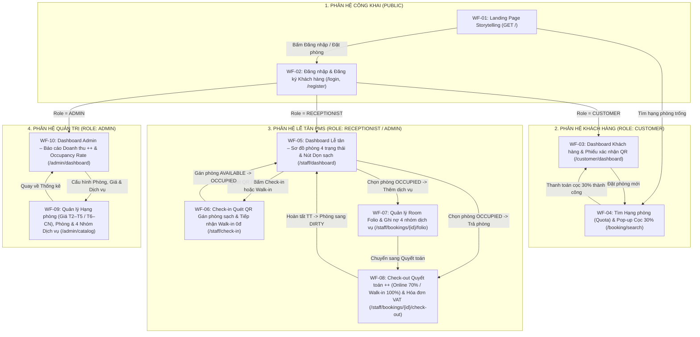

# 04. KIẾN TRÚC 4 PHÂN HỆ GIAO DIỆN, SITEMAP & WIREFRAME 10 MÀN HÌNH CHÍNH (`WF-01` – `WF-10`)

> **Phụ trách thiết kế & viết Chương 6:** **Kiệt** (Cài đặt Thymeleaf/CSS: **Khoa**).  
> **Ánh xạ Báo cáo:** Phục vụ trực tiếp **Chương 6 – Thiết kế giao diện người dùng (Mục 6.1, 6.2, 6.3)** của quyển báo cáo.  
> **Hệ thống màu:** Tuân thủ nghiêm ngặt `ACE Color System` (Dark Mode mặc định, có nút chuyển Light Mode, màu vàng thương hiệu `#FDBF2D`).

---

## 1. Sơ đồ Luồng Điều hướng Tổng thể Giữa 4 Phân hệ (`dieu-huong.png`)



---

## 2. Danh mục 10 Màn hình Wireframe Chuẩn (`WF-01` – `WF-10`) & Phân quyền Route

| Mã WF | Tên màn hình Wireframe | Route URL chính | Quyền truy cập | Use Case |
|:---:|---|---|:---:|:---:|
| **WF-01** | Trang chủ giới thiệu khách sạn theo phong cách Storytelling | `GET /` | Công khai | `UC01`, `UC03` |
| **WF-02** | Màn hình Đăng nhập & Đăng ký tài khoản khách hàng (2 tab) | `GET/POST /login`, `GET/POST /register` | Công khai | `UC01` |
| **WF-03** | Dashboard Khách hàng & Thẻ Phiếu xác nhận đặt phòng kèm Mã QR | `GET /customer/dashboard`, `POST /customer/bookings/{id}/cancel` | `CUSTOMER` | `UC01`, `UC03` |
| **WF-04** | Màn hình Tìm kiếm Hạng phòng (Quota) & Pop-up Xác nhận Cọc 30% | `GET /booking/search`, `POST /booking/deposit` | `CUSTOMER` | `UC03` |
| **WF-05** | Dashboard Nhân viên Lễ tân: Sơ đồ phòng 4 trạng thái & Nút Dọn sạch | `GET /staff/dashboard`, `POST /staff/rooms/{id}/clean` | `RECEPTIONIST`, `ADMIN` | `UC04`, `UC05` |
| **WF-06** | Màn hình Check-in Quét QR Gán phòng sạch & Tiếp nhận Walk-in (0đ cọc) | `GET/POST /staff/check-in`, `GET/POST /staff/walk-in` | `RECEPTIONIST`, `ADMIN` | `UC04` |
| **WF-07** | Màn hình Quản lý Tài khoản phòng (Room Folio – 4 nhóm dịch vụ) | `GET/POST /staff/bookings/{id}/folio` | `RECEPTIONIST`, `ADMIN` | `UC06` |
| **WF-08** | Màn hình Check-out Quyết toán `++` & Xem/In Hóa đơn VAT | `GET/POST /staff/bookings/{id}/check-out`, `GET /staff/invoices/{id}` | `RECEPTIONIST`, `ADMIN` | `UC05` |
| **WF-09** | Màn hình Quản lý Hạng phòng (Giá ngày thường/cuối tuần), Phòng & Dịch vụ | `GET/POST /admin/room-types/**`, `/admin/rooms/**`, `/admin/services/**` | **Chỉ `ADMIN`** | `UC02` |
| **WF-10** | Dashboard Quản trị viên: Báo cáo Doanh thu đa chiều `++` & `Occupancy Rate` | `GET /admin/dashboard` | **Chỉ `ADMIN`** | `UC07` |

---

## 3. Wireframe Chi tiết 10 Màn hình Chính (Chương 6 Báo cáo)

### WF-01 – Trang chủ Landing Page Storytelling (`GET /`)
```text
+---------------------------------------------------------------------------------------+
| [Logo ACE] ACE HOTEL         Câu chuyện | Hạng phòng | Dịch vụ | [☀/🌙] [Đăng nhập]   |
+---------------------------------------------------------------------------------------+
| SECTION 1 (HERO STORYTELLING):                                                        |
|            NGHỆ THUẬT LƯU TRÚ & TRẢI NGHIỆM ĐẲNG CẤP TẠI ACE HOTEL                    |
|         "Accommodation, Check-in & Extras — Chuẩn mực hiếu khách hiện đại"            |
|   +-------------------------------------------------------------------------------+   |
|   | Ngày nhận: [15/10/2026] | Ngày trả: [17/10/2026] | Số khách: [2] [Tìm phòng]  |   |
|   +-------------------------------------------------------------------------------+   |
+---------------------------------------------------------------------------------------+
| SECTION 2 (CÁC HẠNG PHÒNG NỔI BẬT - ĐỌC TỪ BẢNG room_types):                          |
| +-------------------------+ +-------------------------+ +---------------------------+ |
| | STANDARD ROOM (2 khách) | | DELUXE ROOM (2 khách)   | | EXECUTIVE SUITE (4 khách) | |
| | T2–T5: 780.000đ / đêm   | | T2–T5: 1.250.000đ / đêm | | T2–T5: 3.200.000đ / đêm   | |
| | T6–CN: 950.000đ / đêm   | | T6–CN: 1.500.000đ / đêm | | T6–CN: 3.800.000đ / đêm   | |
| | [ Đặt hạng phòng này ]  | | [ Đặt hạng phòng này ]  | | [ Đặt hạng phòng này ]    | |
| +-------------------------+ +-------------------------+ +---------------------------+ |
+---------------------------------------------------------------------------------------+
| SECTION 3 (4 NHÓM TRẢI NGHIỆM & DỊCH VỤ):                                             |
| [1. Ẩm thực & In-room Dining]  [2. Minibar Cao cấp]  [3. Giặt ủi Nhanh]  [4. Spa/VIP] |
+---------------------------------------------------------------------------------------+
| FOOTER: ACE Hotel · Đồ án môn 502050 – Phân tích và Thiết kế Yêu cầu · ĐH TDTU 2026   |
+---------------------------------------------------------------------------------------+
```

---

### WF-02 – Màn hình Đăng nhập & Đăng ký Khách hàng (`/login`, `/register`)
```text
+---------------------------------------------------------------------------------------+
|                              [Logo ACE: Accommodation, Check-in & Extras]             |
|              +-------------------------------------------------------+                |
|              |  [ TAB 1: ĐĂNG NHẬP ]     |  [ TAB 2: ĐĂNG KÝ KHÁCH ] |                |
|              +-------------------------------------------------------+                |
|  (Nếu chọn Tab ĐĂNG NHẬP):               |  (Nếu chọn Tab ĐĂNG KÝ KHÁCH HÀNG MỚI):     |
|  Tên đăng nhập * [ nhanvien           ]  |  1. Họ và tên *     [ Nguyễn Văn A      ]  |
|  Mật khẩu *      [ ••••••••           ]  |  2. Ngày sinh *     [ 15/05/2000        ]  |
|                                          |  3. Số điện thoại * [ 0901234567        ]  |
|  [       ĐĂNG NHẬP HỆ THỐNG       ]      |  4. Tên đăng nhập * [ nguyenvana        ]  |
|  * Tự động nhận diện Role để chuyển về:  |  5. Mật khẩu *      [ ••••••••          ]  |
|    - Admin -> /admin/dashboard           |                                            |
|    - Lễ tân -> /staff/dashboard          |  [   TẠO TÀI KHOẢN & VÀO DASHBOARD   ]     |
|    - Khách  -> /customer/dashboard       |                                            |
+---------------------------------------------------------------------------------------+
```

---

### WF-03 – Dashboard Khách hàng & Phiếu Xác nhận Đặt phòng kèm Mã QR (`/customer/dashboard`)
```text
+---------------------------------------------------------------------------------------+
| [ACE] CỔNG KHÁCH HÀNG      Đơn đặt của tôi* | Đặt phòng mới (WF-04) | Hồ sơ | [Thoát] |
+---------------------------------------------------------------------------------------+
| Xin chào, Nguyễn Văn A (SĐT: 0901234567)                  [+ Đặt phòng trực tuyến mới]|
| ------------------------------------------------------------------------------------- |
| CÁC ĐƠN ĐẶT PHÒNG CỦA TÔI:                                                            |
| +---------------------------------------------------+-------------------------------+ |
| | MÃ BOOKING: BK-8K4P9X2M   [● Đã xác nhận - Cọc 30%]|   PHIẾU XÁC NHẬN ĐẶT PHÒNG    | |
| | Hạng phòng: Deluxe Room (2 khách)                 |   +-----------------------+   | |
| | Nhận phòng: 25/10/2026 (14:00)                    |   |     [ MÃ QR CODE ]    |   | |
| | Trả phòng:  27/10/2026 (12:00) · 2 đêm            |   |    BK-8K4P9X2M        |   | |
| | ------------------------------------------------- |   +-----------------------+   | |
| | Tiền phòng gốc (2 đêm):              2.000.000đ   |   Xuất trình mã QR này tại    | |
| | Phí phục vụ (SVC 5%) + VAT (10%):      310.000đ   |   quầy Lễ tân để nhận phòng   | |
| | Tổng giá trị gói phòng (++):         2.310.000đ   |   vật lý sạch (Clean Room).   | |
| | Đã thanh toán cọc (30%):               693.000đ   |                               | |
| | Còn thanh toán tại quầy (70%):       1.617.000đ   |   [ ⬇ Tải Phiếu ] [Hủy đơn]   | |
| +---------------------------------------------------+-------------------------------+ |
+---------------------------------------------------------------------------------------+
```

---

### WF-04 – Tìm Hạng phòng Trống (Quota) & Pop-up Xác nhận Cọc 30% (`/booking/search`)
```text
+---------------------------------------------------------------------------------------+
| TÌM KIẾM HẠNG PHÒNG TRỐNG & ĐẶT PHÒNG TRỰC TUYẾN (UC03)                               |
+---------------------------------------------------------------------------------------+
| Ngày nhận * [25/10/2026]  Ngày trả * [27/10/2026]  Số khách * [2]  [Kiểm tra phòng]   |
+---------------------------------------------------------------------------------------+
| KẾT QUẢ HẠNG PHÒNG CÒN SUẤT TRỐNG (Kiểm tra theo công thức Quota N_avail >= 1):       |
| +-----------------------------------------------------------------------------------+ |
| | DELUXE ROOM (Sức chứa: 2 khách · Còn 3 suất phòng trống trong khoảng ngày chọn)   | |
| | Giá ngày thường: 1.000.000đ/đêm | Giá cuối tuần: 1.250.000đ/đêm                   | |
| | Tạm tính 2 đêm: 2.000.000đ (+ SVC 5% & VAT 10% = 2.310.000đ) · Cọc 30%: 693.000đ  | |
| |                                                       [ Tiếp tục đặt phòng ]      | |
| +-----------------------------------------------------------------------------------+ |
|                                                                                       |
|   +=================== POP-UP MODAL: XÁC NHẬN & THANH TOÁN CỌC 30% ===============+   |
|   | Khách hàng: Nguyễn Văn A (0901234567) | Hạng phòng: Deluxe Room (2 đêm)       |   |
|   | Nhận dự kiến: 25/10/2026 (14:00)      | Trả dự kiến: 27/10/2026 (12:00)       |   |
|   | ----------------------------------------------------------------------------- |   |
|   | • Tiền phòng gốc (2 đêm):                                         2.000.000đ  |   |
|   | • Phí phục vụ (SVC 5%):                                             100.000đ  |   |
|   | • Thuế GTGT (VAT 10%):                                              210.000đ  |   |
|   | • Tổng giá trị gói phòng (++):                                    2.310.000đ  |   |
|   | • MỨC CỌC 30% CẦN THANH TOÁN NGAY:                                  693.000đ  |   |
|   | • Còn lại thanh toán tại quầy khi Check-out (70%):                1.617.000đ  |   |
|   | Phương thức cọc: (•) Quét VietQR   ( ) Thẻ ngân hàng                          |   |
|   |               [ Quay lại chỉnh sửa ]   [ Xác nhận & Thanh toán cọc 30% ]      |   |
|   +===============================================================================+   |
+---------------------------------------------------------------------------------------+
```

---

### WF-05 – Dashboard Nhân viên Lễ tân: Sơ đồ Phòng 4 Trạng thái & Dọn phòng (`/staff/dashboard`)
```text
+---------------------------------------------------------------------------------------+
| [ACE] BÀN LÀM VIỆC LỄ TÂN (PMS)    Sơ đồ phòng* | Check-in/Walk-in (WF-06) | [Thoát]  |
+---------------------------------------------------------------------------------------+
| [🟢 Trống sạch: 6]   [🔵 Đang ở: 3]   [🟠 Chờ dọn (DIRTY): 2]   [⚪ Bảo trì: 1]       |
| ------------------------------------------------------------------------------------- |
| TRA CỨU NHANH / QUÉT MÃ QR CHECK-IN: [ Nhập mã BK-8K4P9X2M hoặc SĐT... ] [Tìm đơn]    |
|                                                    [+ Tiếp nhận Khách Walk-in (0đ cọc)]|
| ------------------------------------------------------------------------------------- |
| SƠ ĐỒ LƯỚI TÌNH TRẠNG PHÒNG VẬT LÝ (REALTIME):                                        |
| +------------------------+ +------------------------+ +-----------------------------+ |
| | P.201 · Deluxe         | | P.301 · Deluxe         | | P.102 · Standard            | |
| | 🟢 AVAILABLE (Sạch)    | | 🔵 OCCUPIED (Đang ở)   | | 🟠 DIRTY (Chờ dọn dẹp)      | |
| | Sẵn sàng đón khách     | | Khách: Nguyễn Minh Anh | | Vừa trả phòng lúc 11:45     | |
| | [Gán Check-in/Walk-in] | | [Room Folio] [Trả phòng]| | [ ✓ Xác nhận đã dọn sạch ] | |
| +------------------------+ +------------------------+ +-----------------------------+ |
+---------------------------------------------------------------------------------------+
```

---

### WF-06 – Màn hình Check-in Gán Phòng Sạch & Tiếp nhận Khách Walk-in (`/staff/check-in`)
```text
+---------------------------------------------------------------------------------------+
| THỦ TỤC NHẬN PHÒNG (CHECK-IN) & GÁN PHÒNG VẬT LÝ SẠCH (UC04)                          |
+---------------------------------------------------------------------------------------+
| [ CHẾ ĐỘ 1: KHÁCH ĐẶT TRƯỚC (QUÉT QR) ]    | [ CHẾ ĐỘ 2: KHÁCH VÃNG LAI (WALK-IN) ]   |
| ------------------------------------------------------------------------------------- |
| A. THÔNG TIN ĐƠN ĐẶT TRƯỚC (Mã: BK-8K4P9X2M · Trạng thái: RESERVED - Đã cọc 30%):     |
| Khách hàng: Nguyễn Văn A | SĐT: 0901234567 | Số CCCD/Passport * [ 079200012345     ]  |
| Hạng phòng đã đặt: Deluxe Room | Lưu trú: 25/10/2026 → 27/10/2026 (2 đêm)             |
| Tiền cọc đã đóng (30%): 693.000đ | Còn thu lúc Check-out (70% + DV): 1.617.000đ       |
| ------------------------------------------------------------------------------------- |
| B. CHỌN GÁN PHÒNG VẬT LÝ ĐANG TRỐNG SẠCH (Chỉ hiện phòng Deluxe có status=AVAILABLE): |
|   (•) Phòng P.201 – Tầng 2 (🟢 Trống sạch - Clean)                                    |
|   ( ) Phòng P.202 – Tầng 2 (🟢 Trống sạch - Clean)                                    |
|   [x] Phòng P.301 (Đang ở - Khóa)   [x] Phòng P.302 (🟠 DIRTY Chưa dọn - Khóa)        |
| ------------------------------------------------------------------------------------- |
| C. CHÍNH SÁCH NHẬN PHÒNG SỚM (Early Check-in Policy - Chuẩn 14:00):                   |
|   (•) Đúng giờ / Miễn phí ưu đãi (0đ)   ( ) 09h–14h (+30%)   ( ) 06h–09h (+50%)       |
| ------------------------------------------------------------------------------------- |
| * Lưu ý nếu chọn Tab WALK-IN: Lễ tân chọn thẳng phòng AVAILABLE, nhập Họ tên, SĐT,    |
|   CCCD, Ngày trả phòng; hệ thống ghi nhận deposit_amount = 0đ (Thu 100% lúc trả).     |
|                                                                                       |
|                           [ Quay lại Sơ đồ ]   [ Xác nhận Check-in & Giao chìa khóa ] |
+---------------------------------------------------------------------------------------+
```

---

### WF-07 – Màn hình Quản lý Tài khoản Phòng (Room Folio – 4 Nhóm Dịch vụ) (`/staff/bookings/{id}/folio`)
```text
+---------------------------------------------------------------------------------------+
| ROOM FOLIO (SỔ CÁI CHI PHÍ PHÒNG) – PHÒNG P.301 (Mã: BK-2401 · Khách: Nguyễn Minh Anh)|
| Trạng thái: 🔵 OCCUPIED (Đang lưu trú)                 [Chuyển sang Check-out WF-08]  |
+---------------------------------------------------------------------------------------+
| GHI NỢ DỊCH VỤ MỚI VÀO PHÒNG (UC06 - Đóng băng đơn giá tại thời điểm gọi):            |
| Nhóm DV: [1. MINIBAR v] | Mặt hàng: [Bia Tiger lon - 35.000đ/Lon v] | SL: [ 2 ] [+Ghi]|
| (4 nhóm chuẩn: MINIBAR · LAUNDRY Giặt ủi · FB Ẩm thực · DAMAGES Đền bù tài sản)      |
+---------------------------------------------------------------------------------------+
| DANH SÁCH DỊCH VỤ ĐÃ SỬ DỤNG TRONG KỲ LƯU TRÚ:                                        |
| # | Nhóm     | Tên dịch vụ / Hàng hóa   | Thời gian  | Nhân viên | SL | Đơn giá | Tổng|
|---|----------|--------------------------|------------|-----------|----|---------|-----|
| 1 | FB       | Bữa sáng Buffet gọi thêm | 15/10 07:30| nhanvien  | 2  | 100.000đ| 200k|[Xóa]|
| 2 | LAUNDRY  | Giặt ủi nhanh bộ đồ      | 15/10 18:00| nhanvien  | 1  |  50.000đ|  50k|[Xóa]|
| 3 | MINIBAR  | Nước ngọt & Bia lon      | 16/10 21:00| nhanvien  | 2  |  25.000đ|  50k|[Xóa]|
|---------------------------------------------------------------------------------------|
| TỔNG TIỀN DỊCH VỤ GỐC (CHƯA THUẾ PHÍ ++):                                  300.000đ  |
+---------------------------------------------------------------------------------------+
```

---

### WF-08 – Màn hình Check-out Quyết toán `++` & Xuất Hóa đơn VAT (`/staff/bookings/{id}/check-out`)
```text
+---------------------------------------------------------------------------------------+
| QUYẾT TOÁN TRẢ PHÒNG (CHECK-OUT) & HÓA ĐƠN VAT BIỂU GIÁ ++ (UC05)                     |
+---------------------------------------------------------------------------------------+
| Mã Booking: BK-8K4P9X2M | Khách hàng: Nguyễn Văn A | Phòng vật lý: P.201 (Deluxe)     |
| Nhận thực tế: 25/10/2026 14:00 | Trả thực tế: 27/10/2026 11:30 (Đúng giờ < 12:00)     |
| ------------------------------------------------------------------------------------- |
| BẢNG KÊ QUYẾT TOÁN TỰ ĐỘNG (Chuẩn công thức ++):                                      |
| 1. Tiền phòng gốc (2 đêm Deluxe):                                          2.000.000đ |
| 2. Tổng dịch vụ phát sinh (Room Folio - WF-07):                              300.000đ |
| 3. Phụ thu nhận sớm / trả phòng trễ (Trước 12h = 0%):                              0đ |
| ------------------------------------------------------------------------------------- |
| • TỔNG CHI PHÍ GỐC (Subtotal Base = 1 + 2 + 3):                            2.300.000đ |
| • Phí phục vụ (Service Charge - SVC 5%):                                     115.000đ |
| • Thuế Giá trị gia tăng (VAT 10% trên Subtotal + SVC):                       241.500đ |
| • TỔNG CỘNG HÓA ĐƠN (Grand Total ++):                                      2.656.500đ |
| • Khấu trừ tiền đã cọc (Deposit: Online cọc 30% / Walk-in cọc 0đ):         - 693.000đ |
| ===================================================================================== |
| SỐ TIỀN THỰC THU TẠI QUẦY KHI CHECK-OUT (Balance Due):                     1.963.500đ |
| *(Ghi chú: Khách Online trả 70% phòng còn lại + 100% DV; Khách Walk-in trả đủ 100%)*  |
| ------------------------------------------------------------------------------------- |
| Phương thức thanh toán *:  (•) Tiền mặt (CASH)   ( ) Thẻ POS (CARD)   ( ) VietQR      |
|                                                                                       |
|     [ 🖨 In Hóa đơn VAT (window.print) ]   [ Xác nhận Hoàn tất & Chuyển Phòng DIRTY ] |
+---------------------------------------------------------------------------------------+
```

---

### WF-09 – Quản lý Hạng phòng (Giá T2–T5 / T6–CN), Phòng vật lý & Dịch vụ (`/admin/catalog`)
```text
+---------------------------------------------------------------------------------------+
| [ACE] QUẢN TRỊ DANH MỤC & BIỂU GIÁ (ADMIN - UC02)     [← Về Dashboard Admin (WF-10)]  |
+---------------------------------------------------------------------------------------+
| [ TAB 1: HẠNG PHÒNG & GIÁ ]  |  [ TAB 2: PHÒNG VẬT LÝ ]  |  [ TAB 3: 4 NHÓM DỊCH VỤ ] |
+---------------------------------------------------------------------------------------+
| FORM CẤU HÌNH HẠNG PHÒNG & BIỂU GIÁ ĐỘNG (DYNAMIC PRICING):                           |
| Tên hạng * [ Deluxe Room ]  Sức chứa * [ 2 ]  Giá T2–T5 * [1000000]  Giá T6–CN * [1250000]|
| Mô tả      [ Ban công hướng phố, bồn tắm nằm ]                  [ Lưu hạng phòng ]    |
| ------------------------------------------------------------------------------------- |
| DANH SÁCH HẠNG PHÒNG HIỆN CÓ:                                                         |
| Mã | Tên hạng | Sức chứa | Giá Ngày thường (T2–T5) | Giá Cuối tuần (T6–CN) | Thao tác |
|----|----------|----------|-------------------------|-----------------------|----------|
| 1  | Standard | 2 khách  | 780.000đ / đêm          | 950.000đ / đêm        |[Sửa][Xóa]|
| 2  | Deluxe   | 2 khách  | 1.000.000đ / đêm        | 1.250.000đ / đêm      |[Sửa][Xóa]|
| 3  | Suite    | 4 khách  | 3.200.000đ / đêm        | 3.800.000đ / đêm      |[Sửa][Xóa]|
+---------------------------------------------------------------------------------------+
```

---

### WF-10 – Dashboard Quản trị viên: Báo cáo Doanh thu `++` & Công suất Phòng (`/admin/dashboard`)
```text
+---------------------------------------------------------------------------------------+
| [ACE] BẢNG ĐIỀU KHIỂN QUẢN TRỊ (ADMIN BACKOFFICE - UC07)  Danh mục (WF-09) | [Thoát]  |
+---------------------------------------------------------------------------------------+
| Bộ lọc kỳ báo cáo: Từ ngày [01/10/2026] Đến ngày [31/10/2026]          [ Xem báo cáo ]|
+---------------------------------------------------------------------------------------+
| CHỈ SỐ HIỆU QUẢ KHAI THÁC KHÁCH SẠN CHUẨN QUỐC TẾ (Loại trừ phòng MAINTENANCE):       |
| +-------------------------+ +-------------------------+ +---------------------------+ |
| | TỶ LỆ LẤP ĐẦY (OR %)    | | GIÁ BÌNH QUÂN ĐÊM (ADR) | | DOANH THU / PHÒNG (RevPAR)| |
| |        63.6%            | |      1.420.000đ         | |         903.120đ          | |
| | (7 Occupied / 11 Phòng) | | (Doanh thu P / Đêm bán) | |    (ADR × Occupancy Rate) | |
| +-------------------------+ +-------------------------+ +---------------------------+ |
| ------------------------------------------------------------------------------------- |
| BÁO CÁO CƠ CẤU DOANH THU ĐA CHIỀU (CHUẨN HẠCH TOÁN ++):                               |
| Hạng mục doanh thu                           | Số tiền (VNĐ)     | Tỷ trọng (%)       |
|----------------------------------------------|-------------------|--------------------|
| 1. Doanh thu Tiền phòng gốc (Room Revenue)   |       28.400.000đ |             73.8%  |
| 2. Doanh thu Dịch vụ (Minibar, Giặt ủi, F&B) |        4.200.000đ |             10.9%  |
| 3. Phụ thu Nhận sớm & Trả trễ + Đền bù       |          650.000đ |              1.7%  |
| 4. Doanh thu Phí phục vụ (SVC 5%)            |        1.662.500đ |              4.3%  |
| 5. Thuế GTGT thu hộ ngân sách (VAT 10%)      |        3.491.250đ |              9.3%  |
|----------------------------------------------|-------------------|--------------------|
| TỔNG DOANH THU HÓA ĐƠN (GRAND TOTAL ++):     |       38.403.750đ |            100.0%  |
+---------------------------------------------------------------------------------------+
```

---

## 4. Bảng Token Màu Chuẩn `ACE Color System` (Chương 6, Mục 6.1)

| Token CSS | Dark Mode (Mặc định) | Light Mode | Ứng dụng trên 4 Phân hệ Giao diện |
|---|:---:|:---:|---|
| `--bg` | `#000000` | `#F7F6F2` | Nền chính toàn trang |
| `--surface` | `#121212` | `#FFFFFF` | Thẻ phòng, thẻ KPI, Sidebar, Header |
| `--elevated` | `#1C1C1C` | `#FFFFFF` | Pop-up xác nhận đặt cọc 30%, Modal Room Folio |
| `--border` | `#2A2A2A` | `#E6E3DA` | Viền bảng, viền ô nhập liệu |
| `--primary` | `#FDBF2D` | `#FDBF2D` | Nút hành động chính (chữ đen `#0A0A0A`), thương hiệu ACE |
| `--primary-soft` | `#2A2208` | `#FFF4D1` | Nền highlight dòng cần xử lý hôm nay |
| `--text` | `#FFFFFF` | `#0A0A0A` | Chữ tiêu đề và nội dung chính |
| `--primary-text` | `#FDBF2D` | `#B45309` | Chữ/Link màu vàng đảm bảo độ tương phản trên nền sáng |
| `--st-free` (`AVAILABLE`) | `#22C55E` | `#15803D` | Badge Xanh lá: Phòng trống sạch (Clean) |
| `--st-reserved` (`RESERVED`) | `#A78BFA` | `#7C3AED` | Badge Tím: Đơn đã đặt & cọc 30% chờ Check-in |
| `--st-occupied` (`OCCUPIED`) | `#60A5FA` | `#2563EB` | Badge Xanh dương: Phòng đang có khách ở |
| `--st-dirty` (`DIRTY`) | `#F59E0B` | `#D97706` | Badge Cam: Phòng vừa trả, chờ dọn dẹp |
| `--st-overdue` (`OVERDUE`) | `#F87171` | `#DC2626` | Badge Đỏ: Khách ở quá giờ/ngày trả phòng |
| `--st-maint` (`MAINTENANCE`) | `#9CA3AF` | `#6B7280` | Badge Xám: Phòng đang bảo trì |