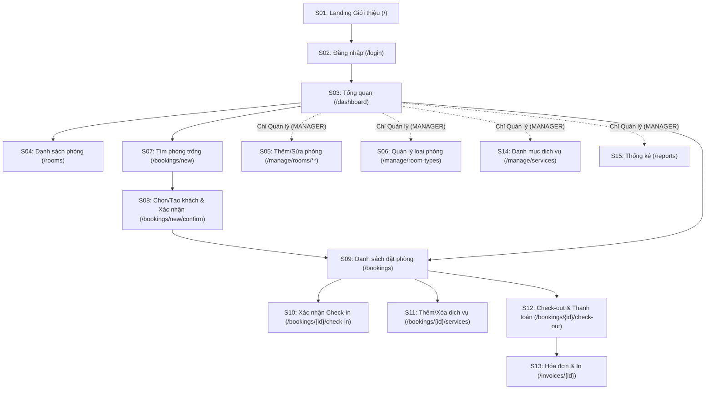

# 04. SITEMAP VÀ WIREFRAME CHI TIẾT TOÀN BỘ 15 MÀN HÌNH (`S01` – `S15`)

> **Trạng thái:** Đã hoàn thiện đầy đủ 15 màn hình (`S01` – `S15`) kèm đặc tả trường dữ liệu và trạng thái nút bấm, giải quyết hoàn toàn **Mục #3** trong [08-bao-cao-tai-lieu-con-thieu.md](file:///D:/ACE/docs/08-bao-cao-tai-lieu-con-thieu.md).  
> Giao diện tuân thủ nghiêm ngặt bảng màu ACE ([ACE_Light_Mode.png](file:///D:/ACE/docs/assets/ACE_Light_Mode.png), [ACE_Dark_Mode.png](file:///D:/ACE/docs/assets/ACE_Dark_Mode.png)).

---

## 1. Sitemap Điều hướng Tổng thể


---

## 2. Danh sách 15 Màn hình và Phân quyền Hiển thị
| # | Màn hình | Route URL | Vai trò truy cập | UC | Ưu tiên |
|:---:|---|---|---|:---:|:---:|
| `S01` | Landing giới thiệu hệ thống | `GET /` | Công khai | (Xem `05`) | Should |
| `S02` | Đăng nhập | `GET/POST /login` | Công khai | `UC01` | Must |
| `S03` | Tổng quan (Dashboard) | `GET /dashboard` | Lễ tân, Quản lý | `UC01`, `FR-18` | Should |
| `S04` | Danh sách phòng (Xem & Lọc) | `GET /rooms` | Lễ tân (xem), Quản lý (CRUD) | `UC02` | Must |
| `S05` | Form Thêm / Sửa phòng | `GET/POST /manage/rooms/new`, `/{id}/edit` | **Chỉ Quản lý** | `UC02` | Must |
| `S06` | Quản lý Loại phòng (CRUD) | `GET/POST /manage/room-types/**` | **Chỉ Quản lý** | `UC02` | Must |
| `S07` | Tìm phòng trống theo ngày | `GET /bookings/new` | Lễ tân, Quản lý | `UC03` | Must |
| `S08` | Chọn/Tạo khách & Xác nhận đặt | `GET /bookings/new/confirm`, `POST /bookings` | Lễ tân, Quản lý | `UC03` | Must |
| `S09` | Danh sách đặt phòng | `GET /bookings` | Lễ tân, Quản lý | `UC03/04/05` | Must |
| `S10` | Xác nhận Check-in | `GET/POST /bookings/{id}/check-in` | Lễ tân, Quản lý | `UC04` | Must |
| `S11` | Thêm / Xóa dịch vụ phòng đang ở | `GET/POST /bookings/{id}/services/**` | Lễ tân, Quản lý | `UC06` | Must |
| `S12` | Check-out và Thanh toán | `GET /bookings/{id}/check-out`, `POST /pay` | Lễ tân, Quản lý | `UC05` | Must |
| `S13` | Chi tiết Hóa đơn & In | `GET /invoices/{id}` | Lễ tân, Quản lý | `UC05` | Should |
| `S14` | Quản lý Danh mục Dịch vụ | `GET/POST /manage/services/**` | **Chỉ Quản lý** | `UC06` | Should |
| `S15` | Báo cáo Thống kê | `GET /reports` | **Chỉ Quản lý** | `UC07` | Could (Đặc tả) |

* **Menu Header theo vai trò:**
  * **Lễ tân (`RECEPTIONIST`):** `Tổng quan (S03)` · `Phòng (S04 - chỉ xem)` · `Đặt phòng mới (S07)` · `Danh sách đặt phòng (S09)`.
  * **Quản lý (`MANAGER`):** Có toàn bộ menu trên + `Loại phòng (S06)` · `Danh mục dịch vụ (S14)` · `Thống kê (S15)` (và các nút Thêm/Sửa/Bảo trì/Xóa ngay trên `S04`).

---

## 3. Luồng Điều hướng Nghiệp vụ Chính (Mục 2.7 Báo cáo)
1. **Xác thực:** Mở trang giới thiệu `S01 (/)` $\rightarrow$ Đăng nhập `S02 (/login)` $\rightarrow$ Tổng quan `S03 (/dashboard)`.
2. **Luồng Đặt phòng (`UC03`):** Từ `S03` hoặc menu bấm `Đặt phòng mới (S07)` $\rightarrow$ Chọn ngày nhận/trả & lọc loại phòng $\rightarrow$ Bấm **[Đặt phòng]** trên thẻ phòng trống $\rightarrow$ Sang `S08` tìm khách cũ hoặc nhập khách mới $\rightarrow$ Bấm **[Xác nhận đặt phòng]** $\rightarrow$ Chuyển về `S09 (/bookings)` hiện mã `BK-{id}`.
3. **Luồng Nhận phòng & Phục vụ (`UC04` + `UC06`):** Tại `S03` hoặc `S09`, bấm **[Check-in]** trên đơn `BOOKED` $\rightarrow$ Xác nhận tại `S10` (phòng sang `OCCUPIED`) $\rightarrow$ Khi khách gọi dịch vụ, bấm **[Dịch vụ]** mở `S11` để thêm/xóa dòng dịch vụ.
4. **Luồng Trả phòng & Lập hóa đơn (`UC05`):** Tại `S03` hoặc `S09`, bấm **[Check-out]** trên đơn `CHECKED_IN` $\rightarrow$ Mở `S12` kiểm tra bảng tính tiền tự động $\rightarrow$ Chọn `Tiền mặt / Thẻ / Chuyển khoản` $\rightarrow$ Bấm **[Xác nhận thanh toán]** $\rightarrow$ Mở `S13` xem và bấm **[In hóa đơn]**.

---

## 4. Wireframe Chi tiết Toàn bộ 15 Màn hình (`S01` – `S15`)

### S01 – Landing Giới thiệu Hệ thống (`GET /`)
```text
+--------------------------------------------------------------------------------+
| [ACE] Accommodation, Check-in & Extras     Tính năng | Quy trình | [☀/🌙] [Đăng nhập] |
+--------------------------------------------------------------------------------+
|                                                                                |
|        HỆ THỐNG QUẢN LÝ KHÁCH SẠN NỘI BỘ CHO LỄ TÂN VÀ QUẢN LÝ                 |
|        "Từ đặt phòng đến trả phòng, gọn trong một màn hình"                    |
|                                                                                |
|                    [ Đăng nhập hệ thống (/login) ]                             |
+--------------------------------------------------------------------------------+
| [1. Quản lý phòng]     [2. Đặt phòng chống trùng]   [3. Check-in / Check-out]  |
| [4. Dịch vụ đi kèm]    [5. Thanh toán & Hóa đơn]    [6. Thống kê doanh thu]    |
+--------------------------------------------------------------------------------+
| Quy trình 4 bước:  (1) Đặt phòng ──► (2) Check-in ──► (3) Dịch vụ ──► (4) Trả  |
+--------------------------------------------------------------------------------+
| Đồ án môn 502050 – Phân tích và Thiết kế Yêu cầu · ĐH Tôn Đức Thắng · 2026     |
+--------------------------------------------------------------------------------+
```

### S02 – Đăng nhập (`GET/POST /login`)
```text
+--------------------------------------------------+
|                      [ACE]                       |
|          Hệ thống Quản lý Khách sạn              |
|  ----------------------------------------------  |
|  [!] (Nếu lỗi: Sai tên đăng nhập hoặc mật khẩu.) |
|                                                  |
|  Tên đăng nhập * [ letan01                    ]  |
|  Mật khẩu *      [ ••••••                     ]  |
|                                                  |
|            [      Đăng nhập      ]               |
|         ← Quay lại trang giới thiệu (/)          |
+--------------------------------------------------+
```
* **Trường nhập:** `username` (text, required), `password` (password, required). Nút **[Đăng nhập]** (Primary `#FDBF2D`).

### S03 – Tổng quan / Dashboard (`GET /dashboard`)
```text
+------------------------------------------------------------------------------------+
| [ACE] | Tổng quan* | Phòng | Đặt phòng mới | DS Đặt phòng | (QL: Loại phòng | DV)  |
|                                               [☀/🌙] Nguyễn Thảo Lễ Tân [Đăng xuất]|
+------------------------------------------------------------------------------------+
| +-------------------+ +-------------------+ +-------------------+ +--------------+ |
| | ● Phòng trống     | | ● Check-in hôm nay| | ● Check-out hôm nay| | ● Dịch vụ    | |
| |   24 (8/12 mẫu)   | |   12 (1 mẫu)      | |   9  (2 mẫu)      | |   38 (6 mẫu) | |
| +-------------------+ +-------------------+ +-------------------+ +--------------+ |
|                                                                                    |
| Check-in / Check-out hôm nay                                  Thứ Ba, 13/10/2026   |
| +---------+-----------------+--------------+-------------+----------+------------+ |
| | MÃ ĐẶT  | KHÁCH HÀNG      | PHÒNG        | NHẬN - TRẢ  | TRẠNG THÁI| THAO TÁC   | |
| +---------+-----------------+--------------+-------------+----------+------------+ |
| | BK-2401 | Nguyễn Minh Anh | 301 · Deluxe | 11/10–13/10 | ● Đang ở | [Check-out]| |
| | BK-2402 | Trần Quốc Bảo   | 205 · Std    | 13/10–14/10 | ● Đã đặt | [Check-in] | |
| | BK-2403 | Lê Thu Hà       | 418 · Suite  | 10/10–12/10 | ● Quá hạn| [Check-out]| |
| +---------+-----------------+--------------+-------------+----------+------------+ |
+------------------------------------------------------------------------------------+
```

### S04 – Danh sách Phòng & Lọc (`GET /rooms`)
```text
+------------------------------------------------------------------------------------+
| DANH SÁCH PHÒNG KHÁCH SẠN        (Chỉ QL hiện: [Quản lý loại phòng] [+ Thêm phòng])|
+------------------------------------------------------------------------------------+
| Số phòng: [ 301... ]  Loại phòng: [ Tất cả v ]  Trạng thái: [ Tất cả v ]  [ Lọc ]  |
+------------------------------------------------------------------------------------+
| +------------------------+ +------------------------+ +--------------------------+ |
| | Phòng 301   ● Đang ở   | | Phòng 205   ● Đã đặt   | | Phòng 103     ● Bảo trì  | |
| | Tầng 3 · Deluxe · 2 ng | | Tầng 2 · Standard · 2ng| | Tầng 1 · Superior · 2 ng | |
| | 1.250.000đ / đêm       | | 780.000đ / đêm         | | 950.000đ / đêm           | |
| | [ Xem đặt phòng ]      | | [ Xem đặt phòng ]      | | (Không khả dụng)         | |
| | (QL: [Sửa] [Bảo trì-x])| | (QL: [Sửa] [Bảo trì-x])| | (QL: [Sửa] [Mở lại] [Xóa])| |
| +------------------------+ +------------------------+ +--------------------------+ |
+------------------------------------------------------------------------------------+
```
* **Quy tắc nút bấm (`RBAC` & `D11`):** Lễ tân chỉ thấy nút **[Đặt phòng]** (nếu trống) hoặc **[Xem đặt phòng]**. Quản lý thấy thêm **[Sửa]**, **[Bảo trì / Mở lại]** (disabled khi đang `OCCUPIED` hoặc có hẹn nhận hôm nay) và **[Xóa]** (chặn xóa nếu đã có lịch sử booking theo `D10`).

### S05 – Form Thêm / Sửa Phòng (`GET/POST /manage/rooms/new`, `/{id}/edit`) – *Chỉ Quản lý*
```text
+------------------------------------------------------------------+
| THÊM / CẬP NHẬT THÔNG TIN PHÒNG (Chỉ Quản lý)                    |
+------------------------------------------------------------------+
| Số phòng *       [ 306                  ] (Unique, VD: 101, 301) |
| Tầng *           [ 3                    ] (Số nguyên >= 1)       |
| Loại phòng *     [ Deluxe - 1.250.000đ/đêm (2 khách)         v ] |
| Trạng thái *     [ Phòng trống (AVAILABLE)                   v ] |
|                  (Chỉ chọn AVAILABLE hoặc MAINTENANCE - D11)     |
|                                                                  |
|                        [ Hủy (/rooms) ]   [ Lưu thông tin phòng ]|
+------------------------------------------------------------------+
```

### S06 – Quản lý Loại phòng (`GET/POST /manage/room-types`) – *Chỉ Quản lý*
```text
+------------------------------------------------------------------------------------+
| QUẢN LÝ LOẠI PHÒNG (Chỉ Quản lý)                                  [← Quay lại S04] |
+------------------------------------------------------------------------------------+
| Form Thêm / Sửa Loại phòng:                                                        |
| Tên loại * [ Superior   ]  Đơn giá/đêm (VNĐ) * [ 950000 ]  Sức chứa * [ 2 ]        |
| Mô tả      [ Phòng diện tích rộng, cửa sổ thoáng nhìn ra phố   ]  [ Lưu loại phòng]|
+------------------------------------------------------------------------------------+
| DANH SÁCH LOẠI PHÒNG HIỆN CÓ                                                       |
| Mã | Tên loại | Đơn giá / đêm | Sức chứa | Số phòng | Mô tả            | Thao tác  |
| 1  | Standard | 780.000đ      | 2 khách  | 3 phòng  | Tiêu chuẩn...    | [Sửa][Xóa]|
| 2  | Superior | 950.000đ      | 2 khách  | 3 phòng  | Cửa sổ thoáng... | [Sửa][Xóa]|
| 3  | Deluxe   | 1.250.000đ    | 2 khách  | 2 phòng  | Ban công riêng...| [Sửa][Xóa]|
+------------------------------------------------------------------------------------+
```
* **Ràng buộc:** Nút **[Xóa]** hiển thị hộp thoại xác nhận; nếu `Số phòng > 0` thì tầng Service chặn xóa và báo lỗi `MSG-12`.

### S07 – Tìm Phòng Trống (`GET /bookings/new`)
```text
+------------------------------------------------------------------------------------+
| BƯỚC 1/2: TÌM PHÒNG TRỐNG THEO NGÀY (UC03)                                         |
+------------------------------------------------------------------------------------+
| Ngày nhận * [ 13/10/2026 ]  Ngày trả * [ 15/10/2026 ]  Loại [ Tất cả v ] [Tìm kiếm]|
| (Số đêm dự kiến: 2 đêm · Chỉ hiển thị phòng không trùng lịch BR2 và không Bảo trì) |
+------------------------------------------------------------------------------------+
| +--------------------------+ +--------------------------+                          |
| | Phòng 101   ● Phòng trống| | Phòng 201   ● Phòng trống|                          |
| | Tầng 1 · Standard · 2 ng | | Tầng 2 · Superior · 2 ng |                          |
| | Đơn giá: 780.000đ / đêm  | | Đơn giá: 950.000đ / đêm  |                          |
| | Tạm tính (2 đêm): 1.560k | | Tạm tính (2 đêm): 1.900k |                          |
| | [  Chọn đặt phòng này  ] | | [  Chọn đặt phòng này  ] |                          |
| +--------------------------+ +--------------------------+                          |
+------------------------------------------------------------------------------------+
```

### S08 – Chọn / Tạo Khách hàng & Xác nhận Đặt phòng (`GET /bookings/new/confirm`, `POST /bookings`)
```text
+------------------------------------------------------------------------------------+
| BƯỚC 2/2: THÔNG TIN KHÁCH HÀNG & XÁC NHẬN ĐẶT PHÒNG                                |
+------------------------------------------------------------------------------------+
| TÓM TẮT PHÒNG ĐÃ CHỌN:                                                             |
| Phòng 101 (Standard · Tầng 1) | Nhận: 13/10/2026 → Trả: 15/10/2026 (2 đêm)         |
| Đơn giá: 780.000đ/đêm         | Tiền phòng dự kiến: 1.560.000đ     [Đổi phòng khác]|
+------------------------------------------------------------------------------------+
| A. TÌM KHÁCH HÀNG ĐÃ CÓ TRONG HỆ THỐNG:                                            |
| Từ khóa (Tên / SĐT / CCCD): [ Nguyễn...             ] [ Tìm khách ]                |
| (•) Nguyễn Minh Anh  | SĐT: 0901234567 | CCCD: 079201001234                        |
| ( ) Tạo khách hàng mới bên dưới                                                    |
| ---------------------------------------------------------------------------------- |
| B. HOẶC NHẬP KHÁCH HÀNG MỚI (Nếu chọn 'Tạo khách hàng mới' - D12):                 |
| Họ và tên * [ ________________________ ]  Số điện thoại * [ __________________ ]   |
| Số CCCD     [ ________________________ ]  Email           [ __________________ ]   |
+------------------------------------------------------------------------------------+
|                                      [ Quay lại S07 ]  [ Xác nhận tạo đặt phòng ]  |
+------------------------------------------------------------------------------------+
```

### S09 – Danh sách Đặt phòng (`GET /bookings`)
```text
+------------------------------------------------------------------------------------+
| DANH SÁCH ĐẶT PHÒNG (BOOKINGS)                              [+ Đặt phòng mới (S07)]|
+------------------------------------------------------------------------------------+
| Tìm (Mã BK / Tên khách / SĐT / Phòng): [ ________ ] Trạng thái: [ Tất cả v ] [Lọc] |
+------------------------------------------------------------------------------------+
| MÃ      | KHÁCH HÀNG      | PHÒNG      | NHẬN - TRẢ  | TRẠNG THÁI| THAO TÁC        |
|---------|-----------------|------------|-------------|-----------|-----------------|
| BK-2401 | Nguyễn Minh Anh | 301 Deluxe | 11/10–13/10 | ● Đang ở  | [DV] [Check-out]|
| BK-2402 | Trần Quốc Bảo   | 205 Std    | 13/10–14/10 | ● Đã đặt  | [Check-in] [Hủy]|
| BK-2403 | Lê Thu Hà       | 418 Suite  | 10/10–12/10 | ● Quá hạn | [DV] [Check-out]|
| BK-2404 | Phạm Gia Huy    | 102 Std    | 14/10–16/10 | ● Đã đặt  | [Hủy đặt]       |
| BK-2406 | Đặng Minh Khôi  | 401 Family | 08/10–10/10 | ● Đã trả  | [Xem hóa đơn]   |
| BK-2407 | Bùi Thanh Trúc  | 302 Deluxe | 03/10–05/10 | ● Đã hủy  | —               |
+------------------------------------------------------------------------------------+
```

### S10 – Xác nhận Check-in Nhận phòng (`GET/POST /bookings/{id}/check-in`)
```text
+--------------------------------------------------------------------+
| XÁC NHẬN THỦ TỤC CHECK-IN NHẬN PHÒNG (UC04)                        |
+--------------------------------------------------------------------+
| Mã đặt phòng:    BK-2402                                           |
| Khách hàng:      Trần Quốc Bảo (SĐT: 0912345678)                   |
| Số CCCD/HC:      [ 079200005678         ] (Có thể cập nhật/bổ sung)|
| Phòng nhận:      Phòng 205 – Hạng Standard (Tầng 2 · 780.000đ/đêm) |
| Lịch lưu trú:    13/10/2026 → 14/10/2026 (1 đêm)                   |
| Giờ nhận thực tế: Ghi nhận tự động thời điểm bấm xác nhận (NOW)    |
|                                                                    |
|                  [ Quay lại (/bookings) ]  [ Xác nhận Check-in ]   |
+--------------------------------------------------------------------+
```

### S11 – Quản lý Dịch vụ Đi kèm của Phòng Đang ở (`GET/POST /bookings/{id}/services`)
```text
+------------------------------------------------------------------------------------+
| DỊCH VỤ ĐI KÈM – ĐẶT PHÒNG BK-2401 (Phòng 301 · Khách: Nguyễn Minh Anh)            |
| Trạng thái: ● Đang ở (CHECKED_IN)                      [Chuyển sang Check-out S12] |
+------------------------------------------------------------------------------------+
| THÊM DỊCH VỤ VÀO PHÒNG (BR5):                                                      |
| Chọn dịch vụ * [ Ăn sáng Buffet - 150.000đ / Suất v ]  Số lượng * [ 2 ] [+ Thêm]   |
+------------------------------------------------------------------------------------+
| DANH SÁCH DỊCH VỤ ĐÃ GỌI CỦA PHÒNG 301                                             |
| # | Tên dịch vụ          | Thời gian gọi    | SL | Đơn giá lúc gọi | Thành tiền |  |
|---|----------------------|------------------|----|-----------------|------------|--|
| 1 | Ăn sáng Buffet       | 12/10/2026 07:30 | 2  | 150.000đ        | 300.000đ   |[Xóa]|
| 2 | Giặt ủi nhanh        | 12/10/2026 18:15 | 1  | 80.000đ         | 80.000đ    |[Xóa]|
|------------------------------------------------------------------------------------|
| TỔNG TIỀN DỊCH VỤ TẠM TÍNH:                                          380.000đ      |
+------------------------------------------------------------------------------------+
```

### S12 – Check-out và Thanh toán (`GET /bookings/{id}/check-out`, `POST /bookings/{id}/pay`)
```text
+--------------------------------------------------------------------+
| CHECK-OUT VÀ THANH TOÁN HÓA ĐƠN (UC05)                             |
+--------------------------------------------------------------------+
| Booking: BK-2401 · Khách: Nguyễn Minh Anh · Phòng 301 (Deluxe)     |
| Nhận thực tế: 11/10/2026 14:00   | Ngày trả dự kiến: 13/10/2026    |
| ------------------------------------------------------------------ |
| 1. TIỀN PHÒNG (BR4, D7):                                           |
|    Phòng 301 (Deluxe): 2 đêm × 1.250.000đ               2.500.000đ |
| 2. DỊCH VỤ ĐI KÈM (UC06):                      [+ Thêm/Xóa DV S11] |
|    - Ăn sáng Buffet × 2 (150.000đ/Suất)                   300.000đ |
|    - Giặt ủi nhanh  × 1 (80.000đ/Lần)                      80.000đ |
|    Tổng tiền dịch vụ:                                     380.000đ |
| ------------------------------------------------------------------ |
| TỔNG CỘNG THANH TOÁN (BR6):                             2.880.000đ |
| ------------------------------------------------------------------ |
| Hình thức thanh toán * (D9):                                       |
|   (•) Tiền mặt (CASH)   ( ) Thẻ (CARD)   ( ) Chuyển khoản (TRANSFER)|
|                                                                    |
|                 [ Hủy (/bookings) ]  [ Xác nhận thanh toán & Trả ] |
+--------------------------------------------------------------------+
```

### S13 – Chi tiết Hóa đơn & In (`GET /invoices/{id}`)
```text
+--------------------------------------------------------------------+
|                   KHÁCH SẠN ACE – HÓA ĐƠN THANH TOÁN               |
| Mã hóa đơn: #INV-2          | Ngày lập: 13/10/2026 11:30           |
| Mã đặt phòng: BK-2401       | Thu ngân: Nguyễn Thảo Lễ Tân         |
| Khách hàng: Nguyễn Minh Anh | SĐT: 0901234567                      |
| Phòng: 301 (Deluxe)         | Lưu trú: 11/10/2026 → 13/10/2026     |
| ------------------------------------------------------------------ |
| Hạng mục                                  SL    Đơn giá  Thành tiền|
| Tiền phòng Deluxe (2 đêm)                  2  1.250.000đ 2.500.000đ|
| Dịch vụ: Ăn sáng Buffet                    2    150.000đ   300.000đ|
| Dịch vụ: Giặt ủi nhanh                     1     80.000đ    80.000đ|
| ------------------------------------------------------------------ |
| TỔNG THANH TOÁN:                                         2.880.000đ|
| Hình thức thanh toán: Chuyển khoản (TRANSFER) · Trạng thái: ĐÃ THU |
+--------------------------------------------------------------------+
|           [ ← Về danh sách đặt phòng ]   [ 🖨 In hóa đơn (D20) ]   |
+--------------------------------------------------------------------+
```

### S14 – Quản lý Danh mục Dịch vụ (`GET/POST /manage/services`) – *Chỉ Quản lý*
```text
+------------------------------------------------------------------------------------+
| QUẢN LÝ DANH MỤC DỊCH VỤ ĐI KÈM (Chỉ Quản lý - FR-12)                              |
+------------------------------------------------------------------------------------+
| Form Thêm / Sửa Dịch vụ:                                                           |
| Tên dịch vụ * [ Ăn sáng Buffet ]  Đơn giá (VNĐ) * [ 150000 ]  Đơn vị * [ Suất ]    |
|                                                                   [ Lưu dịch vụ ]  |
+------------------------------------------------------------------------------------+
| Mã | Tên dịch vụ               | Đơn giá   | Đơn vị tính | Đã gọi    | Thao tác    |
|----|---------------------------|-----------|-------------|-----------|-------------|
| 1  | Ăn sáng Buffet            | 150.000đ  | Suất        | 2 đơn     | [Sửa] [Xóa] |
| 2  | Giặt ủi nhanh             | 80.000đ   | Lần         | 2 đơn     | [Sửa] [Xóa] |
| 6  | Thuê xe máy theo ngày     | 180.000đ  | Ngày        | 0 đơn     | [Sửa] [Xóa] |
+------------------------------------------------------------------------------------+
```

### S15 – Báo cáo Thống kê Doanh thu & Công suất (`GET /reports`) – *Chỉ Quản lý*
```text
+------------------------------------------------------------------------------------+
| BÁO CÁO THỐNG KÊ DOANH THU & CÔNG SUẤT PHÒNG (UC07 - Chỉ Quản lý)                  |
+------------------------------------------------------------------------------------+
| Năm thống kê: [ 2026 v ]  Từ ngày: [ 01/10/2026 ] Đến: [ 31/10/2026 ] [Xem báo cáo]|
+------------------------------------------------------------------------------------+
| 1. DOANH THU THEO THÁNG (FR-16)           | 2. DOANH THU THEO LOẠI PHÒNG (FR-16)   |
| Tháng | Số HĐ | Tiền phòng | Dịch vụ | Tổng | Loại phòng | Số lượt | Tổng doanh thu|
| 10/26 | 2 HĐ  | 6.200.000đ | 730.000đ| 6.93M| Family     | 1 lượt  | 4.050.000đ    |
|       |       |            |         |      | Deluxe     | 1 lượt  | 2.880.000đ    |
|------------------------------------------------------------------------------------|
| 3. CÔNG SUẤT KHAI THÁC PHÒNG (FR-17): Số đêm đã ở / (12 phòng × Số ngày) = 42.5%   |
+------------------------------------------------------------------------------------+
```

---

## 5. Design Tokens Chuẩn (Từ Bảng màu ACE)
| Token | Light Mode (`ACE_Light_Mode.png`) | Dark Mode (`ACE_Dark_Mode.png`) | Ý nghĩa sử dụng |
|---|---|---|---|
| `Background` | `#F7F6F2` | `#000000` | Nền trang chính |
| `Surface` | `#FFFFFF` | `#121212` | Nền thẻ (Card), Sidebar, Header |
| `Elevated` | `#FFFFFF` | `#1C1C1C` | Nền Modal, Dropdown |
| `Border` | `#E6E3DA` | `#2A2A2A` | Đường viền bảng, viền ô nhập |
| `Primary` | `#FDBF2D` | `#FDBF2D` | Nút hành động chính, thương hiệu ACE |
| `Primary hover` | `#E5A90F` | `#FFD056` | Trạng thái rê chuột nút chính |
| `Primary pressed` | `#C98F00` | `#E5A90F` | Trạng thái nhấn giữ nút chính |
| `Primary soft` | `#FFF4D1` | `#2A2208` | Nền highlight dòng cần chú ý, nút phụ |
| `Text` | `#0A0A0A` | `#FFFFFF` | Chữ tiêu đề và nội dung chính |
| `Text secondary` | `#52525B` | `#A1A1AA` | Chữ mô tả phụ |
| `Text muted` | `#71717A` | `#71717A` | Placeholder trong input |
| `Primary text` | `#B45309` | `#FDBF2D` | Chữ nhấn mạnh / Link màu vàng đủ độ tương phản |

* **Màu Badge trạng thái (Light / Dark):**
  * `Phòng trống`: `#15803D` / `#22C55E`
  * `Đã đặt`: `#7C3AED` / `#A78BFA`
  * `Đang ở`: `#2563EB` / `#60A5FA`
  * `Đang dọn / bảo trì`: `#6B7280` / `#9CA3AF`
  * `Quá hạn`: `#DC2626` / `#F87171`
