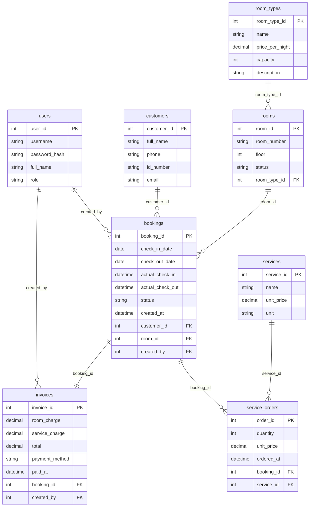

# 06. TÀI LIỆU KỸ THUẬT & THIẾT KẾ CƠ SỞ DỮ LIỆU (ERD + TỪ ĐIỂN DỮ LIỆU)

> **Người phụ trách:** **Khoa**. Tài liệu này cung cấp kiến trúc kỹ thuật, biểu đồ ERD và **Từ điển dữ liệu (Data Dictionary) chi tiết cho 8 bảng** để phục vụ trực tiếp **Mục 2.5, 2.6** của quyển báo cáo và cài đặt `schema.sql` + JPA Entities.

---

## 1. Công nghệ Sử dụng (Tech Stack)
| Lớp | Lựa chọn | Ghi chú |
|---|---|---|
| Ngôn ngữ | Java, **JDK 21** | Đáp ứng `NFR-07` |
| Framework | **Spring Boot 3.x** (Spring Web, Spring Data JPA, Validation, `spring-security-crypto`), **Thymeleaf** | Render giao diện Server-side mượt mà, dễ chạy demo |
| Cơ sở dữ liệu | **H2 Database** (chế độ lưu file `./data/ace_hotel_db` để bền dữ liệu sau khi tắt ứng dụng) | Đáp ứng `NFR-06`, `NFR-08`; đổi sang MySQL chỉ cần sửa `application.properties` |
| Băm mật khẩu | **BCrypt** (`BCryptPasswordEncoder`) | Đáp ứng `NFR-02` |
| Công cụ Build | **Maven** (`pom.xml`) | Chạy bằng `mvn spring-boot:run` |
| Trình duyệt | Google Chrome / Microsoft Edge bản mới | Đáp ứng `NFR-07` |

---

## 2. Kiến trúc Phân lớp (`NFR-06`)
```text
Browser (HTML/CSS ACE Color System)
   ⇅  HTTP Request / Response
Controller Layer (com.ace.hotel.controller)   ──► Kiểm tra phân quyền & điều hướng View Thymeleaf
   ⇅  DTO / Domain Model
Service Layer (com.ace.hotel.service)         ──► Xử lý toàn bộ BR1–BR7, D1–D22 trong @Transactional
   ⇅  JPA Entities
Repository Layer (com.ace.hotel.repository)   ──► Spring Data JPA (Truy vấn chống trùng lịch, thống kê)
   ⇅  JDBC / SQL
H2 Database (schema.sql + sample-data.sql)
```
* **Cấu trúc package chuẩn:** `com.ace.hotel.{config, controller, service, repository, entity, dto, exception}`.
* **Nguyên tắc thiết kế:** Mọi quy tắc nghiệp vụ (chống trùng lịch `BR2`, tính tiền phòng & dịch vụ `BR4`/`BR6`, kiểm tra trạng thái hợp lệ và chặn xóa lịch sử `D10`) bắt buộc đặt tại tầng **`service`**, không đặt rải rác ở `controller` hay `view`.

---

## 3. Biểu đồ Thực thể – Kết hợp (ERD – 8 Bảng)


---

## 4. Lược đồ Quan hệ & Từ điển Dữ liệu Chi tiết (Mục 2.6 Báo cáo)

### 4.1. Bảng 1: `users` (Tài khoản nhân viên hệ thống)
| Tên cột | Kiểu dữ liệu SQL | Kiểu Java | Ràng buộc | Mô tả chi tiết |
|---|---|---|---|---|
| `user_id` | `INT AUTO_INCREMENT` | `Integer` | `PK`, `NOT NULL` | Mã định danh tự tăng của nhân viên |
| `username` | `VARCHAR(50)` | `String` | `UNIQUE`, `NOT NULL` | Tên đăng nhập (ví dụ: `letan01`, `quanly01`) |
| `password_hash` | `VARCHAR(255)` | `String` | `NOT NULL` | Mật khẩu đã băm bằng thuật toán `BCrypt` (`NFR-02`) |
| `full_name` | `VARCHAR(100)` | `String` | `NOT NULL` | Họ và tên đầy đủ của nhân viên |
| `role` | `VARCHAR(20)` | `Role` (Enum) | `NOT NULL`, `CHECK IN ('RECEPTIONIST', 'MANAGER')` | Vai trò phân quyền trên hệ thống |

### 4.2. Bảng 2: `room_types` (Danh mục Loại phòng)
| Tên cột | Kiểu dữ liệu SQL | Kiểu Java | Ràng buộc | Mô tả chi tiết |
|---|---|---|---|---|
| `room_type_id` | `INT AUTO_INCREMENT` | `Integer` | `PK`, `NOT NULL` | Mã loại phòng |
| `name` | `VARCHAR(100)` | `String` | `UNIQUE`, `NOT NULL` | Tên hạng phòng (`Standard`, `Superior`, `Deluxe`, `Family`, `Suite`) |
| `price_per_night` | `DECIMAL(12,0)` | `BigDecimal` | `NOT NULL`, `CHECK (> 0)` | Đơn giá thuê 1 đêm (VNĐ, số nguyên dương) |
| `capacity` | `INT` | `Integer` | `NOT NULL`, `CHECK (>= 1)` | Sức chứa khách tối đa của loại phòng |
| `description` | `VARCHAR(500)` | `String` | `NULL` | Mô tả tiện nghi và đặc điểm loại phòng |

### 4.3. Bảng 3: `rooms` (Danh mục Phòng cụ thể)
| Tên cột | Kiểu dữ liệu SQL | Kiểu Java | Ràng buộc | Mô tả chi tiết |
|---|---|---|---|---|
| `room_id` | `INT AUTO_INCREMENT` | `Integer` | `PK`, `NOT NULL` | Mã định danh phòng |
| `room_number` | `VARCHAR(20)` | `String` | `UNIQUE`, `NOT NULL` | Số phòng hiển thị (ví dụ: `101`, `205`, `301`, `418`) |
| `floor` | `INT` | `Integer` | `NOT NULL`, `CHECK (>= 1)` | Tầng của phòng |
| `status` | `VARCHAR(20)` | `RoomStatus` | `NOT NULL`, `CHECK IN ('AVAILABLE', 'OCCUPIED', 'MAINTENANCE')` | Trạng thái vật lý hiện tại của phòng (`D2`) |
| `room_type_id` | `INT` | `RoomType` | `FK -> room_types(room_type_id)`, `NOT NULL` | Khóa ngoại tham chiếu loại phòng |

### 4.4. Bảng 4: `customers` (Hồ sơ Khách hàng)
| Tên cột | Kiểu dữ liệu SQL | Kiểu Java | Ràng buộc | Mô tả chi tiết |
|---|---|---|---|---|
| `customer_id` | `INT AUTO_INCREMENT` | `Integer` | `PK`, `NOT NULL` | Mã định danh khách hàng |
| `full_name` | `VARCHAR(100)` | `String` | `NOT NULL` | Họ và tên khách hàng (`D12`) |
| `phone` | `VARCHAR(20)` | `String` | `NOT NULL` | Số điện thoại liên hệ (`D12`) |
| `id_number` | `VARCHAR(30)` | `String` | `UNIQUE` (khi có nhập) | Số CCCD / CMND / Hộ chiếu (`D12`) |
| `email` | `VARCHAR(100)` | `String` | `NULL` | Địa chỉ email (tùy chọn) |

### 4.5. Bảng 5: `bookings` (Đơn Đặt phòng & Nhận/Trả phòng)
| Tên cột | Kiểu dữ liệu SQL | Kiểu Java | Ràng buộc | Mô tả chi tiết |
|---|---|---|---|---|
| `booking_id` | `INT AUTO_INCREMENT` | `Integer` | `PK`, `NOT NULL` | Mã đặt phòng (hiển thị dạng `BK-{booking_id}` theo `D5`) |
| `check_in_date` | `DATE` | `LocalDate` | `NOT NULL` | Ngày nhận phòng dự kiến (`D6`) |
| `check_out_date` | `DATE` | `LocalDate` | `NOT NULL`, `CHECK (> check_in_date)` | Ngày trả phòng dự kiến (`BR3`, `D6`) |
| `actual_check_in` | `TIMESTAMP` | `LocalDateTime`| `NULL` | Thời điểm khách thực tế làm thủ tục Check-in (`UC04`) |
| `actual_check_out` | `TIMESTAMP` | `LocalDateTime`| `NULL` | Thời điểm khách thực tế làm thủ tục Check-out (`UC05`) |
| `status` | `VARCHAR(20)` | `BookingStatus`| `NOT NULL`, `CHECK IN ('BOOKED', 'CHECKED_IN', 'CHECKED_OUT', 'CANCELLED')` | Trạng thái đơn đặt phòng |
| `created_at` | `TIMESTAMP` | `LocalDateTime`| `NOT NULL`, `DEFAULT CURRENT_TIMESTAMP` | Thời điểm tạo đơn đặt phòng |
| `customer_id` | `INT` | `Customer` | `FK -> customers(customer_id)`, `NOT NULL` | Khách hàng đứng tên đặt phòng |
| `room_id` | `INT` | `Room` | `FK -> rooms(room_id)`, `NOT NULL` | Phòng được đặt (`BR1`: 1 đơn = 1 phòng) |
| `created_by` | `INT` | `User` | `FK -> users(user_id)`, `NOT NULL` | Nhân viên tạo đơn đặt phòng |

### 4.6. Bảng 6: `services` (Danh mục Dịch vụ đi kèm)
| Tên cột | Kiểu dữ liệu SQL | Kiểu Java | Ràng buộc | Mô tả chi tiết |
|---|---|---|---|---|
| `service_id` | `INT AUTO_INCREMENT` | `Integer` | `PK`, `NOT NULL` | Mã dịch vụ |
| `name` | `VARCHAR(100)` | `String` | `UNIQUE`, `NOT NULL` | Tên dịch vụ (Ăn sáng, Giặt ủi, Spa, Đưa đón...) |
| `unit_price` | `DECIMAL(12,0)` | `BigDecimal` | `NOT NULL`, `CHECK (> 0)` | Đơn giá niêm yết hiện hành (VNĐ) |
| `unit` | `VARCHAR(30)` | `String` | `NOT NULL` | Đơn vị tính (`Suất`, `Lần`, `Chuyến`, `Combo`, `Ngày`) |

### 4.7. Bảng 7: `service_orders` (Chi tiết Dịch vụ đã gọi của Phòng đang ở)
| Tên cột | Kiểu dữ liệu SQL | Kiểu Java | Ràng buộc | Mô tả chi tiết |
|---|---|---|---|---|
| `order_id` | `INT AUTO_INCREMENT` | `Integer` | `PK`, `NOT NULL` | Mã dòng gọi dịch vụ |
| `quantity` | `INT` | `Integer` | `NOT NULL`, `CHECK (>= 1)` | Số lượng dịch vụ sử dụng |
| `unit_price` | `DECIMAL(12,0)` | `BigDecimal` | `NOT NULL`, `CHECK (> 0)` | Đơn giá đóng băng tại thời điểm gọi dịch vụ (`UC06`) |
| `ordered_at` | `TIMESTAMP` | `LocalDateTime`| `NOT NULL`, `DEFAULT CURRENT_TIMESTAMP` | Thời điểm ghi nhận dịch vụ |
| `booking_id` | `INT` | `Booking` | `FK -> bookings(booking_id)`, `NOT NULL` | Thuộc đơn đặt phòng đang `CHECKED_IN` (`BR5`) |
| `service_id` | `INT` | `ServiceItem` | `FK -> services(service_id)`, `NOT NULL` | Tham chiếu dịch vụ trong danh mục |

### 4.8. Bảng 8: `invoices` (Hóa đơn Thanh toán)
| Tên cột | Kiểu dữ liệu SQL | Kiểu Java | Ràng buộc | Mô tả chi tiết |
|---|---|---|---|---|
| `invoice_id` | `INT AUTO_INCREMENT` | `Integer` | `PK`, `NOT NULL` | Mã hóa đơn (hiển thị `#INV-{invoice_id}`) |
| `room_charge` | `DECIMAL(12,0)` | `BigDecimal` | `NOT NULL`, `CHECK (>= 0)` | Tổng tiền phòng (`Số đêm × price_per_night` – `BR4`) |
| `service_charge` | `DECIMAL(12,0)` | `BigDecimal` | `NOT NULL`, `CHECK (>= 0)` | Tổng tiền dịch vụ đi kèm |
| `total` | `DECIMAL(12,0)` | `BigDecimal` | `NOT NULL`, `CHECK (total = room_charge + service_charge)` | Tổng số tiền thanh toán (`BR6`) |
| `payment_method` | `VARCHAR(20)` | `PaymentMethod`| `NOT NULL`, `CHECK IN ('CASH', 'CARD', 'TRANSFER')` | Hình thức thanh toán (`D9`) |
| `paid_at` | `TIMESTAMP` | `LocalDateTime`| `NOT NULL`, `DEFAULT CURRENT_TIMESTAMP` | Thời điểm xác nhận thanh toán |
| `booking_id` | `INT` | `Booking` | `FK -> bookings(booking_id)`, `UNIQUE`, `NOT NULL` | Quan hệ 1–1 với đặt phòng (chống tạo trùng hóa đơn) |
| `created_by` | `INT` | `User` | `FK -> users(user_id)`, `NOT NULL` | Nhân viên thu ngân xác nhận thanh toán |

---

## 5. Truy vấn SQL Trọng tâm (Chống Trùng Lịch `BR2` & `D18`)
```sql
SELECT r.*
FROM rooms r
WHERE r.status <> 'MAINTENANCE'
  AND (:roomTypeId IS NULL OR r.room_type_id = :roomTypeId)
  AND NOT EXISTS (
      SELECT 1
      FROM bookings b
      WHERE b.room_id = r.room_id
        AND b.status IN ('BOOKED', 'CHECKED_IN')
        AND b.check_in_date < :newCheckOutDate
        AND b.check_out_date > :newCheckInDate
  )
ORDER BY r.floor ASC, r.room_number ASC;
```

---

## 6. Môi trường Chạy, Bàn giao & Khai báo Nguồn Tham khảo
* **Môi trường:** JDK 21, chạy lệnh `mvn spring-boot:run` $\rightarrow$ truy cập `http://localhost:8080`.
* **Nguồn tham khảo & thư viện bên ngoài (khai báo trong báo cáo theo Mục 5 đề thi):**
  * Framework & Thư viện: *Spring Boot 3 (Spring Web, Spring Data JPA, Validation, Spring Security Crypto)*, *Thymeleaf*, *H2 Database Engine*.
  * Font chữ & Biểu tượng: Hệ font chữ hệ thống / *Inter* (Google Fonts) và bộ biểu tượng SVG mã nguồn mở *Lucide Icons*.
