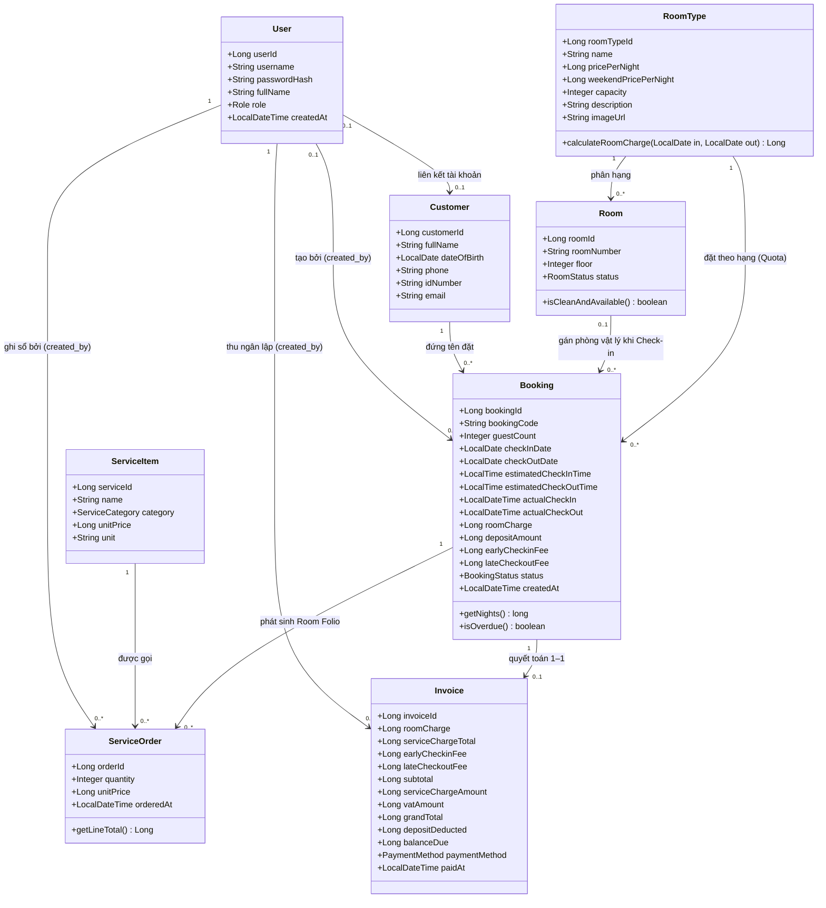
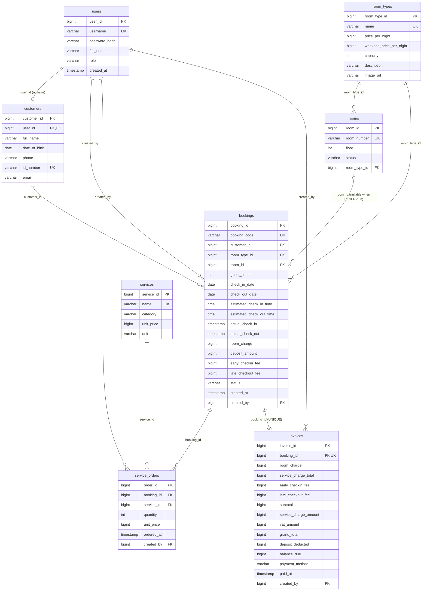

# 06. TÀI LIỆU KỸ THUẬT, CLASS DIAGRAM, ERD & THIẾT KẾ CƠ SỞ DỮ LIỆU (8 BẢNG)

> **Người phụ trách:** **Khoa**.  
> **Ánh xạ Báo cáo:** Tài liệu này cung cấp nội dung hoàn chỉnh cho **Chương 4 (Mục 4.3 Biểu đồ Lớp, Mục 4.4 Mô hình ERD)**, **Chương 5 – Thiết kế cơ sở dữ liệu (Mục 5.1, 5.2, 5.3)** và **Chương 7 (Mục 7.1 Kiến trúc kỹ thuật)**.

---

## 1. Công nghệ Sử dụng (Tech Stack – Mục 7.1)
| Tầng / Thành phần | Lựa chọn kỹ thuật | Mục đích & Đáp ứng yêu cầu phi chức năng |
|---|---|---|
| **Ngôn ngữ & Runtime** | Java (**JDK 21**) | Đáp ứng `NFR-07`, cú pháp hiện đại, hiệu năng cao |
| **Web Framework** | **Spring Boot 3.5** (`Spring Web`, `Validation`) | Kiến trúc MVC chuẩn mực, phản hồi dưới 2 giây (`NFR-01`) |
| **Template Engine** | **Thymeleaf** + HTML5 / CSS3 (`tokens.css`) | Render 4 phân hệ giao diện chuẩn `ACE Color System` (Dark/Light Mode) |
| **Bảo mật & Phân quyền** | **Spring Security 6** + `BCryptPasswordEncoder` | Băm mật khẩu (`NFR-02`), kiểm tra quyền phía Server (`NFR-03`) và tự động điều hướng 3 Role |
| **Truy cập Dữ liệu** | **Spring Data JPA (Hibernate)** + `@Transactional` | Tách lớp `Repository`, đảm bảo toàn vẹn giao dịch ACID (`NFR-04`, `NFR-06`) |
| **Hệ quản trị CSDL** | **H2 Database** (Chế độ lưu file `./data/ace_hotel_db`) | Lưu bền dữ liệu sau khi tắt ứng dụng (`NFR-08`); chuyển sang MySQL chỉ cần đổi cấu hình |
| **Công cụ Build** | **Maven** (`pom.xml`) | Đóng gói và chạy nhanh bằng `mvn spring-boot:run` (`NFR-09`) |

---

## 2. Kiến trúc Phân lớp Ứng dụng & Điều hướng 3 Role (`NFR-06`)

```text
Trình duyệt (4 Phân hệ Giao diện: Landing | Customer Portal | Staff PMS | Admin Backoffice)
   ⇅  HTTP Request / Response (Spring Security Filter Chain & Role-based Success Handler)
Controller Layer (com.ace.hotel.controller)   ──► AuthController, PublicController, CustomerController,
   ⇅  DTO / ViewModel                             StaffCheckInController, StaffFolioController,
   ⇅                                              StaffCheckOutController, AdminCatalogController, AdminReportController
Service Layer (com.ace.hotel.service)         ──► Xử lý BR1–BR7 trong @Transactional (Quota Check, Dynamic Pricing,
   ⇅  JPA Entities (8 Classes)                    Gán phòng sạch, Room Folio Snapshot, Quyết toán ++, Vòng đời DIRTY)
Repository Layer (com.ace.hotel.repository)   ──► 8 Spring Data JPA Repositories (Truy vấn chống trùng, thống kê OR%)
   ⇅  JDBC / SQL
H2 Database Engine (schema.sql + sample-data.sql lưu tại ./data/ace_hotel_db)
```

---

## 3. Biểu đồ Lớp Phân tích & Thiết kế (`Class Diagram` – Chương 4, Mục 4.3)



---

## 4. Mô hình Thực thể – Kết hợp (`ERD` 8 Bảng – Chương 4, Mục 4.4)



---

## 5. Lược đồ Quan hệ & Từ điển Dữ liệu Chi tiết 8 Bảng (Chương 5 – Mục 5.1 & 5.2)

### 5.1. Danh sách 8 Bảng Quan hệ Tổng thể (Mục 5.1)
1. **`users`:** Lưu thông tin tài khoản xác thực của cả 3 vai trò (`ADMIN`, `RECEPTIONIST`, `CUSTOMER`).
2. **`room_types`:** Lưu danh mục hạng phòng kèm biểu giá ngày thường (`price_per_night`) và cuối tuần (`weekend_price_per_night`).
3. **`rooms`:** Lưu danh sách phòng vật lý cụ thể và 4 trạng thái vòng đời (`AVAILABLE`, `OCCUPIED`, `DIRTY`, `MAINTENANCE`).
4. **`customers`:** Lưu hồ sơ khách hàng (liên kết `user_id` nếu là khách đăng ký Online, hoặc `user_id = NULL` nếu là khách vãng lai Walk-in).
5. **`bookings`:** Lưu đơn đặt phòng theo hạng (`room_type_id`), tiền cọc (`deposit_amount`: 30% với khách Online, `0đ` với khách Walk-in) và phòng vật lý được gán khi Check-in (`room_id`).
6. **`services`:** Lưu danh mục dịch vụ chia theo 4 nhóm (`MINIBAR`, `LAUNDRY`, `FB`, `DAMAGES`).
7. **`service_orders`:** Sổ cái Room Folio ghi nhận các dịch vụ khách đã gọi kèm đơn giá đóng băng (`unit_price`).
8. **`invoices`:** Lưu hóa đơn quyết toán 1–1 với `bookings` theo công thức `++` (`SVC 5%`, `VAT 10%`) và khấu trừ tiền cọc (`deposit_deducted`).

---

### 5.2. Đặc tả Từ điển Dữ liệu Chi tiết (Mục 5.2)

#### Bảng 1: `users` (Tài khoản người dùng hệ thống)
| Tên cột | Kiểu SQL | Kiểu Java | Ràng buộc | Mô tả ý nghĩa |
|---|---|---|---|---|
| `user_id` | `BIGINT IDENTITY` | `Long` | `PK`, `NOT NULL` | Mã định danh tự tăng của tài khoản |
| `username` | `VARCHAR(50)` | `String` | `UNIQUE`, `NOT NULL` | Tên đăng nhập (`admin`, `nhanvien`, `khach`...) |
| `password_hash` | `VARCHAR(255)` | `String` | `NOT NULL` | Chuỗi mật khẩu đã băm bằng `BCrypt` (`NFR-02`) |
| `full_name` | `VARCHAR(100)` | `String` | `NOT NULL` | Họ và tên hiển thị trên thanh điều hướng |
| `role` | `VARCHAR(20)` | `Role` (Enum) | `NOT NULL`, `CHECK IN ('ADMIN', 'RECEPTIONIST', 'CUSTOMER')` | Vai trò phân quyền và điều hướng tự động |
| `created_at` | `TIMESTAMP` | `LocalDateTime` | `NOT NULL`, `DEFAULT CURRENT_TIMESTAMP` | Thời điểm tạo tài khoản |

#### Bảng 2: `room_types` (Danh mục Hạng phòng & Biểu giá động)
| Tên cột | Kiểu SQL | Kiểu Java | Ràng buộc | Mô tả ý nghĩa |
|---|---|---|---|---|
| `room_type_id` | `BIGINT IDENTITY` | `Long` | `PK`, `NOT NULL` | Mã định danh hạng phòng |
| `name` | `VARCHAR(50)` | `String` | `UNIQUE`, `NOT NULL` | Tên hạng phòng (`Standard`, `Superior`, `Deluxe`, `Family`, `Suite`) |
| `price_per_night` | `BIGINT` | `Long` | `NOT NULL`, `CHECK (> 0)` | Đơn giá 1 đêm ngày thường (Thứ 2 đến Thứ 5, VNĐ) |
| `weekend_price_per_night` | `BIGINT` | `Long` | `NOT NULL`, `CHECK (> 0)` | Đơn giá 1 đêm cuối tuần & ngày lễ (Thứ 6, Thứ 7, Chủ Nhật, VNĐ) |
| `capacity` | `INT` | `Integer` | `NOT NULL`, `CHECK (>= 1)` | Sức chứa khách tối đa của hạng phòng |
| `description` | `VARCHAR(500)` | `String` | `NULL` | Mô tả diện tích, hướng nhìn và tiện nghi |
| `image_url` | `VARCHAR(255)` | `String` | `NULL` | Đường dẫn ảnh minh họa hạng phòng trên Landing Page |

#### Bảng 3: `rooms` (Danh mục Phòng vật lý & Vòng đời Buồng phòng)
| Tên cột | Kiểu SQL | Kiểu Java | Ràng buộc | Mô tả ý nghĩa |
|---|---|---|---|---|
| `room_id` | `BIGINT IDENTITY` | `Long` | `PK`, `NOT NULL` | Mã định danh phòng vật lý |
| `room_number` | `VARCHAR(10)` | `String` | `UNIQUE`, `NOT NULL` | Số phòng thực tế (`101`, `102`, `201`, `301`, `418`...) |
| `floor` | `INT` | `Integer` | `NOT NULL`, `CHECK (>= 1)` | Tầng lầu của phòng |
| `status` | `VARCHAR(20)` | `RoomStatus` | `NOT NULL`, `CHECK IN ('AVAILABLE', 'OCCUPIED', 'DIRTY', 'MAINTENANCE')` | Trạng thái vật lý hiện tại của phòng (`BR2`, `BR7`) |
| `room_type_id` | `BIGINT` | `RoomType` | `FK -> room_types(room_type_id)`, `NOT NULL` | Thuộc hạng phòng nào |

#### Bảng 4: `customers` (Hồ sơ Khách hàng Online & Khách Walk-in)
| Tên cột | Kiểu SQL | Kiểu Java | Ràng buộc | Mô tả ý nghĩa |
|---|---|---|---|---|
| `customer_id` | `BIGINT IDENTITY` | `Long` | `PK`, `NOT NULL` | Mã định danh hồ sơ khách hàng |
| `user_id` | `BIGINT` | `User` | `FK -> users(user_id)`, `UNIQUE`, `NULL` | Liên kết tài khoản (khách Walk-in tại quầy thì `user_id = NULL`) |
| `full_name` | `VARCHAR(100)` | `String` | `NOT NULL` | Họ và tên đầy đủ của khách hàng |
| `date_of_birth` | `DATE` | `LocalDate` | `NULL` | Ngày sinh (bắt buộc khi đăng ký Online, tùy chọn với Walk-in) |
| `phone` | `VARCHAR(20)` | `String` | `NOT NULL` | Số điện thoại liên hệ |
| `id_number` | `VARCHAR(30)` | `String` | `UNIQUE` (khi có nhập) | Số CCCD / CMND / Hộ chiếu (bắt buộc đối chiếu khi Check-in) |
| `email` | `VARCHAR(100)` | `String` | `NULL` | Địa chỉ email nhận thông tin |

#### Bảng 5: `bookings` (Đơn Đặt phòng, Tiền cọc & Gán phòng thực tế)
| Tên cột | Kiểu SQL | Kiểu Java | Ràng buộc | Mô tả ý nghĩa |
|---|---|---|---|---|
| `booking_id` | `BIGINT IDENTITY` | `Long` | `PK`, `NOT NULL` | Khóa chính tự tăng |
| `booking_code` | `VARCHAR(20)` | `String` | `UNIQUE`, `NOT NULL` | Mã booking hiển thị trên Phiếu QR (`BK-8K4P9X2M`, `BK-2401`...) |
| `customer_id` | `BIGINT` | `Customer` | `FK -> customers(customer_id)`, `NOT NULL` | Khách hàng đứng tên đơn đặt |
| `room_type_id` | `BIGINT` | `RoomType` | `FK -> room_types(room_type_id)`, `NOT NULL` | Hạng phòng khách đã chọn đặt (dùng để kiểm tra Quota) |
| `room_id` | `BIGINT` | `Room` | `FK -> rooms(room_id)`, `NULL` | Phòng vật lý cụ thể (`NULL` khi mới đặt Online `RESERVED`; gán khi Check-in) |
| `guest_count` | `INT` | `Integer` | `NOT NULL`, `CHECK (>= 1)` | Số lượng khách lưu trú |
| `check_in_date` | `DATE` | `LocalDate` | `NOT NULL` | Ngày nhận phòng dự kiến |
| `check_out_date` | `DATE` | `LocalDate` | `NOT NULL`, `CHECK (> check_in_date)` | Ngày trả phòng dự kiến (`BR3`) |
| `estimated_check_in_time` | `TIME` | `LocalTime` | `DEFAULT '14:00:00'` | Giờ nhận phòng tiêu chuẩn (14:00) |
| `estimated_check_out_time` | `TIME` | `LocalTime` | `DEFAULT '12:00:00'` | Giờ trả phòng tiêu chuẩn (12:00) |
| `actual_check_in` | `TIMESTAMP` | `LocalDateTime` | `NULL` | Thời điểm thực tế khách nhận phòng tại quầy (`UC04`) |
| `actual_check_out` | `TIMESTAMP` | `LocalDateTime` | `NULL` | Thời điểm thực tế khách hoàn tất trả phòng (`UC05`) |
| `room_charge` | `BIGINT` | `Long` | `NOT NULL`, `CHECK (>= 0)` | Tổng tiền phòng gốc theo lịch đặt (chưa cộng SVC/VAT) |
| `deposit_amount` | `BIGINT` | `Long` | `NOT NULL`, `DEFAULT 0`, `CHECK (>= 0)` | Số tiền đã cọc: **30% tổng gói phòng `++`** với khách Online; **`0đ`** với khách Walk-in |
| `early_checkin_fee` | `BIGINT` | `Long` | `NOT NULL`, `DEFAULT 0`, `CHECK (>= 0)` | Phụ thu nhận phòng sớm trước 14:00 (nếu có) |
| `late_checkout_fee` | `BIGINT` | `Long` | `NOT NULL`, `DEFAULT 0`, `CHECK (>= 0)` | Phụ thu trả phòng trễ sau 12:00 (nếu có) |
| `status` | `VARCHAR(20)` | `BookingStatus` | `NOT NULL`, `CHECK IN ('RESERVED', 'CHECKED_IN', 'CHECKED_OUT', 'CANCELLED')` | Trạng thái vòng đời của đơn đặt phòng |
| `created_at` | `TIMESTAMP` | `LocalDateTime` | `NOT NULL`, `DEFAULT CURRENT_TIMESTAMP` | Thời điểm tạo đơn |
| `created_by` | `BIGINT` | `User` | `FK -> users(user_id)`, `NULL` | Tài khoản tạo đơn (Khách tự đặt hoặc Lễ tân tạo Walk-in) |

#### Bảng 6: `services` (Danh mục 4 Nhóm Dịch vụ Lưu trú)
| Tên cột | Kiểu SQL | Kiểu Java | Ràng buộc | Mô tả ý nghĩa |
|---|---|---|---|---|
| `service_id` | `BIGINT IDENTITY` | `Long` | `PK`, `NOT NULL` | Mã định danh dịch vụ |
| `name` | `VARCHAR(100)` | `String` | `UNIQUE`, `NOT NULL` | Tên dịch vụ / mặt hàng |
| `category` | `VARCHAR(30)` | `ServiceCategory` | `NOT NULL`, `CHECK IN ('MINIBAR', 'LAUNDRY', 'FB', 'DAMAGES')` | Phân nhóm dịch vụ chuẩn khách sạn |
| `unit_price` | `BIGINT` | `Long` | `NOT NULL`, `CHECK (>= 0)` | Đơn giá niêm yết hiện hành (VNĐ, chưa thuế) |
| `unit` | `VARCHAR(30)` | `String` | `NOT NULL` | Đơn vị tính (`Lon`, `Chai`, `Suất`, `Bộ`, `Lần`, `Cái`) |

#### Bảng 7: `service_orders` (Sổ cái Chi phí Dịch vụ Phòng – Room Folio Ledger)
| Tên cột | Kiểu SQL | Kiểu Java | Ràng buộc | Mô tả ý nghĩa |
|---|---|---|---|---|
| `order_id` | `BIGINT IDENTITY` | `Long` | `PK`, `NOT NULL` | Mã dòng ghi nợ dịch vụ |
| `booking_id` | `BIGINT` | `Booking` | `FK -> bookings(booking_id)`, `NOT NULL` | Thuộc đơn đặt phòng đang ở (`CHECKED_IN` – `BR5`) |
| `service_id` | `BIGINT` | `ServiceItem` | `FK -> services(service_id)`, `NOT NULL` | Mặt hàng / dịch vụ đã sử dụng |
| `quantity` | `INT` | `Integer` | `NOT NULL`, `CHECK (>= 1)` | Số lượng sử dụng |
| `unit_price` | `BIGINT` | `Long` | `NOT NULL`, `CHECK (>= 0)` | Đơn giá đóng băng tại thời điểm gọi (`BR5`) |
| `ordered_at` | `TIMESTAMP` | `LocalDateTime` | `NOT NULL`, `DEFAULT CURRENT_TIMESTAMP` | Thời điểm ghi nhận vào Room Folio |
| `created_by` | `BIGINT` | `User` | `FK -> users(user_id)`, `NOT NULL` | Nhân viên lễ tân thực hiện ghi sổ |

#### Bảng 8: `invoices` (Hóa đơn Quyết toán Chuẩn Biểu giá `++`)
| Tên cột | Kiểu SQL | Kiểu Java | Ràng buộc | Mô tả ý nghĩa |
|---|---|---|---|---|
| `invoice_id` | `BIGINT IDENTITY` | `Long` | `PK`, `NOT NULL` | Mã hóa đơn (`#INV-{id}`) |
| `booking_id` | `BIGINT` | `Booking` | `FK -> bookings(booking_id)`, `UNIQUE`, `NOT NULL` | Quan hệ 1–1 với đặt phòng (chống tạo trùng hóa đơn) |
| `room_charge` | `BIGINT` | `Long` | `NOT NULL`, `CHECK (>= 0)` | Tiền phòng gốc |
| `service_charge_total` | `BIGINT` | `Long` | `NOT NULL`, `DEFAULT 0`, `CHECK (>= 0)` | Tổng tiền dịch vụ phát sinh từ Room Folio |
| `early_checkin_fee` | `BIGINT` | `Long` | `NOT NULL`, `DEFAULT 0`, `CHECK (>= 0)` | Phụ thu nhận phòng sớm |
| `late_checkout_fee` | `BIGINT` | `Long` | `NOT NULL`, `DEFAULT 0`, `CHECK (>= 0)` | Phụ thu trả phòng trễ |
| `subtotal` | `BIGINT` | `Long` | `NOT NULL`, `CHECK (subtotal = room_charge + service_charge_total + early_checkin_fee + late_checkout_fee)` | Tổng chi phí gốc trước thuế phí |
| `service_charge_amount` | `BIGINT` | `Long` | `NOT NULL`, `CHECK (>= 0)` | Phí phục vụ 5% (`ROUND(subtotal * 0.05)`) |
| `vat_amount` | `BIGINT` | `Long` | `NOT NULL`, `CHECK (>= 0)` | Thuế GTGT 10% (`ROUND((subtotal + service_charge_amount) * 0.10)`) |
| `grand_total` | `BIGINT` | `Long` | `NOT NULL`, `CHECK (grand_total = subtotal + service_charge_amount + vat_amount)` | Tổng cộng hóa đơn biểu giá `++` |
| `deposit_deducted` | `BIGINT` | `Long` | `NOT NULL`, `DEFAULT 0`, `CHECK (>= 0)` | Tiền cọc đã khấu trừ (30% với khách Online; `0đ` với khách Walk-in) |
| `balance_due` | `BIGINT` | `Long` | `NOT NULL`, `CHECK (balance_due = grand_total - deposit_deducted)` | Số tiền thực thu tại quầy khi Check-out |
| `payment_method` | `VARCHAR(20)` | `PaymentMethod` | `NOT NULL`, `CHECK IN ('CASH', 'CARD', 'TRANSFER')` | Phương thức thanh toán tại quầy |
| `paid_at` | `TIMESTAMP` | `LocalDateTime` | `NOT NULL`, `DEFAULT CURRENT_TIMESTAMP` | Thời điểm hoàn tất thanh toán |
| `created_by` | `BIGINT` | `User` | `FK -> users(user_id)`, `NOT NULL` | Nhân viên lễ tân thu ngân |

---

## 6. Các Câu Truy vấn SQL Trọng tâm (Chương 5 – Mục 5.3)

### 6.1. Truy vấn Kiểm tra Tồn kho Hạng phòng (`Room Type Quota Check` – `UC03`)
```sql
SELECT rt.*,
       (SELECT COUNT(*) FROM rooms r
        WHERE r.room_type_id = rt.room_type_id
          AND r.status <> 'MAINTENANCE')
       -
       (SELECT COUNT(*) FROM bookings b
        WHERE b.room_type_id = rt.room_type_id
          AND b.status IN ('RESERVED', 'CHECKED_IN')
          AND b.check_in_date < :newCheckOutDate
          AND b.check_out_date > :newCheckInDate) AS available_quota
FROM room_types rt
WHERE rt.capacity >= :guestCount;
```

### 6.2. Truy vấn Lọc Phòng Vật lý Đang Trống Sạch để Gán khi Check-in (`UC04`)
```sql
SELECT r.*
FROM rooms r
WHERE r.room_type_id = :bookedRoomTypeId
  AND r.status = 'AVAILABLE'
ORDER BY r.floor ASC, r.room_number ASC;
```

### 6.3. Truy vấn Tính Công suất Phòng (`Occupancy Rate` – `UC07`)
```sql
SELECT
  SUM(CASE WHEN status = 'OCCUPIED' THEN 1 ELSE 0 END) AS occupied_rooms,
  SUM(CASE WHEN status IN ('AVAILABLE', 'OCCUPIED', 'DIRTY') THEN 1 ELSE 0 END) AS sellable_rooms,
  ROUND(
    100.0 * SUM(CASE WHEN status = 'OCCUPIED' THEN 1 ELSE 0 END) /
    NULLIF(SUM(CASE WHEN status IN ('AVAILABLE', 'OCCUPIED', 'DIRTY') THEN 1 ELSE 0 END), 0),
    1
  ) AS occupancy_rate_percent
FROM rooms;
```