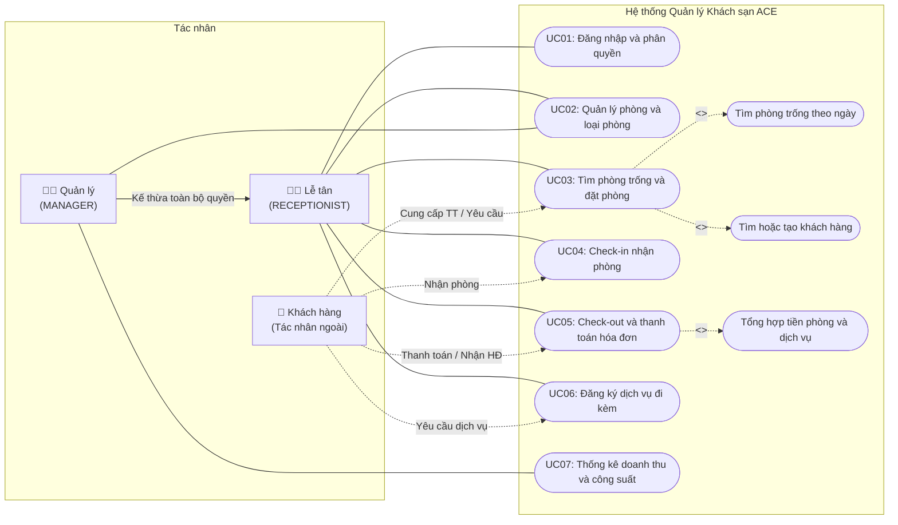
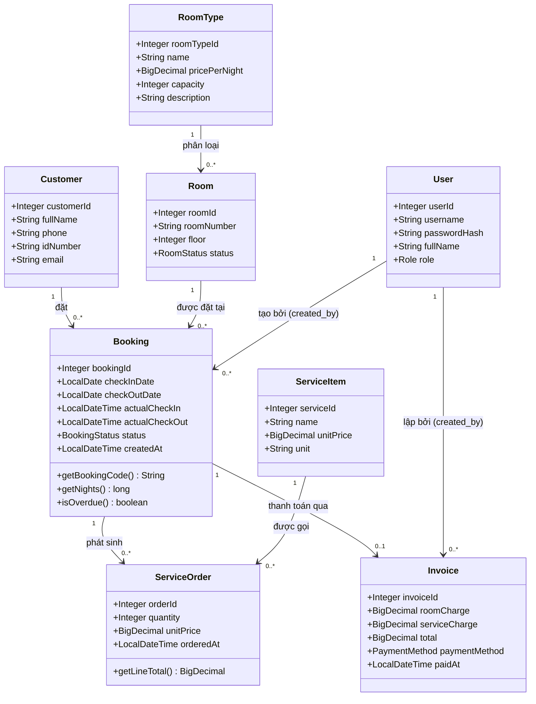

# 09. KHẢO SÁT HIỆN TRẠNG, MÔ HÌNH UML TỔNG QUÁT & ĐẶC TẢ UC01, UC02

> **Mục đích:** Tài liệu này cung cấp nội dung hoàn chỉnh cho **Mục 2.3 (Khảo sát hiện trạng)**, **Mục 2.5 (Biểu đồ Use Case tổng quát, Biểu đồ Lớp - Class Diagram)** và **Đặc tả chi tiết UC01 (Đăng nhập & Phân quyền), UC02 (Quản lý phòng & loại phòng)** để phục vụ trực tiếp việc lập trình của Khoa và ghép vào quyển báo cáo cuối kỳ.

---

## 1. Khảo sát và Mô tả Hiện trạng (Mục 2.3 Báo cáo)

### 1.1. Mô tả nghiệp vụ thực tế tại khách sạn vừa và nhỏ
Tại các khách sạn quy mô vừa và nhỏ (từ 10 đến 30 phòng, vận hành một cơ sở duy nhất), mọi hoạt động đón tiếp khách, kiểm tra phòng trống, nhận/trả phòng, ghi nhận dịch vụ phát sinh (ăn sáng, giặt ủi, minibar, đưa đón...) và thanh toán đều tập trung tại **quầy lễ tân**. Khách hàng liên hệ đặt phòng qua điện thoại, nhắn tin hoặc đến trực tiếp quầy (walk-in) và giao dịch trực tiếp với nhân viên lễ tân.

### 1.2. Các đối tượng liên quan (Stakeholders)
| Đối tượng | Vai trò trong thực tế | Liên hệ với hệ thống ACE |
|---|---|---|
| **Khách hàng** | Người có nhu cầu lưu trú, đặt phòng, nhận/trả phòng, sử dụng dịch vụ đi kèm và thanh toán hóa đơn. | **Tác nhân ngoài (Indirect Actor):** Không trực tiếp đăng nhập hay bấm máy; cung cấp thông tin và nhận hóa đơn qua Lễ tân. |
| **Lễ tân** | Nhân viên trực quầy hằng ngày: tra cứu phòng trống, ghi nhận đặt phòng, làm thủ tục check-in, thêm dịch vụ và tính tiền check-out. | **Tác nhân chính (`RECEPTIONIST`):** Sử dụng các chức năng nghiệp vụ hằng ngày trên hệ thống. |
| **Quản lý** | Người điều hành khách sạn: thiết lập bảng giá loại phòng, quản lý danh sách phòng, duyệt bảo trì phòng, quản lý danh mục dịch vụ và theo dõi doanh thu. | **Tác nhân chính (`MANAGER`):** Có toàn bộ quyền của Lễ tân cộng thêm quyền cấu hình danh mục và xem báo cáo thống kê. |
| **Buồng phòng** | Nhân viên dọn dẹp, kiểm tra phòng sau khi khách trả hoặc khi phòng bảo trì. | **Đối tượng liên quan ngoài hệ thống:** Nhận thông báo miệng/bộ đàm từ Lễ tân; Lễ tân/Quản lý cập nhật trạng thái phòng trên phần mềm. |
| **Kế toán / Chủ KS** | Người đối soát doanh thu và hóa đơn cuối tháng. | **Đối tượng liên quan ngoài hệ thống:** Nhận số liệu từ chức năng Hóa đơn và Thống kê của Quản lý. |

### 1.3. Quy trình nghiệp vụ hiện tại (Thủ công / Bán thủ công)
1. **Khi khách hỏi đặt phòng:** Lễ tân mở sổ lịch đặt phòng hoặc file Excel chia ô theo ngày $\rightarrow$ dò bằng mắt xem ngày khách muốn ở có phòng nào trống $\rightarrow$ ghi tên, số điện thoại khách vào ô tương ứng.
2. **Khi khách đến nhận phòng (Check-in):** Lễ tân tìm lại dòng ghi chú trong sổ/Excel $\rightarrow$ đối chiếu CCCD $\rightarrow$ gạch đánh dấu phòng đang có khách ở trên bảng trắng sau quầy.
3. **Khi khách gọi dịch vụ (ăn sáng, giặt ủi, nước uống):** Lễ tân ghi tạm vào phiếu giấy kẹp theo số phòng hoặc gõ thêm vào một sheet phụ trên Excel.
4. **Khi khách trả phòng (Check-out):** Lễ tân lấy ngày đi trừ ngày đến để nhân với đơn giá phòng, sau đó gom các phiếu giấy dịch vụ cộng tay bằng máy tính bỏ túi $\rightarrow$ viết hóa đơn giấy / in phiếu thu $\rightarrow$ xóa bảng trắng để báo phòng trống.

### 1.4. Các vấn đề và hạn chế cần giải quyết
1. **Dễ xảy ra trùng lịch đặt phòng (Overbooking):** Khi 2 lễ tân giao ca hoặc khách đổi ngày, việc dò mắt trên sổ/Excel rất dễ dẫn đến nhận đặt trùng một phòng trong cùng khoảng ngày.
2. **Sai sót và thất thoát khi tính tiền trả phòng:** Phiếu ghi dịch vụ đi kèm bằng giấy dễ thất lạc; tính nhẩm hoặc bấm máy tính tay dễ nhầm số đêm hoặc áp sai đơn giá loại phòng.
3. **Không đồng bộ trạng thái phòng theo thời gian thực:** Lễ tân không nắm rõ ngay lập tức phòng nào đang trống, phòng nào có lịch check-in/check-out hôm nay, phòng nào khách ở quá hạn chưa trả hoặc đang bảo trì.
4. **Thiếu phân quyền và kiểm soát thao tác:** File Excel chung ai cũng có thể tự ý sửa giá phòng, xóa lịch sử đặt phòng hoặc sửa số tiền hóa đơn mà không lưu vết người thực hiện (`created_by`).
5. **Tốn thời gian tổng hợp báo cáo:** Cuối tháng, Quản lý mất nhiều giờ cộng sổ từng hóa đơn để biết doanh thu theo tháng, theo loại phòng và công suất khai thác phòng.

---

## 2. Biểu đồ Use Case Tổng quát (Mục 2.5 Báo cáo)

**Giải thích quan hệ trên biểu đồ Use Case tổng quát:**
* **Kế thừa Actor (Generalization):** `Quản lý` kế thừa toàn bộ quyền thực hiện Use Case của `Lễ tân` (`UC01`, `UC03`, `UC04`, `UC05`, `UC06`) và có thêm quyền đầy đủ ở `UC02` (Thêm/Sửa/Xóa/Bảo trì phòng & loại phòng, trong khi Lễ tân chỉ được Xem/Lọc) cùng quyền riêng ở `UC07` (Thống kê) và quản lý danh mục dịch vụ (`FR-12` trong `UC06`).
* **Quan hệ `<<include>>`:**
  * `UC03` bắt buộc bao gồm bước **Tìm phòng trống theo ngày** và **Tìm hoặc tạo khách hàng**.
  * `UC05` bắt buộc bao gồm bước **Tổng hợp tiền phòng và dịch vụ** trước khi xác nhận thanh toán.

---

## 3. Đặc tả Chi tiết UC01 – Đăng nhập và Phân quyền

| Mục | Nội dung chi tiết |
|---|---|
| **Mã & Tên Use Case** | **UC01 – Đăng nhập và phân quyền** |
| **Người phụ trách** | Kiệt (Phân tích & Wireframe) · Khoa (Cài đặt Java) |
| **Yêu cầu liên quan** | `FR-01`, `FR-02`, `FR-18` (Dashboard), `NFR-02` (BCrypt), `NFR-03` (Server-side RBAC) |
| **Màn hình liên quan** | `S01` (`/`), `S02` (`/login`), `S03` (`/dashboard`) |
| **Tác nhân (Actor)** | Lễ tân (`RECEPTIONIST`), Quản lý (`MANAGER`) |
| **Mô tả ngắn** | Người dùng xác thực bằng tên đăng nhập và mật khẩu để truy cập hệ thống; hệ thống kiểm tra quyền trên máy chủ và chỉ hiển thị menu/chức năng tương ứng với vai trò. |
| **Tiền điều kiện** | Tài khoản nhân viên đã được khởi tạo sẵn trong bảng `users` với mật khẩu băm BCrypt (`D14`, `D22`). |
| **Hậu điều kiện** | **Thành công:** Phiên đăng nhập (HTTP Session / SecurityContext) được thiết lập; người dùng được đưa tới trang Tổng quan (`/dashboard`) với thanh điều hướng đúng vai trò. **Thất bại:** Không tạo phiên đăng nhập; người dùng ở lại trang `/login` kèm thông báo lỗi chung. |

### 3.1. Luồng sự kiện chính (Main Success Scenario – Đăng nhập)
1. Người dùng truy cập vào hệ thống (từ trang giới thiệu `/` nhấn **[Đăng nhập]** hoặc truy cập trực tiếp `/login`).
2. Hệ thống hiển thị màn hình Đăng nhập (`S02`) gồm các trường: `Tên đăng nhập` (`username`), `Mật khẩu` (`password`) và nút **[Đăng nhập]**.
3. Người dùng nhập `username`, `password` và nhấn **[Đăng nhập]** (`POST /login`).
4. Hệ thống truy vấn bảng `users` theo `username` và kiểm tra mật khẩu nhập vào với cột `password_hash` bằng thuật toán `BCryptPasswordEncoder.matches()`.
5. Thông tin hợp lệ: Hệ thống lưu thông tin người dùng (`user_id`, `username`, `full_name`, `role`) vào phiên làm việc (Session).
6. Hệ thống chuyển hướng (`redirect:/dashboard`) sang màn hình Tổng quan (`S03`):
   * Nếu `role = RECEPTIONIST`: Hiển thị menu `Tổng quan`, `Phòng` (chỉ xem), `Đặt phòng mới`, `Danh sách đặt phòng`.
   * Nếu `role = MANAGER`: Hiển thị đầy đủ menu trên và thêm cụm menu quản trị: `Quản lý phòng`, `Loại phòng`, `Danh mục dịch vụ`, `Thống kê`.

### 3.2. Luồng sự kiện phụ (Alternative Flows)
* **A1 – Đăng xuất (`POST /logout`):**
  1. Tại bất kỳ màn hình nội bộ nào, người dùng nhấn nút **[Đăng xuất]** ở góc phải thanh Header.
  2. Hệ thống hủy phiên làm việc hiện tại (`session.invalidate()`) và xóa SecurityContext.
  3. Hệ thống chuyển hướng về trang `/login?logout` và hiển thị thông báo: *"Bạn đã đăng xuất khỏi hệ thống."* (`MSG-02`).
* **A2 – Người dùng đã đăng nhập truy cập lại `/login`:**
  1. Nếu người dùng đã có phiên đăng nhập hợp lệ mà mở lại `/login`, hệ thống tự động chuyển hướng thẳng về `/dashboard`.

### 3.3. Luồng ngoại lệ (Exception Flows)
* **E1 – Bỏ trống tên đăng nhập hoặc mật khẩu:**
  * Tại bước 3, nếu người dùng để trống `username` hoặc `password`, trình duyệt/hệ thống chặn gửi hoặc trả về lỗi: *"Vui lòng nhập đầy đủ tên đăng nhập và mật khẩu."* (`MSG-03`).
* **E2 – Sai tên đăng nhập hoặc sai mật khẩu:**
  * Tại bước 4, nếu `username` không tồn tại trong bảng `users` hoặc `BCrypt` không khớp, hệ thống trả về trang `/login?error` và hiển thị thông báo chung: **"Sai tên đăng nhập hoặc mật khẩu."** (`MSG-01` – tuyệt đối không tiết lộ cụ thể sai trường nào để đảm bảo bảo mật).
* **E3 – Truy cập trang nghiệp vụ khi chưa đăng nhập (Unauthenticated):**
  * Nếu người dùng chưa đăng nhập mà gõ trực tiếp bất kỳ URL nào ngoài `/`, `/login`, `/css/**`, `/js/**`, `/images/**`, hệ thống tự động chặn và chuyển hướng (`302 Redirect`) về `/login`.
* **E4 – Lễ tân cố tình truy cập URL của Quản lý (Unauthorized – `NFR-03`):**
  * Nếu người dùng có vai trò `RECEPTIONIST` gõ trực tiếp URL thuộc `/manage/**` hoặc `/reports` trên thanh địa chỉ trình duyệt, bộ lọc bảo mật phía máy chủ (Server-side Interceptor/Spring Security) trả về mã lỗi `403 Forbidden` (hoặc chuyển hướng về `/dashboard` kèm thông báo lỗi `MSG-04`: *"Bạn không có quyền truy cập chức năng dành cho Quản lý."*).

---

## 4. Đặc tả Chi tiết UC02 – Quản lý Phòng và Loại phòng

| Mục | Nội dung chi tiết |
|---|---|
| **Mã & Tên Use Case** | **UC02 – Quản lý phòng và loại phòng** |
| **Người phụ trách** | Hoàng (Phân tích) · Khoa (Cài đặt Java) |
| **Yêu cầu liên quan** | `FR-03` (CRUD loại phòng), `FR-04` (CRUD phòng), `FR-05` (Tìm/lọc phòng), `NFR-04` (Toàn vẹn dữ liệu), `D2`, `D10`, `D11`, `D13` |
| **Màn hình liên quan** | `S04` (`/rooms`), `S05` (`/manage/rooms/**`), `S06` (`/manage/room-types/**`) |
| **Tác nhân (Actor)** | **Quản lý (`MANAGER`):** Toàn quyền Xem, Lọc, Thêm, Sửa, Xóa, Đổi trạng thái bảo trì. **Lễ tân (`RECEPTIONIST`):** Chỉ có quyền Xem và Lọc danh sách phòng tại `S04`. |
| **Tiền điều kiện** | Người dùng đã đăng nhập vào hệ thống (`UC01`). Đối với thao tác Thêm/Sửa/Xóa/Bảo trì, người dùng bắt buộc có vai trò `MANAGER`. |
| **Hậu điều kiện** | Dữ liệu bảng `room_types` và `rooms` được cập nhật chính xác và nhất quán; không làm mất tính toàn vẹn khóa ngoại với bảng `bookings`. |

### 4.1. Luồng sự kiện chính 2A – Xem và Lọc danh sách phòng (`FR-05`, Màn hình `S04`)
1. Người dùng (Lễ tân hoặc Quản lý) chọn menu **Phòng** (`GET /rooms`).
2. Hệ thống truy vấn danh sách tất cả các phòng kèm thông tin loại phòng (`room_types`) và kiểm tra trạng thái đặt phòng trong ngày hiện tại (`D2`) để hiển thị dạng lưới thẻ (Card Grid) hoặc bảng.
3. Người dùng nhập bộ lọc:
   * `Từ khóa số phòng` (`keyword` – tìm chuỗi con không phân biệt hoa thường theo `D13`, ví dụ gõ `"30"` ra phòng `301`, `302`).
   * `Loại phòng` (`roomTypeId` – Dropdown: Tất cả hoặc chọn 1 loại phòng).
   * `Trạng thái` (`status` – Dropdown: Tất cả, Phòng trống `AVAILABLE`, Đang ở `OCCUPIED`, Đang bảo trì `MAINTENANCE`).
4. Người dùng nhấn **[Lọc]**. Hệ thống hiển thị các phòng thỏa đồng thời các điều kiện lọc.
5. Nếu người dùng là `MANAGER`, trên giao diện hiển thị thêm nút **[+ Thêm phòng]**, **[Quản lý loại phòng]**, và trên mỗi phòng có nút **[Sửa]**, **[Bảo trì / Mở lại]**, **[Xóa]**. Nếu là `RECEPTIONIST`, toàn bộ các nút quản trị này bị ẩn hoàn toàn.

### 4.2. Luồng sự kiện chính 2B – Quản lý Loại phòng (`FR-03`, Màn hình `S06`)
1. Quản lý truy cập `/manage/room-types` (`S06`). Hệ thống hiển thị danh sách loại phòng hiện có cùng form Thêm/Sửa loại phòng.
2. **Thêm / Sửa loại phòng (`POST /manage/room-types` hoặc `POST /manage/room-types/{id}`):**
   * Quản lý nhập: `Tên loại phòng` (`name`), `Đơn giá 1 đêm` (`price_per_night`), `Sức chứa tối đa` (`capacity`), `Mô tả` (`description`).
   * Hệ thống kiểm tra hợp lệ (Validation):
     * `name`: Bắt buộc, không rỗng, độ dài $\le 100$ ký tự, không trùng tên loại phòng khác.
     * `price_per_night`: Bắt buộc, số nguyên dương $> 0$ (đơn vị VNĐ, ví dụ `780000` – `D16`).
     * `capacity`: Bắt buộc, số nguyên $\ge 1$ khách.
   * Hợp lệ: Hệ thống lưu vào bảng `room_types` và hiển thị thông báo thành công (`MSG-05`).
3. **Xóa loại phòng (`POST /manage/room-types/{id}/delete`):**
   * Quản lý nhấn **[Xóa]** trên một loại phòng và xác nhận hộp thoại.
   * Hệ thống kiểm tra số lượng bản ghi trong bảng `rooms` có `room_type_id` này (`D10`).
   * Nếu chưa có phòng nào trực thuộc (`count == 0`): Hệ thống xóa bản ghi `room_types` và báo thành công (`MSG-06`).

### 4.3. Luồng sự kiện chính 2C – Thêm, Sửa, Xóa Phòng & Chuyển Bảo trì (`FR-04`, Màn hình `S05`)
1. **Thêm phòng mới (`GET /manage/rooms/new` $\rightarrow$ `POST /manage/rooms`):**
   * Quản lý nhập: `Số phòng` (`room_number`, ví dụ `"301"`), `Tầng` (`floor`, ví dụ `3`), chọn `Loại phòng` (`room_type_id`), và `Trạng thái ban đầu` (`AVAILABLE` hoặc `MAINTENANCE`).
   * Hệ thống kiểm tra `room_number` không rỗng và chưa tồn tại trong bảng `rooms` (`UNIQUE`), `floor >= 1`.
   * Hợp lệ: Lưu bản ghi mới vào `rooms` và chuyển về `/rooms` kèm thông báo `MSG-07`.
2. **Sửa thông tin phòng (`GET /manage/rooms/{id}/edit` $\rightarrow$ `POST /manage/rooms/{id}`):**
   * Quản lý cập nhật `room_number` (không trùng phòng khác), `floor`, `room_type_id`.
   * Lưu ý: Không cho phép đổi trực tiếp trạng thái sang `OCCUPIED` bằng form sửa (`D11` – trạng thái `OCCUPIED` chỉ do hệ thống tự gán khi Check-in).
3. **Chuyển trạng thái Bảo trì thủ công (`POST /manage/rooms/{id}/toggle-maintenance` – `D11`):**
   * Nếu phòng đang `AVAILABLE` và không có booking `BOOKED` nào có ngày nhận phòng là hôm nay: Hệ thống chuyển `rooms.status` sang `MAINTENANCE`.
   * Nếu phòng đang `MAINTENANCE`: Hệ thống chuyển `rooms.status` về lại `AVAILABLE`.
4. **Xóa phòng (`POST /manage/rooms/{id}/delete` – `D10`):**
   * Hệ thống kiểm tra xem phòng đã từng có bất kỳ bản ghi nào trong bảng `bookings` hay chưa.
   * Nếu chưa từng có booking nào (`count == 0`): Xóa phòng khỏi bảng `rooms`.

### 4.4. Luồng ngoại lệ (Exception Flows) của UC02
* **E1 – Không tìm thấy phòng khi lọc (`S04`):** Hiển thị trạng thái rỗng kèm câu thông báo: *"Không tìm thấy phòng phù hợp với điều kiện lọc."* (`MSG-08`) và nút **[Xóa bộ lọc]**.
* **E2 – Dữ liệu nhập không hợp lệ (Trùng số phòng, giá $\le 0$, sức chứa $< 1$):** Hệ thống giữ nguyên dữ liệu vừa nhập trên form và hiển thị lỗi đỏ ngay dưới từng trường tương ứng (`MSG-09`, `MSG-10`, `MSG-11`).
* **E3 – Xóa loại phòng đang có phòng trực thuộc (`D10`):** Hệ thống từ chối xóa và báo lỗi: *"Không thể xóa loại phòng này vì đang có phòng trực thuộc. Vui lòng chuyển hoặc xóa các phòng thuộc loại này trước."* (`MSG-12`).
* **E4 – Xóa phòng đã từng có đặt phòng (`D10`):** Hệ thống từ chối xóa để bảo toàn lịch sử hóa đơn/đặt phòng và báo lỗi: *"Không thể xóa phòng đã có lịch sử đặt phòng. Vui lòng chuyển phòng sang trạng thái Bảo trì nếu ngưng sử dụng."* (`MSG-13`).
* **E5 – Chuyển bảo trì phòng đang có khách ở hoặc có lịch nhận hôm nay (`D11`):** Hệ thống từ chối và báo lỗi: *"Không thể chuyển sang Bảo trì vì phòng đang có khách lưu trú hoặc có lịch hẹn nhận phòng hôm nay."* (`MSG-14`).

---

## 5. Biểu đồ Lớp Phân tích & Thiết kế (Class Diagram – Mục 2.5 Báo cáo)

