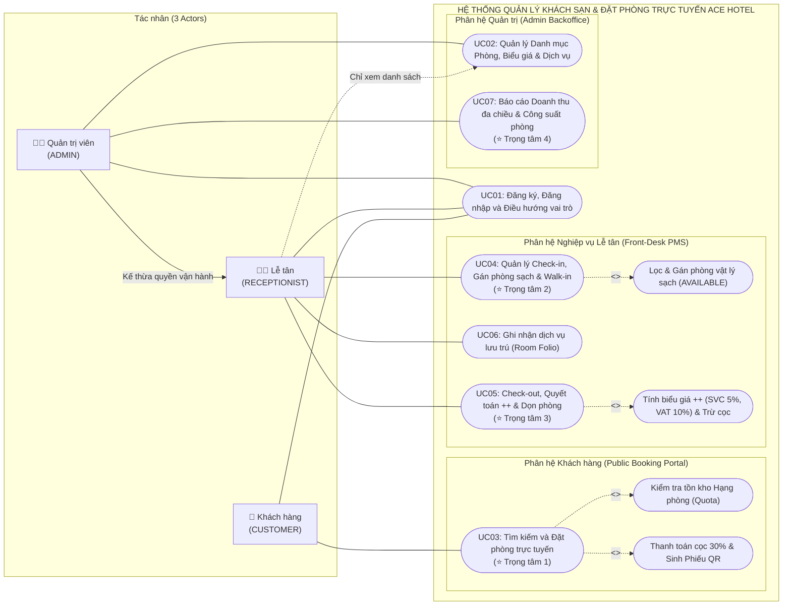
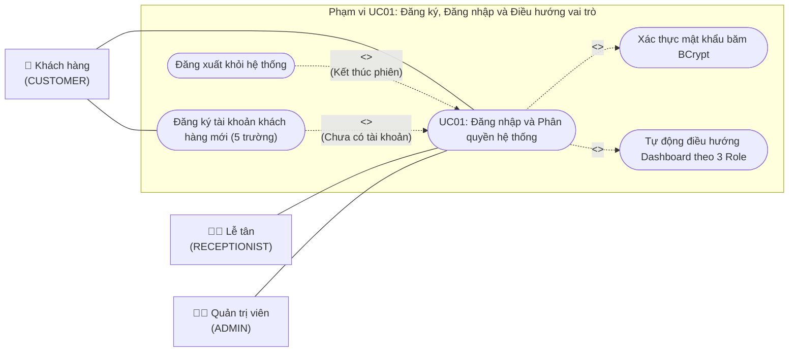
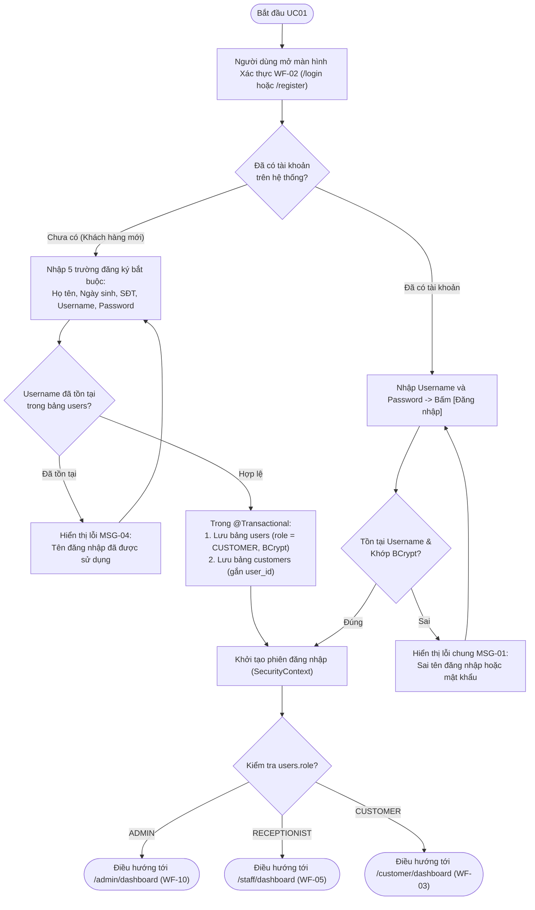
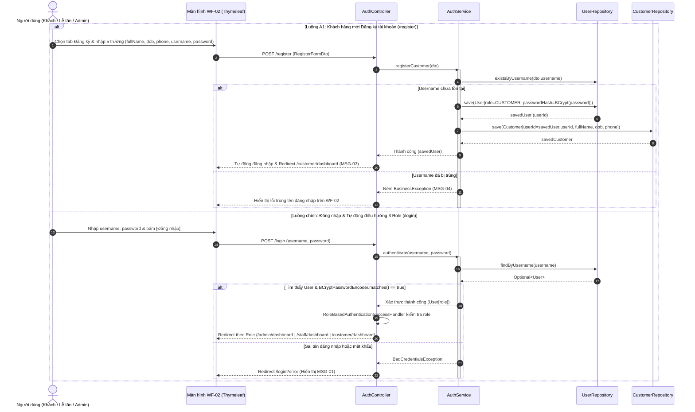
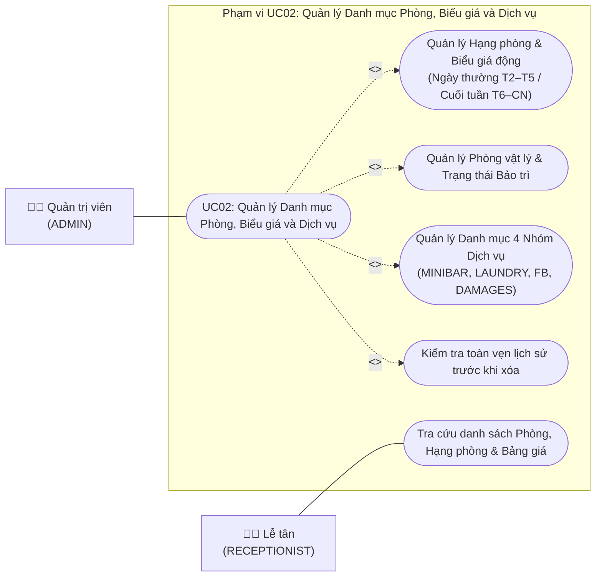
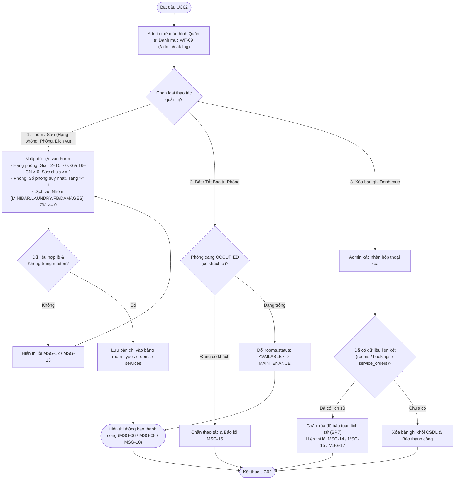
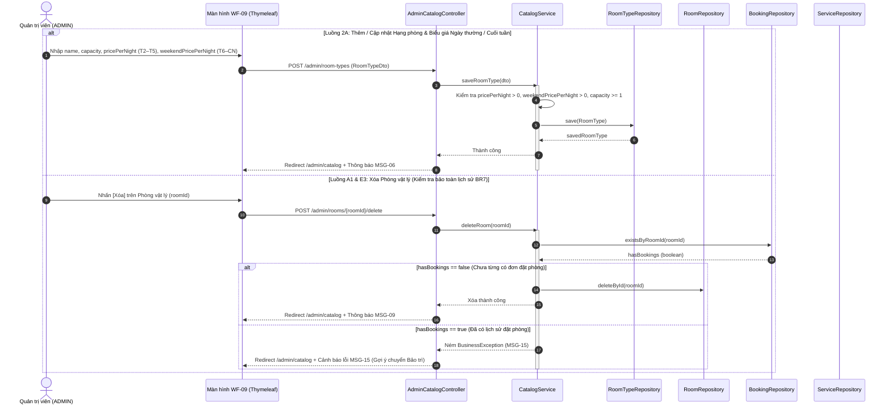

# 09. KHẢO SÁT HIỆN TRẠNG (CHƯƠNG 2), USE CASE TỔNG QUÁT & ĐẶC TẢ CHI TIẾT UC01, UC02 (CHƯƠNG 4)

> **Ánh xạ Báo cáo:**  
> - **Chương 2 (Mục 2.1 – 2.4):** Khảo sát và mô tả hiện trạng *(Phụ trách: Phong)*.  
> - **Chương 4 (Mục 4.1):** Biểu đồ Use Case tổng quát toàn hệ thống *(Phụ trách: Hoàng)*.  
> - **Chương 4 (Mục 4.2.1):** Bộ 3 sơ đồ & Bảng đặc tả `UC01` – Đăng ký, Đăng nhập và Điều hướng vai trò *(Phụ trách: Kiệt)*.  
> - **Chương 4 (Mục 4.2.2):** Bộ 3 sơ đồ & Bảng đặc tả `UC02` – Quản lý Danh mục Phòng, Biểu giá và Dịch vụ *(Phụ trách: Hoàng)*.

---

## 1. Khảo sát và Mô tả Hiện trạng (Chương 2 Báo cáo – Phụ trách: Phong)

### 1.1. Mô tả nghiệp vụ thực tế tại khách sạn vừa và nhỏ (Mục 2.1)
Tại các khách sạn quy mô vừa và nhỏ (từ 10 đến 30 phòng, vận hành một cơ sở độc lập), hoạt động kinh doanh lưu trú diễn ra song song trên hai luồng: (1) Khách hàng tìm hiểu hạng phòng, đặt trước từ xa và chuyển khoản đặt cọc giữ chỗ; (2) Quầy lễ tân trực tiếp đón khách đặt trước đến nhận phòng, tiếp nhận khách vãng lai (*Walk-in*), gán phòng vật lý đang trống sạch, ghi nhận các dịch vụ phát sinh trong thời gian lưu trú (Minibar, giặt ủi, ẩm thực, đền bù thiết bị), quyết toán hóa đơn theo biểu giá cộng thuế phí (`++`) và phối hợp với bộ phận buồng phòng để vệ sinh phòng sau khi khách trả.

### 1.2. Các đối tượng liên quan (Stakeholders) và Tác nhân (Actors) (Mục 2.2)
| Đối tượng | Phân loại trong hệ thống | Vai trò thực tế & Tương tác với hệ thống ACE Hotel |
|---|---|---|
| **Khách hàng (`CUSTOMER`)** | **Tác nhân chính (Phân hệ Public)** | Đăng ký/đăng nhập tài khoản trực tuyến; tra cứu hạng phòng trống theo ngày; đặt phòng theo hạng và thanh toán cọc 30%; nhận Phiếu xác nhận kèm mã QR; xem lịch sử hoặc hủy đơn giữ chỗ trên `/customer/dashboard`. |
| **Nhân viên Lễ tân (`RECEPTIONIST`)** | **Tác nhân chính (Phân hệ PMS)** | Vận hành hằng ngày trên `/staff/dashboard`: quét/nhập mã QR đơn đặt trước để gán phòng vật lý đang trống sạch (`AVAILABLE`); tiếp nhận khách vãng lai (*Walk-in* 0đ cọc); ghi nợ dịch vụ vào *Room Folio*; quyết toán Check-out theo biểu giá `++` và bấm xác nhận phòng đã dọn sạch. |
| **Quản trị viên (`ADMIN`)** | **Tác nhân chính (Phân hệ Backoffice)** | Điều hành trên `/admin/dashboard`: cấu hình hạng phòng, biểu giá ngày thường (Thứ 2–Thứ 5) và cuối tuần (Thứ 6–Chủ Nhật), quản lý phòng vật lý, danh mục 4 nhóm dịch vụ; theo dõi báo cáo doanh thu đa chiều và công suất phòng (`Occupancy Rate`, `ADR`, `RevPAR`). |
| **Bộ phận Buồng phòng (*Housekeeping*)** | **Đối tượng liên quan (Ngoài hệ thống)** | Kiểm tra phòng khi khách báo trả, dọn vệ sinh các phòng đang ở trạng thái chờ dọn (`DIRTY`) và báo lại quầy lễ tân để lễ tân bấm mở khóa phòng về trạng thái sạch (`AVAILABLE`). |
| **Bộ phận Kế toán** | **Đối tượng liên quan (Ngoài hệ thống)** | Đối soát các hóa đơn GTGT (`invoices`), khoản tiền cọc 30%, phí phục vụ (`SVC 5%`), thuế (`VAT 10%`) và bảng tổng hợp doanh thu cuối kỳ từ hệ thống. |

### 1.3. Quy trình nghiệp vụ hiện tại khi chưa chuẩn hóa (Mục 2.3)
1. **Đặt phòng & Giữ chỗ:** Khách nhắn tin hoặc gọi điện hỏi phòng -> Lễ tân dò mắt trên file Excel chia ô theo từng số phòng (101, 102...) -> Gán cứng một số phòng cụ thể ngay từ lúc khách mới hỏi đặt và ghi chú tiền cọc thủ công.
2. **Nhận phòng (Check-in) & Khách vãng lai:** Khi khách đến nhận phòng hoặc có khách Walk-in, lễ tân tìm dòng tên trong sổ, nhiều trường hợp phòng đã gán trước đó khách cũ trả trễ hoặc buồng phòng chưa dọn xong dẫn đến lúng túng phải đổi phòng bằng tay.
3. **Ghi nhận dịch vụ phát sinh:** Khách dùng đồ uống Minibar, gọi đồ ăn hoặc gửi giặt ủi -> Lễ tân ghi tạm vào tờ phiếu giấy kẹp theo ngăn chìa khóa phòng.
4. **Trả phòng (Check-out) & Tính tiền:** Lễ tân bấm máy tính tay cộng tiền phòng (thường nhầm giữa giá ngày thường và giá cuối tuần), cộng các phiếu giấy dịch vụ, nhân nhẩm phí phục vụ 5% và thuế VAT 10%, trừ tiền cọc rồi viết hóa đơn giấy.
5. **Bàn giao dọn phòng:** Lễ tân gọi bộ đàm báo buồng phòng nhưng không có trạng thái khóa phòng trên sổ, dễ dẫn đến lễ tân ca sau xếp khách Walk-in mới vào ngay phòng vừa trả chưa kịp thay drap.

### 1.4. Năm vấn đề và hạn chế cốt lõi cần giải quyết (Mục 2.4)
1. **Bất cập khi gán cứng số phòng từ lúc đặt xa & Dễ trùng lịch (Overbooking):** Việc gán cứng phòng vật lý từ sớm làm giảm tính linh hoạt điều phối; khi nhiều khách đặt cùng lúc trên file Excel rất dễ nhận vượt quá số lượng phòng thực có của hạng phòng đó.
2. **Rủi ro xếp khách mới vào phòng bẩn chưa dọn (`Dirty Room Risk`):** Thiếu trạng thái khóa phòng tự động (`DIRTY`) ngay sau khi Check-out để ngăn lễ tân gán nhầm phòng chưa vệ sinh cho khách mới.
3. **Thất thoát dịch vụ lưu trú & Biến động giá danh mục:** Phiếu giấy ghi dịch vụ dễ thất lạc; hoặc khi quản lý đổi giá dịch vụ thì các đơn cũ chưa thanh toán bị nhảy giá theo nếu không có cơ chế đóng băng đơn giá vào *Room Folio*.
4. **Sai sót khi quyết toán công thức `++` và khấu trừ tiền cọc:** Tính tay dễ nhầm lẫn giữa khách đặt Online (đã cọc 30%, chỉ thu 70% tiền phòng còn lại + dịch vụ) và khách Walk-in (cọc 0đ, phải thu đủ 100%), cũng như sai lệch làm tròn Phí phục vụ 5% (`SVC`) và Thuế GTGT 10% (`VAT`).
5. **Thiếu báo cáo quản trị chuyên sâu:** Quản lý mất nhiều giờ cộng sổ cuối tháng và không đo lường tức thời được các chỉ số chuẩn ngành khách sạn như Tỷ lệ lấp đầy (`Occupancy Rate` – loại trừ phòng bảo trì), Giá bình quân đêm (`ADR`) và Doanh thu trên mỗi phòng khả dụng (`RevPAR`).

---

## 2. Biểu đồ Use Case Tổng quát Toàn Hệ thống (Chương 4, Mục 4.1 – Phụ trách: Hoàng)

*Tên file sơ đồ nộp: `usecase-tong-quat.drawio` / `usecase-tong-quat.png`*

---

## 3. Đặc tả Chi tiết `UC01` – Đăng ký, Đăng nhập và Điều hướng vai trò (Chương 4, Mục 4.2.1 – Phụ trách: Kiệt)

### 3.1. Sơ đồ Use Case chi tiết `UC01` (`uc-01.png`)

### 3.2. Bảng Đặc tả Chi tiết `UC01` (Mẫu chuẩn 9 dòng)
| Hạng mục | Nội dung đặc tả chi tiết |
|---|---|
| **1. Mã & Tên Use Case** | **UC01 – Đăng ký, Đăng nhập và Điều hướng vai trò** |
| **2. Tác nhân (Actors)** | Khách hàng (`CUSTOMER`), Nhân viên Lễ tân (`RECEPTIONIST`), Quản trị viên (`ADMIN`) |
| **3. Mô tả ngắn** | Cho phép khách hàng mới tự đăng ký tài khoản trực tuyến và cho phép cả 3 nhóm người dùng đăng nhập vào hệ thống; sau khi xác thực thành công, hệ thống tự động nhận diện vai trò (`Role`) để chuyển hướng về đúng không gian làm việc tương ứng. |
| **4. Tiền điều kiện** | • Với chức năng Đăng nhập: Tài khoản đã tồn tại trong bảng `users` với mật khẩu lưu dạng băm `BCrypt`. • Với chức năng Đăng ký: Người dùng chưa đăng nhập và truy cập màn hình `/register` (`WF-02`). |
| **5. Hậu điều kiện** | • **Thành công:** Khởi tạo phiên làm việc (`SecurityContext` / `HTTP Session`) và chuyển hướng tới `/customer/dashboard` (`CUSTOMER`), `/staff/dashboard` (`RECEPTIONIST`) hoặc `/admin/dashboard` (`ADMIN`). Nếu đăng ký mới thì thêm 1 bản ghi vào `users` và 1 bản ghi vào `customers`. • **Thất bại:** Không tạo phiên đăng nhập; hiển thị thông báo lỗi tiếng Việt trên màn hình `WF-02`. |
| **6. Yêu cầu & Bảng CSDL** | • Yêu cầu: `FR-01`, `FR-02`, `NFR-02` (BCrypt), `NFR-03` (Server-side RBAC). • Bảng CSDL: `users`, `customers`. Màn hình: `WF-01`, `WF-02`, `WF-03`, `WF-05`, `WF-10`. |
| **7. Luồng sự kiện chính (Đăng nhập & Điều hướng 3 Role)** | 1. Từ trang chủ Storytelling (`WF-01`), người dùng nhấn nút **[Đăng nhập]** để mở màn hình xác thực (`WF-02` – `GET /login`). 2. Hệ thống hiển thị form Đăng nhập gồm `Tên đăng nhập` (`username`), `Mật khẩu` (`password`) và nút **[Đăng nhập hệ thống]**. 3. Người dùng nhập `username`, `password` và nhấn **[Đăng nhập hệ thống]** (`POST /login`). 4. Hệ thống truy vấn bảng `users` theo `username` và kiểm tra mật khẩu bằng `BCryptPasswordEncoder.matches(rawPassword, passwordHash)`. 5. Thông tin hợp lệ, hệ thống lưu thông tin phiên làm việc (`user_id`, `username`, `full_name`, `role`). 6. Bộ xử lý `AuthenticationSuccessHandler` kiểm tra giá trị `users.role` và tự động điều hướng:    • Nếu `role == 'ADMIN'`: chuyển hướng tới `/admin/dashboard` (`WF-10`).    • Nếu `role == 'RECEPTIONIST'`: chuyển hướng tới `/staff/dashboard` (`WF-05`).    • Nếu `role == 'CUSTOMER'`: chuyển hướng tới `/customer/dashboard` (`WF-03`). |
| **8. Luồng sự kiện phụ (Alternative Flows)** | • **A1 – Khách hàng mới Đăng ký tài khoản (`POST /register`):**   1. Tại màn hình `WF-02`, khách hàng chuyển sang tab **Đăng ký khách hàng**.   2. Khách hàng nhập đủ 5 trường bắt buộc: `Họ và tên` (`full_name`), `Ngày sinh` (`date_of_birth`), `Số điện thoại` (`phone`), `Tên đăng nhập` (`username`), `Mật khẩu` (`password`).   3. Hệ thống kiểm tra hợp lệ và trong một `@Transactional` thực hiện: (a) Lưu bản ghi vào bảng `users` với `password_hash = BCrypt(password)`, `role = 'CUSTOMER'`; (b) Lưu bản ghi vào bảng `customers` liên kết khóa ngoại `user_id` vừa tạo.   4. Hệ thống tự động đăng nhập và chuyển khách hàng vào `/customer/dashboard` (`WF-03`) kèm thông báo `MSG-03`. • **A2 – Đăng xuất (`POST /logout`):** Người dùng nhấn **[Đăng xuất]**, hệ thống hủy phiên làm việc và chuyển về trang chủ `/` (`MSG-02`). |
| **9. Luồng ngoại lệ (Exception Flows)** | • **E1 – Sai tên đăng nhập hoặc mật khẩu:** Tại bước 4, nếu không tìm thấy `username` hoặc mật khẩu không khớp, hệ thống giữ nguyên tại `/login` và hiển thị thông báo chung `MSG-01`: *"Sai tên đăng nhập hoặc mật khẩu."* • **E2 – Trùng tên đăng nhập khi Đăng ký:** Tại luồng phụ A1, nếu `username` đã tồn tại trong bảng `users`, hệ thống từ chối tạo mới và báo lỗi `MSG-04`: *"Tên đăng nhập này đã được sử dụng. Vui lòng chọn tên khác."* • **E3 – Truy cập trái quyền giữa các phân hệ (`403 Forbidden`):** Nếu người dùng cố tình gõ URL không thuộc quyền của mình (ví dụ `CUSTOMER` gõ `/staff/**` hoặc `RECEPTIONIST` gõ `/admin/**`), bộ lọc bảo mật phía máy chủ chặn ngay với mã lỗi `403` và thông báo `MSG-05`. |

### 3.3. Biểu đồ Hoạt động `Activity Diagram UC01` (`act-uc01.png`)

### 3.4. Biểu đồ Tuần tự `Sequence Diagram UC01` (`seq-uc01.png`)

---

## 4. Đặc tả Chi tiết `UC02` – Quản lý Danh mục Phòng, Biểu giá và Dịch vụ (Chương 4, Mục 4.2.2 – Phụ trách: Hoàng)

### 4.1. Sơ đồ Use Case chi tiết `UC02` (`uc-02.png`)

### 4.2. Bảng Đặc tả Chi tiết `UC02` (Mẫu chuẩn 9 dòng)
| Hạng mục | Nội dung đặc tả chi tiết |
|---|---|
| **1. Mã & Tên Use Case** | **UC02 – Quản lý Danh mục Phòng, Biểu giá và Dịch vụ** |
| **2. Tác nhân (Actors)** | **Quản trị viên (`ADMIN`):** Toàn quyền Thêm, Sửa, Xóa, Cấu hình biểu giá và Đổi trạng thái bảo trì. **Nhân viên Lễ tân (`RECEPTIONIST`):** Chỉ có quyền Xem và Lọc danh sách phòng, hạng phòng và bảng giá dịch vụ. |
| **3. Mô tả ngắn** | Cho phép Quản trị viên thiết lập danh mục Hạng phòng (kèm 2 mức giá Ngày thường Thứ 2–Thứ 5 và Cuối tuần Thứ 6–Chủ Nhật), quản lý danh sách Phòng vật lý cụ thể và quản lý bảng giá 4 nhóm Dịch vụ lưu trú, đồng thời bảo vệ dữ liệu lịch sử không bị xóa nhầm. |
| **4. Tiền điều kiện** | Người dùng đã đăng nhập với vai trò `ADMIN` (`UC01`) và truy cập màn hình Quản trị danh mục (`WF-09`). |
| **5. Hậu điều kiện** | Dữ liệu trong các bảng `room_types`, `rooms`, `services` được cập nhật chính xác; không làm gãy khóa ngoại của các bảng giao dịch (`bookings`, `service_orders`). |
| **6. Yêu cầu & Bảng CSDL** | • Yêu cầu: `FR-03`, `FR-04`, `FR-05`, `BR7`, `NFR-04`. • Bảng CSDL: `room_types`, `rooms`, `services`, `bookings`, `service_orders`. Màn hình: `WF-09`. |
| **7. Luồng sự kiện chính (Main Success Scenarios)** | • **Luồng 2A – Quản lý Hạng phòng & Biểu giá linh hoạt (`room_types`):**   1. Admin mở tab **Hạng phòng & Giá** trên màn hình `WF-09` (`GET /admin/room-types`).   2. Admin nhập thông tin thêm mới hoặc cập nhật: `Tên hạng phòng` (`name` duy nhất), `Sức chứa tối đa` (`capacity >= 1`), `Giá ngày thường T2–T5` (`price_per_night > 0`), `Giá cuối tuần T6–CN` (`weekend_price_per_night > 0`), `Mô tả` (`description`).   3. Hệ thống kiểm tra hợp lệ, lưu bản ghi vào bảng `room_types` và hiển thị thông báo `MSG-06`. • **Luồng 2B – Quản lý Phòng vật lý & Bảo trì (`rooms`):**   1. Admin mở tab **Phòng vật lý** (`GET /admin/rooms`), nhập `Số phòng` (`room_number` duy nhất), `Tầng` (`floor >= 1`), chọn `Hạng phòng` (`room_type_id`) và trạng thái ban đầu (`AVAILABLE` hoặc `MAINTENANCE`).   2. Hệ thống kiểm tra không trùng `room_number`, lưu vào bảng `rooms` và thông báo `MSG-08`.   3. Khi phòng đang `AVAILABLE` bị hỏng thiết bị, Admin bấm nút **[Chuyển Bảo trì]** để đổi `rooms.status` sang `MAINTENANCE` (hoặc bấm **[Mở lại phòng]** để đưa về `AVAILABLE`). • **Luồng 2C – Quản lý Danh mục 4 Nhóm Dịch vụ (`services`):**   1. Admin mở tab **Danh mục dịch vụ** (`GET /admin/services`), nhập `Tên dịch vụ` (`name`), chọn `Nhóm dịch vụ` (`category` thuộc `MINIBAR`, `LAUNDRY`, `FB`, `DAMAGES`), `Đơn giá` (`unit_price >= 0`) và `Đơn vị tính` (`unit`).   2. Hệ thống lưu vào bảng `services` và hiển thị thông báo `MSG-10`. |
| **8. Luồng sự kiện phụ (Alternative Flows)** | • **A1 – Xóa Hạng phòng, Phòng vật lý hoặc Dịch vụ chưa phát sinh giao dịch:**   1. Admin nhấn nút **[Xóa]** trên một bản ghi danh mục và xác nhận hộp thoại.   2. Hệ thống kiểm tra bản ghi đó chưa từng có dữ liệu con liên kết (`rooms` / `bookings` / `service_orders`).   3. Hệ thống thực hiện xóa vật lý khỏi CSDL và hiển thị thông báo xóa thành công (`MSG-07`, `MSG-09`, `MSG-11`). |
| **9. Luồng ngoại lệ (Exception Flows)** | • **E1 – Dữ liệu nhập không hợp lệ (Trùng tên/số phòng, giá <= 0, sức chứa < 1):** Hệ thống chặn lưu và báo lỗi dưới trường tương ứng (`MSG-12`, `MSG-13`). • **E2 – Chặn xóa Hạng phòng đang có phòng vật lý hoặc đơn đặt (`BR7`):** Nếu `roomRepository.existsByRoomTypeId(id)` hoặc `bookingRepository.existsByRoomTypeId(id)` là `true`, hệ thống từ chối xóa và báo lỗi `MSG-14`. • **E3 – Chặn xóa Phòng vật lý đã từng có lịch sử đặt phòng (`BR7`):** Nếu `bookingRepository.existsByRoomId(id)` là `true`, hệ thống chặn xóa và báo lỗi `MSG-15` (hướng dẫn Admin chuyển sang `MAINTENANCE`). • **E4 – Chặn chuyển Bảo trì khi phòng đang có khách (`OCCUPIED`):** Hệ thống từ chối và báo lỗi `MSG-16`. • **E5 – Chặn xóa Dịch vụ đã phát sinh trong Room Folio (`BR7`):** Nếu `serviceOrderRepository.existsByServiceId(id)` là `true`, hệ thống chặn xóa và báo lỗi `MSG-17`. |

### 4.3. Biểu đồ Hoạt động `Activity Diagram UC02` (`act-uc02.png`)

### 4.4. Biểu đồ Tuần tự `Sequence Diagram UC02` (`seq-uc02.png`)
