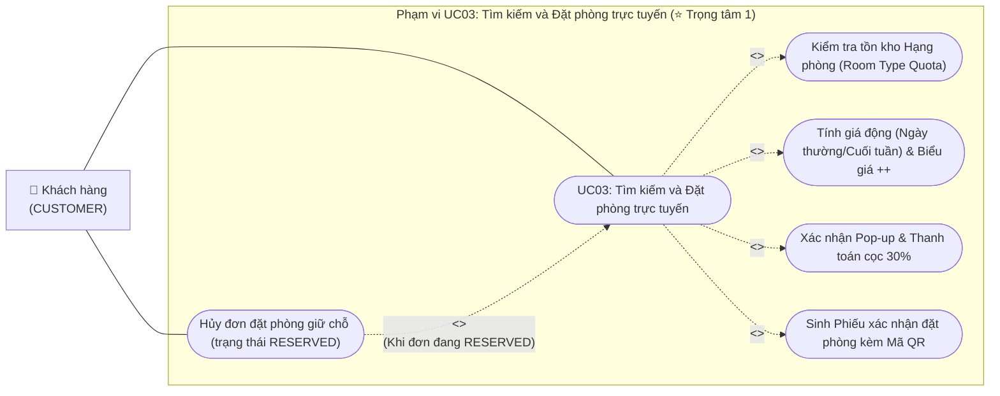
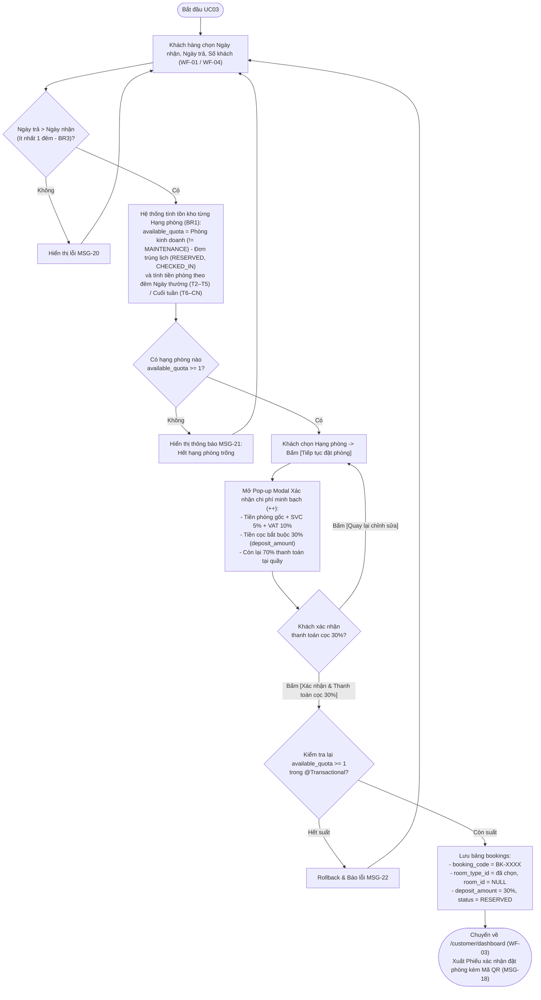
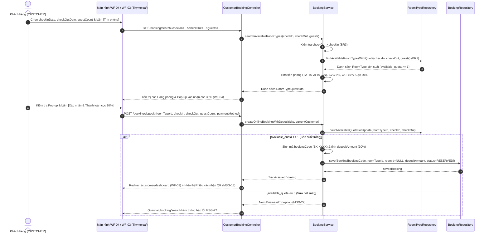
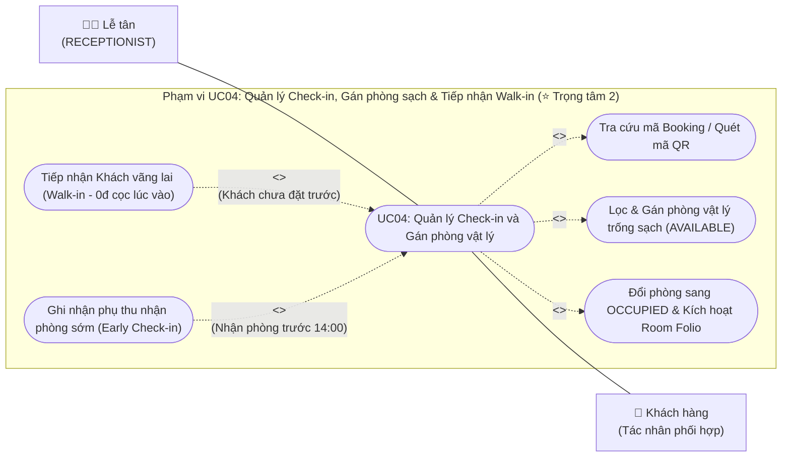
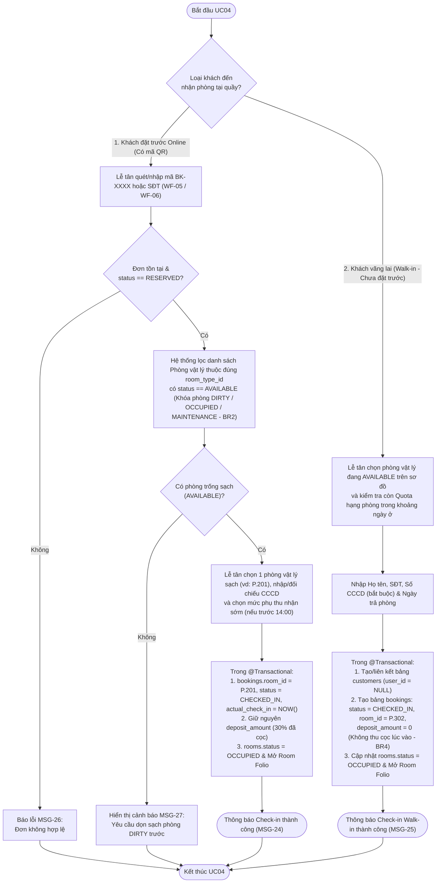
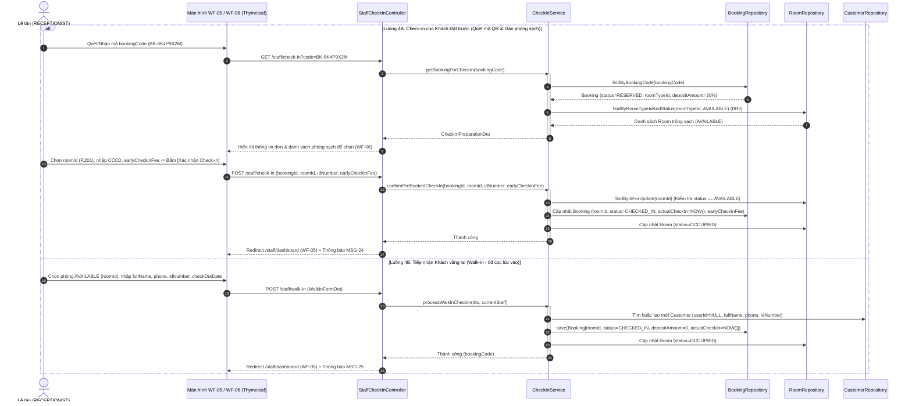
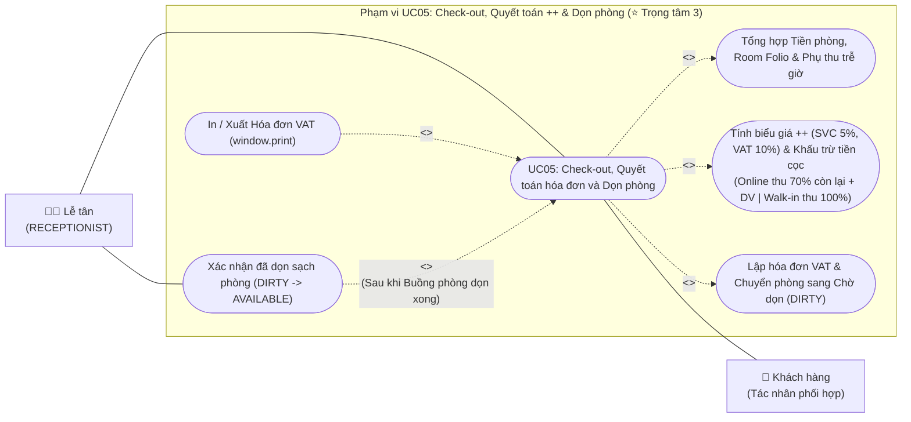
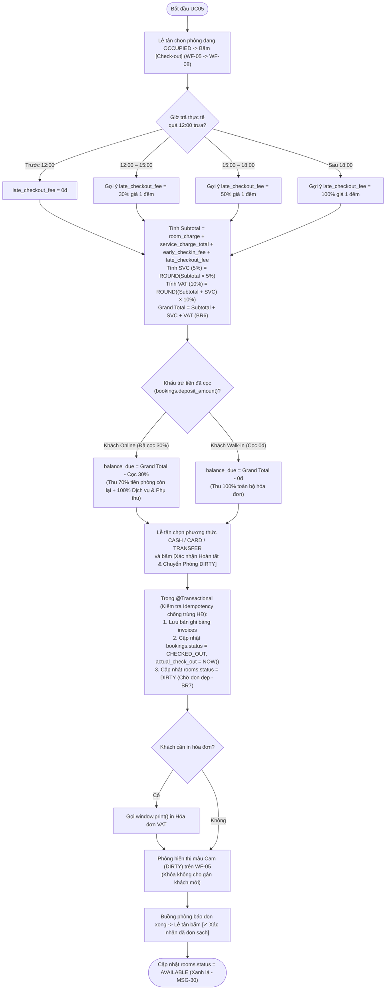

# 10. ĐẶC TẢ CHI TIẾT & BỘ SƠ ĐỒ UML CHO UC03 (ĐẶT PHÒNG ONLINE), UC04 (CHECK-IN & WALK-IN), UC05 (CHECK-OUT ++ & DỌN PHÒNG)

> **Ánh xạ Báo cáo:**  
> - **Chương 4 (Mục 4.2.3):** Bộ 3 sơ đồ & Bảng đặc tả `UC03` – Tìm kiếm và Đặt phòng trực tuyến *(Phụ trách: Hoàng – ⭐ Trọng tâm 1)*.  
> - **Chương 4 (Mục 4.2.4):** Bộ 3 sơ đồ & Bảng đặc tả `UC04` – Quản lý Check-in, Gán phòng sạch và Tiếp nhận Walk-in *(Phụ trách: Phong – ⭐ Trọng tâm 2)*.  
> - **Chương 4 (Mục 4.2.5):** Bộ 3 sơ đồ & Bảng đặc tả `UC05` – Check-out, Quyết toán hóa đơn biểu giá `++` và Dọn phòng *(Phụ trách: Phong – ⭐ Trọng tâm 3)*.

---

## 1. Đặc tả Chi tiết `UC03` – Tìm kiếm và Đặt phòng trực tuyến (Chương 4, Mục 4.2.3 – Phụ trách: Hoàng)

### 1.1. Sơ đồ Use Case chi tiết `UC03` (`uc-03.png`)


### 1.2. Bảng Đặc tả Chi tiết `UC03` (Mẫu chuẩn 9 dòng)
| Hạng mục | Nội dung đặc tả chi tiết |
|---|---|
| **1. Mã & Tên Use Case** | **UC03 – Tìm kiếm và Đặt phòng trực tuyến (Theo Hạng phòng, Đặt cọc 30% & Mã QR)** |
| **2. Tác nhân (Actors)** | Khách hàng (`CUSTOMER`) |
| **3. Mô tả ngắn** | Khách hàng tra cứu các Hạng phòng còn suất trống theo khoảng ngày dựa trên tồn kho hạng phòng (*Quota*), xem bảng tính giá động (ngày thường/cuối tuần) theo công thức `++` trong Pop-up xác nhận, thanh toán **tiền cọc 30%** để giữ chỗ (`RESERVED`, chưa gán phòng vật lý) và nhận **Phiếu xác nhận đặt phòng kèm mã QR**. |
| **4. Tiền điều kiện** | Khách hàng đã đăng nhập tài khoản (`role = 'CUSTOMER'`); CSDL đã có danh mục `room_types` và `rooms`. |
| **5. Hậu điều kiện** | • **Đặt phòng thành công:** Thêm 1 bản ghi vào bảng `bookings` với mã `booking_code` (`BK-XXXX`), `room_type_id` đã chọn, **`room_id = NULL`**, `deposit_amount` bằng 30% tổng gói phòng ước tính (`++`), `status = 'RESERVED'`; hiển thị Phiếu xác nhận QR trên `/customer/dashboard`.<br>• **Hủy đơn thành công:** Bản ghi `bookings` chuyển từ `RESERVED` sang `CANCELLED`, trả lại 1 suất Quota cho hạng phòng. |
| **6. Yêu cầu & Bảng CSDL** | • Yêu cầu: `FR-06`, `FR-07`, `FR-08`, `FR-09`, `BR1`, `BR3`, `BR4`, `BR6`.<br>• Bảng CSDL: `room_types`, `rooms`, `bookings`, `customers`. Màn hình: `WF-01`, `WF-04`, `WF-03`. |
| **7. Luồng sự kiện chính (Đặt phòng Online & Cọc 30%)** | 1. Từ trang chủ (`WF-01`) hoặc Dashboard Khách hàng (`WF-03`), khách chọn `Ngày nhận phòng` (`check_in_date`), `Ngày trả phòng` (`check_out_date`), `Số lượng khách` (`guest_count`) và nhấn **[Tìm hạng phòng trống]** (`GET /booking/search` – `WF-04`).<br>2. Hệ thống kiểm tra `check_out_date > check_in_date` (`BR3`) và tính số suất phòng còn trống (`available_quota`) cho từng hạng phòng có `capacity >= guest_count` (`BR1`):<br>   `available_quota = COUNT(rooms != 'MAINTENANCE') - COUNT(bookings IN ('RESERVED','CHECKED_IN') giao khoảng ngày)`.<br>3. Hệ thống hiển thị các hạng phòng có `available_quota >= 1` kèm giá tiền phòng gốc được tính tự động theo từng đêm (đêm Thứ 2–Thứ 5 áp giá `price_per_night`, đêm Thứ 6–Chủ Nhật áp giá `weekend_price_per_night`).<br>4. Khách hàng nhấn **[Tiếp tục đặt phòng]** ở hạng phòng mong muốn -> Hệ thống mở **Pop-up Modal Xác nhận thông tin đặt phòng** hiển thị minh bạch:<br>   • `Tiền phòng gốc (room_charge)`<br>   • `Phí phục vụ ước tính (SVC 5%) = ROUND(room_charge × 5%)`<br>   • `Thuế GTGT ước tính (VAT 10%) = ROUND((room_charge + SVC) × 10%)`<br>   • `Tổng giá trị gói phòng (++) = room_charge + SVC + VAT`<br>   • **`Mức cọc 30% cần thanh toán ngay (deposit_amount) = ROUND(Tổng gói phòng × 30%)`**<br>   • `Số tiền còn lại thanh toán tại quầy khi trả phòng (70%) = Tổng gói phòng - deposit_amount`.<br>5. Khách chọn phương thức thanh toán cọc (VietQR / Thẻ) và nhấn **[Xác nhận & Thanh toán cọc 30%]** (`POST /booking/deposit`).<br>6. Trong một `@Transactional`, hệ thống kiểm tra lại `available_quota >= 1`, sinh mã `booking_code` duy nhất (ví dụ `BK-8K4P9X2M`) và lưu bản ghi `bookings` với `room_id = NULL`, `status = 'RESERVED'`, `deposit_amount` = cọc 30%.<br>7. Hệ thống chuyển hướng về `/customer/dashboard` (`WF-03`), hiển thị **Phiếu xác nhận đặt phòng kèm Mã QR** và thông báo `MSG-18`. |
| **8. Luồng sự kiện phụ (Alternative Flows)** | • **A1 – Quay lại chỉnh sửa từ Pop-up xác nhận:** Tại bước 4, khách nhấn `[Quay lại chỉnh sửa]`, hệ thống đóng Pop-up và giữ nguyên dữ liệu tìm kiếm.<br>• **A2 – Hủy đơn đặt phòng giữ chỗ (`POST /customer/bookings/{id}/cancel`):** Tại `WF-03`, khách nhấn **[Hủy đơn]** trên đơn đang ở trạng thái `RESERVED` và xác nhận hộp thoại -> Hệ thống đổi `bookings.status = 'CANCELLED'` (`MSG-19`), giải phóng suất phòng. |
| **9. Luồng ngoại lệ (Exception Flows)** | • **E1 – Ngày trả không sau ngày nhận ít nhất 1 đêm (`BR3`):** Báo lỗi `MSG-20`: *"Ngày trả phòng phải sau ngày nhận phòng ít nhất 1 đêm."*<br>• **E2 – Hết suất hạng phòng trống trong khoảng ngày chọn:** Hiển thị thông báo `MSG-21`: *"Không còn hạng phòng trống phù hợp trong khoảng ngày đã chọn."*<br>• **E3 – Hết suất trống ngay lúc bấm xác nhận thanh toán cọc (Race Condition):** Hệ thống hủy giao dịch (`Rollback`) và báo lỗi `MSG-22`: *"Hạng phòng này vừa hết suất trống. Vui lòng chọn hạng phòng hoặc ngày khác."*<br>• **E4 – Hủy đơn không còn ở trạng thái `RESERVED`:** Báo lỗi `MSG-23`. |

### 1.3. Biểu đồ Hoạt động `Activity Diagram UC03` (`act-uc03.png`)


### 1.4. Biểu đồ Tuần tự `Sequence Diagram UC03` (`seq-uc03.png`)


---

## 2. Đặc tả Chi tiết `UC04` – Quản lý Check-in, Gán phòng sạch & Tiếp nhận Walk-in (Chương 4, Mục 4.2.4 – Phụ trách: Phong)

### 2.1. Sơ đồ Use Case chi tiết `UC04` (`uc-04.png`)


### 2.2. Bảng Đặc tả Chi tiết `UC04` (Mẫu chuẩn 9 dòng)
| Hạng mục | Nội dung đặc tả chi tiết |
|---|---|
| **1. Mã & Tên Use Case** | **UC04 – Quản lý Check-in, Gán phòng vật lý sạch và Tiếp nhận Khách vãng lai (Walk-in)** |
| **2. Tác nhân (Actors)** | **Chính:** Nhân viên Lễ tân (`RECEPTIONIST`), Quản trị viên (`ADMIN`). **Phối hợp:** Khách hàng. |
| **3. Mô tả ngắn** | Lễ tân tiếp nhận khách đặt trước qua mã QR/mã Booking để gán một phòng vật lý cụ thể đang ở trạng thái trống sạch (`AVAILABLE`), hoặc tiếp nhận trực tiếp khách vãng lai (*Walk-in*) nhận phòng ngay với **tiền cọc `0đ` lúc vào** (thanh toán 100% khi trả phòng); hệ thống chuyển phòng sang `OCCUPIED` và mở sổ *Room Folio*. |
| **4. Tiền điều kiện** | Nhân viên đã đăng nhập (`/staff/dashboard` – `WF-05`); khách sạn có ít nhất 1 phòng vật lý thuộc hạng phòng tương ứng đang ở trạng thái **`AVAILABLE` (Trống & Đã dọn sạch)** (`BR2`). |
| **5. Hậu điều kiện** | • Bản ghi `bookings` được gán `room_id` cụ thể, `status = 'CHECKED_IN'`, `actual_check_in = CURRENT_TIMESTAMP`, ghi nhận `early_checkin_fee` (nếu có).<br>• Bản ghi `rooms` chuyển từ `AVAILABLE` sang **`OCCUPIED`**.<br>• Khởi tạo sổ cái **Room Folio** sẵn sàng ghi nhận dịch vụ lưu trú. |
| **6. Yêu cầu & Bảng CSDL** | • Yêu cầu: `FR-10`, `FR-11`, `BR2`, `BR4`.<br>• Bảng CSDL: `bookings`, `rooms`, `customers`, `room_types`. Màn hình: `WF-05`, `WF-06`. |
| **7. Luồng sự kiện chính (4A – Check-in cho Khách Đặt trước đã cọc 30%)** | 1. Khách hàng xuất trình Phiếu xác nhận đặt phòng có mã QR tại quầy lễ tân.<br>2. Trên `/staff/dashboard` (`WF-05`), Lễ tân quét mã QR hoặc nhập `booking_code` (`BK-XXXX`) / SĐT khách để mở màn hình Check-in (`WF-06` – `GET /staff/check-in`).<br>3. Hệ thống hiển thị thông tin đơn đặt (`status = 'RESERVED'`), hạng phòng đã đặt (`room_type_id`), số tiền cọc 30% đã thanh toán (`deposit_amount`) và số tiền 70% còn lại sẽ thu lúc Check-out.<br>4. Hệ thống tự động truy vấn danh sách các phòng vật lý thuộc đúng `room_type_id` đang có **`rooms.status = 'AVAILABLE'`** (`BR2` – khóa hoàn toàn các phòng `DIRTY`, `OCCUPIED`, `MAINTENANCE`).<br>5. Lễ tân chọn 1 phòng vật lý sạch (ví dụ `P.201`), đối chiếu và cập nhật số CCCD/Passport (`id_number`) của khách.<br>6. Nếu khách nhận phòng sớm trước `14:00`, hệ thống gợi ý mức phụ thu `early_checkin_fee` (Trước 06h: 100%; 06h–09h: 50%; 09h–14h: 30% hoặc Lễ tân chọn miễn phí ưu đãi `0đ`).<br>7. Lễ tân nhấn **[Xác nhận Check-in & Giao chìa khóa]** (`POST /staff/check-in`).<br>8. Trong một `@Transactional`, hệ thống cập nhật `bookings.room_id = 201`, `bookings.status = 'CHECKED_IN'`, `actual_check_in = NOW()`, cập nhật `rooms.status = 'OCCUPIED'` và thông báo `MSG-24`. |
| **8. Luồng sự kiện phụ (4B – Tiếp nhận Khách vãng lai Walk-in 0đ cọc)** | 1. Khách vãng lai đến trực tiếp quầy -> Lễ tân chọn tab **Khách vãng lai (Walk-in)** trên `WF-06` (hoặc bấm vào thẻ phòng `AVAILABLE` trên sơ đồ `WF-05`).<br>2. Lễ tân chọn phòng vật lý đang `AVAILABLE` (hệ thống kiểm tra hạng phòng còn đủ Quota cho khoảng ngày khách ở), nhập thông tin khách (`full_name`, `phone`, `id_number` CCCD bắt buộc) và `check_out_date`.<br>3. Lễ tân nhấn **[Hoàn tất Check-in Walk-in]** (`POST /staff/walk-in`).<br>4. Trong một `@Transactional`, hệ thống tạo hồ sơ `customers` (`user_id = NULL`, `date_of_birth = NULL`), tạo bản ghi `bookings` với **`deposit_amount = 0`** (không thu cọc lúc vào, khách sẽ thanh toán 100% lúc Check-out), `status = 'CHECKED_IN'`, gán `room_id`, đổi `rooms.status = 'OCCUPIED'` và thông báo `MSG-25`. |
| **9. Luồng ngoại lệ (Exception Flows)** | • **E1 – Mã Booking không tồn tại hoặc không ở trạng thái `RESERVED`:** Báo lỗi `MSG-26`.<br>• **E2 – Chưa có phòng vật lý nào dọn sạch (`AVAILABLE`) thuộc hạng phòng đó:** Hệ thống cảnh báo `MSG-27`: *"Hiện chưa có phòng vật lý nào thuộc hạng phòng này ở trạng thái Trống sạch (AVAILABLE). Vui lòng xác nhận dọn sạch phòng DIRTY trước khi gán."*<br>• **E3 – Phòng vừa bị lễ tân khác gán mất:** Hủy giao dịch và yêu cầu chọn lại phòng sạch khác (`MSG-28`). |

### 2.3. Biểu đồ Hoạt động `Activity Diagram UC04` (`act-uc04.png`)


### 2.4. Biểu đồ Tuần tự `Sequence Diagram UC04` (`seq-uc04.png`)


---

## 3. Đặc tả Chi tiết `UC05` – Check-out, Quyết toán `++` & Dọn phòng (Chương 4, Mục 4.2.5 – Phụ trách: Phong)

### 3.1. Sơ đồ Use Case chi tiết `UC05` (`uc-05.png`)


### 3.2. Bảng Đặc tả Chi tiết `UC05` (Mẫu chuẩn 9 dòng)
| Hạng mục | Nội dung đặc tả chi tiết |
|---|---|
| **1. Mã & Tên Use Case** | **UC05 – Check-out, Quyết toán hóa đơn biểu giá `++` và Chuyển trạng thái dọn phòng (`DIRTY`)** |
| **2. Tác nhân (Actors)** | **Chính:** Nhân viên Lễ tân (`RECEPTIONIST`), Quản trị viên (`ADMIN`). **Phối hợp:** Khách hàng. |
| **3. Mô tả ngắn** | Khi khách trả phòng, hệ thống tự động tổng hợp tiền phòng, tổng dịch vụ trong *Room Folio*, phụ thu nhận sớm/trả trễ, tính **Phí phục vụ 5% (`SVC`)** và **Thuế GTGT 10% (`VAT`)**, sau đó **khấu trừ số tiền đã cọc** (Khách Online thanh toán 70% tiền phòng còn lại + dịch vụ/phụ thu; Khách Walk-in thanh toán 100% toàn bộ hóa đơn), lập hóa đơn VAT và tự động chuyển phòng sang trạng thái **`DIRTY` (Chờ dọn dẹp)**. |
| **4. Tiền điều kiện** | Đơn đặt phòng đang ở trạng thái `CHECKED_IN` và chưa tồn tại hóa đơn trong bảng `invoices`. |
| **5. Hậu điều kiện** | • Tạo 1 bản ghi trong bảng `invoices` (1–1 với `bookings`).<br>• Bản ghi `bookings` chuyển sang `CHECKED_OUT`, ghi nhận `actual_check_out = CURRENT_TIMESTAMP`.<br>• Bản ghi `rooms` tự động chuyển từ `OCCUPIED` sang **`DIRTY`** (màu cam); sau khi dọn xong và Lễ tân bấm xác nhận, `rooms` chuyển về **`AVAILABLE`**. |
| **6. Yêu cầu & Bảng CSDL** | • Yêu cầu: `FR-13`, `FR-14`, `FR-15`, `BR4`, `BR6`, `BR7`.<br>• Bảng CSDL: `bookings`, `service_orders`, `invoices`, `rooms`. Màn hình: `WF-08`, `WF-05`. |
| **7. Luồng sự kiện chính (Check-out, Quyết toán `++` & Chuyển `DIRTY`)** | 1. Trên `/staff/dashboard` (`WF-05`), Lễ tân chọn phòng đang ở (`OCCUPIED` / `CHECKED_IN`) và nhấn **[Trả phòng (Check-out)]** để mở màn hình quyết toán (`WF-08` – `GET /staff/bookings/{id}/check-out`).<br>2. Hệ thống đối chiếu giờ hiện tại với mốc `12:00` trưa của ngày trả phòng để gợi ý phụ thu trả trễ `late_checkout_fee` (Trước 12h: `0%`; 12h–15h: `30%`; 15h–18h: `50%`; sau 18h: `100%` giá 1 đêm).<br>3. Hệ thống tự động tính toán bảng kê quyết toán tuần tự theo kiểu số nguyên `BIGINT` (`BR6`):<br>   • `subtotal = room_charge + service_charge_total + early_checkin_fee + late_checkout_fee`<br>   • `service_charge_amount (SVC 5%) = ROUND(subtotal × 0.05)`<br>   • `vat_amount (VAT 10%) = ROUND((subtotal + service_charge_amount) × 0.10)`<br>   • `grand_total = subtotal + service_charge_amount + vat_amount`<br>   • `deposit_deducted = bookings.deposit_amount`<br>   • **`balance_due (Thực thu tại quầy) = grand_total - deposit_deducted`**:<br>     - Với **Khách Online** (đã cọc 30%): chỉ thu **70% tiền phòng còn lại + 100% dịch vụ & phụ thu**.<br>     - Với **Khách Walk-in** (cọc `0đ`): thu **100% toàn bộ `grand_total`**.<br>4. Lễ tân thông báo số tiền `balance_due` cho khách, thu tiền qua Tiền mặt (`CASH`), Thẻ (`CARD`) hoặc Chuyển khoản (`TRANSFER`) và nhấn **[Xác nhận Hoàn tất & Chuyển Phòng DIRTY]** (`POST /staff/bookings/{id}/check-out`).<br>5. Trong một `@Transactional`, hệ thống lưu bản ghi `invoices`, cập nhật `bookings.status = 'CHECKED_OUT'`, `actual_check_out = NOW()`, và đổi **`rooms.status = 'DIRTY'`** (`BR7`, `MSG-29`). |
| **8. Luồng sự kiện phụ (Alternative Flows)** | • **A1 – In Hóa đơn VAT (`window.print()`):** Tại màn hình Hóa đơn (`WF-08`), Lễ tân nhấn **[In Hóa đơn VAT]** để in phiếu thu hoặc xuất PDF cho khách.<br>• **A2 – Xác nhận đã dọn sạch phòng (`POST /staff/rooms/{id}/clean`):** Khi nhân viên buồng phòng báo đã dọn xong phòng `DIRTY`, Lễ tân bấm nút **[✓ Xác nhận đã dọn sạch]** ngay trên thẻ phòng màu cam tại `WF-05` -> Hệ thống đổi `rooms.status = 'AVAILABLE'` (màu xanh lá, `MSG-30`), mở khóa phòng để đón khách mới. |
| **9. Luồng ngoại lệ (Exception Flows)** | • **E1 – Bấm nút xác nhận thanh toán 2 lần liên tiếp (Double Submit / Idempotency):** Hệ thống kiểm tra `invoiceRepository.findByBookingId(bookingId)`, nếu đã có hóa đơn thì không tạo bản ghi thứ hai mà chuyển thẳng tới trang xem hóa đơn đó.<br>• **E2 – Đơn đặt phòng không ở trạng thái `CHECKED_IN`:** Chặn thao tác và báo lỗi `MSG-31`. |

### 3.3. Biểu đồ Hoạt động `Activity Diagram UC05` (`act-uc05.png`)


### 3.4. Biểu đồ Tuần tự `Sequence Diagram UC05` (`seq-uc05.png`)
```mermaid
sequenceDiagram
    autonumber
    actor LT as Lễ tân (RECEPTIONIST)
    participant UI as Màn hình WF-08 / WF-05 (Thymeleaf)
    participant COC as StaffCheckOutController
    participant COS as CheckOutService
    participant SOR as ServiceOrderRepository
    participant IR as InvoiceRepository
    participant BR as BookingRepository
    participant RR as RoomRepository

    LT->>UI: Nhấn [Check-out] trên phòng đang OCCUPIED (bookingId)
    UI->>COC: GET /staff/bookings/{id}/check-out
    COC->>COS: prepareCheckOutSummary(bookingId)
    activate COS
    COS->>BR: findById(bookingId)
    COS->>SOR: findByBookingId(bookingId)
    SOR-->>COS: Danh sách ServiceOrder (Room Folio)
    COS->>COS: Gợi ý lateCheckoutFee; tính Subtotal, SVC 5%, VAT 10%, GrandTotal
    COS->>COS: Tính balanceDue = GrandTotal - booking.depositAmount (Online 30% vs Walk-in 0đ)
    COS-->>COC: CheckOutSummaryDto
    deactivate COS
    COC-->>UI: Hiển thị bảng kê quyết toán ++ & số tiền thực thu balanceDue (WF-08)

    LT->>UI: Chọn paymentMethod (CASH/CARD/TRANSFER) & bấm [Xác nhận Hoàn tất]
    UI->>COC: POST /staff/bookings/{id}/check-out (paymentMethod, lateCheckoutFee)
    COC->>COS: confirmCheckOutAndPay(bookingId, paymentMethod, lateCheckoutFee, currentStaff)
    activate COS
    COS->>IR: findByBookingId(bookingId) (Kiểm tra Idempotency)
    alt Chưa có hóa đơn
        COS->>IR: save(Invoice[roomCharge, serviceChargeTotal, subtotal, svc, vat, grandTotal, depositDeducted, balanceDue])
        COS->>BR: Cập nhật Booking (status=CHECKED_OUT, actualCheckOut=NOW())
        COS->>RR: Cập nhật Room (status=DIRTY) (BR7)
        COS-->>COC: invoiceId
        COC-->>UI: Hiển thị Hóa đơn VAT (WF-08) + Thông báo MSG-29
    else Đã có hóa đơn (Double submit)
        COS-->>COC: existingInvoiceId
        COC-->>UI: Hiển thị Hóa đơn hiện có
    end
    deactivate COS

    opt Luồng phụ A2: Buồng phòng báo dọn xong -> Lễ tân xác nhận phòng sạch
        LT->>UI: Bấm nút [✓ Xác nhận đã dọn sạch] trên thẻ phòng DIRTY (WF-05)
        UI->>COC: POST /staff/rooms/{roomId}/clean
        COC->>COS: markRoomAsClean(roomId)
        COS->>RR: Cập nhật Room (status=AVAILABLE)
        COC-->>UI: Redirect /staff/dashboard (Thẻ phòng chuyển sang Xanh lá AVAILABLE - MSG-30)
    end
```