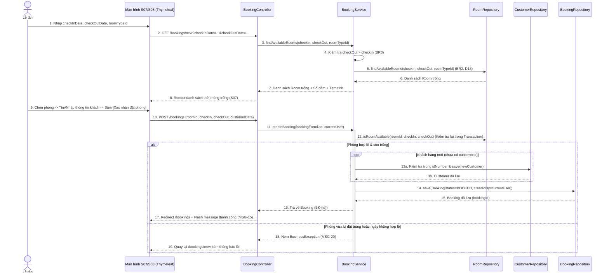
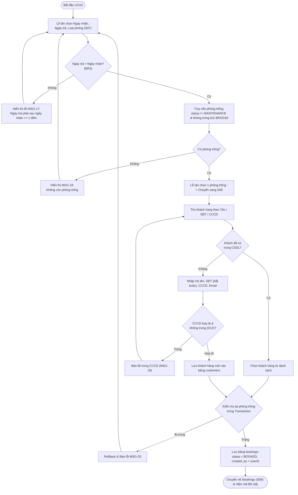
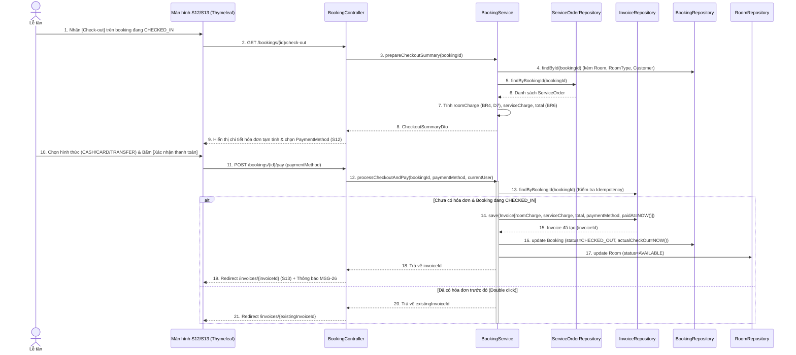
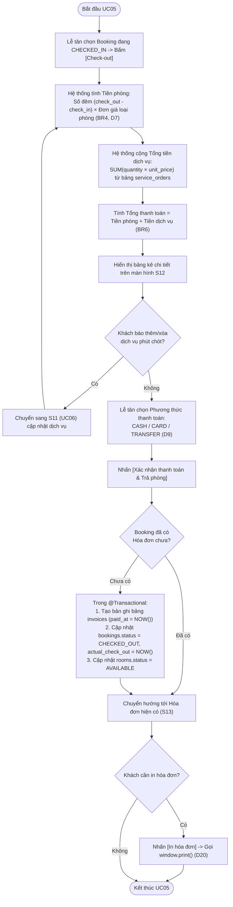

# 10. ĐẶC TẢ CHI TIẾT UC03 (ĐẶT PHÒNG), UC04 (CHECK-IN), UC05 (CHECK-OUT & THANH TOÁN) KÈM SEQUENCE / ACTIVITY DIAGRAM

> **Mục đích:** Tài liệu này cung cấp đặc tả đầy đủ cho cụm nghiệp vụ cốt lõi của lễ tân (**UC03, UC04, UC05**) kèm theo các biểu đồ **Sequence Diagram** và **Activity Diagram** cho **UC03** và **UC05** (đáp ứng yêu cầu mục 2.5 của đề thi và mục #6, #7, #8 trong file 08).

---

## 1. Đặc tả Chi tiết UC03 – Tìm Phòng Trống và Đặt Phòng

| Mục | Nội dung chi tiết |
|---|---|
| **Mã & Tên Use Case** | **UC03 – Tìm phòng trống và đặt phòng** |
| **Người phụ trách** | Hoàng (Phân tích & UML) · Khoa (Cài đặt Java) |
| **Yêu cầu liên quan** | `FR-06` (Tìm phòng trống), `FR-07` (Tìm/tạo khách hàng), `FR-08` (Tạo đặt phòng & chống trùng lịch), `FR-09` (Hủy đặt phòng), `BR1`, `BR2`, `BR3`, `BR7`, `D5`, `D6`, `D12`, `D13`, `D18`, `D19` |
| **Màn hình liên quan** | `S07` (`/bookings/new`), `S08` (`/bookings/new/confirm`), `S09` (`/bookings`) |
| **Tác nhân (Actor)** | **Chính:** Lễ tân (`RECEPTIONIST`), Quản lý (`MANAGER`). **Ngoài:** Khách hàng (cung cấp ngày lưu trú và thông tin cá nhân). |
| **Tiền điều kiện** | Nhân viên đã đăng nhập (`UC01`); trong CSDL đã có danh mục loại phòng và phòng ở trạng thái hoạt động (`AVAILABLE` / `OCCUPIED`). |
| **Hậu điều kiện** | **Đặt phòng thành công:** Bản ghi mới được thêm vào bảng `bookings` với `status = 'BOOKED'`, `created_by` là ID nhân viên đang đăng nhập; nếu khách mới thì thêm 1 bản ghi vào `customers`. Trạng thái vật lý trong bảng `rooms` vẫn giữ nguyên (`D2`). **Hủy thành công:** Bản ghi `bookings` chuyển từ `BOOKED` sang `CANCELLED`. |

### 1.1. Luồng sự kiện chính (Main Success Scenario – Tìm phòng & Tạo đặt phòng)
1. Lễ tân chọn menu **Đặt phòng** (`GET /bookings/new` – Màn hình `S07`).
2. Hệ thống hiển thị bộ lọc tìm phòng trống với giá trị mặc định: `Ngày nhận phòng` (`checkInDate` = hôm nay), `Ngày trả phòng` (`checkOutDate` = ngày mai), `Loại phòng` (`Tất cả`).
3. Lễ tân nhập `checkInDate`, `checkOutDate`, chọn `roomTypeId` (tùy chọn) và nhấn **[Tìm phòng trống]**.
4. Hệ thống kiểm tra hợp lệ ngày (`checkOutDate > checkInDate`, ít nhất 1 đêm theo `BR3`) và truy vấn danh sách các phòng thỏa mãn đồng thời 3 điều kiện (`BR2`, `D18`):
   * `rooms.status <> 'MAINTENANCE'` (không lấy phòng đang bảo trì).
   * Nếu có chọn loại phòng: `rooms.room_type_id = :roomTypeId`.
   * Phòng **không tồn tại** bất kỳ bản ghi `bookings` nào có `status IN ('BOOKED', 'CHECKED_IN')` mà thỏa mãn biểu thức giao khoảng ngày:
     $$\text{existing.check\_in\_date} < \text{newCheckOutDate} \quad \text{AND} \quad \text{existing.check\_out\_date} > \text{newCheckInDate}$$
     *(Lưu ý theo `D18`: Cho phép đặt phòng mới có `newCheckInDate` trùng đúng bằng `existing.check_out_date` của khách cũ).*
5. Hệ thống hiển thị danh sách các thẻ phòng trống kèm số phòng, tầng, tên loại phòng, sức chứa, đơn giá/đêm, số đêm dự kiến và tổng tiền phòng dự kiến.
6. Lễ tân nhấn nút **[Đặt phòng]** trên thẻ phòng khách chọn $\rightarrow$ Hệ thống chuyển sang bước Chọn/Tạo khách hàng và Xác nhận (`S08` – `/bookings/new/confirm?roomId=...&checkInDate=...&checkOutDate=...`).
7. Lễ tân nhập từ khóa (Tên, SĐT hoặc số CCCD/Hộ chiếu) vào ô tìm kiếm khách hàng (`D13`). Hệ thống hiển thị danh sách khách hàng khớp từ bảng `customers`.
8. Lễ tân chọn một khách hàng có sẵn trong danh sách kết quả và nhấn **[Xác nhận đặt phòng]** (`POST /bookings`).
9. Trong một giao dịch CSDL (`@Transactional`), hệ thống **kiểm tra lại điều kiện chống trùng lịch (Bước 4)** một lần nữa để phòng ngừa trường hợp có người khác vừa đặt phòng đó, sau đó lưu bản ghi `bookings`:
   * `customer_id`, `room_id`, `check_in_date`, `check_out_date`
   * `status = 'BOOKED'`, `created_at = LocalDateTime.now()`, `created_by = currentUser.userId`
10. Hệ thống chuyển hướng về màn hình Danh sách đặt phòng (`S09` – `/bookings`) và hiển thị thông báo thành công kèm mã đặt phòng `BK-{booking_id}` (`D5`, `MSG-15`).

### 1.2. Luồng sự kiện phụ (Alternative Flows)
* **A1 – Khách hàng mới chưa có trong hệ thống (`FR-07`, `D12`):**
  1. Tại bước 7, nếu tìm không thấy khách hàng, Lễ tân chọn tab/khối **"Tạo khách hàng mới"** ngay trên màn hình `S08`.
  2. Lễ tân nhập: `Họ và tên` (`full_name` – bắt buộc), `Số điện thoại` (`phone` – bắt buộc, 9–15 chữ số), `Số CCCD/Hộ chiếu` (`id_number` – tùy chọn, nhưng nếu nhập phải là duy nhất `UNIQUE`), `Email` (`email` – tùy chọn).
  3. Khi nhấn **[Xác nhận đặt phòng]**, hệ thống tạo mới bản ghi trong bảng `customers` rồi tiếp tục bước 9 trong cùng một `@Transactional`.
* **A2 – Hủy đặt phòng (`FR-09`, `BR7`, `D19`):**
  1. Tại màn hình Danh sách đặt phòng (`S09`), Lễ tân tìm đặt phòng đang ở trạng thái `Đã đặt` (`BOOKED`).
  2. Lễ tân nhấn nút **[Hủy đặt]** và xác nhận trong hộp thoại: *"Bạn có chắc chắn muốn hủy đặt phòng BK-{id}?"*.
  3. Hệ thống kiểm tra `booking.status == 'BOOKED'`, cập nhật `booking.status = 'CANCELLED'` (`POST /bookings/{id}/cancel`) và thông báo thành công (`MSG-16`). Phòng đó lập tức xuất hiện trở lại khi tìm phòng trống trong khoảng ngày tương ứng.

### 1.3. Luồng ngoại lệ (Exception Flows)
* **E1 – Ngày trả phòng không hợp lệ (`BR3`):**
  * Tại bước 4, nếu `checkOutDate <= checkInDate`, hệ thống báo lỗi: *"Ngày trả phòng phải sau ngày nhận phòng ít nhất 1 đêm."* (`MSG-17`).
* **E2 – Không còn phòng trống trong khoảng ngày đã chọn:**
  * Tại bước 5, nếu kết quả truy vấn rỗng, hệ thống hiển thị thông báo: *"Không còn phòng trống trong khoảng ngày và loại phòng đã chọn. Vui lòng đổi ngày hoặc chọn loại phòng khác."* (`MSG-18`).
* **E3 – Trùng số CCCD/Hộ chiếu khi tạo khách hàng mới (`D12`):**
  * Tại luồng phụ A1, nếu `id_number` đã tồn tại trong bảng `customers`, hệ thống báo lỗi: *"Số CCCD/Hộ chiếu này đã tồn tại trong hệ thống (Khách hàng: {Tên} - {SĐT}). Vui lòng chọn khách hàng đã có."* (`MSG-19`).
* **E4 – Phòng vừa bị đặt trùng tại thời điểm bấm xác nhận (Race Condition):**
  * Tại bước 9, nếu kiểm tra lại trong `@Transactional` phát hiện phòng vừa có booking trùng lịch hoặc vừa bị Quản lý chuyển sang `MAINTENANCE`, hệ thống hủy giao dịch, báo lỗi: *"Phòng {roomNumber} vừa được đặt hoặc chuyển bảo trì. Vui lòng chọn phòng khác."* (`MSG-20`) và đưa về màn hình `S07`.
* **E5 – Cố tình hủy booking không ở trạng thái `BOOKED` (`BR7`):**
  * Nếu gửi request hủy cho booking đang `CHECKED_IN`, `CHECKED_OUT` hoặc `CANCELLED`, hệ thống từ chối và báo lỗi: *"Chỉ có thể hủy đặt phòng đang ở trạng thái Đã đặt (BOOKED)."* (`MSG-21`).

### 1.4. Biểu đồ Tuần tự (Sequence Diagram) – UC03 Đặt phòng

### 1.5. Biểu đồ Hoạt động (Activity Diagram) – UC03 Đặt phòng

---

## 2. Đặc tả Chi tiết UC04 – Check-in (Nhận Phòng)

| Mục | Nội dung chi tiết |
|---|---|
| **Mã & Tên Use Case** | **UC04 – Check-in (Nhận phòng)** |
| **Người phụ trách** | Phong (Phân tích) · Khoa (Cài đặt Java) |
| **Yêu cầu liên quan** | `FR-10`, `D1`, `D6`, `D7`, `D8`, `D17` |
| **Màn hình liên quan** | `S03` (`/dashboard`), `S09` (`/bookings`), `S10` (`/bookings/{id}/check-in`) |
| **Tác nhân (Actor)** | **Chính:** Lễ tân (`RECEPTIONIST`), Quản lý (`MANAGER`). **Ngoài:** Khách hàng. |
| **Tiền điều kiện** | Nhân viên đã đăng nhập; đặt phòng đang ở trạng thái `BOOKED`; ngày nhận phòng dự kiến `check_in_date <= LocalDate.now()` (`D7`); phòng vật lý đang ở trạng thái `AVAILABLE`. |
| **Hậu điều kiện** | Cột `bookings.status` chuyển thành `CHECKED_IN`; `bookings.actual_check_in` ghi nhận thời điểm hiện tại (`LocalDateTime.now()`); cột `rooms.status` chuyển thành `OCCUPIED`. |

### 2.1. Luồng sự kiện chính (Main Success Scenario)
1. Tại màn hình Tổng quan (`S03`) hoặc Danh sách đặt phòng (`S09`), Lễ tân tìm đặt phòng của khách (theo mã `BK-{id}`, tên khách hoặc SĐT) đang ở trạng thái `Đã đặt` (`BOOKED`).
2. Lễ tân nhấn nút **[Check-in]** trên dòng đặt phòng $\rightarrow$ Hệ thống mở màn hình/hộp thoại xác nhận Check-in (`S10` – `GET /bookings/{id}/check-in`), hiển thị thông tin đối chiếu: Mã đặt phòng, Họ tên khách, SĐT, CCCD, Số phòng, Loại phòng, Ngày nhận – Ngày trả dự kiến.
3. Lễ tân kiểm tra giấy tờ tùy thân của khách (có thể bổ sung số CCCD nếu lúc đặt qua điện thoại chưa có), sau đó nhấn **[Xác nhận Check-in]** (`POST /bookings/{id}/check-in`).
4. Trong một `@Transactional`, hệ thống kiểm tra:
   * `booking.status == BookingStatus.BOOKED`
   * `booking.checkInDate <= LocalDate.now(ZoneId.of("Asia/Ho_Chi_Minh"))` (`D7`, `D17`)
   * `booking.room.status == RoomStatus.AVAILABLE`
5. Hệ thống cập nhật đồng thời:
   * `booking.status = BookingStatus.CHECKED_IN`
   * `booking.actualCheckIn = LocalDateTime.now()`
   * `booking.room.status = RoomStatus.OCCUPIED`
6. Hệ thống chuyển hướng về `/bookings` (hoặc `/dashboard`) kèm thông báo thành công: *"Đã check-in thành công cho đặt phòng BK-{id} (Phòng {roomNumber})."* (`MSG-22`).

### 2.2. Luồng sự kiện phụ (Alternative Flows)
* **A1 – Khách vãng lai đến trực tiếp không đặt trước (Walk-in Guest – `D8`):**
  1. Không tạo luồng code riêng gây phức tạp dữ liệu. Lễ tân thực hiện tuần tự 2 thao tác:
     * Bước 1: Vào `/bookings/new` (`UC03`) với `checkInDate = hôm nay`, chọn phòng trống và tạo booking $\rightarrow$ hệ thống chuyển về danh sách `/bookings`.
     * Bước 2: Nhấn ngay nút **[Check-in]** trên dòng booking vừa tạo ở đầu danh sách (`UC04`).
* **A2 – Khách đến nhận phòng muộn hơn ngày `check_in_date` (nhưng chưa hủy và chưa hết hạn `check_out_date` – `D7`):**
  1. Do biểu thức điều kiện là `check_in_date <= hôm nay` và `check_out_date > hôm nay`, hệ thống vẫn cho phép Check-in bình thường; số đêm tính tiền khi Check-out vẫn giữ nguyên theo khoảng ngày đặt ban đầu (`D7`).

### 2.3. Luồng ngoại lệ (Exception Flows)
* **E1 – Khách đến sớm trước ngày đặt (`check_in_date > hôm nay` – `D7`):**
  * Hệ thống không cho phép Check-in và báo lỗi: *"Chưa đến ngày nhận phòng của đơn đặt này (Ngày nhận dự kiến: {checkInDate}). Nếu khách muốn nhận phòng ngay hôm nay, vui lòng hủy đơn cũ và tạo đặt phòng mới từ ngày hôm nay."* (`MSG-23`).
* **E2 – Phòng đang ở trạng thái `MAINTENANCE` hoặc `OCCUPIED` (do khách trước quá hạn chưa trả):**
  * Hệ thống từ chối Check-in và báo lỗi: *"Phòng {roomNumber} hiện đang ở trạng thái {status} (chưa sẵn sàng). Vui lòng hoàn tất trả phòng cũ hoặc kết thúc bảo trì trước khi nhận khách."* (`MSG-24`).
* **E3 – Booking không còn ở trạng thái `BOOKED`:**
  * Báo lỗi: *"Đặt phòng này không ở trạng thái chờ nhận phòng (BOOKED)."* (`MSG-25`).

---

## 3. Đặc tả Chi tiết UC05 – Check-out và Thanh toán Hóa đơn

| Mục | Nội dung chi tiết |
|---|---|
| **Mã & Tên Use Case** | **UC05 – Check-out và thanh toán hóa đơn** |
| **Người phụ trách** | Phong (Phân tích & UML) · Khoa (Cài đặt Java) |
| **Yêu cầu liên quan** | `FR-13` (Tự tính tiền), `FR-14` (Thanh toán, lập hóa đơn, trả phòng), `FR-15` (In/xuất hóa đơn), `BR4`, `BR6`, `D1`, `D6`, `D7`, `D9`, `D16`, `D20` |
| **Màn hình liên quan** | `S12` (`/bookings/{id}/check-out`), `S13` (`/invoices/{id}`) |
| **Tác nhân (Actor)** | **Chính:** Lễ tân (`RECEPTIONIST`), Quản lý (`MANAGER`). **Ngoài:** Khách hàng. |
| **Tiền điều kiện** | Nhân viên đã đăng nhập; đặt phòng đang ở trạng thái `CHECKED_IN` (bao gồm cả trường hợp hiển thị nhãn `Quá hạn` theo `D1`) và chưa có bản ghi trong bảng `invoices`. |
| **Hậu điều kiện** | Tạo 1 bản ghi mới trong `invoices` (1–1 với `booking`); `bookings.status` chuyển sang `CHECKED_OUT`; `bookings.actual_check_out = NOW()`; `rooms.status` chuyển về `AVAILABLE`. |

### 3.1. Luồng sự kiện chính (Main Success Scenario)
1. Tại màn hình Tổng quan (`S03`) hoặc Danh sách đặt phòng (`S09`), Lễ tân nhấn nút **[Check-out]** trên dòng đặt phòng đang ở trạng thái `Đang ở` (`CHECKED_IN`) hoặc `Quá hạn`.
2. Hệ thống mở màn hình Check-out và Thanh toán (`S12` – `GET /bookings/{id}/check-out`) và tự động tính toán chi phí (`BR4`, `BR6`, `D7`):
   * $\text{Số đêm} = \max(1, \text{check\_out\_date} - \text{check\_in\_date})$
   * $\text{Tiền phòng (room\_charge)} = \text{Số đêm} \times \text{room\_types.price\_per\_night}$
   * $\text{Tiền dịch vụ (service\_charge)} = \sum (\text{service\_orders.quantity} \times \text{service\_orders.unit\_price})$
   * $\text{Tổng thanh toán (total)} = \text{room\_charge} + \text{service\_charge}$
3. Hệ thống hiển thị bảng kê chi tiết (thông tin khách, phòng, thời gian nhận thực tế, tiền phòng, danh sách từng dịch vụ đã dùng, tổng cộng tiền định dạng `1.250.000đ` theo `D16`) và 3 lựa chọn hình thức thanh toán (`D9`):
   * `CASH` (Tiền mặt – chọn mặc định)
   * `CARD` (Thẻ ngân hàng)
   * `TRANSFER` (Chuyển khoản)
4. Lễ tân thông báo tổng tiền cho khách, nhận thanh toán, chọn `paymentMethod` tương ứng và nhấn **[Xác nhận thanh toán & Trả phòng]** (`POST /bookings/{id}/pay`).
5. Trong một `@Transactional`, hệ thống kiểm tra booking đang `CHECKED_IN` và chưa tồn tại hóa đơn, sau đó thực hiện:
   * Tạo bản ghi mới trong bảng `invoices` với `room_charge`, `service_charge`, `total`, `payment_method`, `paid_at = LocalDateTime.now()`, `booking_id`, `created_by = currentUser.userId`.
   * Cập nhật `booking.status = BookingStatus.CHECKED_OUT` và `booking.actualCheckOut = LocalDateTime.now()`.
   * Cập nhật `booking.room.status = RoomStatus.AVAILABLE`.
6. Hệ thống chuyển hướng sang màn hình Chi tiết Hóa đơn (`S13` – `GET /invoices/{invoiceId}`) kèm thông báo: *"Thanh toán và trả phòng thành công. Đã lập hóa đơn #INV-{invoiceId}."* (`MSG-26`).

### 3.2. Luồng sự kiện phụ (Alternative Flows)
* **A1 – In hoặc xuất hóa đơn cho khách (`FR-15`, `D20`):**
  1. Tại màn hình Chi tiết Hóa đơn (`S13`), Lễ tân nhấn nút **[In hóa đơn]**.
  2. Giao diện gọi `window.print()` với CSS `@media print` (ẩn thanh menu và các nút điều hướng, chỉ giữ lại khung hóa đơn chuẩn của khách sạn ACE) để in ra máy in hoặc lưu thành file PDF.
* **A2 – Phát sinh thêm dịch vụ ngay lúc khách đang đứng trả phòng:**
  1. Tại màn hình `S12`, trước khi bấm xác nhận thanh toán, Lễ tân có thể nhấn liên kết **[+ Thêm/Sửa dịch vụ]** để chuyển sang màn hình `S11` (`UC06`), cập nhật dịch vụ rồi quay lại `S12` để tính lại tổng tiền.

### 3.3. Luồng ngoại lệ (Exception Flows)
* **E1 – Nhấn nút Xác nhận thanh toán 2 lần liên tiếp (Double Submit / Idempotency):**
  * Nếu request thứ hai gửi tới khi booking đã chuyển sang `CHECKED_OUT` hoặc đã có bản ghi trong bảng `invoices` (ràng buộc `UNIQUE(booking_id)`), hệ thống không tạo hóa đơn thứ hai mà chuyển hướng thẳng về trang xem hóa đơn đã tạo (`/invoices/{existingInvoiceId}`).
* **E2 – Booking không ở trạng thái `CHECKED_IN`:**
  * Nếu truy cập `/bookings/{id}/check-out` của một booking đang `BOOKED` hoặc `CANCELLED`, hệ thống từ chối và báo lỗi: *"Chỉ có thể trả phòng và thanh toán cho đặt phòng đang ở trạng thái Đang ở (CHECKED_IN)."* (`MSG-27`).

### 3.4. Biểu đồ Tuần tự (Sequence Diagram) – UC05 Check-out & Thanh toán

### 3.5. Biểu đồ Hoạt động (Activity Diagram) – UC05 Check-out & Thanh toán

