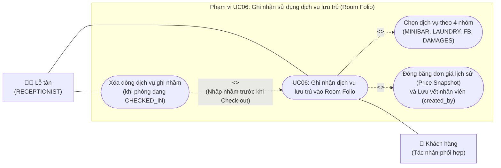
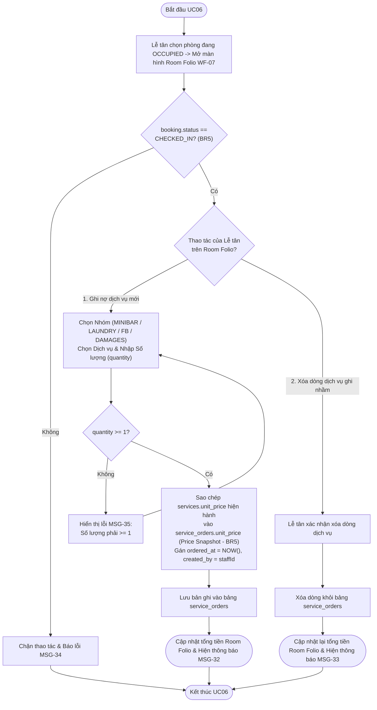
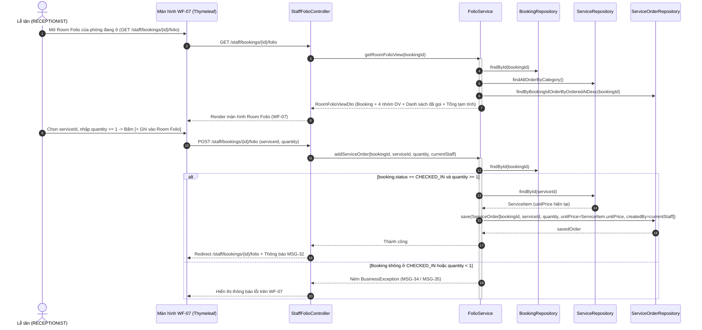
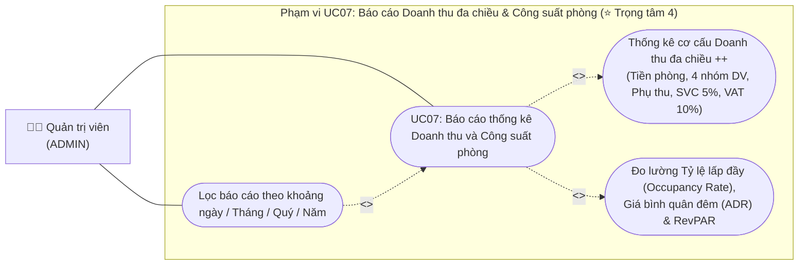
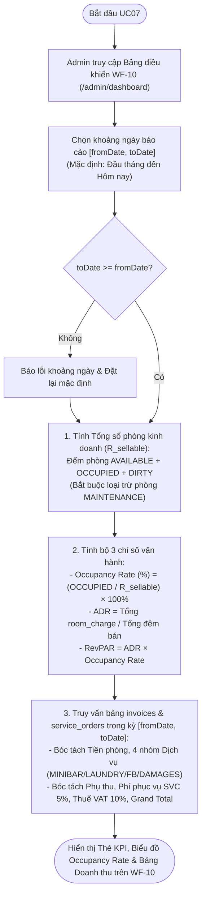
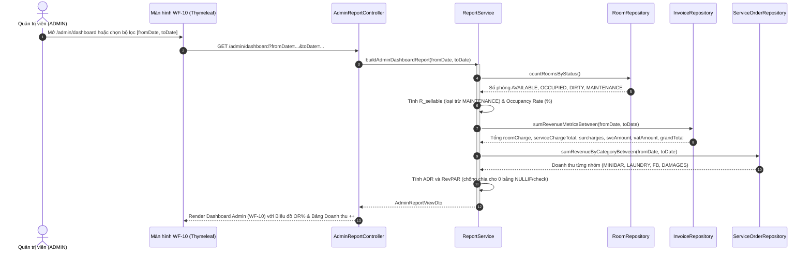

# 11. ĐẶC TẢ CHI TIẾT & BỘ SƠ ĐỒ UML CHO UC06 (DỊCH VỤ ROOM FOLIO) & UC07 (BÁO CÁO DOANH THU ++ & CÔNG SUẤT PHÒNG)

> **Ánh xạ Báo cáo:**  
> - **Chương 4 (Mục 4.2.6):** Bộ 3 sơ đồ & Bảng đặc tả `UC06` – Ghi nhận sử dụng dịch vụ lưu trú vào Room Folio *(Phụ trách: Kiệt)*.  
> - **Chương 4 (Mục 4.2.7):** Bộ 3 sơ đồ & Bảng đặc tả `UC07` – Báo cáo thống kê doanh thu đa chiều và Công suất khai thác phòng *(Phụ trách: Khoa – ⭐ Trọng tâm 4)*.

---

## 1. Đặc tả Chi tiết `UC06` – Ghi nhận sử dụng dịch vụ lưu trú vào Room Folio (Chương 4, Mục 4.2.6 – Phụ trách: Kiệt)

### 1.1. Sơ đồ Use Case chi tiết `UC06` (`uc-06.png`)

### 1.2. Bảng Đặc tả Chi tiết `UC06` (Mẫu chuẩn 9 dòng)
| Hạng mục | Nội dung đặc tả chi tiết |
|---|---|
| **1. Mã & Tên Use Case** | **UC06 – Ghi nhận sử dụng dịch vụ lưu trú vào Room Folio** |
| **2. Tác nhân (Actors)** | **Chính:** Nhân viên Lễ tân (`RECEPTIONIST`), Quản trị viên (`ADMIN`). **Phối hợp:** Khách hàng. |
| **3. Mô tả ngắn** | Trong thời gian khách đang lưu trú (`CHECKED_IN`), Lễ tân ghi nhận các dịch vụ/mặt hàng khách sử dụng thuộc 4 nhóm (`MINIBAR`, `LAUNDRY`, `FB`, `DAMAGES`) vào sổ cái tài khoản phòng (**Room Folio**); hệ thống đóng băng đơn giá tại thời điểm gọi và tự động cộng dồn vào hóa đơn quyết toán khi trả phòng. |
| **4. Tiền điều kiện** | Nhân viên đã đăng nhập; đơn đặt phòng bắt buộc đang ở trạng thái **`CHECKED_IN`** (phòng vật lý đang `OCCUPIED` – `BR5`). |
| **5. Hậu điều kiện** | Bản ghi mới được thêm vào bảng `service_orders` với `unit_price` sao chép từ `services.unit_price` hiện hành và `created_by` là ID nhân viên thao tác; tổng tiền dịch vụ tạm tính của phòng được cập nhật tức thì. |
| **6. Yêu cầu & Bảng CSDL** | • Yêu cầu: `FR-12`, `BR5`. • Bảng CSDL: `service_orders`, `services`, `bookings`. Màn hình: `WF-07`. |
| **7. Luồng sự kiện chính (Ghi nợ dịch vụ vào Room Folio)** | 1. Trên sơ đồ phòng của Dashboard Lễ tân (`WF-05`), Lễ tân chọn một phòng đang có khách ở (`OCCUPIED`) và nhấn nút **[Room Folio]** (`GET /staff/bookings/{id}/folio` – Màn hình `WF-07`). 2. Hệ thống hiển thị thông tin phòng, tên khách, danh sách các dịch vụ đã sử dụng trước đó và form **Ghi nợ dịch vụ mới** chia theo 4 nhóm: `MINIBAR` (Đồ uống/Snack), `LAUNDRY` (Giặt ủi), `FB` (Ẩm thực), `DAMAGES` (Đền bù tài sản). 3. Lễ tân chọn nhóm dịch vụ, chọn mặt hàng cụ thể, nhập `Số lượng` (`quantity >= 1`) và nhấn **[+ Ghi vào Room Folio]** (`POST /staff/bookings/{id}/folio`). 4. Hệ thống kiểm tra `booking.status == 'CHECKED_IN'` và `quantity >= 1` (`BR5`). 5. Hệ thống lấy `services.unit_price` tại thời điểm hiện tại gán vào `service_orders.unit_price` (đảm bảo nếu sau này Admin thay đổi bảng giá thì dòng dịch vụ đã gọi không bị biến đổi số tiền), gán `ordered_at = NOW()`, `created_by = currentStaff.userId` và lưu vào bảng `service_orders`. 6. Hệ thống tải lại màn hình `WF-07`, cập nhật tổng tiền dịch vụ gốc và hiển thị thông báo `MSG-32`. |
| **8. Luồng sự kiện phụ (Alternative Flows)** | • **A1 – Xóa dòng dịch vụ ghi nhầm khi phòng chưa Check-out (`POST /staff/bookings/{id}/folio/{orderId}/delete`):**   1. Nếu Lễ tân chọn nhầm món hoặc số lượng khi phòng vẫn đang `CHECKED_IN`, Lễ tân nhấn nút **[Xóa]** cạnh dòng dịch vụ đó.   2. Hệ thống kiểm tra `booking.status == 'CHECKED_IN'`, xóa bản ghi `service_orders` tương ứng và cập nhật lại tổng tiền Room Folio (`MSG-33`). |
| **9. Luồng ngoại lệ (Exception Flows)** | • **E1 – Đơn đặt phòng không ở trạng thái `CHECKED_IN` (`BR5`):** Hệ thống từ chối thêm/xóa dịch vụ và báo lỗi `MSG-34`: *"Chỉ được phép ghi nhận hoặc chỉnh sửa Room Folio cho phòng đang có khách lưu trú (CHECKED_IN)."* • **E2 – Số lượng nhập nhỏ hơn 1:** Hệ thống chặn lưu và báo lỗi `MSG-35`: *"Số lượng dịch vụ phải lớn hơn hoặc bằng 1."* |

### 1.3. Biểu đồ Hoạt động `Activity Diagram UC06` (`act-uc06.png`)

### 1.4. Biểu đồ Tuần tự `Sequence Diagram UC06` (`seq-uc06.png`)

---

## 2. Đặc tả Chi tiết `UC07` – Báo cáo Doanh thu đa chiều & Công suất phòng (Chương 4, Mục 4.2.7 – Phụ trách: Khoa)

### 2.1. Sơ đồ Use Case chi tiết `UC07` (`uc-07.png`)

### 2.2. Bảng Đặc tả Chi tiết `UC07` (Mẫu chuẩn 9 dòng)
| Hạng mục | Nội dung đặc tả chi tiết |
|---|---|
| **1. Mã & Tên Use Case** | **UC07 – Báo cáo thống kê doanh thu đa chiều và Công suất khai thác phòng (`Occupancy Rate`, `ADR`, `RevPAR`)** |
| **2. Tác nhân (Actors)** | **Chỉ Quản trị viên (`ADMIN`)** |
| **3. Mô tả ngắn** | Cung cấp cho Quản trị viên bảng điều khiển chiến lược để phân tích cơ cấu doanh thu theo chuẩn hạch toán `++` (tách bạch tiền phòng, 4 nhóm dịch vụ, phụ thu, phí phục vụ 5%, thuế GTGT 10%) và đo lường các chỉ số vận hành cốt lõi của khách sạn gồm Tỷ lệ lấp đầy phòng (`Occupancy Rate` – loại trừ phòng bảo trì khỏi mẫu số), `ADR` và `RevPAR`. |
| **4. Tiền điều kiện** | Người dùng đã đăng nhập với vai trò `ADMIN` (`UC01`) và truy cập `/admin/dashboard` (`WF-10`). |
| **5. Hậu điều kiện** | Hệ thống hiển thị chính xác các thẻ chỉ số `Occupancy Rate`, `ADR`, `RevPAR` và bảng cơ cấu doanh thu đa chiều theo khoảng thời gian được chọn. |
| **6. Yêu cầu & Bảng CSDL** | • Yêu cầu: `FR-17`, `FR-18`. • Bảng CSDL: `invoices`, `bookings`, `rooms`, `room_types`, `service_orders`, `services`. Màn hình: `WF-10`. |
| **7. Luồng sự kiện chính (Xem báo cáo Doanh thu `++` & Công suất phòng)** | 1. Quản trị viên đăng nhập hoặc mở menu **Bảng điều khiển Quản trị** (`GET /admin/dashboard` – Màn hình `WF-10`). 2. Hệ thống lấy khoảng thời gian mặc định (từ ngày đầu tháng hiện tại đến ngày hôm nay) và thực hiện 2 nhóm phép tính:    • **Nhóm 1 – Chỉ số Công suất & Hiệu quả khai thác phòng (Loại trừ phòng `MAINTENANCE`):**      - Tổng số phòng có thể kinh doanh: `R_sellable = COUNT(rooms WHERE status IN ('AVAILABLE', 'OCCUPIED', 'DIRTY'))`.      - Tỷ lệ lấp đầy phòng hiện thời: `Occupancy Rate (%) = (Số phòng OCCUPIED / R_sellable) × 100%`.      - Giá bán bình quân mỗi đêm phòng: `ADR = Tổng room_charge đã thu / Tổng số đêm phòng đã bán`.      - Doanh thu trên mỗi phòng sẵn có: `RevPAR = Tổng room_charge đã thu / R_sellable`.    • **Nhóm 2 – Báo cáo Cơ cấu Doanh thu Đa chiều (`++`) từ bảng `invoices` và `service_orders`:**      - Tổng doanh thu Tiền phòng gốc (`SUM(room_charge)`).      - Tổng doanh thu Dịch vụ lưu trú tách theo 4 nhóm (`MINIBAR`, `LAUNDRY`, `FB`, `DAMAGES`).      - Tổng tiền Phụ thu nhận sớm & trả trễ (`SUM(early_checkin_fee + late_checkout_fee)`).      - Tổng Phí phục vụ thu được (`SUM(service_charge_amount)` – 5%).      - Tổng Thuế GTGT thu hộ ngân sách (`SUM(vat_amount)` – 10%).      - Tổng cộng doanh thu hóa đơn (`SUM(grand_total)`). 3. Hệ thống hiển thị trực quan các thẻ KPI, biểu đồ tỷ lệ lấp đầy và bảng cơ cấu doanh thu trên `WF-10`. |
| **8. Luồng sự kiện phụ (Alternative Flows)** | • **A1 – Lọc báo cáo theo khoảng ngày tùy chọn (`GET /admin/dashboard?fromDate=...&toDate=...`):**   1. Admin chọn `Từ ngày` (`fromDate`), `Đến ngày` (`toDate`) và nhấn **[Xem báo cáo]**.   2. Hệ thống tính toán lại doanh thu và công suất khai thác phòng trong kỳ `[fromDate, toDate]` và cập nhật giao diện. |
| **9. Luồng ngoại lệ (Exception Flows)** | • **E1 – Khoảng ngày lọc không hợp lệ (`toDate < fromDate`):** Hệ thống hiển thị cảnh báo và giữ nguyên kỳ báo cáo mặc định. • **E2 – Chưa phát sinh hóa đơn nào trong kỳ:** Hệ thống hiển thị giá trị `0đ` và `0%` một cách an toàn (dùng `COALESCE(..., 0)` và `NULLIF(..., 0)` để tránh lỗi chia cho 0). |

### 2.3. Biểu đồ Hoạt động `Activity Diagram UC07` (`act-uc07.png`)

### 2.4. Biểu đồ Tuần tự `Sequence Diagram UC07` (`seq-uc07.png`)
