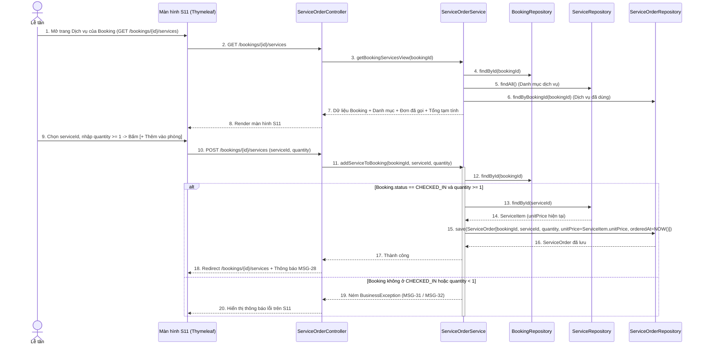
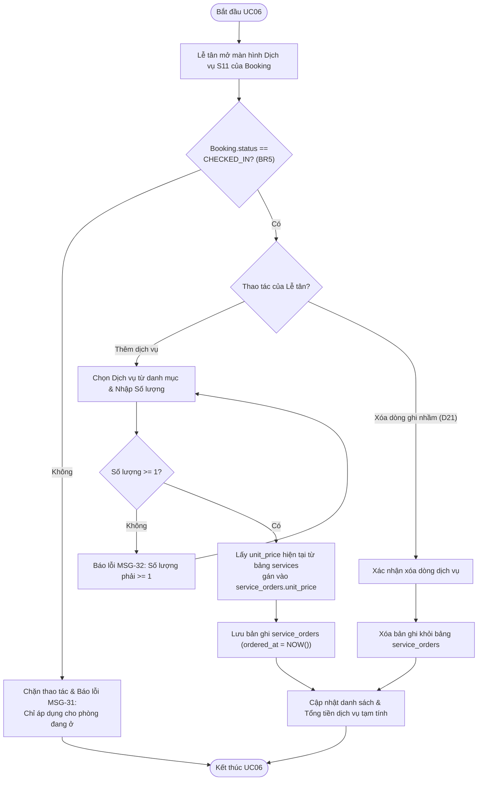

# 11. ĐẶC TẢ CHI TIẾT UC06 (DỊCH VỤ ĐI KÈM) KÈM SEQUENCE / ACTIVITY DIAGRAM & UC07 (THỐNG KÊ)

> **Mục đích:** Tài liệu này cung cấp đặc tả chi tiết cho **UC06 – Đăng ký dịch vụ đi kèm** (kèm biểu đồ **Sequence Diagram** và **Activity Diagram** theo phân công của Kiệt) và **UC07 – Thống kê doanh thu & công suất phòng** (do Khoa đặc tả trong quyển báo cáo).

---

## 1. Đặc tả Chi tiết UC06 – Đăng ký Dịch vụ Đi kèm & Quản lý Danh mục Dịch vụ

| Mục | Nội dung chi tiết |
|---|---|
| **Mã & Tên Use Case** | **UC06 – Đăng ký dịch vụ đi kèm** |
| **Người phụ trách** | Kiệt (Phân tích & UML) · Khoa (Cài đặt Java) |
| **Yêu cầu liên quan** | `FR-11` (Thêm dịch vụ cho phòng đang ở), `FR-12` (Quản lý danh mục dịch vụ), `BR5`, `D3`, `D10`, `D21` |
| **Màn hình liên quan** | `S11` (`/bookings/{id}/services`), `S14` (`/manage/services`) |
| **Tác nhân (Actor)** | **Lễ tân (`RECEPTIONIST`), Quản lý (`MANAGER`):** Thêm/xóa dòng dịch vụ cho phòng đang ở (`S11`).<br>**Chỉ Quản lý (`MANAGER`):** Thêm/sửa/xóa danh mục dịch vụ gốc (`S14`). |
| **Tiền điều kiện** | Nhân viên đã đăng nhập; đối với thao tác ghi nhận dịch vụ sử dụng (`FR-11`), đặt phòng bắt buộc đang ở trạng thái `CHECKED_IN` (`BR5`). |
| **Hậu điều kiện** | Bản ghi mới được thêm vào bảng `service_orders` với cột `unit_price` sao chép từ `services.unit_price` tại thời điểm đặt; tổng tiền dịch vụ tạm tính của booking được cập nhật ngay lập tức. |

### 1.1. Luồng sự kiện chính 6A – Thêm dịch vụ cho phòng đang ở (`FR-11`, Màn hình `S11`)
1. Tại màn hình Danh sách đặt phòng (`S09`) hoặc màn hình Check-out (`S12`), Lễ tân chọn một đặt phòng đang ở trạng thái `Đang ở` (`CHECKED_IN`) và nhấn nút **[Dịch vụ]** (`GET /bookings/{id}/services` – Màn hình `S11`).
2. Hệ thống hiển thị:
   * Thông tin tóm tắt của đặt phòng: Mã `BK-{id}`, Tên khách, Số phòng, Ngày nhận thực tế.
   * Danh sách các dịch vụ đã gọi của đặt phòng này (Tên dịch vụ, Đơn vị, Số lượng, Đơn giá lúc gọi, Thành tiền, Thời gian gọi, và nút **[Xóa]**).
   * Form **Thêm dịch vụ mới**: Dropdown chọn `Dịch vụ` (lấy từ bảng `services` kèm đơn giá hiện tại), ô nhập `Số lượng` (`quantity`, mặc định = `1`), và nút **[+ Thêm vào phòng]**.
3. Lễ tân chọn dịch vụ (ví dụ: *Ăn sáng – 150.000đ/suất*), nhập số lượng (ví dụ: `2`) và nhấn **[+ Thêm vào phòng]** (`POST /bookings/{id}/services`).
4. Hệ thống kiểm tra hợp lệ:
   * Booking phải đang ở trạng thái `CHECKED_IN` (`BR5`).
   * Dịch vụ tồn tại trong bảng `services`.
   * Số lượng `quantity >= 1`.
5. Hệ thống lấy `services.unit_price` hiện hành để gán cứng vào `service_orders.unit_price` (đảm bảo nếu sau này Quản lý đổi giá danh mục thì các đơn đã gọi trước đó không bị lệch tiền), gán `ordered_at = LocalDateTime.now()`, và lưu bản ghi mới vào bảng `service_orders`.
6. Hệ thống tải lại màn hình `S11`, hiển thị dòng dịch vụ vừa thêm cùng tổng tiền dịch vụ cộng dồn và thông báo thành công (`MSG-28`).

### 1.2. Luồng sự kiện phụ (Alternative Flows)
* **A1 – Xóa dòng dịch vụ ghi nhầm khi chưa thanh toán (`D21`):**
  1. Tại màn hình `S11`, nếu Lễ tân nhập nhầm dịch vụ hoặc số lượng và booking vẫn đang `CHECKED_IN`, Lễ tân nhấn nút **[Xóa]** cạnh dòng dịch vụ đó (`POST /bookings/{id}/services/{orderId}/delete`).
  2. Hệ thống xác nhận booking vẫn đang `CHECKED_IN`, xóa dòng `service_orders` tương ứng và cập nhật lại tổng tiền dịch vụ (`MSG-29`).
  *(Lưu ý theo `D21`: Để đơn giản hóa giao diện, không làm chức năng sửa số lượng dòng đã thêm; nếu muốn đổi số lượng, Lễ tân xóa dòng cũ và thêm lại dòng mới).*
* **A2 – Quản lý Danh mục Dịch vụ (`FR-12`, Màn hình `S14` – Chỉ `MANAGER`):**
  1. Quản lý truy cập menu **Danh mục dịch vụ** (`GET /manage/services` – `S14`).
  2. **Thêm / Sửa dịch vụ (`POST /manage/services` hoặc `POST /manage/services/{id}`):** Nhập `Tên dịch vụ` (`name` – bắt buộc, không trùng), `Đơn giá` (`unit_price > 0`), `Đơn vị tính` (`unit` – bắt buộc, ví dụ: *Suất, Lần, Kg, Lon, Chuyến*).
  3. **Xóa dịch vụ (`POST /manage/services/{id}/delete` – `D10`):** Hệ thống kiểm tra bảng `service_orders`. Nếu dịch vụ chưa từng được gọi trong bất kỳ đơn nào (`count == 0`) thì xóa thành công (`MSG-30`).

### 1.3. Luồng ngoại lệ (Exception Flows)
* **E1 – Thêm/Xóa dịch vụ cho booking không ở trạng thái `CHECKED_IN` (`BR5`):**
  * Nếu booking đang ở `BOOKED`, `CHECKED_OUT` hoặc `CANCELLED`, hệ thống từ chối và báo lỗi: *"Chỉ được thêm hoặc xóa dịch vụ cho phòng đang có khách lưu trú (CHECKED_IN)."* (`MSG-31`).
* **E2 – Số lượng dịch vụ $< 1$:**
  * Báo lỗi: *"Số lượng dịch vụ phải lớn hơn hoặc bằng 1."* (`MSG-32`).
* **E3 – Quản lý xóa dịch vụ đã từng phát sinh trong `service_orders` (`D10`):**
  * Hệ thống chặn xóa và báo lỗi: *"Không thể xóa dịch vụ này vì đã phát sinh trong lịch sử đặt phòng/hóa đơn."* (`MSG-33`).

### 1.4. Biểu đồ Tuần tự (Sequence Diagram) – UC06 Thêm dịch vụ cho phòng đang ở


### 1.5. Biểu đồ Hoạt động (Activity Diagram) – UC06 Thêm/Xóa dịch vụ đi kèm


---

## 2. Đặc tả Chi tiết UC07 – Thống kê Doanh thu và Công suất Phòng (Chỉ đặc tả)

> **Lưu ý phạm vi:** Theo [chot-pham-vi-actor-usecase-bang.md](file:///D:/ACE/docs/chot-pham-vi-actor-usecase-bang.md) và [01-project-brief.md](file:///D:/ACE/docs/01-project-brief.md), **UC07** do Khoa phụ trách viết đặc tả trong báo cáo để hoàn thiện chu trình nghiệp vụ của Quản lý (và chỉ cài đặt giao diện/code nếu còn dư thời gian sau khi xong 5 chức năng chính).

| Mục | Nội dung chi tiết |
|---|---|
| **Mã & Tên Use Case** | **UC07 – Thống kê doanh thu và công suất phòng** |
| **Người phụ trách** | Khoa (Đặc tả kỹ thuật & nghiệp vụ) |
| **Yêu cầu liên quan** | `FR-16` (Doanh thu theo tháng & loại phòng), `FR-17` (Công suất phòng theo khoảng ngày) |
| **Màn hình liên quan** | `S15` (`/reports`) |
| **Tác nhân (Actor)** | **Chỉ Quản lý (`MANAGER`)** |
| **Tiền điều kiện** | Người dùng đăng nhập với vai trò `MANAGER`; trong hệ thống đã có các hóa đơn đã thanh toán (`invoices`) và lịch sử đặt phòng (`bookings`). |
| **Hậu điều kiện** | Hệ thống hiển thị bảng số liệu thống kê doanh thu (tiền phòng, tiền dịch vụ, tổng cộng) và tỷ lệ lấp đầy phòng chính xác theo bộ lọc thời gian. |

### 2.1. Luồng sự kiện chính
1. Quản lý chọn menu **Thống kê** (`GET /reports` – Màn hình `S15`).
2. Hệ thống hiển thị bộ lọc thời gian: `Năm` (mặc định: `2026`), `Khoảng ngày tính công suất` (`fromDate` = đầu tháng hiện tại, `toDate` = ngày hiện tại).
3. Quản lý chọn bộ lọc và nhấn **[Xem báo cáo]**.
4. Hệ thống thực hiện 3 phép tính tổng hợp:
   * **Bảng 1 – Doanh thu theo tháng trong năm (`FR-16`):** Nhóm các hóa đơn trong bảng `invoices` theo tháng của cột `paid_at`, tính tổng `room_charge`, tổng `service_charge`, tổng `total` và số lượng hóa đơn.
   * **Bảng 2 – Doanh thu theo loại phòng (`FR-16`):** Kết nối `invoices` $\rightarrow$ `bookings` $\rightarrow$ `rooms` $\rightarrow$ `room_types`, nhóm theo `room_types.name` để tính số lượt thuê và tổng doanh thu mang lại của từng hạng phòng.
   * **Bảng 3 – Công suất khai thác phòng (`FR-17`):**
     $$\text{Công suất phòng (\%)} = \frac{\text{Tổng số đêm phòng có khách ở trong khoảng } [fromDate, toDate]}{\text{Tổng số phòng khách sạn} \times \text{Số ngày trong khoảng } [fromDate, toDate]} \times 100\%$$
5. Hệ thống hiển thị kết quả dưới dạng bảng số liệu trực quan kèm dòng tổng cộng.

### 2.2. Câu truy vấn SQL chuẩn cho UC07
* **Truy vấn 1 – Doanh thu theo tháng (`FR-16`):**
  ```sql
  SELECT EXTRACT(MONTH FROM i.paid_at) AS thang,
         COUNT(i.invoice_id)           AS so_hoa_don,
         SUM(i.room_charge)            AS doanh_thu_phong,
         SUM(i.service_charge)         AS doanh_thu_dich_vu,
         SUM(i.total)                  AS tong_doanh_thu
  FROM invoices i
  WHERE EXTRACT(YEAR FROM i.paid_at) = :nam
  GROUP BY EXTRACT(MONTH FROM i.paid_at)
  ORDER BY thang ASC;
  ```
* **Truy vấn 2 – Doanh thu theo loại phòng (`FR-16`):**
  ```sql
  SELECT rt.name               AS loai_phong,
         COUNT(i.invoice_id)   AS so_luot_tra_phong,
         SUM(i.room_charge)    AS doanh_thu_phong,
         SUM(i.service_charge) AS doanh_thu_dich_vu,
         SUM(i.total)          AS tong_doanh_thu
  FROM room_types rt
  LEFT JOIN rooms r     ON r.room_type_id = rt.room_type_id
  LEFT JOIN bookings b  ON b.room_id = r.room_id
  LEFT JOIN invoices i  ON i.booking_id = b.booking_id
  GROUP BY rt.room_type_id, rt.name
  ORDER BY tong_doanh_thu DESC;
  ```
