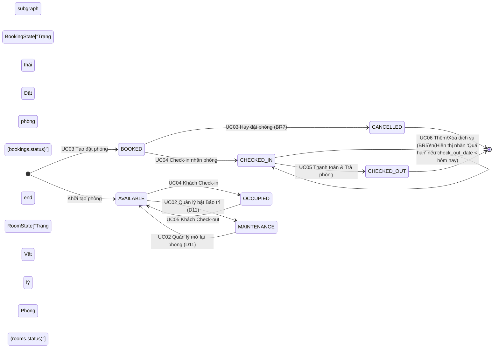

# 12. QUYẾT ĐỊNH NGHIỆP VỤ (D1–D22), MA TRẬN TRẠNG THÁI, PHÂN QUYỀN RBAC & TỪ ĐIỂN THÔNG BÁO TIẾNG VIỆT

> **Mục đích:** Tài liệu này giải quyết dứt điểm **Mục #1, #2, #4 và #10** trong [08-bao-cao-tai-lieu-con-thieu.md](file:///D:/ACE/docs/08-bao-cao-tai-lieu-con-thieu.md), cung cấp bảng quy chiếu chuẩn xác để Khoa lập trình tầng `Service`, `Security/Interceptor` và giao diện `Thymeleaf` mà không phải tự suy đoán bất kỳ chi tiết nào.

---

## 1. Bảng Chốt Chính thức 7 Quy tắc Nghiệp vụ (BR1–BR7) & 22 Quyết định Thiết kế (D1–D22)

### 1.1. Bảy Quy tắc Nghiệp vụ Cốt lõi (`BR1` – `BR7`)
| Mã | Tên quy tắc | Định nghĩa chính thức để cài đặt |
|:---:|---|---|
| **BR1** | Đơn vị đặt phòng | Mỗi đơn đặt phòng (`bookings`) gắn với **đúng 1 phòng** (`room_id`) trong một khoảng ngày xác định. |
| **BR2** | Chống trùng lịch | Một phòng không được phép có 2 đơn đặt phòng ở trạng thái chưa hủy (`status IN ('BOOKED', 'CHECKED_IN')`) giao nhau về khoảng ngày: `existing.check_in_date < new.check_out_date AND existing.check_out_date > new.check_in_date`. |
| **BR3** | Khoảng ngày tối thiểu | Ngày trả phòng dự kiến phải sau ngày nhận phòng dự kiến ít nhất 1 đêm (`check_out_date > check_in_date`). |
| **BR4** | Công thức tiền phòng | $\text{Tiền phòng} = \text{Số đêm} \times \text{Đơn giá 1 đêm của loại phòng}$ (`room_types.price_per_night`), với $\text{Số đêm} = \max(1, \text{check\_out\_date} - \text{check\_in\_date})$. |
| **BR5** | Điều kiện gọi dịch vụ | Chỉ cho phép thêm hoặc xóa dòng dịch vụ (`service_orders`) khi đặt phòng đang ở trạng thái `CHECKED_IN`. |
| **BR6** | Công thức tổng hóa đơn | $\text{Tổng thanh toán (`invoices.total`)} = \text{Tiền phòng (`room\_charge`)} + \sum (\text{Số lượng} \times \text{Đơn giá dịch vụ lúc đặt})$. Không áp dụng giảm giá, phụ thu hay thuế. |
| **BR7** | Điều kiện hủy đặt phòng | Chỉ cho phép hủy đặt phòng khi đang ở trạng thái `BOOKED` (chuyển sang `CANCELLED`). |

### 1.2. Hai mươi hai Quyết định Thiết kế Đã Chốt (`D1` – `D22`)
| Mã | Vấn đề | Quyết định đã chốt (Chính thức áp dụng vào Code & Báo cáo) |
|:---:|---|---|
| **D1** | Nhãn **"Quá hạn"** trên giao diện | **Không thêm giá trị vào cột `status` trong CSDL.** Tính động bằng phương thức `booking.isOverdue()`: trả về `true` khi `booking.status == 'CHECKED_IN'` và `booking.checkOutDate.isBefore(LocalDate.now())`. |
| **D2** | Nhãn phòng **"Đã đặt"** trên giao diện | Cột `rooms.status` trong CSDL chỉ lưu **3 trạng thái vật lý**: `AVAILABLE`, `OCCUPIED`, `MAINTENANCE`. Trên màn hình Danh sách phòng (`S04`), nếu phòng đang `AVAILABLE` nhưng có đơn `BOOKED` phủ ngày hôm nay (`check_in_date <= today AND check_out_date > today`), giao diện hiển thị badge phụ **"Đã đặt"** màu tím (`#7C3AED` / `#A78BFA`). |
| **D3** | Công tắc **Late check-out**, tag **Ăn sáng / Đưa đón** | **Loại bỏ công tắc Late check-out** khỏi form nghiệp vụ (vì phạm vi không có phụ thu). "Ăn sáng", "Đưa đón sân bay", "Spa", "Giặt ủi" là các bản ghi trong bảng `services` (`UC06`). |
| **D4** | Công thức 4 thẻ chỉ số Dashboard (`S03`) | Xem công thức truy vấn chi tiết tại **Mục 2.3** bên dưới. |
| **D5** | Định dạng Mã đặt phòng & Mã hóa đơn | Hiển thị trên giao diện dạng `BK-{booking_id}` (ví dụ: `BK-2401`) và `INV-{invoice_id}` (không tạo thêm cột dư thừa trong DB). |
| **D6** | Kiểu dữ liệu ngày/giờ nhận trả | `check_in_date`, `check_out_date` dùng kiểu `DATE` (`LocalDate`). `actual_check_in`, `actual_check_out`, `created_at`, `ordered_at`, `paid_at` dùng kiểu `TIMESTAMP` (`LocalDateTime`). |
| **D7** | Nhận/trả phòng sớm hoặc muộn | Chỉ cho phép Check-in khi `check_in_date <= LocalDate.now()`. Cho phép Check-out bất kỳ lúc nào khi đang `CHECKED_IN`. Tiền phòng tính cố định theo số đêm đăng ký ban đầu (`check_out_date - check_in_date`). |
| **D8** | Khách vãng lai (Walk-in) | Thực hiện qua 2 bước chuẩn: Tạo đặt phòng ngày hôm nay (`UC03`) $\rightarrow$ Nhấn Check-in ngay (`UC04`). |
| **D9** | Phương thức thanh toán | Enum `PaymentMethod` gồm 3 giá trị: `CASH` (Tiền mặt), `CARD` (Thẻ ngân hàng), `TRANSFER` (Chuyển khoản). |
| **D10** | Quy tắc chặn xóa dữ liệu (Bảo toàn lịch sử) | - Không xóa `rooms` nếu đã có bản ghi trong `bookings`. - Không xóa `room_types` nếu còn bản ghi trong `rooms`. - Không xóa `services` nếu đã có bản ghi trong `service_orders`. - Không cung cấp nút xóa `customers`, `bookings`, `invoices`. |
| **D11** | Đổi trạng thái phòng thủ công | Chỉ `MANAGER` được chuyển phòng qua lại giữa `AVAILABLE` và `MAINTENANCE` (với điều kiện phòng không đang `OCCUPIED` và không có booking `BOOKED` nhận phòng hôm nay). |
| **D12** | Trường dữ liệu khách hàng | Bắt buộc: `full_name`, `phone`. Tùy chọn: `id_number` (`UNIQUE` khi khác null/rỗng), `email`. |
| **D13** | Cơ chế tìm kiếm | Tìm chuỗi con không phân biệt hoa thường (`LOWER(col) LIKE LOWER('%keyword%')`). |
| **D14** | Tài khoản Demo mặc định | 1. Lễ tân: `letan01` / mật khẩu `123456` (`RECEPTIONIST`) 2. Quản lý: `quanly01` / mật khẩu `123456` (`MANAGER`) |
| **D15** | Phân trang & Sắp xếp | Không phân trang; sắp xếp bảng đặt phòng theo ưu tiên thao tác hôm nay và `booking_id DESC`; danh sách phòng sắp theo `floor ASC, room_number ASC`. |
| **D16** | Định dạng tiền tệ | Lưu kiểu `DECIMAL(12,0)` (số nguyên VNĐ); hiển thị phân cách hàng nghìn bằng dấu chấm kèm ký hiệu `đ` (ví dụ: `1.250.000đ`). |
| **D17** | Múi giờ hệ thống | Cố định `ZoneId.of("Asia/Ho_Chi_Minh")`. |
| **D18** | Biên trùng lịch đặt phòng | Cho phép khách mới nhận phòng vào đúng ngày khách cũ trả phòng (`new.check_in_date == old.check_out_date`). |
| **D19** | Hủy đặt phòng | Chỉ áp dụng cho booking `BOOKED` $\rightarrow$ chuyển sang `CANCELLED`; giữ nguyên `rooms.status`. |
| **D20** | Xem & In hóa đơn | Màn hình Hóa đơn (`S13`) có nút **[In hóa đơn]** gọi `window.print()` với CSS `@media print`. |
| **D21** | Sửa/Xóa dòng dịch vụ đã gọi | Không làm nút sửa số lượng; cho phép **Xóa dòng dịch vụ** (`service_orders`) khi booking còn ở trạng thái `CHECKED_IN`. |
| **D22** | Quản lý tài khoản nhân viên | Không làm màn hình CRUD tài khoản nhân viên; nạp sẵn qua `sample-data.sql`. |

---

## 2. Bảng Chuyển Trạng thái (State Transition Matrix) & Công thức Dashboard

### 2.1. Sơ đồ Trạng thái của Đặt phòng (`bookings.status`) và Phòng (`rooms.status`)

### 2.2. Bảng Đồng bộ Trạng thái 2 Chiều (`bookings` $\leftrightarrow$ `rooms` $\leftrightarrow$ Badge Giao diện)
| Sự kiện / Tình huống | `bookings.status` (DB) | `rooms.status` (DB) | Badge hiển thị trên Thẻ Phòng (`S04`) | Badge hiển thị trên Bảng Booking (`S03`, `S09`) | Màu Badge (Light / Dark) |
|---|:---:|:---:|---|---|---|
| Phòng trống, không có lịch đặt hôm nay | *(Không có)* | `AVAILABLE` | **Phòng trống** | — | `#15803D` / `#22C55E` (Xanh lá) |
| Đã tạo đặt phòng nhận hôm nay | `BOOKED` | `AVAILABLE` | **Đã đặt** *(suy diễn D2)* | **Đã đặt** | `#7C3AED` / `#A78BFA` (Tím) |
| Khách đã Check-in, trong hạn ở | `CHECKED_IN` | `OCCUPIED` | **Đang ở** | **Đang ở** | `#2563EB` / `#60A5FA` (Xanh dương) |
| Khách đang ở nhưng `check_out_date < hôm nay` (`D1`) | `CHECKED_IN` | `OCCUPIED` | **Quá hạn** *(suy diễn D1)* | **Quá hạn** *(suy diễn D1)* | `#DC2626` / `#F87171` (Đỏ) |
| Khách đã Check-out & thanh toán | `CHECKED_OUT` | `AVAILABLE` | **Phòng trống** | **Đã trả phòng** | `#6B7280` / `#9CA3AF` (Xám) |
| Đơn đặt phòng bị hủy | `CANCELLED` | *(Giữ nguyên)* | *(Theo trạng thái phòng)* | **Đã hủy** | `#6B7280` / `#9CA3AF` (Xám) |
| Quản lý chuyển phòng sang bảo trì | *(Không có)* | `MAINTENANCE` | **Đang dọn / bảo trì** | — | `#6B7280` / `#9CA3AF` (Xám) |

### 2.3. Công thức Tính 4 Thẻ Chỉ số trên Màn hình Tổng quan (`S03` – Quyết định `D4`)
Với `today = LocalDate.now(ZoneId.of("Asia/Ho_Chi_Minh"))`:
1. **Thẻ 1 – Phòng trống (`availableRoomsCount`):**
   * **Ý nghĩa:** Số lượng phòng vật lý hiện đang sẵn sàng đón khách.
   * **SQL:** `SELECT COUNT(*) FROM rooms WHERE status = 'AVAILABLE';`
2. **Thẻ 2 – Check-in hôm nay (`todayCheckInCount`):**
   * **Ý nghĩa:** Số đơn đặt phòng đang chờ khách đến nhận phòng trong ngày hôm nay (hoặc đơn đặt từ hôm trước chưa hủy mà ngày nhận $\le$ hôm nay).
   * **SQL:** `SELECT COUNT(*) FROM bookings WHERE status = 'BOOKED' AND check_in_date = :today;`
3. **Thẻ 3 – Check-out hôm nay (`todayCheckOutCount`):**
   * **Ý nghĩa:** Số phòng đang có khách lưu trú cần làm thủ tục trả phòng trong ngày hôm nay (cộng cả các phòng quá hạn chưa trả).
   * **SQL:** `SELECT COUNT(*) FROM bookings WHERE status = 'CHECKED_IN' AND check_out_date <= :today;`
4. **Thẻ 4 – Dịch vụ đi kèm (`activeServiceOrdersCount`):**
   * **Ý nghĩa:** Tổng số lượt/suất dịch vụ (`SUM(quantity)` hoặc `COUNT(order_id)`) đã phục vụ cho các phòng đang lưu trú (`CHECKED_IN`).
   * **SQL:** `SELECT COALESCE(SUM(so.quantity), 0) FROM service_orders so JOIN bookings b ON so.booking_id = b.booking_id WHERE b.status = 'CHECKED_IN';`

---

## 3. Ma trận Phân quyền Chi tiết theo Route URL và Nút bấm (RBAC Matrix)

### 3.1. Ma trận Phân quyền theo Route URL (Kiểm tra ở Server-side – `NFR-03`)
| Mã MH | Chức năng / Màn hình | HTTP Method & Route URL | Công khai (Chưa login) | Lễ tân (`RECEPTIONIST`) | Quản lý (`MANAGER`) | Xử lý khi vi phạm quyền |
|:---:|---|---|:---:|:---:|:---:|---|
| `S01` | Trang giới thiệu (Landing) | `GET /` | ✅ Cho phép | ✅ Cho phép | ✅ Cho phép | — |
| `S02` | Đăng nhập / Đăng xuất | `GET /login`, `POST /login`, `POST /logout` | ✅ Cho phép | ✅ Cho phép | ✅ Cho phép | Đã login vào `/login` $\rightarrow$ `redirect:/dashboard` |
| `S03` | Trang Tổng quan (Dashboard) | `GET /dashboard` | ❌ `redirect:/login` | ✅ Cho phép | ✅ Cho phép | Chưa login $\rightarrow$ `redirect:/login` |
| `S04` | Xem & Lọc danh sách phòng | `GET /rooms` | ❌ `redirect:/login` | ✅ Chỉ xem & lọc | ✅ Toàn quyền | Chưa login $\rightarrow$ `redirect:/login` |
| `S05` | Thêm / Sửa / Xóa / Bảo trì phòng | `GET /manage/rooms/new` `POST /manage/rooms` `GET /manage/rooms/{id}/edit` `POST /manage/rooms/{id}` `POST /manage/rooms/{id}/toggle-maintenance` `POST /manage/rooms/{id}/delete` | ❌ `redirect:/login` | ⛔ **Chặn (403)** | ✅ Cho phép | Lễ tân truy cập $\rightarrow$ Trả về `403` hoặc `redirect:/dashboard` kèm `MSG-04` |
| `S06` | Quản lý Loại phòng (CRUD) | `GET /manage/room-types` `POST /manage/room-types` `POST /manage/room-types/{id}` `POST /manage/room-types/{id}/delete` | ❌ `redirect:/login` | ⛔ **Chặn (403)** | ✅ Cho phép | Lễ tân truy cập $\rightarrow$ Chặn `403` / `MSG-04` |
| `S07` | Tìm phòng trống theo ngày | `GET /bookings/new` | ❌ `redirect:/login` | ✅ Cho phép | ✅ Cho phép | Chưa login $\rightarrow$ `redirect:/login` |
| `S08` | Chọn/Tạo khách & Xác nhận đặt | `GET /bookings/new/confirm` `POST /bookings` | ❌ `redirect:/login` | ✅ Cho phép | ✅ Cho phép | Chưa login $\rightarrow$ `redirect:/login` |
| `S09` | Danh sách đặt phòng & Hủy đặt | `GET /bookings` `POST /bookings/{id}/cancel` | ❌ `redirect:/login` | ✅ Cho phép | ✅ Cho phép | Chưa login $\rightarrow$ `redirect:/login` |
| `S10` | Xác nhận Check-in | `GET /bookings/{id}/check-in` `POST /bookings/{id}/check-in` | ❌ `redirect:/login` | ✅ Cho phép | ✅ Cho phép | Chưa login $\rightarrow$ `redirect:/login` |
| `S11` | Thêm / Xóa dịch vụ phòng đang ở | `GET /bookings/{id}/services` `POST /bookings/{id}/services` `POST /bookings/{id}/services/{orderId}/delete` | ❌ `redirect:/login` | ✅ Cho phép | ✅ Cho phép | Chưa login $\rightarrow$ `redirect:/login` |
| `S12` | Check-out & Thanh toán | `GET /bookings/{id}/check-out` `POST /bookings/{id}/pay` | ❌ `redirect:/login` | ✅ Cho phép | ✅ Cho phép | Chưa login $\rightarrow$ `redirect:/login` |
| `S13` | Xem & In Hóa đơn | `GET /invoices/{id}` | ❌ `redirect:/login` | ✅ Cho phép | ✅ Cho phép | Chưa login $\rightarrow$ `redirect:/login` |
| `S14` | Quản lý Danh mục Dịch vụ (CRUD) | `GET /manage/services` `POST /manage/services` `POST /manage/services/{id}` `POST /manage/services/{id}/delete` | ❌ `redirect:/login` | ⛔ **Chặn (403)** | ✅ Cho phép | Lễ tân truy cập $\rightarrow$ Chặn `403` / `MSG-04` |
| `S15` | Báo cáo Thống kê | `GET /reports` | ❌ `redirect:/login` | ⛔ **Chặn (403)** | ✅ Cho phép | Lễ tân truy cập $\rightarrow$ Chặn `403` / `MSG-04` |

### 3.2. Ma trận Ẩn / Hiện Nút bấm trên Giao diện theo Vai trò & Trạng thái
| Màn hình | Thành phần / Nút bấm | Điều kiện hiển thị (Logic trên Thymeleaf `th:if`) |
|---|---|---|
| **Thanh Header** | Menu `Loại phòng`, `Danh mục dịch vụ`, `Thống kê` | Chỉ hiển thị khi `currentUser.role == 'MANAGER'`. |
| **S04 (`/rooms`)** | Nút **[+ Thêm phòng mới]**, **[Quản lý loại phòng]** | Chỉ hiển thị khi `currentUser.role == 'MANAGER'`. |
| **S04 (`/rooms`)** | Nút **[Sửa]**, **[Bảo trì / Mở lại]**, **[Xóa]** trên thẻ phòng | Chỉ hiển thị khi `currentUser.role == 'MANAGER'`. Nút **[Bảo trì]** bị `disabled` nếu `room.status == 'OCCUPIED'`. |
| **S04 (`/rooms`)** | Nút **[Đặt phòng]** trên thẻ phòng | Hiển thị cho cả Lễ tân & Quản lý khi `room.status == 'AVAILABLE'` và chưa có lịch đặt hôm nay. |
| **S09 (`/bookings`)** | Nút **[Check-in]** | Chỉ hiển thị khi `booking.status == 'BOOKED'` và `booking.checkInDate <= today`. |
| **S09 (`/bookings`)** | Nút **[Hủy đặt]** | Chỉ hiển thị khi `booking.status == 'BOOKED'`. |
| **S09 (`/bookings`)** | Nút **[Dịch vụ]** và nút **[Check-out]** | Chỉ hiển thị khi `booking.status == 'CHECKED_IN'`. |
| **S09 (`/bookings`)** | Nút **[Xem hóa đơn]** | Chỉ hiển thị khi `booking.status == 'CHECKED_OUT'` (đã có `invoice`). |
| **S11 (`/services`)** | Form **[+ Thêm vào phòng]** và nút **[Xóa]** dòng dịch vụ | Chỉ hiển thị và cho phép bấm khi `booking.status == 'CHECKED_IN'`. |

---

## 4. Danh sách Thông báo Hệ thống Chuẩn Tiếng Việt (`MSG-01` – `MSG-35`)

> **Quy ước cho Khoa khi code:** Sử dụng chính xác các chuỗi thông báo tiếng Việt dưới đây trong Controller/Service (`RedirectAttributes.addFlashAttribute("successMessage", ...)` hoặc `"errorMessage"`) để khớp 100% với kịch bản kiểm thử của Hoàng và kịch bản thuyết trình của Phong.

| Mã | Nhóm | Loại | Nội dung thông báo chuẩn tiếng Việt |
|:---:|---|:---:|---|
| `MSG-01` | UC01 | Lỗi | Sai tên đăng nhập hoặc mật khẩu. |
| `MSG-02` | UC01 | Thành công | Bạn đã đăng xuất khỏi hệ thống. |
| `MSG-03` | UC01 | Lỗi | Vui lòng nhập đầy đủ tên đăng nhập và mật khẩu. |
| `MSG-04` | UC01 | Lỗi (403) | Bạn không có quyền truy cập chức năng dành cho Quản lý. |
| `MSG-05` | UC02 | Thành công | Lưu thông tin loại phòng thành công. |
| `MSG-06` | UC02 | Thành công | Đã xóa loại phòng thành công. |
| `MSG-07` | UC02 | Thành công | Lưu thông tin phòng thành công. |
| `MSG-08` | UC02 | Thông tin | Không tìm thấy phòng phù hợp với điều kiện lọc. |
| `MSG-09` | UC02 | Lỗi | Số phòng đã tồn tại hoặc không hợp lệ. Vui lòng kiểm tra lại. |
| `MSG-10` | UC02 | Lỗi | Đơn giá một đêm phải lớn hơn 0 VNĐ. |
| `MSG-11` | UC02 | Lỗi | Sức chứa tối đa của loại phòng phải từ 1 khách trở lên. |
| `MSG-12` | UC02 | Lỗi | Không thể xóa loại phòng này vì đang có phòng trực thuộc. |
| `MSG-13` | UC02 | Lỗi | Không thể xóa phòng đã có lịch sử đặt phòng. Vui lòng chuyển phòng sang trạng thái Bảo trì nếu ngưng sử dụng. |
| `MSG-14` | UC02 | Lỗi | Không thể chuyển sang Bảo trì vì phòng đang có khách lưu trú hoặc có lịch hẹn nhận phòng hôm nay. |
| `MSG-15` | UC03 | Thành công | Tạo đặt phòng thành công! Mã đặt phòng: {bookingCode}. |
| `MSG-16` | UC03 | Thành công | Đã hủy đặt phòng {bookingCode} thành công. |
| `MSG-17` | UC03 | Lỗi | Ngày trả phòng phải sau ngày nhận phòng ít nhất 1 đêm. |
| `MSG-18` | UC03 | Thông tin | Không còn phòng trống trong khoảng ngày và loại phòng đã chọn. |
| `MSG-19` | UC03 | Lỗi | Số CCCD/Hộ chiếu này đã tồn tại trong hệ thống. Vui lòng chọn khách hàng đã có. |
| `MSG-20` | UC03 | Lỗi | Phòng {roomNumber} vừa được đặt trong khoảng ngày này hoặc đang bảo trì. Vui lòng chọn phòng khác. |
| `MSG-21` | UC03 | Lỗi | Chỉ có thể hủy đặt phòng đang ở trạng thái Đã đặt (BOOKED). |
| `MSG-22` | UC04 | Thành công | Đã check-in nhận phòng thành công cho đơn {bookingCode} (Phòng {roomNumber}). |
| `MSG-23` | UC04 | Lỗi | Chưa đến ngày nhận phòng dự kiến ({checkInDate}). Không thể check-in sớm. |
| `MSG-24` | UC04 | Lỗi | Phòng {roomNumber} hiện chưa sẵn sàng (đang có khách hoặc đang bảo trì). |
| `MSG-25` | UC04 | Lỗi | Đặt phòng này không ở trạng thái chờ nhận phòng (BOOKED). |
| `MSG-26` | UC05 | Thành công | Thanh toán và trả phòng thành công! Đã lập hóa đơn #{invoiceCode}. |
| `MSG-27` | UC05 | Lỗi | Chỉ có thể trả phòng và thanh toán cho đặt phòng đang ở trạng thái Đang ở (CHECKED_IN). |
| `MSG-28` | UC06 | Thành công | Đã thêm dịch vụ vào phòng thành công. |
| `MSG-29` | UC06 | Thành công | Đã xóa dòng dịch vụ khỏi đặt phòng. |
| `MSG-30` | UC06 | Thành công | Cập nhật danh mục dịch vụ thành công. |
| `MSG-31` | UC06 | Lỗi | Chỉ được thêm hoặc xóa dịch vụ cho phòng đang có khách lưu trú (CHECKED_IN). |
| `MSG-32` | UC06 | Lỗi | Số lượng dịch vụ phải lớn hơn hoặc bằng 1. |
| `MSG-33` | UC06 | Lỗi | Không thể xóa dịch vụ này vì đã phát sinh trong lịch sử đặt phòng. |
| `MSG-34` | Xác nhận | Hộp thoại | Bạn có chắc chắn muốn hủy đặt phòng {bookingCode} không? |
| `MSG-35` | Xác nhận | Hộp thoại | Xác nhận khách đã thanh toán đủ {totalAmount} và hoàn tất trả phòng {roomNumber}? |
