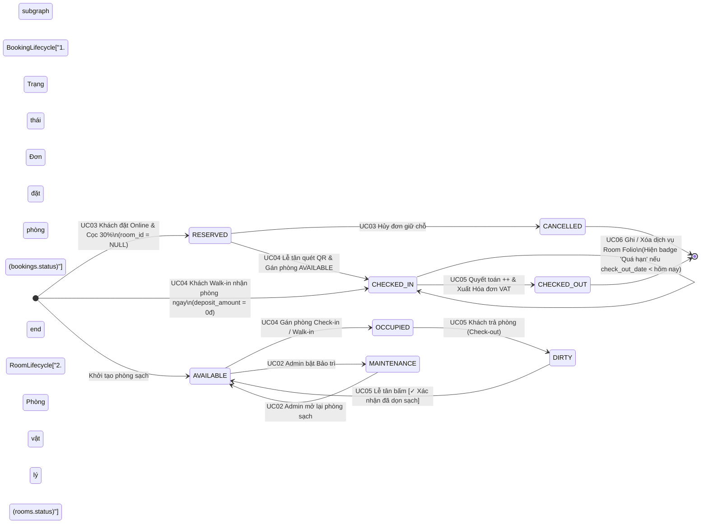

# 12. MA TRẬN PHÂN QUYỀN 3 ROLE (RBAC), ĐỒNG BỘ TRẠNG THÁI (DIRTY LIFECYCLE) & TỪ ĐIỂN 35 THÔNG BÁO TIẾNG VIỆT

> **Ánh xạ Báo cáo:** Phục vụ trực tiếp **Chương 3 (Mục 3.1, 3.3)**, **Chương 5 (Mục 5.3)** và **Chương 6 (Mục 6.2 Ma trận phân quyền RBAC)**.  
> **Mục đích cho Khoa khi code:** Cung cấp bảng quy chiếu chính xác 100% cho `SecurityConfig`, điều kiện hiển thị nút bấm `th:if` trên Thymeleaf và các hằng số thông báo tiếng Việt (`MSG-01` $\rightarrow$ `MSG-35`).

---

## 1. Sơ đồ & Bảng Đồng bộ Trạng thái Hai Chiều (`bookings.status` $\leftrightarrow$ `rooms.status`)

### 1.1. Sơ đồ Vòng đời Trạng thái Đơn đặt phòng và Phòng vật lý

### 1.2. Bảng Quy chiếu Badge Màu trên Giao diện (`ACE Color System`)
| Tình huống nghiệp vụ | `bookings.status` | `rooms.status` | Nhãn Badge hiển thị | Mã màu (Dark / Light) |
|---|:---:|:---:|---|---|
| Phòng trống và đã dọn vệ sinh sạch sẽ | — | `AVAILABLE` | **Trống sạch (Clean)** | `#22C55E` / `#15803D` (Xanh lá) |
| Đơn đặt trực tuyến đã đóng cọc 30%, chờ đến nhận | `RESERVED` | *(Chưa gán)* | **Đã xác nhận – Đã cọc 30%** | `#A78BFA` / `#7C3AED` (Tím) |
| Khách đã nhận phòng, đang trong thời hạn lưu trú | `CHECKED_IN` | `OCCUPIED` | **Đang ở (Occupied)** | `#60A5FA` / `#2563EB` (Xanh dương) |
| Khách vừa Check-out, phòng khóa chờ buồng phòng dọn | `CHECKED_OUT` | **`DIRTY`** | **Chờ dọn dẹp (Dirty)** | `#F59E0B` / `#D97706` (Cam) |
| Khách đang `CHECKED_IN` nhưng quá ngày/giờ trả phòng | `CHECKED_IN` | `OCCUPIED` | **Quá hạn (Overdue)** *(suy diễn)* | `#F87171` / `#DC2626` (Đỏ) |
| Phòng đang sửa chữa thiết bị (loại khỏi mẫu số `OR%`) | — | `MAINTENANCE` | **Đang bảo trì** | `#9CA3AF` / `#6B7280` (Xám) |
| Đơn đặt phòng giữ chỗ bị hủy trước khi nhận | `CANCELLED` | *(Không đổi)* | **Đã hủy** | `#9CA3AF` / `#6B7280` (Xám) |

---

## 2. Ma trận Phân quyền Chi tiết theo 3 Role & 10 Màn hình (`RBAC Matrix` – Chương 6, Mục 6.2)

### 2.1. Phân quyền Truy cập Route URL phía Máy chủ (`Spring Security` – `NFR-03`)
| Mã WF | Phân hệ / Màn hình | Route URL | Công khai (Chưa login) | Khách hàng (`CUSTOMER`) | Lễ tân (`RECEPTIONIST`) | Quản trị viên (`ADMIN`) |
|:---:|---|---|:---:|:---:|:---:|:---:|
| `WF-01` | Trang chủ Storytelling | `GET /` | ✅ Cho phép | ✅ Cho phép | ✅ Cho phép | ✅ Cho phép |
| `WF-02` | Đăng nhập & Đăng ký | `GET/POST /login`, `/register`, `POST /logout` | ✅ Cho phép | ✅ (Đã login tự về Dashboard) | ✅ (Đã login tự về Dashboard) | ✅ (Đã login tự về Dashboard) |
| `WF-03` | Dashboard Khách hàng & Phiếu QR | `GET /customer/dashboard` `POST /customer/bookings/{id}/cancel` | ❌ `redirect:/login` | ✅ Cho phép | ⛔ Chặn (`403`) | ✅ Cho phép |
| `WF-04` | Tìm Hạng phòng & Pop-up Cọc 30% | `GET /booking/search` `POST /booking/deposit` | ✅ Xem tìm kiếm ❌ Cọc cần login | ✅ Cho phép | ⛔ Chặn (`403`) | ✅ Cho phép |
| `WF-05` | Dashboard Lễ tân (Sơ đồ phòng & Dọn sạch) | `GET /staff/dashboard` `POST /staff/rooms/{id}/clean` | ❌ `redirect:/login` | ⛔ Chặn (`403`) | ✅ Cho phép | ✅ Cho phép |
| `WF-06` | Check-in Quét QR Gán phòng & Walk-in 0đ | `GET/POST /staff/check-in` `GET/POST /staff/walk-in` | ❌ `redirect:/login` | ⛔ Chặn (`403`) | ✅ Cho phép | ✅ Cho phép |
| `WF-07` | Quản lý Room Folio (4 nhóm dịch vụ) | `GET/POST /staff/bookings/{id}/folio/**` | ❌ `redirect:/login` | ⛔ Chặn (`403`) | ✅ Cho phép | ✅ Cho phép |
| `WF-08` | Check-out Quyết toán `++` & Hóa đơn VAT | `GET/POST /staff/bookings/{id}/check-out` `GET /staff/invoices/{id}` | ❌ `redirect:/login` | ⛔ Chặn (`403`) | ✅ Cho phép | ✅ Cho phép |
| `WF-09` | Quản trị Hạng phòng, Giá, Phòng & Dịch vụ | `GET/POST /admin/room-types/**` `/admin/rooms/**`, `/admin/services/**` | ❌ `redirect:/login` | ⛔ Chặn (`403`) | 👀 Chỉ xem bảng giá (Chặn POST `403`) | ✅ Toàn quyền CRUD |
| `WF-10` | Dashboard Admin (Doanh thu `++` & `OR%`) | `GET /admin/dashboard` | ❌ `redirect:/login` | ⛔ Chặn (`403`) | ⛔ Chặn (`403`) | ✅ Toàn quyền |

### 2.2. Quy tắc Hiển thị Nút Thao tác theo Trạng thái Phòng trên `WF-05` (`/staff/dashboard`)
- Khi thẻ phòng có `status == 'AVAILABLE'` (🟢 Xanh lá): Hiển thị nút **[Gán Check-in / Walk-in]**.
- Khi thẻ phòng có `status == 'OCCUPIED'` (🔵 Xanh dương): Hiển thị 2 nút **[Room Folio]** (mở `WF-07`) và **[Trả phòng / Check-out]** (mở `WF-08`).
- Khi thẻ phòng có `status == 'DIRTY'` (🟠 Cam): Khóa gán khách mới; hiển thị nút nổi bật **[✓ Xác nhận đã dọn sạch]** để chuyển phòng về `AVAILABLE`.
- Khi thẻ phòng có `status == 'MAINTENANCE'` (⚪ Xám): Khóa mọi thao tác nghiệp vụ của Lễ tân; chỉ `ADMIN` có nút **[Mở lại phòng]**.

---

## 3. Từ điển 35 Thông báo Hệ thống Chuẩn Tiếng Việt (`MSG-01` – `MSG-35`)

| Mã MSG | Use Case | Loại | Nội dung thông báo chuẩn tiếng Việt trên giao diện |
|:---:|:---:|:---:|---|
| `MSG-01` | `UC01` | Lỗi | Sai tên đăng nhập hoặc mật khẩu. |
| `MSG-02` | `UC01` | Thành công | Bạn đã đăng xuất khỏi hệ thống ACE Hotel. |
| `MSG-03` | `UC01` | Thành công | Đăng ký tài khoản khách hàng thành công! Chào mừng bạn đến với ACE Hotel. |
| `MSG-04` | `UC01` | Lỗi | Tên đăng nhập này đã được sử dụng. Vui lòng chọn tên đăng nhập khác. |
| `MSG-05` | `UC01` | Lỗi (403) | Bạn không có quyền truy cập vào phân hệ chức năng này. |
| `MSG-06` | `UC02` | Thành công | Lưu thông tin hạng phòng và biểu giá thành công. |
| `MSG-07` | `UC02` | Thành công | Đã xóa hạng phòng thành công. |
| `MSG-08` | `UC02` | Thành công | Lưu thông tin phòng vật lý thành công. |
| `MSG-09` | `UC02` | Thành công | Đã xóa phòng vật lý thành công. |
| `MSG-10` | `UC02` | Thành công | Lưu danh mục dịch vụ thành công. |
| `MSG-11` | `UC02` | Thành công | Đã xóa dịch vụ khỏi danh mục. |
| `MSG-12` | `UC02` | Lỗi | Số phòng hoặc tên danh mục đã tồn tại. Vui lòng kiểm tra lại. |
| `MSG-13` | `UC02` | Lỗi | Đơn giá ngày thường, giá cuối tuần phải lớn hơn 0 VNĐ và sức chứa tối thiểu là 1 khách. |
| `MSG-14` | `UC02` | Lỗi | Không thể xóa hạng phòng này vì đang có phòng vật lý hoặc đơn đặt phòng tham chiếu. |
| `MSG-15` | `UC02` | Lỗi | Không thể xóa phòng đã có lịch sử đặt phòng. Vui lòng chuyển phòng sang trạng thái Bảo trì nếu ngưng khai thác. |
| `MSG-16` | `UC02` | Lỗi | Không thể chuyển sang trạng thái Bảo trì vì phòng đang có khách lưu trú (OCCUPIED). |
| `MSG-17` | `UC02` | Lỗi | Không thể xóa dịch vụ này vì đã phát sinh trong lịch sử Room Folio của khách hàng. |
| `MSG-18` | `UC03` | Thành công | Đặt phòng và thanh toán cọc 30% thành công! Mã đặt phòng của quý khách là {bookingCode}. |
| `MSG-19` | `UC03` | Thành công | Đã hủy đơn đặt phòng giữ chỗ {bookingCode} thành công. |
| `MSG-20` | `UC03` | Lỗi | Ngày trả phòng phải sau ngày nhận phòng ít nhất 1 đêm. |
| `MSG-21` | `UC03` | Thông tin | Không còn hạng phòng trống phù hợp trong khoảng ngày và số lượng khách đã chọn. |
| `MSG-22` | `UC03` | Lỗi | Hạng phòng này vừa hết suất trống trong khoảng ngày bạn chọn. Vui lòng chọn hạng phòng khác. |
| `MSG-23` | `UC03` | Lỗi | Chỉ có thể hủy đơn đặt phòng khi đang ở trạng thái Đã xác nhận giữ chỗ (RESERVED). |
| `MSG-24` | `UC04` | Thành công | Check-in thành công! Đã gán Phòng {roomNumber} (Sạch) cho đơn đặt {bookingCode} và kích hoạt Room Folio. |
| `MSG-25` | `UC04` | Thành công | Tiếp nhận khách vãng lai (Walk-in) thành công! Đã nhận Phòng {roomNumber} (Tiền cọc: 0đ – Quyết toán 100% khi trả phòng). |
| `MSG-26` | `UC04` | Lỗi | Không tìm thấy mã đặt phòng {bookingCode} hoặc đơn không ở trạng thái chờ nhận phòng (RESERVED). |
| `MSG-27` | `UC04` | Lỗi | Hiện chưa có phòng vật lý nào thuộc hạng phòng này ở trạng thái Trống sạch (AVAILABLE). Vui lòng xác nhận dọn sạch phòng DIRTY trước khi gán! |
| `MSG-28` | `UC04` | Lỗi | Phòng {roomNumber} vừa được gán cho khách khác hoặc không ở trạng thái sạch (AVAILABLE). |
| `MSG-29` | `UC05` | Thành công | Quyết toán trả phòng thành công! Đã lập Hóa đơn VAT #{invoiceCode} và chuyển Phòng {roomNumber} sang trạng thái Chờ dọn dẹp (DIRTY). |
| `MSG-30` | `UC05` | Thành công | Đã xác nhận dọn vệ sinh hoàn tất! Phòng {roomNumber} đã chuyển về trạng thái Trống sạch (AVAILABLE), sẵn sàng đón khách mới. |
| `MSG-31` | `UC05` | Lỗi | Chỉ có thể thực hiện quyết toán trả phòng cho đơn đang ở trạng thái Đang lưu trú (CHECKED_IN). |
| `MSG-32` | `UC06` | Thành công | Đã ghi nhận dịch vụ vào Room Folio của Phòng {roomNumber} thành công. |
| `MSG-33` | `UC06` | Thành công | Đã xóa dòng dịch vụ khỏi Room Folio thành công. |
| `MSG-34` | `UC06` | Lỗi | Chỉ được phép thêm hoặc xóa dịch vụ trong Room Folio khi phòng đang có khách lưu trú (CHECKED_IN). |
| `MSG-35` | `UC06` | Lỗi | Số lượng dịch vụ sử dụng phải lớn hơn hoặc bằng 1. |