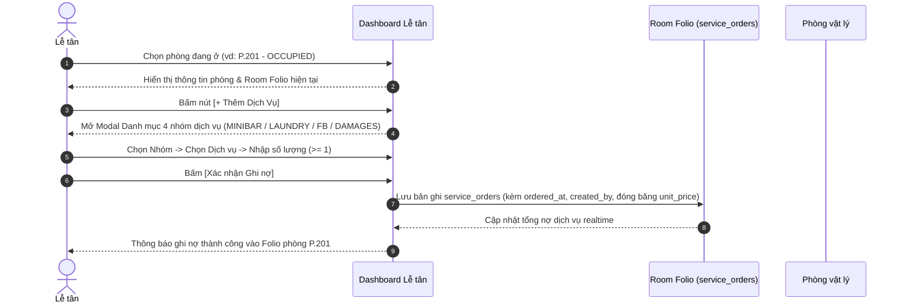
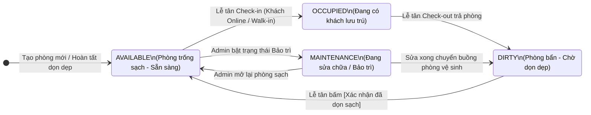

# QUY TRÌNH NGHIỆP VỤ CHÍNH THỨC — ACE HOTEL (PMS & BOOKING PORTAL)

> **Trạng thái:** Bản chốt chính thức (Official Specification)  
> **Ngày cập nhật:** 14/10/2026  
> **Mục tiêu:** Chuẩn hóa hệ thống theo mô hình PMS thực tế đạt chuẩn môn học 502050 (6 chức năng cốt lõi, 4 trọng tâm phản biện), phân tách rõ 2 phân hệ Public và Backoffice, bổ sung luồng đặt phòng theo Hạng phòng (Quota), đặt cọc 30% cho khách Online, tiếp nhận khách Walk-in thanh toán 100% khi trả phòng, gán phòng vật lý sạch khi check-in, vòng đời dọn phòng (`DIRTY`), 4 giao diện dashboard phân quyền độc lập và cơ chế đăng ký/điều hướng vai trò tự động[cite: 53].

---

## 1. Mục tiêu & Định hướng nâng cấp

1. **Chuẩn hóa quy trình khách sạn thực tế (PMS Standard):**
   - **Khách đặt trực tuyến (Online Booking):** Đặt trước theo **Hạng phòng (Room Type)** dựa trên tồn kho hạng phòng khả dụng (*Room Type Quota*), thanh toán **tiền cọc 30%** để giữ chỗ (*Hold booking*) và nhận **Phiếu xác nhận kèm mã QR**[cite: 53].
   - **Khi khách đến quầy (Check-in):** Lễ tân kiểm tra và **Gán phòng vật lý cụ thể (Room Number)** đang ở trạng thái trống sạch (*Available / Clean*) vào đơn đặt[cite: 53].
   - **Tiếp nhận khách vãng lai (Walk-in):** Khách đến trực tiếp quầy được Lễ tân gán thẳng phòng sạch và nhận phòng ngay (**không cần thu tiền cọc lúc vào**); toàn bộ 100% chi phí sẽ được quyết toán một lần khi Check-out.
2. **Khép kín dòng tiền & chuẩn hạch toán thuế phí (Formula `++`):**
   - Áp dụng công thức `++` chuẩn khách sạn gồm **Phí phục vụ 5% (Service Charge - SVC)** và **Thuế GTGT 10% (VAT)** tính tuần tự trên tổng chi phí gốc[cite: 53]:
     $$\text{Chi phí gốc (Subtotal)} = \text{Tiền phòng} + \text{Tổng dịch vụ (Folio)} + \text{Phụ thu (Nhận sớm / Trả trễ)}$$
     $$\text{Phí phục vụ (SVC 5\%)} = \text{ROUND}(\text{Subtotal} \times 5\%)$$
     $$\text{Thuế GTGT (VAT 10\%)} = \text{ROUND}((\text{Subtotal} + \text{SVC}) \times 10\%)$$
     $$\text{Tổng cộng hóa đơn (Grand Total)} = \text{Subtotal} + \text{SVC} + \text{VAT}$$
     $$\text{Số tiền thực thu khi Check-out (Balance Due)} = \text{Grand Total} - \text{Tiền đã cọc (Deposit)}$$
   - **Quy tắc thanh toán thống nhất khi Check-out:**
     - **Khách Online** (đã cọc 30% lúc đặt): Khi Check-out thanh toán **70% tiền phòng còn lại + 100% dịch vụ phát sinh & phụ thu** (đã bao gồm SVC 5% và VAT 10%)[cite: 53].
     - **Khách Walk-in** (cọc `0đ` lúc vào): Khi Check-out thanh toán **100% toàn bộ hóa đơn** (100% tiền phòng + dịch vụ phát sinh & phụ thu, kèm SVC 5% và VAT 10%).
   - Vòng đời phòng bổ sung trạng thái **`DIRTY` (Chờ dọn dẹp)** ngay sau khi khách trả phòng, khóa cứng không cho gán nhầm phòng bẩn cho khách mới[cite: 53].
3. **Phân định rõ 2 phân hệ, 3 Actor & 4 Không gian Giao diện (Dashboards):**
   - Phân hệ khách hàng trực tuyến (Public) và Phân hệ nội bộ (PMS/Backoffice)[cite: 53].
   - Landing page dạng Storytelling cuộn dọc, kèm 3 Dashboard chuyên biệt cho 3 nhóm đối tượng: Khách hàng (`CUSTOMER`), Nhân viên Lễ tân (`RECEPTIONIST`), Quản trị viên (`ADMIN`)[cite: 53].
   - Hệ thống tự động nhận diện vai trò sau khi đăng nhập để chuyển hướng về đúng Dashboard tương ứng[cite: 53].

---

## 2. Kiến trúc 4 Màn hình / Phân hệ Giao diện chính

Hệ thống được thiết kế với **4 giao diện hoàn toàn khác nhau**, phục vụ đúng ngữ cảnh của từng đối tượng[cite: 53]:

```text
+-----------------------------------------------------------------------------------------------+
|                                    KIẾN TRÚC 4 GIAO DIỆN CHÍNH                                |
+------------------------------------+----------------------------------------------------------+
|       PHÂN HỆ CÔNG KHAI (PUBLIC)   |               PHÂN HỆ NỘI BỘ & CÁ NHÂN (PORTALS)         |
|                                    |                                                          |
|  [1. LANDING PAGE STORYTELLING]    |  [2. DASHBOARD KHÁCH HÀNG]   [3. DASHBOARD LỄ TÂN]       |
|  - Scroll dọc qua từng section     |  - Quản lý lịch sử booking   - Sơ đồ phòng trực quan     |
|  - Thiết kế đa phong cách          |  - Phiếu xác nhận & Mã QR    - Check-in gán phòng sạch   |
|  - Giới thiệu Khách sạn            |  - Đơn cọc & trạng thái giữ  - Tiếp nhận Walk-in (0đ cọc)|
|  - Giới thiệu Dịch vụ tiện ích     |  - Thông tin cá nhân         - Ghi dịch vụ vào Folio     |
|  - Giới thiệu Tính năng & Đặt P    |                              - Check-out & chuyển Dirty  |
|                                    |  ------------------------------------------------------- |
|                                    |  [4. DASHBOARD ADMIN / QUẢN LÝ]                          |
|                                    |  - Cấu hình hạng phòng & giá ngày thường / cuối tuần     |
|                                    |  - Quản lý danh mục phòng & bảng giá dịch vụ             |
|                                    |  - Biểu đồ doanh thu & tỷ lệ lấp đầy (Occupancy Rate)    |
+------------------------------------+----------------------------------------------------------+
```

### Chi tiết 4 giao diện:

1. **Giao diện 1: Landing Page với Storytelling (Scroll dọc):**
   - Trải nghiệm cuộn dọc theo dòng câu chuyện thương hiệu, mỗi section là một phong cách thiết kế mỹ thuật riêng biệt[cite: 53]:
     - **Section 1 (Hero - Câu chuyện thương hiệu):** Giới thiệu không gian, triết lý phục vụ và đẳng cấp của khách sạn ACE[cite: 53].
     - **Section 2 (Dịch vụ & Tiện ích):** Hình ảnh và giới thiệu các trải nghiệm ẩm thực, thư giãn, minibar, giặt ủi[cite: 53].
     - **Section 3 (Các hạng phòng nổi bật):** Trình diễn các hạng phòng (Standard, Superior, Deluxe, Family, Suite) kèm bảng giá ngày thường / cuối tuần và tiện nghi độc bản[cite: 21, 53].
     - **Section 4 (Chức năng website & Đặt phòng nhanh):** Thanh tìm kiếm ngày nhận/trả, số khách và nút dẫn vào luồng đặt phòng trực tuyến[cite: 53].
2. **Giao diện 2: Dashboard Khách hàng (Customer Portal):**
   - Không gian cá nhân sau khi khách đăng ký / đăng nhập[cite: 53]:
     - Danh sách các đơn đặt phòng của tôi (Mã `BK-...`, Hạng phòng, Ngày đến/đi, Tiền cọc 30% đã thanh toán, Số tiền 70% còn lại, Trạng thái đơn `RESERVED` / `CHECKED_IN` / `CHECKED_OUT` / `CANCELLED`)[cite: 53].
     - Xem và tải **Phiếu xác nhận đặt phòng kèm mã QR**, xem chính sách nhận phòng hoặc yêu cầu hủy phòng (khi đơn đang ở trạng thái `RESERVED`)[cite: 53].
     - Cập nhật thông tin hồ sơ cá nhân[cite: 53].
3. **Giao diện 3: Dashboard Nhân viên Lễ tân (Receptionist PMS):**
   - Bàn làm việc tác nghiệp thường trực tại quầy[cite: 53]:
     - Sơ đồ lưới tình trạng phòng trực quan (Mã phòng, Hạng, Trạng thái: Trống sạch `AVAILABLE`, Đang ở `OCCUPIED`, Chờ dọn `DIRTY`, Bảo trì `MAINTENANCE`)[cite: 53].
     - Danh sách check-in / check-out hôm nay và ô nhập/quét nhanh mã QR (`BK-XXXX`)[cite: 53].
     - Tiếp nhận khách đặt trước (kiểm tra phòng sạch và **Gán phòng vật lý cụ thể**) và tiếp nhận **Khách vãng lai (Walk-in)** nhận phòng ngay (cọc `0đ`, thanh toán 100% lúc trả phòng)[cite: 53].
     - Ghi nhận phát sinh dịch vụ vào tài khoản phòng (*Room Folio*)[cite: 53].
     - Check-out, quyết toán hóa đơn (khấu trừ cọc 30% cho khách Online hoặc thu đủ 100% cho khách Walk-in, cộng phụ thu nếu có), đổi trạng thái phòng sang `DIRTY` và nút bấm nhanh **[Xác nhận đã dọn sạch]**[cite: 53].
4. **Giao diện 4: Dashboard Quản trị viên (Admin Backoffice):**
   - Bảng điều khiển quản trị chiến lược[cite: 53]:
     - Cấu hình hạng phòng, số lượng phòng thực tế, biểu giá linh hoạt theo ngày thường (T2–T5) và cuối tuần/ngày lễ (T6–CN)[cite: 53].
     - Quản lý bảng giá danh mục dịch vụ theo 4 nhóm (`MINIBAR`, `LAUNDRY`, `FB`, `DAMAGES`)[cite: 53].
     - Báo cáo thống kê doanh thu đa chiều (doanh thu phòng, dịch vụ, phí phục vụ SVC 5%, thuế VAT 10%)[cite: 53].
     - Biểu đồ đo lường **Tỷ lệ lấp đầy phòng (Occupancy Rate)**, **ADR** và **RevPAR** theo thời gian[cite: 53].

---

## 3. Quy chuẩn Nhận diện Thương hiệu & Hệ thống Thiết kế (Brand Identity & Design System)

### 3.1. Nhận diện Thương hiệu & Logo (Giữ nguyên 100%)
* **Tên thương hiệu:** **ACE Hotel** (*Accommodation, Check-in & Extras*)[cite: 2, 53].
* **Bộ Logo chính thức:** Giữ nguyên tài sản thương hiệu trong dự án[cite: 1, 2, 3, 4, 53]:
  * Logo đầy đủ có tên: `1_logo-day-du_khong-nen.png`, `3_logo-ACE-co-ten_khong-nen.png`, `4_logo-giong-hien-tai_them-ten.png`[cite: 2, 3, 4, 11].
  * Biểu tượng độc lập (Header / Sidebar / Favicon): `2_logo-ACE_khong-nen.png`[cite: 1, 11].
  * Phông chữ chủ đạo: **Inter** (Regular, Medium, SemiBold, Bold) nhúng offline nội bộ[cite: 11, 53].

### 3.2. Chế độ Giao diện Sáng / Tối (Dark Mode & Light Mode)
* **Cơ chế chuyển đổi:**
  * Có nút bấm chuyển đổi nhanh Dark/Light (`data-theme-toggle`) trên thanh điều hướng ở cả 4 giao diện (Landing, Customer, Receptionist, Admin)[cite: 53].
  * Mặc định khởi tạo: **Dark Mode** (tạo phong cách sang trọng, cao cấp cho khách sạn); lưu trạng thái lựa chọn của người dùng vào `localStorage ('ace-theme')` để không bị nháy sáng khi chuyển trang[cite: 11, 53].

### 3.3. Tuân thủ bảng màu ACE Color System (`tokens.css`)
Hệ thống sử dụng đồng bộ bảng màu định danh thông qua CSS Custom Properties (Design Tokens)[cite: 11, 37, 46, 53]:

| Thành phần màu | Chế độ Tối (Dark Mode - Mặc định) | Chế độ Sáng (Light Mode) | Ý nghĩa / Ứng dụng |
|---|---|---|---|
| **Màu thương hiệu (`--primary`)** | **`#FDBF2D`** (Vàng Gold) | **`#FDBF2D`** (Vàng Gold) | Giữ nguyên màu vàng nhận diện ở cả 2 chế độ; nút bấm chính, điểm nhấn thương hiệu[cite: 11, 53] |
| **Màu nền chính (`--bg`)** | `#000000` (Đen sâu) | `#F7F6F2` (Trắng kem ấm) | Nền toàn trang[cite: 11, 53] |
| **Màu bề mặt (`--surface`)** | `#121212` (Xám đen) | `#FFFFFF` (Trắng tinh) | Thẻ card, bảng dữ liệu, modal, sidebar[cite: 11, 53] |
| **Màu nổi (`--elevated`)** | `#1C1C1C` | `#FFFFFF` | Modal, Pop-up xác nhận đặt phòng, Dropdown[cite: 11] |
| **Màu viền (`--border`)** | `#2A2A2A` | `#E6E3DA` | Viền ngăn cách card, ô nhập liệu[cite: 11, 53] |
| **Chữ chính (`--text`)** | `#FFFFFF` | `#0A0A0A` | Tiêu đề, nội dung văn bản chính[cite: 11, 53] |
| **Chữ phụ (`--text-2`, `--text-3`)** | `#A1A1AA`, `#71717A` | `#52525B`, `#71717A` | Nhãn phụ, mô tả, chú thích mờ[cite: 11, 53] |
| **Chữ nhấn (`--primary-text`)** | `#FDBF2D` | `#B45309` | Link, nhãn vàng đảm bảo độ tương phản trên nền sáng[cite: 11, 37] |

#### Bảng màu mã hóa Trạng thái phòng (Room State Colors):
* **Trống / Sạch (`AVAILABLE / Clean`):** `--st-free` (`#22C55E` Dark / `#15803D` Light) — Sẵn sàng gán cho khách[cite: 53].
* **Đã đặt / Cọc (`RESERVED`):** `--st-reserved` (`#A78BFA` Dark / `#7C3AED` Light) — Đơn giữ chỗ đã cọc 30%, chờ check-in[cite: 53].
* **Đang ở (`OCCUPIED`):** `--st-occupied` (`#60A5FA` Dark / `#2563EB` Light) — Phòng đang có khách lưu trú[cite: 53].
* **Chờ dọn dẹp (`DIRTY`):** `--st-dirty` (`#F59E0B` Dark / `#D97706` Light) — Phòng vừa check-out, chưa dọn dẹp[cite: 53].
* **Quá hạn / Trễ (`OVERDUE`):** `--st-overdue` (`#F87171` Dark / `#DC2626` Light) — Khách lưu trú quá giờ/ngày quy định[cite: 53].
* **Bảo trì (`MAINTENANCE`):** `--st-maint` (`#9CA3AF` Dark / `#6B7280` Light) — Đang sửa chữa / ngừng khai thác[cite: 53].

---

## 4. Cơ chế Đăng ký, Đăng nhập & Điều hướng vai trò tự động

Hệ thống phân luồng người dùng tự động ngay tại cổng xác thực[cite: 53]:

```text
                       [ MÀN HÌNH ĐĂNG NHẬP / ĐĂNG KÝ ]
                                      |
         +----------------------------+----------------------------+
         |                                                         |
  [Tài khoản Nội bộ có sẵn]                                [Khách hàng mới]
  - Admin (quanly / Ace@123)                                       |
  - Lễ tân (letan / Ace@123)                               [Form Đăng ký Khách hàng]
         |                                                 - Họ và tên (full_name)
         |                                                 - Ngày sinh (date_of_birth)
         |                                                 - Số điện thoại (phone)
         |                                                 - Tên đăng nhập (username)
         |                                                 - Mật khẩu (password)
         |                                                         |
         v                                                         v
   [ĐĂNG NHẬP HỆ THỐNG]                                   [TẠO TÀI KHOẢN THÀNH CÔNG]
         |                                                         |
         +----------------------------+----------------------------+
                                      |
                        [KIỂM TRA ROLE & ĐIỀU HƯỚNG]
                                      |
         +----------------------------+----------------------------+
         |                            |                            |
    Role: ADMIN                Role: RECEPTIONIST           Role: CUSTOMER
         |                            |                            |
         v                            v                            v
  /admin/dashboard             /staff/dashboard            /customer/dashboard
(Dashboard Admin)            (Dashboard Lễ tân)          (Dashboard Khách hàng)
```

### Quy tắc đăng nhập & điều hướng:
1. **Đối với Admin và Nhân viên Lễ tân:**
   - Khởi tạo sẵn trong `sample-data.sql` (mật khẩu băm `BCrypt`)[cite: 6, 53]:
     - Quản trị viên: `quanly` / `Ace@123` (Role: `ADMIN`) $\rightarrow$ Tự động điều hướng về `/admin/dashboard`[cite: 53].
     - Lễ tân: `letan` / `Ace@123` (Role: `RECEPTIONIST`) $\rightarrow$ Tự động điều hướng về `/staff/dashboard`[cite: 53].
2. **Đối với Khách hàng trực tuyến (`CUSTOMER`):**
   - Khách hàng bấm **Đăng ký (`/register`)** và nhập 5 trường bắt buộc trên form: `full_name`, `date_of_birth`, `phone`, `username`, `password` (có thể nhập thêm `email`, `id_number` tùy chọn)[cite: 53].
   - Hệ thống tạo bản ghi `users` (`role = 'CUSTOMER'`) và bản ghi `customers` liên kết qua `user_id`, sau đó điều hướng về `/customer/dashboard`[cite: 53].
3. **Đối với Hồ sơ Khách vãng lai (Walk-in Guest tại quầy):**
   - Do Lễ tân tạo trực tiếp khi làm thủ tục Walk-in tại quầy (chỉ cần nhập `full_name`, `phone`, `id_number` CCCD/Passport)[cite: 53]. Bản ghi này lưu vào bảng `customers` với `user_id = NULL` và `date_of_birth = NULL` (khách Walk-in không cần tự tạo tài khoản đăng nhập).

---

## 5. Mô hình 3 Actor & Phân quyền hệ thống

```text
+---------------------------------------------------------------------------------+
|                           HỆ THỐNG QUẢN LÝ KHÁCH SẠN ACE                        |
+----------------------------------------+----------------------------------------+
|       PHÂN HỆ KHÁCH HÀNG (PUBLIC)      |    PHÂN HỆ NỘI BỘ (PMS / BACKOFFICE)   |
|                                        |                                        |
| [Actor: Khách hàng (CUSTOMER)]         | [Actor: Lễ tân]        [Actor: Admin]  |
| - Đăng ký / Đăng nhập tài khoản        | - Tiếp nhận check-in   - Cấu hình giá  |
| - Tìm hạng phòng trống theo ngày       | - Gán phòng vật lý     - Quản lý phòng |
| - Đặt theo Hạng phòng & Cọc 30%        | - Tiếp nhận Walk-in    - Quản lý DV    |
| - Nhận Phiếu xác nhận & Mã QR          | - Ghi nhận Room Folio  - Xem báo cáo   |
| - Quản lý Dashboard cá nhân / Hủy đơn  | - Check-out & Dọn phòng  Doanh thu/OR  |
+----------------------------------------+----------------------------------------+
```

---

## 6. Danh mục 6 Chức năng Chính (Đạt chuẩn 5–7 Chức năng, 4 Trọng tâm phản biện)

| STT | Mã UC | Tên Use Case | Actor chính | Vai trò phản biện | Phạm vi nghiệp vụ cụ thể |
|:---:|:---:|---|:---:|:---:|---|
| **1** | **UC01** | **Tìm kiếm & Đặt phòng trực tuyến** | Khách hàng | ⭐ **Trọng tâm 1** | Đăng ký/Đăng nhập; tra cứu tồn kho **Hạng phòng** theo ngày; tính giá ngày thường/cuối tuần; thanh toán **cọc 30%**; giữ chỗ (*Hold booking* `RESERVED`); xuất **Phiếu xác nhận kèm mã QR** tại Dashboard khách hàng[cite: 53]. |
| **2** | **UC02** | **Quản lý Check-in, Gán phòng & Walk-in** | Lễ tân | ⭐ **Trọng tâm 2** | Tra cứu mã Booking/QR của khách đặt trước hoặc tạo mới khách vãng lai (*Walk-in* cọc `0đ`); kiểm tra và **Gán phòng vật lý sạch (`AVAILABLE`)**; tính phụ thu nhận sớm (nếu có); đổi trạng thái phòng sang `OCCUPIED`[cite: 53]. |
| **3** | **UC03** | **Ghi nhận Dịch vụ Lưu trú (Room Folio)** | Lễ tân | Bổ trợ | Chọn phòng đang ở (`OCCUPIED`) $\rightarrow$ chọn dịch vụ thuộc 4 nhóm (`MINIBAR`, `LAUNDRY`, `FB`, `DAMAGES`) $\rightarrow$ đóng băng đơn giá lúc gọi và cộng dồn vào *Room Folio*[cite: 53]. |
| **4** | **UC04** | **Check-out, Quyết toán `++` & Dọn phòng** | Lễ tân | ⭐ **Trọng tâm 3** | Tự động tổng hợp: `(Tiền phòng + Dịch vụ + Phụ thu) + SVC 5% + VAT 10% - Tiền đã cọc` (**Khách Online trả 70% còn lại + phát sinh; Khách Walk-in trả 100%**); xuất hóa đơn VAT; chuyển phòng sang **`DIRTY`**; xác nhận đã dọn sạch về `AVAILABLE`[cite: 53]. |
| **5** | **UC05** | **Quản lý Danh mục Phòng, Giá & Dịch vụ** | Admin | Nền tảng | Cấu hình hạng phòng, đơn giá ngày thường (T2–T5) và cuối tuần (T6–CN), quản lý phòng vật lý (Thêm/Sửa/Bảo trì/Xóa) và danh mục dịch vụ trên Dashboard Admin[cite: 53]. |
| **6** | **UC06** | **Báo cáo Doanh thu & Công suất phòng** | Admin | ⭐ **Trọng tâm 4** | Thống kê doanh thu đa chiều (phòng, dịch vụ, SVC, VAT) theo thời gian; tính toán và biểu đồ hóa **Tỷ lệ lấp đầy phòng (Occupancy Rate)**, **ADR**, **RevPAR**[cite: 53]. |

---

## 7. Đặc tả Chi tiết Quy trình Đặt phòng, Kiểm tra Tồn kho (Quota) & Phiếu xác nhận (UC01 - Trọng tâm 1)

### 7.1. Công thức Kiểm tra Tồn kho Hạng phòng (Room Type Quota Check) & Tính giá Động
Vì khách đặt trực tuyến chọn theo **Hạng phòng (`room_type_id`)** và chỉ được gán phòng vật lý (`room_id`) khi đến quầy Check-in, hệ thống kiểm tra khả năng đáp ứng của từng Hạng phòng trong khoảng ngày nửa mở `[newCheckIn, newCheckOut)` theo quy tắc sau[cite: 9, 53]:

1. **Tổng số phòng khai thác của hạng phòng ($N_{\text{total}}$):**
   $$N_{\text{total}} = \text{COUNT}(\text{rooms } r \text{ WHERE } r.\text{room\_type\_id} = X \text{ AND } r.\text{status} \neq \text{'MAINTENANCE'})$$
2. **Số lượng đơn đặt đang giữ chỗ hoặc đang ở trùng khoảng ngày ($N_{\text{booked}}$):**
   $$N_{\text{booked}} = \text{COUNT}(\text{bookings } b \text{ WHERE } b.\text{room\_type\_id} = X \text{ AND } b.\text{status} \in \{\text{'RESERVED'}, \text{'CHECKED\_IN'}\} \text{ AND } b.\text{check\_in\_date} < \text{newCheckOut} \text{ AND } b.\text{check\_out\_date} > \text{newCheckIn})$$
3. **Số lượng phòng trống còn lại của hạng phòng ($N_{\text{available}}$):**
   $$N_{\text{available}} = N_{\text{total}} - N_{\text{booked}}$$
   *Hạng phòng được hiển thị cho khách đặt khi và chỉ khi $N_{\text{available}} \ge 1$ (và sức chứa `capacity >= số khách`).*

4. **Cách tính Tiền phòng gốc theo Ngày thường / Cuối tuần (Dynamic Pricing):**
   - Hệ thống duyệt từng đêm $d$ từ `check_in_date` đến `check_out_date.minusDays(1)`[cite: 53]:
     - Nếu $d$ rơi vào **Thứ Hai, Thứ Ba, Thứ Tư, Thứ Năm**: Cộng `room_types.price_per_night`[cite: 53].
     - Nếu $d$ rơi vào **Thứ Sáu, Thứ Bảy, Chủ Nhật**: Cộng `room_types.weekend_price_per_night`[cite: 53].

### 7.2. Luồng 4 bước thực hiện Đặt phòng trực tuyến:
1. **Bước 1 — Chọn thông tin đặt phòng:**
   - Khách hàng chọn **Ngày nhận phòng (`check_in_date`)**, **Ngày trả phòng (`check_out_date` > `check_in_date`)**, **Số khách** và **Hạng phòng (`Room Type`)** còn suất trống ($N_{\text{available}} \ge 1$)[cite: 53].
   - Hệ thống tự động tính toán tài chính theo quy tắc làm tròn tuần tự số nguyên (`BIGINT`)[cite: 53]:
     - `room_charge` = Tổng tiền phòng gốc của các đêm lưu trú[cite: 53].
     - `est_svc` = $\text{ROUND}(\text{room\_charge} \times 0.05)$ (Phí phục vụ 5%)[cite: 53].
     - `est_vat` = $\text{ROUND}((\text{room\_charge} + \text{est\_svc}) \times 0.10)$ (Thuế GTGT 10%)[cite: 53].
     - `est_grand_total` = $\text{room\_charge} + \text{est\_svc} + \text{est\_vat}$ (Tổng tiền phòng ước tính `++`)[cite: 53].
     - **`deposit_amount` (Tiền cọc bắt buộc 30%)** = $\text{ROUND}(\text{est\_grand\_total} \times 0.30)$[cite: 53].
     - **Còn phải thanh toán tại quầy (70% tiền phòng)** = $\text{est\_grand\_total} - \text{deposit\_amount}$[cite: 53].
   - Khách bấm: **[Tiếp tục đặt phòng]**[cite: 53].

2. **Bước 2 — Pop-up Modal Xác nhận lại thông tin (Trước khi thanh toán):**
   - Hệ thống mở hộp thoại Pop-up (Modal) *"Xác nhận thông tin đặt phòng"* hiển thị: Thông tin khách hàng, Hạng phòng, Ngày nhận/trả (số đêm), Giờ check-in dự kiến (`14:00`) & check-out dự kiến (`12:00`), Bảng kê chi phí minh bạch (`Tiền phòng gốc`, `SVC 5%`, `VAT 10%`, `Tổng giá trị gói phòng ++`, **`Mức cọc 30% cần thanh toán ngay`**, `Số tiền 70% còn lại thanh toán khi trả phòng`) và phương thức thanh toán cọc (VietQR / Thẻ / Cổng giả lập)[cite: 53].
   - Hai nút hành động: `[Quay lại chỉnh sửa]` và `[Xác nhận & Thanh toán cọc 30%]`[cite: 53].

3. **Bước 3 — Thanh toán tiền cọc (30%) & Giữ chỗ (Hold Booking):**
   - Khách hàng xác nhận thanh toán cọc 30%[cite: 53].
   - Trong một `@Transactional`, hệ thống kiểm tra lại $N_{\text{available}} \ge 1$, sau đó:
     - Sinh mã đặt phòng duy nhất: `BK-` + chuỗi định danh (ví dụ `BK-8K4P9X2M`)[cite: 47, 53].
     - Lưu bản ghi `bookings` với `room_type_id` đã chọn, **`room_id = NULL`**, `deposit_amount` = số tiền cọc 30%, và **`status = 'RESERVED'`**[cite: 53].

4. **Bước 4 — Trả về Phiếu Xác Nhận Đặt Phòng (Booking Confirmation Card / Voucher):**
   - Hệ thống hiển thị ngay **Phiếu xác nhận đặt phòng trực quan** kèm mã QR Code (vẽ tự động từ `booking_code`) và lưu vĩnh viễn trong mục *"Đơn đặt của tôi"* trên **Dashboard Khách hàng**[cite: 47, 53].

### 7.3. Cấu trúc Phiếu Xác Nhận Đặt Phòng (Chuẩn mẫu thực tế):

```text
+---------------------------------------------------------------+
|                 PHIẾU XÁC NHẬN ĐẶT PHÒNG                      |
|                  ACE HOTEL & RESIDENCES                       |
|---------------------------------------------------------------|
|  MÃ BOOKING                                                   |
|  BK-8K4P9X2M                          +------------------+    |
|  [Đã xác nhận - Đã cọc 30%]           |  [ MÃ QR CODE ]  |    |
|                                       |  Quét check-in   |    |
|                                       +------------------+    |
|                                       QR tra cứu booking      |
|---------------------------------------------------------------|
|  Thông tin đặt phòng                                          |
|  Khách hàng:             Nguyễn Văn A                         |
|  Hạng phòng:             Deluxe Room                          |
|  Ngày nhận phòng:        25/10/2026                           |
|  Ngày trả phòng:         27/10/2026 (2 đêm)                   |
|  Giờ check-in dự kiến:   14:00                                |
|  Giờ check-out dự kiến:  12:00                                |
|---------------------------------------------------------------|
|  Bảng kê chi phí (Biểu giá ++)                                |
|  Tiền phòng gốc (2 đêm):                  2.000.000đ          |
|  Phí phục vụ (SVC 5%):                      100.000đ          |
|  Thuế GTGT (VAT 10%):                       210.000đ          |
|  Tổng giá trị phòng (++):                 2.310.000đ          |
|  Tiền cọc 30% (Đã thanh toán):              693.000đ          |
|  Còn phải thanh toán tại quầy (70%):      1.617.000đ          |
|---------------------------------------------------------------|
|  * Chi phí phát sinh (minibar, giặt ủi, ăn uống...) chưa bao  |
|    gồm trong giá phòng và sẽ được tính riêng khi trả phòng.   |
|  * Quý khách vui lòng xuất trình phiếu này hoặc đưa mã QR cho |
|    Lễ tân khi làm thủ tục check-in nhận phòng.                |
+---------------------------------------------------------------+
```

---

## 8. Đặc tả Chi tiết Quy trình Check-in, Gán Phòng & Tiếp nhận Khách vãng lai (UC02 - Trọng tâm 2)

### 8.1. Check-in cho khách đã đặt phòng trước (Pre-booked Guest - Đã cọc 30%):
1. **Bước 1 — Tiếp nhận & Tra cứu đơn đặt:**
   - Khách hàng đến quầy Lễ tân và xuất trình **Phiếu xác nhận đặt phòng**[cite: 53].
   - Lễ tân dùng súng bắn mã QR hoặc gõ trực tiếp `booking_code` (ví dụ `BK-8K4P9X2M`) / Số điện thoại khách vào ô tra cứu trên Dashboard Lễ tân[cite: 53].
   - Hệ thống hiển thị thông tin đơn đặt: Họ tên, SĐT, Hạng phòng đã đặt, Ngày nhận/trả, Tiền cọc 30% đã đóng (`deposit_amount`) và số tiền 70% còn lại sẽ thu khi Check-out[cite: 53].
2. **Bước 2 — Lọc & Gán phòng vật lý sạch (`Clean Physical Room Assignment`):**
   - Hệ thống tự động lọc danh sách các phòng vật lý thuộc đúng hạng phòng (`room_type_id`) đang ở trạng thái **`AVAILABLE` (Trống & Đã dọn sạch - Clean)**[cite: 53].
   - Các phòng đang ở trạng thái `DIRTY` (chưa dọn), `OCCUPIED` (đang có khách), hoặc `MAINTENANCE` (bảo trì) bị khóa hoàn toàn, không hiển thị trong danh sách gán phòng[cite: 53].
   - Lễ tân chọn 1 phòng vật lý cụ thể (ví dụ `P.201`), đối chiếu và cập nhật số CCCD / Passport (`id_number`) của khách[cite: 53].
3. **Bước 3 — Xác nhận Check-in & Kích hoạt Room Folio:**
   - Lễ tân bấm **[Xác nhận Check-in]**[cite: 53].
   - Trong một `@Transactional`, hệ thống cập nhật:
     - `bookings.room_id` = ID phòng vật lý vừa chọn (ví dụ `201`)[cite: 53].
     - `bookings.status = 'CHECKED_IN'` và `bookings.actual_check_in = CURRENT_TIMESTAMP`[cite: 53].
     - `bookings.early_checkin_fee` = Mức phụ thu nhận phòng sớm (nếu có áp dụng theo Mục 8.3)[cite: 53].
     - `rooms.status = 'OCCUPIED'` (Phòng chuyển sang trạng thái Đang ở trên sơ đồ phòng)[cite: 53].
     - Kích hoạt **Room Folio** cho đơn đặt phòng để sẵn sàng ghi nhận dịch vụ lưu trú[cite: 53].

---

### 8.2. Tiếp nhận & Check-in Khách vãng lai (Walk-in Guest - Không cần đặt cọc lúc vào):
> **Quy tắc chốt:** Khách vãng lai (*Walk-in*) đến trực tiếp quầy được nhận phòng ngay mà **không cần đóng tiền cọc trước (`deposit_amount = 0`)**. Khi trả phòng (Check-out), khách Walk-in sẽ thanh toán **100% toàn bộ hóa đơn** (100% tiền phòng + dịch vụ phát sinh + phụ thu + thuế phí `++`).

1. **Bước 1 — Chọn phòng trống sạch tại quầy:**
   - Lễ tân mở chức năng **"Tiếp nhận khách vãng lai (Walk-in)"** (hoặc bấm trực tiếp vào một thẻ phòng đang `AVAILABLE / Clean` trên sơ đồ phòng của Dashboard Lễ tân)[cite: 53].
   - Kiểm tra hạng phòng còn đủ tồn kho cho khoảng ngày khách muốn ở (không lẹm vào số phòng đã được khách Online giữ chỗ `RESERVED` trong cùng khoảng ngày).
2. **Bước 2 — Nhập thông tin khách & Thiết lập lưu trú:**
   - Lễ tân chọn phòng vật lý đang `AVAILABLE` (ví dụ `P.302 - Deluxe`)[cite: 53].
   - Lễ tân tìm khách cũ theo SĐT/CCCD hoặc nhập thông tin khách mới ngay trên form:
     - **Họ và tên (`full_name`)** — Bắt buộc[cite: 53].
     - **Số điện thoại (`phone`)** — Bắt buộc[cite: 53].
     - **Số CCCD / Passport (`id_number`)** — Bắt buộc khi nhận phòng trực tiếp[cite: 53].
     - **Ngày trả phòng dự kiến (`check_out_date`)**[cite: 53].
3. **Bước 3 — Hoàn tất Check-in Walk-in (Ghi nhận `deposit_amount = 0`):**
   - Lễ tân bấm **[Hoàn tất Check-in Walk-in]**[cite: 53]:
     - Hệ thống tạo hồ sơ `customers` (với `user_id = NULL`, `date_of_birth = NULL`) nếu là khách mới[cite: 53].
     - Tạo bản ghi `bookings` với mã `BK-XXXX`, trạng thái **`CHECKED_IN`** ngay lập tức, gán trực tiếp `room_id` và `room_type_id`, `actual_check_in = CURRENT_TIMESTAMP`, và **`deposit_amount = 0`**.
     - Đổi trạng thái phòng vật lý sang **`OCCUPIED`** và mở **Room Folio**[cite: 53].

---

### 8.3. Chính sách Phụ thu Nhận phòng sớm (Early Check-in Policy):
* **Giờ nhận phòng chuẩn:** Từ `14:00`[cite: 53].
* **Trường hợp khách đến sớm và khách sạn có sẵn phòng sạch (`AVAILABLE`):**
  * **Trước 06:00 sáng:** Phụ thu **100%** đơn giá 1 đêm phòng[cite: 53].
  * **Từ 06:00 đến 09:00:** Phụ thu **50%** đơn giá 1 đêm phòng[cite: 53].
  * **Từ 09:00 đến 14:00:** Phụ thu **30%** đơn giá 1 đêm phòng (hoặc Lễ tân tích chọn miễn phí ưu đãi `0đ` nếu khách sạn còn nhiều phòng trống)[cite: 53].
* Khoản phụ thu này (nếu có) được lưu trực tiếp vào cột `bookings.early_checkin_fee` và tự động cộng vào `subtotal` khi quyết toán Check-out ở Mục 10.

---

## 9. Đặc tả Chi tiết Dịch vụ Lưu trú & Quản lý Room Folio (UC03 - Bổ trợ)

### 9.1. Danh mục 4 Nhóm dịch vụ thực tế trong khách sạn:

| Nhóm Dịch Vụ | Mã Nhóm (`category`) | Các mặt hàng / Dịch vụ tiêu biểu | Đơn vị tính | Cách tính cước |
|---|:---:|---|:---:|---|
| **Minibar** | `MINIBAR` | Nước ngọt (Coca, Pepsi, 7Up), Bia lon (Tiger, Heineken), Snack khoai tây, Mì ly, Nước suối | Lon / Gói / Chai / Ly | Theo đơn giá niêm yết trên menu Minibar đặt trong phòng[cite: 53]. |
| **Giặt ủi** | `LAUNDRY` | Giặt thường (Áo sơ mi, Quần tây), Giặt hấp / Giặt khô (Áo vest, Áo dài), Ủi phẳng, Giặt lấy gấp | Bộ / Chiếc / Cái | Theo bảng giá giặt ủi niêm yết[cite: 53]. |
| **Ẩm thực** | `FB` | Bữa sáng Buffet gọi thêm, Đồ ăn phục vụ tại phòng (Phở bò, Cơm chiên, Mì Ý), Cà phê, Nước ép | Phần / Suất / Ly | Theo thực đơn nhà hàng của khách sạn[cite: 53]. |
| **Đền bù tài sản** | `DAMAGES` | Vỡ ly thủy tinh/cốc sứ, Làm hỏng/ố bẩn khăn tắm & drap giường, Hỏng Remote, Mất thẻ từ phòng | Cái / Chiếc / Lần | Căn cứ Bảng giá đền bù tài sản lưu trú niêm yết tại phòng[cite: 53]. |

### 9.2. Quy trình Ghi nhận nợ vào Room Folio trên Dashboard Lễ tân:


* **Lưu vết & Đóng băng giá:** Mỗi lần thêm dịch vụ cho phòng đang `CHECKED_IN`, hệ thống sao chép `services.unit_price` vào `service_orders.unit_price` và lưu `created_by` là ID lễ tân thao tác[cite: 53]. Nếu Lễ tân ghi nhầm khi phòng chưa Check-out, cho phép xóa dòng dịch vụ đã thêm nhầm[cite: 30].

---

## 10. Đặc tả Chi tiết Quy trình Check-out, Phụ thu & Quyết toán (UC04 - Trọng tâm 3)

### 10.1. Khung giờ & Biểu phí Phụ thu Check-out trễ (Late Check-out):
* **Giờ trả phòng chuẩn:** Trước **`12:00`** trưa[cite: 53].
* **Biểu phí phụ thu Check-out trễ tự động (`late_checkout_fee`):**

| Khung giờ thực tế trả phòng | Mức phụ thu gợi ý | Cách tính chi tiết |
|---|:---:|---|
| **Trước 12:00** | **0% (Miễn phí)** | Trả phòng đúng giờ quy định, không tính phụ thu[cite: 53]. |
| **Từ 12:00 đến 15:00** | **30%** | Phụ thu 30% đơn giá 1 đêm của hạng phòng đang ở[cite: 53]. |
| **Từ 15:00 đến 18:00** | **50%** | Phụ thu 50% đơn giá 1 đêm của hạng phòng đang ở[cite: 53]. |
| **Sau 18:00** | **100%** | Phụ thu 100% đơn giá 1 đêm phòng (tương đương 1 đêm phát sinh)[cite: 53]. |

*(Lễ tân có thể xác nhận áp dụng mức phụ thu hệ thống tự động gợi ý hoặc chỉnh về `0đ` nếu hỗ trợ khách)[cite: 53].*

### 10.2. Quy trình 4 Bước Quyết toán Check-out & Xuất Hóa đơn VAT:
1. **Bước 1 — Kiểm tra phòng (Room Inspection) & Chốt Room Folio:**
   - Bộ phận buồng phòng kiểm tra Minibar và tài sản trong phòng; nếu có phát sinh, Lễ tân ghi bổ sung vào Room Folio trước khi bấm thanh toán[cite: 53].
2. **Bước 2 — Hệ thống tổng hợp Hóa đơn Quyết toán tự động (Chuẩn `BIGINT` không lệch số):**
   - Hệ thống tính toán tuần tự các khoản mục[cite: 53]:
     1. `room_charge` = Tổng tiền phòng theo lịch đặt (áp giá ngày thường T2–T5 / cuối tuần T6–CN)[cite: 53].
     2. `service_charge_total` = $\sum (\text{quantity} \times \text{unit\_price})$ từ bảng `service_orders`[cite: 53].
     3. `surcharge_total` = `early_checkin_fee` + `late_checkout_fee`[cite: 53].
     4. **`subtotal` (Tổng chi phí gốc)** = `room_charge` + `service_charge_total` + `surcharge_total`[cite: 53].
     5. **`service_charge_amount` (Phí phục vụ SVC 5%)** = $\text{ROUND}(\text{subtotal} \times 0.05)$[cite: 53].
     6. **`vat_amount` (Thuế GTGT VAT 10%)** = $\text{ROUND}((\text{subtotal} + \text{service\_charge\_amount}) \times 0.10)$[cite: 53].
     7. **`grand_total` (Tổng cộng hóa đơn `++`)** = `subtotal` + `service_charge_amount` + `vat_amount`[cite: 53].
     8. **`deposit_deducted` (Khấu trừ tiền đã cọc)** = `bookings.deposit_amount`[cite: 53]:
        - Với **Khách Online**: Đã cọc `30%` tiền phòng ước tính $\rightarrow$ chỉ cần trả **70% tiền phòng còn lại + 100% dịch vụ & phụ thu**[cite: 53].
        - Với **Khách Walk-in**: Lúc vào cọc `0đ` $\rightarrow$ thanh toán **100% toàn bộ `grand_total`**.
     9. **`balance_due` (Số tiền thực thu tại quầy)** = `grand_total` - `deposit_deducted`[cite: 53].
3. **Bước 3 — Thu tiền thực tế (`balance_due`) & Xuất hóa đơn VAT:**
   - Khách thanh toán khoản `balance_due` qua Tiền mặt (`CASH`), Thẻ (`CARD`) hoặc Chuyển khoản VietQR (`TRANSFER`)[cite: 53].
   - Lễ tân chọn phương thức thanh toán và bấm **[Xác nhận Hoàn tất Thanh toán]**[cite: 53].
   - Hệ thống tạo bản ghi `invoices` (1–1 với `bookings`, chống tạo trùng hóa đơn Idempotency) và mở màn hình Hóa đơn VAT hỗ trợ in `window.print()`[cite: 28, 53].
4. **Bước 4 — Đóng giao dịch & Chuyển phòng sang `DIRTY` (Chờ dọn dẹp):**
   - Trong cùng `@Transactional`:
     - `bookings.status = 'CHECKED_OUT'` và `bookings.actual_check_out = CURRENT_TIMESTAMP`[cite: 53].
     - **`rooms.status = 'DIRTY'`** (Thẻ phòng lập tức chuyển sang màu cam *"Chờ dọn dẹp"*, khóa không cho gán khách mới)[cite: 53].

---

## 11. Đặc tả Vòng đời Buồng phòng & Chuyển giao Trạng thái (Housekeeping Lifecycle)

### 11.1. Sơ đồ Chuyển giao Vòng đời Trạng thái Phòng:



### 11.2. Cơ chế Khóa an toàn Nghiệp vụ & Nút `[Xác nhận đã dọn sạch]`:
* **Quy tắc bất biến:** Chỉ những phòng vật lý có `rooms.status = 'AVAILABLE'` mới xuất hiện trong danh sách gán phòng khi Check-in[cite: 53].
* **Thao tác 1-Click trên Dashboard Lễ tân:** Trên mỗi thẻ phòng đang ở trạng thái `DIRTY` (màu cam), Lễ tân có nút **[Xác nhận đã dọn sạch]**[cite: 53]. Khi bộ phận buồng phòng báo đã dọn xong, Lễ tân bấm nút này để chuyển `rooms.status` về lại `AVAILABLE`[cite: 53].

---

## 12. Đặc tả Chi tiết Quản trị Danh mục & Cấu hình Biểu giá (UC05 - Admin)

1. **Quản lý Hạng phòng (`room_types`) & Giá ngày thường / cuối tuần:**
   - Thêm, sửa, xóa hạng phòng: `name`, `capacity`, `description`, `price_per_night` (Giá ngày thường T2–T5) và `weekend_price_per_night` (Giá cuối tuần T6–CN)[cite: 53].
   - Chặn xóa hạng phòng nếu đang có phòng vật lý hoặc đơn đặt phòng tham chiếu[cite: 30].
2. **Quản lý Phòng vật lý (`rooms`):**
   - Thêm, sửa, xóa phòng (`room_number` duy nhất, `floor`, `room_type_id`), chuyển trạng thái `MAINTENANCE` khi phòng không có khách ở[cite: 30, 53].
   - Chặn xóa phòng nếu đã từng phát sinh lịch sử trong bảng `bookings`[cite: 30].
3. **Quản lý Danh mục Dịch vụ (`services`):**
   - Thêm, sửa, xóa dịch vụ theo 4 nhóm `category IN ('MINIBAR', 'LAUNDRY', 'FB', 'DAMAGES')`, `unit`, `unit_price`[cite: 53]. Chặn xóa dịch vụ đã có trong `service_orders`[cite: 30].

---

## 13. Đặc tả Chi tiết Báo cáo Doanh thu & Tỷ lệ Lấp đầy phòng (UC06 - Trọng tâm 4 - Admin)

### 13.1. Công thức Đo lường Tỷ lệ Lấp đầy (Occupancy Rate), ADR & RevPAR:
* **Tổng số phòng có thể kinh doanh ($R_{\text{sellable}}$ — Loại trừ phòng `MAINTENANCE`):**
  $$R_{\text{sellable}} = \text{COUNT}(\text{rooms WHERE status} \in \{\text{'AVAILABLE'}, \text{'OCCUPIED'}, \text{'DIRTY'}\})$$
* **Tỷ lệ lấp đầy phòng hiện thời (Current Occupancy Rate):**
  $$\text{Occupancy Rate (\%)} = \frac{\text{Số phòng đang OCCUPIED}}{R_{\text{sellable}}} \times 100\%$$
* **Công suất khai thác phòng theo khoảng ngày $[fromDate, toDate]$ ($D$ ngày):**
  $$\text{Period Occupancy (\%)} = \frac{\text{Tổng số đêm phòng đã khai thác trong kỳ}}{R_{\text{sellable}} \times D} \times 100\%$$
* **Giá bán bình quân mỗi đêm phòng (ADR) & Doanh thu trên mỗi phòng sẵn có (RevPAR):**
  $$\text{ADR} = \frac{\text{Tổng doanh thu tiền phòng (`room\_charge`)}}{\text{Tổng số đêm phòng đã bán}}, \qquad \text{RevPAR} = \text{ADR} \times \text{Occupancy Rate}$$

### 13.2. Báo cáo Cơ cấu Doanh thu Đa chiều:
* Bóc tách rõ: Doanh thu Tiền phòng (`room_charge`), Doanh thu Dịch vụ theo 4 nhóm (`MINIBAR`, `LAUNDRY`, `FB`, `DAMAGES`), Tổng phụ thu (`early_checkin_fee + late_checkout_fee`), Phí phục vụ (`service_charge_amount` 5%), và Thuế GTGT (`vat_amount` 10%) theo Tháng / Quý / Năm hoặc khoảng ngày tùy chọn[cite: 53].

---

## 14. Luồng dữ liệu nghiệp vụ khép kín (End-to-End Flow)

```text
  [Khách hàng (Online)]              [Lễ tân (PMS Quầy)]                 [Admin (Backoffice)]
       |                                     |                                    |
 (0) Đăng ký & Đăng nhập                     |                                    |
  - Vào /customer/dashboard                  |                                    |
       |                                     |                                    |
 (1) Đặt phòng Online theo Hạng              |                                    |
  - Chọn 15/10 - 17/10, Hạng Deluxe          |                                    |
  - Kiểm tra Quota hạng Deluxe còn trống     |                                    |
  - Cọc 30% (693.000đ) -> Mã BK-8K4P9X2M     |                                    |
  - Trạng thái: RESERVED (room_id = NULL)    |                                    |
  - Nhận Phiếu xác nhận + Mã QR              |                                    |
       |                                     |                                    |
       |============ Ngày 15/10 ============>|                                    |
       | (2A) Khách Online trình mã QR       | Quét/Nhập BK-8K4P9X2M              |
       |                                     | -> Gán phòng sạch P.201 (AVAILABLE)|
       |                                     | -> P.201 đổi sang OCCUPIED         |
       |                                     | -> Kích hoạt Room Folio            |
       |                                     |                                    |
       | (2B) Hoặc Khách Walk-in đến quầy    | Chọn P.302 (AVAILABLE), nhập CCCD  |
       |      (Không cần cọc: deposit = 0đ)  | -> P.302 sang OCCUPIED ngay        |
       |                                     |                                    |
       |======== Trong thời gian ở =========>|                                    |
       | (3) Gọi Minibar + Giặt ủi           | Ghi nợ vào Room Folio P.201        |
       |                                     | (Đóng băng unit_price lúc gọi)     |
       |                                     |                                    |
       |============ Ngày 17/10 ============>|                                    |
       | (4) Yêu cầu trả phòng (Check-out)   | Hệ thống tự động quyết toán (++):  |
       |                                     |   Subtotal = Phòng + DV + Phụ thu  |
       |                                     |   + SVC 5% + VAT 10% = Grand Total |
       |                                     |   - Khấu trừ tiền đã cọc (Deposit) |
       |                                     |   * Khách Online: Thu 70% + DV     |
       |                                     |   * Khách Walk-in: Thu 100%        |
       |                                     | -> Xuất hóa đơn VAT                |
       |                                     | -> P.201 chuyển sang DIRTY (Cam)   |
       |                                     |                                    |
       |                                     | (4.1) Buồng phòng báo đã dọn xong: |
       |                                     | Lễ tân bấm [Xác nhận đã dọn sạch]  |
       |                                     | -> P.201 về lại AVAILABLE (Xanh)   |
       |                                     |                                    |
       |                                     |============= Cuối kỳ =============>|
       |                                     | (5) Xem /admin/dashboard:          |
       |                                     |   - Doanh thu đa chiều (++)        |
       |                                     |   - Occupancy Rate, ADR, RevPAR    |
```

### Bảng minh họa đối chiếu Quyết toán Check-out giữa Khách Online (30/70) và Khách Walk-in (0/100):
*(Ví dụ cùng ở hạng phòng Deluxe 2 đêm = `2.000.000đ`, gọi dịch vụ Minibar & Giặt ủi = `300.000đ`, không phụ thu trễ giờ)*[cite: 53]:

| Khoản mục trên Hóa đơn Quyết toán | Công thức tính | Khách Online (Đã cọc 30%) | Khách Walk-in (Cọc 0đ) |
|---|---|:---:|:---:|
| 1. Tiền phòng gốc (`room_charge`) | 2 đêm $\times$ 1.000.000đ | 2.000.000đ[cite: 53] | 2.000.000đ |
| 2. Dịch vụ phát sinh (`service_charge_total`) | Room Folio thực tế | 300.000đ[cite: 53] | 300.000đ |
| 3. Phụ thu nhận sớm / trả trễ | `early + late fee` | 0đ[cite: 53] | 0đ |
| **Tổng chi phí gốc (`subtotal`)** | `(1) + (2) + (3)` | **2.300.000đ**[cite: 53] | **2.300.000đ** |
| **Phí phục vụ (`service_charge_amount` 5%)** | `ROUND(subtotal * 5%)` | **115.000đ**[cite: 53] | **115.000đ** |
| **Thuế GTGT (`vat_amount` 10%)** | `ROUND((subtotal + SVC) * 10%)` | **241.500đ**[cite: 53] | **241.500đ** |
| **TỔNG CỘNG HÓA ĐƠN (`grand_total`)** | `subtotal + SVC + VAT` | **2.656.500đ**[cite: 53] | **2.656.500đ** |
| **Khấu trừ tiền đã cọc (`deposit_deducted`)** | Online 30% (`2.310k * 30%`) / Walk-in `0đ` | **- 693.000đ**[cite: 53] | **0đ** |
| **THỰC THU TẠI QUẦY KHI CHECK-OUT (`balance_due`)** | `grand_total - deposit_deducted` | **1.963.500đ** *(70% phòng + 100% DV)*[cite: 53] | **2.656.500đ** *(100% toàn bộ)* |

---

## 15. Bảng so sánh đối chiếu: Quy trình MỚI vs. Quy trình CŨ

| Tiêu chí so sánh | Quy trình CŨ | Quy trình MỚI (Đã chốt) | Điểm nhấn kỹ thuật & nghiệp vụ |
|---|---|---|---|
| **Cấu trúc Giao diện** | 1 Landing tĩnh + 1 Dashboard chung cho Lễ tân & Quản lý[cite: 53]. | **4 Giao diện riêng biệt**: Landing Storytelling + Dashboard Khách hàng + Dashboard Lễ tân + Dashboard Admin[cite: 53]. | Phân định rạch ròi không gian trải nghiệm theo từng đối tượng sử dụng[cite: 53]. |
| **Tài khoản & Phân quyền** | Chỉ có 2 vai trò nội bộ (`RECEPTIONIST`, `MANAGER`). Khách không có tài khoản[cite: 6, 53]. | **3 Role**: `ADMIN`, `RECEPTIONIST`, `CUSTOMER`. Khách Online có luồng đăng ký riêng; Khách Walk-in tạo nhanh tại quầy[cite: 53]. | Tự động điều hướng đúng dashboard sau khi đăng nhập; không bắt khách Walk-in phải tạo tài khoản[cite: 53]. |
| **Cơ chế Đặt phòng (Booking)** | Gán cứng một phòng vật lý (`101`, `205`...) ngay lúc đặt[cite: 23, 53]. | Đặt theo **Hạng phòng (Quota)**, **Cọc 30%** qua Pop-up xác nhận, cấp **Phiếu xác nhận kèm mã QR** (`room_id = NULL`)[cite: 53]. | Tránh khóa cứng phòng vật lý từ sớm; đúng chuẩn vận hành khách sạn thực tế[cite: 53]. |
| **Cơ chế Check-in & Walk-in** | Chỉ đổi trạng thái booking đã gán sẵn phòng[cite: 28, 53]. | Khách Online: Quét/nhập mã QR $\rightarrow$ **Gán phòng vật lý sạch (`AVAILABLE`)**. Khách Walk-in: Chọn phòng sạch nhận ngay (**0đ cọc lúc vào**)[cite: 53]. | Xử lý mượt mà cả khách đặt trước lẫn khách vãng lai mà không cần màn hình thu tiền kép lúc nhận phòng. |
| **Quyết toán Hóa đơn (`++`)** | Không cọc, không phụ thu, không thuế phí[cite: 23, 53]. | Biểu giá **`++` (SVC 5% + VAT 10%)**, tự động cộng phụ thu nhận sớm/trả trễ. Khi Check-out: **Khách Online đóng 70% còn lại + DV; Khách Walk-in đóng 100%**[cite: 53]. | Một công thức quyết toán thống nhất (`balance_due = grand_total - deposit_deducted`), khép kín dòng tiền chuẩn quốc tế[cite: 53]. |
| **Vòng đời trạng thái phòng** | `AVAILABLE` $\leftrightarrow$ `OCCUPIED` $\leftrightarrow$ `MAINTENANCE`[cite: 9, 53]. | Thêm trạng thái **`DIRTY` (Chờ dọn dẹp)**: `AVAILABLE` $\rightarrow$ `OCCUPIED` $\rightarrow$ `DIRTY` $\rightarrow$ `AVAILABLE`[cite: 53]. | Ngăn chặn 100% rủi ro xếp khách mới vào phòng vừa trả chưa kịp vệ sinh[cite: 53]. |
| **Định giá & Báo cáo** | 1 giá cố định; báo cáo đơn giản[cite: 53]. | Giá **ngày thường (T2–T5)** & **cuối tuần (T6–CN)**; báo cáo **Occupancy Rate, ADR, RevPAR**[cite: 53]. | Tối ưu doanh thu theo ngày trong tuần và đo lường hiệu quả khai thác chuẩn khách sạn[cite: 53]. |

---

## 16. Thiết kế Cơ sở Dữ liệu Chuẩn Hóa (8 Bảng - DDL H2 / SQL)

Giữ nguyên cấu trúc **8 bảng cốt lõi** nhưng nâng cấp đầy đủ các cột để phục vụ toàn bộ 6 Use Case mới[cite: 9, 53]:

```sql
-- 1. Bảng tài khoản người dùng (3 vai trò: ADMIN, RECEPTIONIST, CUSTOMER)
CREATE TABLE IF NOT EXISTS users (
  user_id       BIGINT GENERATED BY DEFAULT AS IDENTITY PRIMARY KEY,
  username      VARCHAR(50)  NOT NULL UNIQUE,
  password_hash VARCHAR(255) NOT NULL,
  full_name     VARCHAR(100) NOT NULL,
  role          VARCHAR(20)  NOT NULL CHECK (role IN ('ADMIN', 'RECEPTIONIST', 'CUSTOMER')),
  created_at    TIMESTAMP    NOT NULL DEFAULT CURRENT_TIMESTAMP
);

-- 2. Bảng hạng phòng (hỗ trợ giá ngày thường T2-T5 và giá cuối tuần T6-CN)
CREATE TABLE IF NOT EXISTS room_types (
  room_type_id            BIGINT GENERATED BY DEFAULT AS IDENTITY PRIMARY KEY,
  name                    VARCHAR(50)  NOT NULL UNIQUE,
  price_per_night         BIGINT       NOT NULL CHECK (price_per_night > 0),
  weekend_price_per_night BIGINT       NOT NULL CHECK (weekend_price_per_night > 0),
  capacity                INT          NOT NULL CHECK (capacity >= 1),
  description             VARCHAR(500),
  image_url               VARCHAR(255)
);

-- 3. Bảng phòng vật lý (4 trạng thái: AVAILABLE, OCCUPIED, DIRTY, MAINTENANCE)
CREATE TABLE IF NOT EXISTS rooms (
  room_id      BIGINT GENERATED BY DEFAULT AS IDENTITY PRIMARY KEY,
  room_number  VARCHAR(10) NOT NULL UNIQUE,
  floor        INT         NOT NULL CHECK (floor >= 1),
  status       VARCHAR(20) NOT NULL DEFAULT 'AVAILABLE'
               CHECK (status IN ('AVAILABLE', 'OCCUPIED', 'DIRTY', 'MAINTENANCE')),
  room_type_id BIGINT      NOT NULL REFERENCES room_types(room_type_id)
);

-- 4. Bảng hồ sơ khách hàng (user_id và date_of_birth cho phép NULL đối với khách Walk-in)
CREATE TABLE IF NOT EXISTS customers (
  customer_id   BIGINT GENERATED BY DEFAULT AS IDENTITY PRIMARY KEY,
  user_id       BIGINT       UNIQUE REFERENCES users(user_id),
  full_name     VARCHAR(100) NOT NULL,
  date_of_birth DATE,
  phone         VARCHAR(20)  NOT NULL,
  id_number     VARCHAR(30)  UNIQUE,
  email         VARCHAR(100)
);

-- 5. Bảng đơn đặt phòng & lưu trú (room_id cho phép NULL khi mới đặt Online trạng thái RESERVED)
CREATE TABLE IF NOT EXISTS bookings (
  booking_id               BIGINT GENERATED BY DEFAULT AS IDENTITY PRIMARY KEY,
  booking_code             VARCHAR(20) NOT NULL UNIQUE,
  customer_id              BIGINT      NOT NULL REFERENCES customers(customer_id),
  room_type_id             BIGINT      NOT NULL REFERENCES room_types(room_type_id),
  room_id                  BIGINT      REFERENCES rooms(room_id),
  guest_count              INT         NOT NULL DEFAULT 1 CHECK (guest_count >= 1),
  check_in_date            DATE        NOT NULL,
  check_out_date           DATE        NOT NULL,
  estimated_check_in_time  TIME        DEFAULT '14:00:00',
  estimated_check_out_time TIME        DEFAULT '12:00:00',
  actual_check_in          TIMESTAMP,
  actual_check_out         TIMESTAMP,
  room_charge              BIGINT      NOT NULL CHECK (room_charge >= 0),
  deposit_amount           BIGINT      NOT NULL DEFAULT 0 CHECK (deposit_amount >= 0),
  early_checkin_fee        BIGINT      NOT NULL DEFAULT 0 CHECK (early_checkin_fee >= 0),
  late_checkout_fee        BIGINT      NOT NULL DEFAULT 0 CHECK (late_checkout_fee >= 0),
  status                   VARCHAR(20) NOT NULL DEFAULT 'RESERVED'
                           CHECK (status IN ('RESERVED', 'CHECKED_IN', 'CHECKED_OUT', 'CANCELLED')),
  created_at               TIMESTAMP   NOT NULL DEFAULT CURRENT_TIMESTAMP,
  created_by               BIGINT      REFERENCES users(user_id),
  CHECK (check_out_date > check_in_date)
);
CREATE INDEX IF NOT EXISTS idx_bookings_type_dates
  ON bookings(room_type_id, status, check_in_date, check_out_date);

-- 6. Bảng danh mục dịch vụ (4 nhóm: MINIBAR, LAUNDRY, FB, DAMAGES)
CREATE TABLE IF NOT EXISTS services (
  service_id BIGINT GENERATED BY DEFAULT AS IDENTITY PRIMARY KEY,
  name       VARCHAR(100) NOT NULL UNIQUE,
  category   VARCHAR(30)  NOT NULL CHECK (category IN ('MINIBAR', 'LAUNDRY', 'FB', 'DAMAGES')),
  unit_price BIGINT       NOT NULL CHECK (unit_price >= 0),
  unit       VARCHAR(30)  NOT NULL
);

-- 7. Bảng chi tiết sử dụng dịch vụ (Room Folio Ledger)
CREATE TABLE IF NOT EXISTS service_orders (
  order_id   BIGINT GENERATED BY DEFAULT AS IDENTITY PRIMARY KEY,
  booking_id BIGINT    NOT NULL REFERENCES bookings(booking_id),
  service_id BIGINT    NOT NULL REFERENCES services(service_id),
  quantity   INT       NOT NULL CHECK (quantity >= 1),
  unit_price BIGINT    NOT NULL CHECK (unit_price >= 0),
  ordered_at TIMESTAMP NOT NULL DEFAULT CURRENT_TIMESTAMP,
  created_by BIGINT    NOT NULL REFERENCES users(user_id)
);

-- 8. Bảng hóa đơn quyết toán (Chuẩn biểu giá ++ và khấu trừ cọc)
CREATE TABLE IF NOT EXISTS invoices (
  invoice_id            BIGINT GENERATED BY DEFAULT AS IDENTITY PRIMARY KEY,
  booking_id            BIGINT      NOT NULL UNIQUE REFERENCES bookings(booking_id),
  room_charge           BIGINT      NOT NULL CHECK (room_charge >= 0),
  service_charge_total  BIGINT      NOT NULL DEFAULT 0 CHECK (service_charge_total >= 0),
  early_checkin_fee     BIGINT      NOT NULL DEFAULT 0 CHECK (early_checkin_fee >= 0),
  late_checkout_fee     BIGINT      NOT NULL DEFAULT 0 CHECK (late_checkout_fee >= 0),
  subtotal              BIGINT      NOT NULL CHECK (subtotal >= 0),
  service_charge_amount BIGINT      NOT NULL CHECK (service_charge_amount >= 0),
  vat_amount            BIGINT      NOT NULL CHECK (vat_amount >= 0),
  grand_total           BIGINT      NOT NULL CHECK (grand_total >= 0),
  deposit_deducted      BIGINT      NOT NULL DEFAULT 0 CHECK (deposit_deducted >= 0),
  balance_due           BIGINT      NOT NULL CHECK (balance_due >= 0),
  payment_method        VARCHAR(20) NOT NULL CHECK (payment_method IN ('CASH', 'CARD', 'TRANSFER')),
  paid_at               TIMESTAMP   NOT NULL DEFAULT CURRENT_TIMESTAMP,
  created_by            BIGINT      NOT NULL REFERENCES users(user_id),
  CHECK (subtotal = room_charge + service_charge_total + early_checkin_fee + late_checkout_fee),
  CHECK (grand_total = subtotal + service_charge_amount + vat_amount),
  CHECK (balance_due = grand_total - deposit_deducted)
);
```

---

## 17. Thay đổi Backend & Routing (Spring Boot & Spring Security)

1. **Spring Security & Authentication Success Handler:**
   - Cấu hình custom `AuthenticationSuccessHandler`[cite: 53]:
     - Nếu `hasRole('ADMIN')` $\rightarrow$ Redirect `/admin/dashboard`[cite: 53]
     - Nếu `hasRole('RECEPTIONIST')` $\rightarrow$ Redirect `/staff/dashboard`[cite: 53]
     - Nếu `hasRole('CUSTOMER')` $\rightarrow$ Redirect `/customer/dashboard`[cite: 53]
2. **Form Đăng ký Khách hàng (`/register`):**
   - Controller & Service xử lý tạo mới bản ghi `users` (mã hóa mật khẩu BCrypt, role `CUSTOMER`) đồng thời tạo bản ghi `customers` tương ứng (họ tên, ngày sinh, SĐT)[cite: 53].
3. **Bộ 4 Giao diện:**
   - `landing.html`: Thiết kế storytelling scroll dọc qua 4 sections[cite: 53].
   - `customer-dashboard.html`: Quản lý danh sách đặt phòng cá nhân, lưu thẻ Phiếu xác nhận đặt phòng kèm mã QR[cite: 53].
   - `receptionist-dashboard.html`: Bàn làm việc lễ tân (sơ đồ phòng, quét QR check-in, tiếp nhận Walk-in 0đ cọc, Room Folio, check-out quyết toán 70% hoặc 100%, nút xác nhận dọn phòng sạch)[cite: 53].
   - `admin-dashboard.html`: Bảng điều khiển admin (cấu hình giá ngày thường/cuối tuần, quản lý phòng & dịch vụ, biểu đồ Occupancy Rate, ADR, RevPAR & doanh thu đa chiều)[cite: 53].

---

## 18. Tài liệu hình ảnh tham khảo

* [Sơ đồ Phân hệ 3 Actor & 6 Use Case](file:///D:/ACE/docs/assets/quy-trinh-moi-1-actor-usecase.png)[cite: 53]
* [Sơ đồ Luồng dữ liệu nghiệp vụ khép kín End-to-End](file:///D:/ACE/docs/assets/quy-trinh-moi-2-e2e-flow.png)[cite: 53]
* [Mẫu Phiếu xác nhận đặt phòng kèm mã QR Code](file:///D:/ACE/docs/assets/phieu-xac-nhan-dat-phong-mau.png)[cite: 53]