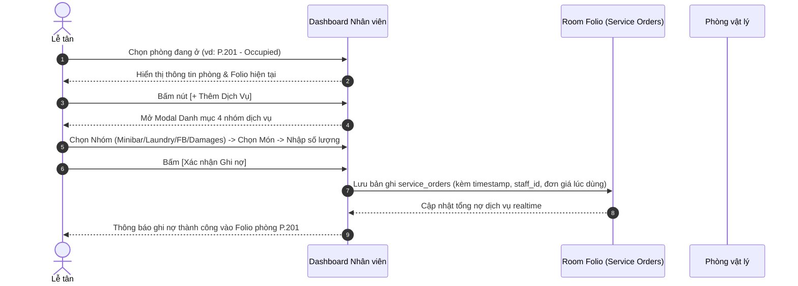
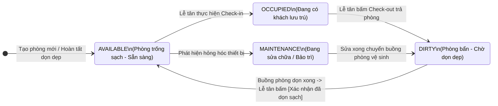

# ĐỀ XUẤT QUY TRÌNH NGHIỆP VỤ MỚI — ACE HOTEL

> **Trạng thái:** Dự thảo hoàn chỉnh (Detailed Proposal)  
> **Ngày cập nhật:** 13/10/2026  
> **Mục tiêu:** Chuẩn hoá hệ thống theo mô hình PMS thực tế đạt chuẩn môn học 502050 (5–7 chức năng, 4 trọng tâm phản biện), phân tách rõ 2 phân hệ Public và Backoffice, bổ sung luồng đặt cọc, gán phòng vật lý khi check-in, vòng đời dọn phòng, 4 giao diện dashboard phân quyền độc lập và cơ chế đăng ký/điều hướng vai trò tự động.

---

## 1. Mục tiêu & Định hướng nâng cấp

1. **Chuẩn hóa quy trình khách sạn thực tế (PMS Standard):**
   - Khách đặt trước theo **Hạng phòng (Room Type)** và **đặt cọc**, giữ chỗ tạm thời (*Hold booking*).
   - Khi khách đến quầy, Lễ tân mới thực hiện **Gán phòng vật lý cụ thể (Room Number)** đang ở trạng thái sạch (*Clean*) vào đơn đặt, đồng thời tiếp nhận linh hoạt cả khách vãng lai (*Walk-in*).
2. **Khép kín dòng tiền & chuẩn hạch toán thuế phí (Formula ++):**
   - Chuẩn hoá theo biểu giá quốc tế và thông lệ khách sạn Việt Nam: Áp dụng công thức `++` gồm **Phí phục vụ 5% (Service Charge - SVC)** và **Thuế GTGT 10% (VAT)** tính đè lên tổng chi phí (`x 1.155`).
   - Quyết toán hóa đơn tự động tính:
     $$\text{Tổng cộng hóa đơn} = (\text{Tiền phòng} + \text{Dịch vụ} + \text{Phụ thu trễ} + \text{SVC 5\%}) \times (1 + \text{VAT 10\%})$$
     $$\text{Số tiền thực thu tại quầy} = \text{Tổng cộng hóa đơn} - \text{Tiền cọc 30\% ban đầu}$$
   - Vòng đời phòng bổ sung trạng thái **Dirty (Chờ dọn dẹp)** sau khi khách trả phòng, tránh gán nhầm phòng chưa dọn cho khách mới.
3. **Phân định rõ 2 phân hệ, 3 Actor & 4 Không gian Giao diện (Dashboards):**
   - Phân hệ khách hàng trực tuyến (Public) và Phân hệ nội bộ (PMS/Backoffice).
   - Landing page dạng Storytelling cuộn dọc, kèm 3 Dashboard chuyên biệt cho 3 nhóm đối tượng: Khách hàng, Nhân viên Lễ tân, Quản trị viên (Admin).
   - Hệ thống tự động nhận diện vai trò sau khi đăng nhập để chuyển hướng về đúng Dashboard tương ứng.

---

## 2. Kiến trúc 4 Màn hình / Phân hệ Giao diện chính

Hệ thống được thiết kế với **4 giao diện hoàn toàn khác nhau**, phục vụ đúng ngữ cảnh của từng đối tượng:

```text
+-----------------------------------------------------------------------------------------------+
|                                    KIẾN TRÚC 4 GIAO DIỆN CHÍNH                                |
+------------------------------------+----------------------------------------------------------+
|       PHÂN HỆ CÔNG KHAI (PUBLIC)   |               PHÂN HỆ NỘI BỘ & CÁ NHÂN (PORTALS)         |
|                                    |                                                          |
|  [1. LANDING PAGE STORYTELLING]    |  [2. DASHBOARD KHÁCH HÀNG]   [3. DASHBOARD LỄ TÂN]       |
|  - Scroll dọc qua từng section     |  - Quản lý lịch sử booking   - Sơ đồ phòng trực quan     |
|  - Thiết kế đa phong cách          |  - Đơn cọc & trạng thái giữ  - Tiếp nhận Check-in/gán P  |
|  - Giới thiệu Khách sạn            |  - Thông tin cá nhân         - Ghi dịch vụ vào Folio     |
|  - Giới thiệu Dịch vụ tiện ích     |                              - Check-out & chuyển Dirty  |
|  - Giới thiệu Tính năng & Đặt P    |  ------------------------------------------------------- |
|                                    |  [4. DASHBOARD ADMIN / QUẢN LÝ]                          |
|                                    |  - Cấu hình hạng phòng & giá ngày thường / ngày lễ       |
|                                    |  - Quản lý danh mục phòng & bảng giá dịch vụ             |
|                                    |  - Biểu đồ doanh thu & tỷ lệ lấp đầy (Occupancy Rate)    |
+------------------------------------+----------------------------------------------------------+
```

### Chi tiết 4 giao diện:

1. **Giao diện 1: Landing Page với Storytelling (Scroll dọc):**
   - Trải nghiệm cuộn dọc theo dòng câu chuyện thương hiệu, mỗi section là một phong cách thiết kế mỹ thuật riêng biệt:
     - **Section 1 (Hero - Câu chuyện thương hiệu):** Giới thiệu không gian, triết lý phục vụ và đẳng cấp của khách sạn ACE.
     - **Section 2 (Dịch vụ & Tiện ích):** Hình ảnh và giới thiệu các trải nghiệm ẩm thực, thư giãn, minibar, giặt ủi.
     - **Section 3 (Các hạng phòng nổi bật):** Trình diễn các hạng phòng (Standard, Deluxe, Suite) kèm tiện nghi độc bản.
     - **Section 4 (Chức năng website & Đặt phòng nhanh):** Thanh tìm kiếm ngày nhận/trả, số khách và nút dẫn vào luồng đặt phòng trực tuyến.
2. **Giao diện 2: Dashboard Khách hàng (Customer Portal):**
   - Không gian cá nhân sau khi khách đăng ký / đăng nhập:
     - Danh sách các đơn đặt phòng của tôi (Mã `BK...`, Hạng phòng, Ngày đến/đi, Tiền cọc đã thanh toán, Trạng thái đơn `Reserved` / `CheckedIn` / `Completed` / `Cancelled`).
     - Chức năng tra cứu chi tiết đơn, xem chính sách nhận phòng hoặc yêu cầu hủy phòng.
     - Cập nhật thông tin hồ sơ cá nhân.
3. **Giao diện 3: Dashboard Nhân viên Lễ tân (Receptionist PMS):**
   - Bàn làm việc tác nghiệp thường trực tại quầy:
     - Sơ đồ lưới tình trạng phòng trực quan (Mã phòng, Hạng, Trạng thái: Trống sạch `Available`, Đang ở `Occupied`, Chờ dọn `Dirty`, Bảo trì `Maintenance`).
     - Danh sách check-in / check-out hôm nay.
     - Tiếp nhận khách đến, kiểm tra phòng sạch và **Gán phòng vật lý cụ thể** (hỗ trợ cả khách đặt trước và khách vãng lai *Walk-in*).
     - Ghi nhận phát sinh dịch vụ vào tài khoản phòng (*Room Folio*).
     - Check-out, quyết toán hóa đơn (trừ cọc, cộng phụ thu trễ) và đổi trạng thái phòng sang `Dirty`.
4. **Giao diện 4: Dashboard Quản trị viên (Admin Backoffice):**
   - Bảng điều khiển quản trị chiến lược:
     - Cấu hình hạng phòng, số lượng phòng thực tế, biểu giá linh hoạt theo ngày thường và ngày lễ/cao điểm.
     - Quản lý bảng giá danh mục dịch vụ.
     - Báo cáo thống kê doanh thu đa chiều (doanh thu phòng + doanh thu dịch vụ).
     - Biểu đồ đo lường **Tỷ lệ lấp đầy phòng (Occupancy Rate)** theo thời gian.

---

## 3. Quy chuẩn Nhận diện Thương hiệu & Hệ thống Thiết kế (Brand Identity & Design System)

### 3.1. Nhận diện Thương hiệu & Logo (Giữ nguyên)
* **Tên thương hiệu:** **ACE Hotel** (*Accommodation, Check-in & Extras*).
* **Bộ Logo chính thức:** Giữ nguyên 100% tài sản thương hiệu đã thiết kế trong dự án:
  * Logo đầy đủ có tên: `logo-full.png`, `logo-ace-name.png`
  * Biểu tượng độc lập: `logo-ace.png`
  * Favicon website: `favicon.png`
  * Phông chữ chủ đạo: **Inter** (Regular, Medium, SemiBold, Bold) nhúng offline nội bộ.

### 3.2. Chế độ Giao diện Sáng / Tối (Dark Mode & Light Mode)
* **Cơ chế chuyển đổi:**
  * Có nút bấm chuyển đổi nhanh Dark/Light (`data-theme-toggle`) trên thanh điều hướng ở cả 4 giao diện (Landing, Customer, Receptionist, Admin).
  * Mặc định khởi tạo: **Dark Mode** (tạo phong cách sang trọng, cao cấp cho khách sạn); lưu trạng thái lựa chọn của người dùng vào `localStorage ('ace-theme')` để không bị nháy sáng khi chuyển trang.

### 3.3. Tuân thủ bảng màu ACE Color System (`tokens.css`)
Hệ thống sử dụng đồng bộ bảng màu định danh thông qua CSS Custom Properties (Design Tokens):

| Thành phần màu | Chế độ Tối (Dark Mode - Mặc định) | Chế độ Sáng (Light Mode) | Ý nghĩa / Ứng dụng |
|---|---|---|---|
| **Màu thương hiệu (`--primary`)** | **`#FDBF2D`** (Vàng Champagne / Gold) | **`#FDBF2D`** (Vàng Champagne / Gold) | Giữ nguyên màu vàng nhận diện ở cả 2 chế độ; nút bấm chính, điểm nhấn thương hiệu |
| **Màu nền chính (`--bg`)** | `#000000` (Đen sâu) | `#F7F6F2` (Trắng kem ấm sang trọng) | Nền toàn trang |
| **Màu bề mặt (`--surface`)** | `#121212` (Xám đen) | `#FFFFFF` (Trắng tinh) | Thẻ card, bảng dữ liệu, modal, sidebar |
| **Màu viền (`--border`)** | `#2A2A2A` | `#E6E3DA` | Viền ngăn cách card, ô nhập liệu |
| **Chữ chính (`--text`)** | `#FFFFFF` | `#0A0A0A` | Tiêu đề, nội dung văn bản chính |
| **Chữ phụ (`--text-2`, `--text-3`)** | `#A1A1AA`, `#71717A` | `#52525B`, `#71717A` | Nhãn phụ, mô tả, chú thích mờ |

#### Bảng màu mã hóa Trạng thái phòng (Room State Colors):
* 🟢 **Trống / Sạch (`Available / Clean`):** `--st-free` (`#22C55E` Dark / `#15803D` Light) — Sẵn sàng gán cho khách.
* 🟣 **Đã đặt / Cọc (`Reserved`):** `--st-reserved` (`#A78BFA` Dark / `#7C3AED` Light) — Giữ chỗ chờ check-in.
* 🔵 **Đang ở (`Occupied`):** `--st-occupied` (`#60A5FA` Dark / `#2563EB` Light) — Phòng đang có khách lưu trú.
* 🟠 **Chờ dọn dẹp (`Dirty`):** `--st-dirty` (`#F59E0B` Dark / `#D97706` Light) — Phòng vừa check-out, chưa dọn dẹp.
* 🔴 **Quá hạn / Trễ (`Overdue`):** `--st-overdue` (`#F87171` Dark / `#DC2626` Light) — Khách lưu trú quá giờ quy định.
* ⚪ **Bảo trì (`Maintenance`):** `--st-maint` (`#9CA3AF` Dark / `#6B7280` Light) — Đang sửa chữa / ngừng khai thác.

---

## 4. Cơ chế Đăng ký, Đăng nhập & Điều hướng vai trò tự động

Hệ thống có cơ chế phân luồng người dùng thông minh ngay tại cổng xác thực:

```text
                       [ MÀN HÌNH ĐĂNG NHẬP / ĐĂNG KÝ ]
                                      |
         +----------------------------+----------------------------+
         |                                                         |
  [Tài khoản Nội bộ có sẵn]                                [Khách hàng mới]
  - Admin (quanly / Ace@123)                                       |
  - Lễ tân (letan / Ace@123)                               [Form Đăng ký Khách hàng]
         |                                                 - Họ và tên
         |                                                 - Ngày sinh (DOB)
         |                                                 - Số điện thoại
         |                                                 - Tên đăng nhập
         |                                                 - Mật khẩu
         |                                                         |
         v                                                         v
   [ĐĂNG NHẬP HỆ THỐNG]                                   [TẠO TÀI KHOẢN THÀNH CÔNG]
         |                                                         |
         +----------------------------+----------------------------+
                                      |
                        [KIỂM TRA ROLE & ĐIỀU HƯỚNG]
                                      |
         +----------------------------+----------------------------+
         |                            |                            |
    Role: ADMIN                Role: RECEPTIONIST           Role: CUSTOMER
         |                            |                            |
         v                            v                            v
  /admin/dashboard             /staff/dashboard            /customer/dashboard
(Dashboard Admin)            (Dashboard Lễ tân)          (Dashboard Khách hàng)
```

### Quy tắc đăng nhập & điều hướng:
1. **Đối với Admin và Nhân viên Lễ tân:**
   - Đã được khởi tạo sẵn tài khoản trong hệ thống (`users` data seed):
     - Quản lý: `quanly` (hoặc `admin`) / `Ace@123` $\rightarrow$ Tự động điều hướng về **Dashboard Admin** (`/admin/dashboard`).
     - Lễ tân: `letan` / `Ace@123` $\rightarrow$ Tự động điều hướng về **Dashboard Nhân viên** (`/staff/dashboard`).
2. **Đối với Khách hàng (Lần đầu truy cập):**
   - Khách hàng bấm **Đăng ký (Register)**.
   - Form đăng ký yêu cầu nhập đầy đủ 5 trường thông tin:
     1. **Họ và tên (`full_name`)**
     2. **Ngày sinh (`date_of_birth`)**
     3. **Số điện thoại (`phone`)**
     4. **Tên đăng nhập (`username`)**
     5. **Mật khẩu (`password`)**
   - Sau khi đăng ký thành công và đăng nhập, hệ thống gắn Role `CUSTOMER` và tự động điều hướng về **Dashboard Khách hàng** (`/customer/dashboard`).

---

## 5. Mô hình 3 Actor & Phân quyền hệ thống

```text
+---------------------------------------------------------------------------------+
|                           HỆ THỐNG QUẢN LÝ KHÁCH SẠN                            |
+----------------------------------------+----------------------------------------+
|       PHÂN HỆ KHÁCH HÀNG (PUBLIC)      |    PHÂN HỆ NỘI BỘ (PMS / BACKOFFICE)   |
|                                        |                                        |
| [Actor: Khách hàng]                    | [Actor: Lễ tân]        [Actor: Admin]  |
| - Đăng ký / Đăng nhập tài khoản        | - Tiếp nhận check-in   - Cấu hình giá  |
| - Tìm kiếm phòng trống theo ngày       | - Gán phòng vật lý     - Quản lý kho   |
| - Đặt phòng theo Hạng & Đặt cọc        | - Ghi nhận dịch vụ     - Xem báo cáo   |
| - Quản lý Dashboard cá nhân            | - Check-out tính tiền  - Quản trị HT   |
+----------------------------------------+----------------------------------------+
```

---

## 6. Danh mục 6 Chức năng (5–7 Chức năng, 4 Trọng tâm phản biện)

| STT | Tên Use Case | Actor chính | Vai trò phản biện | Phạm vi nghiệp vụ cụ thể |
|:---:|---|:---:|:---:|---|
| **1** | **Tìm kiếm & Đặt phòng trực tuyến** | Khách hàng | ⭐ **Trọng tâm 1** | Tra cứu phòng trống theo ngày; đặt theo **Hạng phòng**; thanh toán cọc; giữ chỗ tạm thời (*Hold booking*); xem tại Dashboard khách hàng. |
| **2** | **Quản lý Check-in & Gán phòng** | Lễ tân | ⭐ **Trọng tâm 2** | Tiếp nhận khách đã đặt trước hoặc khách vãng lai (*Walk-in*); gán vào **Phòng vật lý cụ thể** (P.101, P.202...); đổi trạng thái phòng sang "Đang ở" (*Occupied*). |
| **3** | **Ghi nhận sử dụng dịch vụ lưu trú** | Lễ tân | Bổ trợ | Chọn phòng đang ở → chọn dịch vụ (Minibar, Giặt ủi, Ăn uống, Hư hại tài sản) → cộng dồn chi phí vào tài khoản phòng (*Room Folio*). |
| **4** | **Check-out & Quyết toán hóa đơn** | Lễ tân | ⭐ **Trọng tâm 3** | Tự động tổng hợp: `Tiền phòng + Dịch vụ + Phụ thu trễ giờ + Phí phục vụ (SVC 5%) + Thuế GTGT (VAT 10%) - Tiền cọc 30%`; in hóa đơn VAT; đóng giao dịch; chuyển phòng sang "Chờ dọn dẹp" (*Dirty*). |
| **5** | **Quản lý Danh mục Phòng & Dịch vụ** | Admin | Nền tảng | Cấu hình hạng phòng, số lượng phòng thực tế, đơn giá theo ngày thường/ngày lễ và bảng giá danh mục dịch vụ trên Dashboard Admin. |
| **6** | **Báo cáo doanh thu & Công suất phòng** | Admin | ⭐ **Trọng tâm 4** | Thống kê doanh thu theo mốc thời gian; biểu đồ tỷ lệ lấp đầy phòng (*Occupancy Rate*) để đánh giá hiệu quả kinh doanh. |

---

## 7. Đặc tả Chi tiết Quy trình Đặt phòng & Phiếu xác nhận (UC1 - Trọng tâm 1)

### 7.1. Luồng 4 bước thực hiện Đặt phòng trực tuyến:
1. **Bước 1 — Chọn thông tin đặt phòng:**
   - Khách hàng đăng nhập trên Cổng khách hàng (hoặc bấm Đặt phòng từ Landing Page).
   - Khách hàng lựa chọn:
     - **Hạng phòng (Room Type):** Standard, Deluxe, Suite...
     - **Ngày nhận phòng (`check_in_date`)** & **Giờ check-in dự kiến** (chuẩn từ 14:00).
     - **Ngày trả phòng (`check_out_date`)** & **Giờ check-out dự kiến** (chuẩn trước 12:00).
     - **Số lượng khách lưu trú.**
   - Hệ thống tự động tính toán tài chính (theo công thức chuẩn `++` của khách sạn):
     $$\text{Tiền phòng gốc} = \text{Số đêm lưu trú} \times \text{Đơn giá hạng phòng theo ngày}$$
     $$\text{Phí phục vụ ước tính (SVC 5\%)} = \text{Tiền phòng gốc} \times 5\%$$
     $$\text{Thuế GTGT ước tính (VAT 10\%)} = (\text{Tiền phòng gốc} + \text{SVC}) \times 10\%$$
     $$\text{Tổng tiền phòng ước tính (++)} = \text{Tiền phòng gốc} \times 1.05 \times 1.10 = \text{Tiền phòng gốc} \times 1.155$$
     $$\text{Tiền cọc bắt buộc (30\%)} = \text{Tổng tiền phòng ước tính} \times 30\%$$
     $$\text{Còn phải thanh toán tại quầy (70\%)} = \text{Tổng tiền phòng ước tính} - \text{Tiền cọc (30\%)}$$
   - Khách bấm: **[Tiếp tục đặt phòng]**.

2. **Bước 2 — Pop-up Modal Xác nhận lại thông tin (Trước khi thanh toán):**
   - Hệ thống mở một hộp thoại Pop-up (Modal) tóm tắt toàn bộ thông tin để khách rà soát lần cuối:
     - **Tiêu đề Pop-up:** *"Xác nhận thông tin đặt phòng"*
     - **Thông tin khách hàng:** Họ và tên, Số điện thoại, Email.
     - **Thông tin phòng:** Hạng phòng đã chọn, Khoảng thời gian lưu trú (số đêm), Giờ check-in & check-out dự kiến.
     - **Bảng kê chi phí minh bạch:**
       - Tiền phòng gốc: `X.XXX.XXXđ`
       - Phí phục vụ (SVC 5%): `A.AAA.AAAđ`
       - Thuế GTGT (VAT 10%): `B.BBB.BBBđ`
       - Tổng giá trị gói phòng (`++`): `C.CCC.CCCđ`
       - **Mức cọc 30% cần thanh toán ngay:** `Y.YYY.YYYđ`
       - Số tiền còn lại sẽ thanh toán tại quầy khi trả phòng: `Z.ZZZ.ZZZđ`
     - **Lựa chọn phương thức cọc:** Chuyển khoản quét mã VietQR / Thẻ ATM / Visa / Cổng giả lập.
     - **Hai nút hành động:**
       - `[Quay lại chỉnh sửa]` (Đóng modal, giữ nguyên dữ liệu đã chọn).
       - `[Xác nhận & Thanh toán cọc 30%]` (Chuyển sang bước thanh toán cọc).

3. **Bước 3 — Thanh toán tiền cọc (30%):**
   - Khách hàng thực hiện thanh toán số tiền cọc 30% qua mã QR thanh toán hoặc form nhập thẻ demo.
   - Khi giao dịch cọc thành công:
     - Hệ thống sinh mã đặt phòng duy nhất: `BK-8K4P9X2M` (hoặc `BK-XXXX...`).
     - Ghi nhận trạng thái booking: **`Reserved` (Đã xác nhận & Đã cọc 30%)**.
     - Giữ chỗ tạm thời (*Hold booking*) trên hệ thống.

4. **Bước 4 — Trả về Phiếu Xác Nhận Đặt Phòng (Booking Confirmation Card / Voucher):**
   - Ngay sau khi đặt và cọc thành công, hệ thống xuất trả về một **Phiếu xác nhận đặt phòng trực quan** (dạng thẻ hình ảnh có thể tải về / chụp ảnh màn hình).
   - Phiếu xác nhận cũng được lưu trữ vĩnh viễn trong mục *"Đơn đặt của tôi"* trên **Dashboard Khách hàng** để khách xuất trình khi đến quầy Lễ tân.

### 7.2. Cấu trúc Phiếu Xác Nhận Đặt Phòng (Chuẩn mẫu thực tế):

```text
+---------------------------------------------------------------+
|                 PHIẾU XÁC NHẬN ĐẶT PHÒNG                      |
|                  ACE HOTEL & RESIDENCES                       |
|---------------------------------------------------------------|
|  MÃ BOOKING                                                   |
|  BK-8K4P9X2M                          +------------------+    |
|  [Đã xác nhận - Đã cọc 30%]           |  [ MÃ QR CODE ]  |    |
|                                       |  Quét check-in   |    |
|                                       +------------------+    |
|                                       QR tra cứu booking      |
|---------------------------------------------------------------|
|  Thông tin đặt phòng                                          |
|  Khách hàng:             Nguyễn Văn A                         |
|  Hạng phòng:             Deluxe Room                          |
|  Ngày nhận phòng:        25/10/2026                           |
|  Ngày trả phòng:         27/10/2026 (2 đêm)                   |
|  Giờ check-in dự kiến:   14:00                                |
|  Giờ check-out dự kiến:  12:00                                |
|---------------------------------------------------------------|
|  Bảng kê chi phí (Biểu giá ++)                                |
|  Tiền phòng gốc (2 đêm):                  2.000.000đ          |
|  Phí phục vụ (SVC 5%):                      100.000đ          |
|  Thuế GTGT (VAT 10%):                       210.000đ          |
|  Tổng giá trị phòng (++):                 2.310.000đ          |
|  Tiền cọc 30% (Đã thanh toán):              693.000đ          |
|  Còn phải thanh toán tại quầy:            1.617.000đ          |
|---------------------------------------------------------------|
|  * Chi phí phát sinh (minibar, giặt ủi, ăn uống...) chưa bao  |
|    gồm trong giá phòng và sẽ được tính riêng khi trả phòng.   |
|  * Quý khách vui lòng xuất trình phiếu này hoặc đưa mã QR cho |
|    Lễ tân khi làm thủ tục check-in nhận phòng.                |
+---------------------------------------------------------------+
```

*Ảnh mẫu thực tế:* [phieu-xac-nhan-dat-phong-mau.png](file:///D:/ACE/docs/assets/phieu-xac-nhan-dat-phong-mau.png)

---

## 8. Đặc tả Chi tiết Quy trình Check-in & Tiếp nhận Khách vãng lai (UC2 - Trọng tâm 2)

### 8.1. Check-in cho khách đã đặt phòng trước (Pre-booked Guest):
1. **Bước 1 — Tiếp nhận & Tra cứu đơn đặt:**
   - Khách hàng đến quầy Lễ tân và xuất trình **Phiếu xác nhận đặt phòng** (trên điện thoại hoặc mã QR lưu tại Dashboard Khách hàng).
   - Lễ tân sử dụng camera/đầu quét QR trên Dashboard Nhân viên để quét mã QR Code (hoặc nhập trực tiếp mã `booking_code` ví dụ `BK-8K4P9X2M` hoặc tra cứu theo Số điện thoại khách).
   - Hệ thống lập tức hiển thị thông tin chi tiết của đơn đặt:
     - Họ tên khách hàng, SĐT, Email.
     - Hạng phòng đã đặt (`Room Type`: ví dụ Deluxe Room).
     - Thời gian lưu trú (Ngày nhận - Ngày trả, số đêm).
     - Số tiền cọc đã thanh toán (30%), số tiền phòng còn lại cần thu khi check-out (70%).
     - Giờ check-in dự kiến (chuẩn 14:00).
2. **Bước 2 — Lọc & Gán phòng vật lý sạch (`Clean Physical Room Assignment`):**
   - Hệ thống tự động lọc danh sách toàn bộ các phòng vật lý thuộc đúng hạng phòng khách đã đặt (`room_type_id`) đang ở trạng thái **`AVAILABLE` (đã dọn sạch - Clean)**.
   - Các phòng đang ở trạng thái `DIRTY` (chưa dọn), `OCCUPIED` (đang có khách), hoặc `MAINTENANCE` (bảo trì) sẽ bị khóa, không hiển thị để chọn.
   - Lễ tân chọn 1 phòng vật lý thích hợp theo nhu cầu của khách (ví dụ: `P.201` - Tầng 2, không hút thuốc, view thoáng).
   - Lễ tân kiểm tra và đối chiếu giấy tờ tùy thân (CCCD / Hộ chiếu) của khách lưu trú.
3. **Bước 3 — Xác nhận Check-in & Kích hoạt Room Folio:**
   - Lễ tân bấm nút **[Xác nhận Check-in]**.
   - Hệ thống thực hiện các cập nhật tự động trong cơ sở dữ liệu:
     - `bookings.room_id = 201` (Gán phòng vật lý).
     - `bookings.status = 'CHECKED_IN'`.
     - `bookings.actual_check_in = CURRENT_TIMESTAMP`.
     - `rooms.status = 'OCCUPIED'` (Đổi trạng thái phòng sang Đang ở, lập tức chuyển màu đỏ trên sơ đồ phòng).
     - Khởi tạo tài khoản phòng (**Room Folio**) rỗng cho phòng `P.201` sẵn sàng ghi nhận các chi phí phát sinh.
   - Lễ tân giao chìa khóa/thẻ phòng và hướng dẫn tiện ích cho khách.

---

### 8.2. Tiếp nhận & Check-in Khách vãng lai (Walk-in Guest - Chưa đặt trước):
> [!NOTE]
> Khách vãng lai (*Walk-in*) là khách đến trực tiếp quầy lễ tân mà không đặt phòng trước qua website. Đây là nguồn khách thường xuyên tại các khách sạn Việt Nam và đòi hỏi quy trình xử lý tại chỗ nhanh gọn.

1. **Bước 1 — Kiểm tra tình trạng phòng trống tại quầy:**
   - Lễ tân mở chức năng **"Tiếp nhận khách vãng lai (Walk-in)"** trên Dashboard Nhân viên.
   - Hệ thống hiển thị sơ đồ phòng realtime: Lễ tân tra cứu danh sách các phòng vật lý đang trống sạch (`AVAILABLE / Clean`), phân chia theo từng Hạng phòng và kèm đơn giá áp dụng của ngày hôm nay.
2. **Bước 2 — Nhập thông tin & Thiết lập lưu trú:**
   - Lễ tân chọn phòng vật lý trực tiếp từ danh sách phòng sạch (ví dụ: `P.302 - Suite`).
   - Lễ tân nhập thông tin khách hàng:
     - Họ và tên, Số điện thoại, Số CCCD / Passport.
     - Ngày trả phòng dự kiến (`check_out_date`) và giờ check-out dự kiến (chuẩn 12:00).
     - Số lượng khách ở.
3. **Bước 3 — Chính sách thu tiền đảm bảo cho khách Walk-in (Chuẩn khách sạn):**
   - Khác với khách đặt online chỉ cọc 30%, khách Walk-in **bắt buộc thanh toán trước 100% tiền phòng dự kiến** (hoặc thanh toán toàn bộ tiền phòng + đặt cọc đảm bảo phát sinh *Incidental Deposit* 500.000đ - 1.000.000đ).
   - Lễ tân thu tiền qua Tiền mặt, Thẻ POS hoặc Chuyển khoản VietQR.
   - Sau khi thu tiền thành công, Lễ tân bấm **[Hoàn tất Check-in Walk-in]**:
     - Hệ thống tự động tạo mới hồ sơ khách hàng (nếu khách mới) hoặc liên kết khách cũ theo SĐT/CCCD.
     - Tạo bản ghi `bookings` với trạng thái `CHECKED_IN`, gán trực tiếp `room_id`, ghi nhận `deposit_amount` (số tiền phòng đã thu trước 100%).
     - Đổi trạng thái phòng vật lý sang `OCCUPIED`.
     - Kích hoạt tài khoản Room Folio để sẵn sàng theo dõi dịch vụ.

---

### 8.3. Chính sách Phụ thu Nhận phòng sớm (Early Check-in Policy):
Căn cứ thông lệ vận hành khách sạn tại Việt Nam (Vinpearl, Mường Thanh, Marriott):
* **Giờ nhận phòng chuẩn:** Từ `14:00`.
* **Trường hợp khách đến sớm và khách sạn có sẵn phòng sạch:**
  * **Trước 06:00 sáng:** Phụ thu **100%** đơn giá 1 đêm phòng (tính trọn gói như ở từ đêm trước).
  * **Từ 06:00 đến 09:00:** Phụ thu **50%** đơn giá 1 đêm phòng.
  * **Từ 09:00 đến 14:00:** Phụ thu **30%** đơn giá 1 đêm phòng (hoặc hỗ trợ nhận phòng sớm miễn phí nếu khách sạn còn nhiều phòng trống sạch).
* Khi khách làm thủ tục nhận phòng sớm, hệ thống tự động gợi ý mức phụ thu vào chi phí phòng, lễ tân có thể duyệt ghi nhận vào Folio hoặc tích chọn miễn phí ưu đãi.

---

## 9. Đặc tả Chi tiết Dịch vụ Lưu trú & Quản lý Room Folio (UC3 - Bổ trợ)

### 9.1. Danh mục 4 Nhóm dịch vụ thực tế trong khách sạn:
Hệ thống chuẩn hóa dịch vụ khách sạn thành 4 nhóm chính:

| Nhóm Dịch Vụ | Mã Nhóm | Các mặt hàng / Dịch vụ tiêu biểu | Đơn vị tính | Cách tính cước |
|---|---|---|:---:|---|
| **Minibar** | `MINIBAR` | Nước ngọt (Coca, Pepsi, 7Up)<br>Bia lon (Tiger, Heineken)<br>Snack khoai tây, Hạt điều, Mì ly<br>Nước suối cao cấp (vượt định mức 2 chai miễn phí) | Lon / Gói / Chai / Ly | Theo đơn giá niêm yết trên menu Minibar đặt trong phòng. |
| **Giặt ủi** | `LAUNDRY` | Giặt thường (Áo sơ mi, Quần tây, Váy)<br>Giặt hấp / Giặt khô (Dry clean - Áo vest, Áo dạ, Áo dài)<br>Ủi phẳng theo yêu cầu (Pressing only)<br>Giặt lấy gấp (Express - Phụ thu 50%) | Bộ / Chiếc / Cái | Theo bảng giá giặt ủi niêm yết trong tủ đồ. |
| **Ẩm thực** | `FB` | Bữa sáng gọi thêm (Extra Breakfast)<br>Đồ ăn phục vụ tại phòng (In-room Dining: Phở bò, Cơm chiên, Pizza, Burger)<br>Cà phê pha máy, Nước ép trái cây tươi | Phần / Suất / Ly / Tách | Theo thực đơn nhà hàng của khách sạn. |
| **Đền bù tài sản** | `DAMAGES` | Vỡ ly thủy tinh, cốc sứ<br>Làm ố bẩn/cháy rách khăn tắm, vỏ gối, drap giường<br>Hỏng điều khiển từ xa (Remote TV, Điều hòa)<br>Mất chìa khóa / thẻ từ phòng | Cái / Chiếc / Lần | Căn cứ Bảng giá đền bù tài sản lưu trú niêm yết tại phòng. |

---

### 9.2. Quy trình Ghi nhận nợ vào Room Folio trên Dashboard Lễ tân:


1. **Bước 1 — Mở tài khoản phòng:**
   - Lễ tân nhấp chọn phòng có khách đang lưu trú trên sơ đồ phòng (`rooms.status = 'OCCUPIED'`).
   - Màn hình hiển thị chi tiết tài khoản phòng (**Room Folio**): Danh sách các dịch vụ khách đã gọi trước đó, tổng tiền dịch vụ tạm tính.
2. **Bước 2 — Thao tác thêm dịch vụ:**
   - Bấm nút **[+ Thêm Dịch Vụ]**.
   - Màn hình mở Pop-up với 4 tab danh mục: `Minibar`, `Giặt ủi`, `Ẩm thực F&B`, `Đền bù tài sản`.
   - Lễ tân chọn món hàng và nhập số lượng phát sinh (Ví dụ: 2 lon Bia Tiger, 1 Áo vest giặt hấp).
   - Hệ thống tự động nhân với đơn giá niêm yết hiện hành và tính tổng tiền phát sinh của đợt này.
3. **Bước 3 — Xác nhận lưu vết và đối soát (Audit Trail):**
   - Lễ tân bấm **[Xác nhận Ghi nợ]**.
   - Hệ thống ghi 1 bản ghi vào bảng `service_orders` với đầy đủ thông tin truy vết:
     - `order_id`: Mã đơn dịch vụ tự sinh.
     - `booking_id`: Liên kết trực tiếp với mã đặt phòng hiện tại.
     - `service_id`: Mã dịch vụ.
     - `quantity`: Số lượng sử dụng.
     - `unit_price`: Đơn giá tại thời điểm sử dụng (bảo đảm giá không bị ảnh hưởng nếu sau này admin thay đổi bảng giá).
     - `ordered_at`: Thời điểm ghi nhận.
     - `created_by`: ID nhân viên lễ tân thực hiện ghi nhận.
   - Room Folio được cập nhật ngay lập tức và tự động cộng dồn vào hóa đơn quyết toán khi trả phòng.

---

## 10. Đặc tả Chi tiết Quy trình Check-out & Phụ thu Trễ giờ (UC4 - Trọng tâm 3)

### 10.1. Khung giờ & Biểu phí Phụ thu Check-out trễ (Late Check-out):
Căn cứ quy chế vận hành chuẩn tại các khách sạn hàng đầu Việt Nam:
* **Giờ trả phòng chuẩn (Standard Check-out Time):** Trước **`12:00`** trưa.
* **Biểu phí phụ thu Check-out trễ tự động:**

| Khung giờ thực tế trả phòng | Mức phụ thu áp dụng | Cách tính chi tiết |
|---|:---:|---|
| **Trước 12:00** | **0% (Miễn phí)** | Trả phòng đúng giờ quy định, không tính phụ thu. |
| **Từ 12:00 đến 15:00** | **30%** | Phụ thu 30% đơn giá 1 đêm của hạng phòng đang ở. |
| **Từ 15:00 đến 18:00** | **50%** | Phụ thu 50% đơn giá 1 đêm của hạng phòng đang ở. |
| **Sau 18:00** | **100%** | Phụ thu 100% đơn giá 1 đêm phòng (tính tương đương 1 đêm phát sinh). |

* **Cơ chế tính toán tự động:** Khi Lễ tân thao tác Check-out, hệ thống đối chiếu thời điểm hiện tại (`CURRENT_TIMESTAMP`) với mốc `12:00` của ngày trả phòng. Nếu quá giờ, hệ thống tự động gợi ý mức phụ thu vào trường `late_checkout_fee`. Lễ tân có thể xác nhận áp dụng hoặc bỏ chọn nếu có chính sách chăm sóc khách hàng VIP đặc biệt.

---

### 10.2. Quy trình 4 Bước Quyết toán Check-out & Xuất Hóa đơn VAT:
1. **Bước 1 — Khách báo trả phòng & Kiểm tra phòng (Room Inspection):**
   - Khách hàng tới quầy lễ tân bàn giao chìa khóa/thẻ phòng và yêu cầu trả phòng.
   - Lễ tân liên hệ bộ phận buồng phòng kiểm tra phòng nhanh:
     - Kiểm tra đồ uống Minibar khách đã sử dụng trong ngày cuối.
     - Kiểm tra tình trạng tài sản và trang thiết bị trong phòng.
   - Nếu có phát sinh, Lễ tân ghi nhận thêm vào Room Folio (theo quy trình ở Mục 9).
2. **Bước 2 — Hệ thống tổng hợp Hóa đơn Quyết toán tự động:**
   - Lễ tân nhấp chọn **[Check-out & Tính hóa đơn]**.
   - Hệ thống tự động thu thập và tính toán khép kín theo chuẩn biểu giá `++`:
     $$\text{Chi phí gốc (Subtotal Base)} = \text{Tiền phòng} + \text{Tổng tiền dịch vụ (Folio)} + \text{Phụ thu trễ giờ}$$
     $$\text{Phí phục vụ (SVC 5\%)} = \text{Subtotal Base} \times 5\%$$
     $$\text{Thuế GTGT (VAT 10\%)} = (\text{Subtotal Base} + \text{SVC 5\%}) \times 10\%$$
     $$\text{Tổng cộng hóa đơn (Grand Total)} = \text{Subtotal Base} \times 1.05 \times 1.10 = \text{Subtotal Base} \times 1.155$$
     $$\text{Thực thu tại quầy (Balance Due)} = \text{Grand Total} - \text{Tiền cọc 30\% ban đầu}$$
3. **Bước 3 — Thu tiền chênh lệch & In hóa đơn:**
   - Lễ tân hiển thị màn hình quyết toán cho khách xem hoặc in Phiếu thanh toán tạm tính (*Guest Folio*).
   - Khách thanh toán số tiền `Balance Due` còn lại qua một trong các phương thức:
     - Tiền mặt (*Cash*)
     - Cà thẻ qua máy POS (*Card*)
     - Chuyển khoản ngân hàng quét mã VietQR (*Transfer*)
   - Lễ tân chọn phương thức thanh toán và bấm **[Xác nhận Hoàn tất Thanh toán]**.
   - Hệ thống in / xuất hóa đơn điện tử VAT đầy đủ thông tin: Tên khách sạn, MST, Chi tiết từng dòng tiền phòng, dịch vụ, phí phục vụ 5%, thuế GTGT 10%, và khấu trừ cọc 30%.
4. **Bước 4 — Đóng giao dịch & Chuyển trạng thái phòng:**
   - Bản ghi `bookings` chuyển trạng thái sang **`CHECKED_OUT`**; cập nhật `actual_check_out = CURRENT_TIMESTAMP`.
   - Lưu bản ghi quyết toán hoàn chỉnh vào bảng `invoices`.
   - **Đặc biệt:** Phòng vật lý ngay lập tức tự động chuyển sang màu cam: **`DIRTY` (Chờ dọn dẹp)**, khóa phòng trên hệ thống không cho gán khách mới.

---

## 11. Đặc tả Vòng đời Buồng phòng & Chuyển giao Trạng thái (Housekeeping Lifecycle)

### 11.1. Sơ đồ Chuyển giao Vòng đời Trạng thái Phòng:



---

### 11.2. Cơ chế Khóa an toàn Nghiệp vụ (Business Protection Guard):
* **Quy tắc bất biến:** Một phòng vật lý **CHỈ CÓ THỂ** được gán cho khách khi trạng thái là **`AVAILABLE` (Sạch sẽ & Sẵn sàng đón khách)**.
* **Khóa chặn:**
  - Nếu phòng đang ở trạng thái `DIRTY`: Bị loại bỏ khỏi danh sách gợi ý gán phòng khi làm thủ tục Check-in cho khách đặt trước hoặc khách Walk-in.
  - Ngăn ngừa 100% rủi ro nghiêm trọng trong phục vụ: Khách nhận nhầm phòng bẩn chưa thay drap, chưa dọn rác, làm suy giảm uy tín khách sạn.

---

### 11.3. Nút Thao tác nhanh `[Xác nhận đã dọn sạch]` trên Dashboard Lễ tân:
* Để giữ hệ thống **tinh gọn, trực quan** và không làm phát sinh phân hệ nhân viên buồng phòng cồng kềnh ngoài quy mô môn học:
  1. Trên sơ đồ phòng của **Dashboard Nhân viên Lễ tân**, các phòng ở trạng thái `DIRTY` hiển thị màu cam nổi bật kèm nhãn cảnh báo *"Chờ dọn dẹp"*.
  2. Tại mỗi thẻ phòng `DIRTY`, tích hợp sẵn một nút hành động nhanh: **[Xác nhận đã dọn sạch]**.
  3. Sau khi nhân viên buồng phòng dọn dẹp xong và báo lại quầy lễ tân (qua bộ đàm hoặc trực tiếp) $\rightarrow$ Lễ tân chỉ cần bấm 1 click vào nút **[Xác nhận đã dọn sạch]**.
  4. Hệ thống lập tức cập nhật `rooms.status = 'AVAILABLE'`, thẻ phòng chuyển về màu xanh tươi sáng, tự động xuất hiện lại trong danh sách phòng sẵn sàng đón khách mới.

---

## 12. Đặc tả Chi tiết Quản trị Danh mục & Cấu hình Biểu giá (UC5 - Admin)

### 12.1. Quản lý Danh mục Phòng & Phân tầng:
* **Quản lý Hạng phòng (`room_types`):**
  - Thêm, sửa, xem thông tin hạng phòng: Tên hạng (Standard, Deluxe, Suite), Sức chứa tối đa (người lớn, trẻ em), Mô tả tiện nghi đặc trưng, Ảnh đại diện.
* **Quản lý Phòng vật lý (`rooms`):**
  - Quản lý danh sách từng phòng: Số phòng (`room_number`: 101, 102, 201, 202, 301...), Tầng lầu (`floor`: 1, 2, 3...), Hạng phòng tương ứng.
  - Chuyển trạng thái bảo trì: Khi phòng hỏng điều hòa hoặc cần sơn sửa, Admin chuyển sang `MAINTENANCE` để khóa phòng khỏi hoạt động kinh doanh.

### 12.2. Quản lý Danh mục Dịch vụ & Đơn giá (`services`):
* Admin toàn quyền thêm mới, cập nhật tên và đơn giá niêm yết cho các sản phẩm dịch vụ thuộc 4 nhóm:
  - Tên dịch vụ (ví dụ: *Nước ngọt lon*, *Bia Tiger*, *Giặt áo sơ mi*, *Bồi thường vỡ ly thủy tinh*...).
  - Phân loại nhóm (`category`): `MINIBAR`, `LAUNDRY`, `FB`, `DAMAGES`.
  - Đơn vị tính (`unit`): lon, chai, bộ, cái, phần, lần.
  - Đơn giá gốc chưa thuế (`unit_price`): tính bằng VND.

### 12.3. Cơ chế Cấu hình Biểu giá Linh hoạt theo Thời điểm (Dynamic Pricing):
Chuẩn hóa theo tập quán định giá ngành khách sạn:
* Mỗi hạng phòng hỗ trợ cấu hình 2 mức giá:
  1. **Giá ngày thường (Weekday Price):** Áp dụng cho các đêm từ **Thứ 2 đến Thứ 5**.
  2. **Giá cuối tuần & Ngày lễ (Weekend / Holiday Price):** Áp dụng cho các đêm **Thứ 6, Thứ 7, Chủ Nhật** và các ngày nghỉ Lễ/Tết quốc gia (thường cao hơn 20% - 40% so với ngày thường).
* **Cơ chế tính giá tự động:** Khi khách đặt phòng từ ngày $A$ đến ngày $B$, hệ thống tự động bóc tách từng đêm lưu trú để áp đúng đơn giá ngày thường hoặc cuối tuần, cộng dồn thành tổng tiền phòng chính xác tuyệt đối.

---

## 13. Đặc tả Chi tiết Báo cáo Doanh thu & Tỷ lệ Lấp đầy phòng (UC6 - Trọng tâm 4 - Admin)

### 13.1. Công thức Toán học Đo lường Tỷ lệ Lấp đầy (Occupancy Rate):
Tỷ lệ lấp đầy phòng (*Occupancy Rate - OR*) là chỉ số quan trọng hàng đầu trong quản trị khách sạn:

$$\text{Occupancy Rate (\%)} = \frac{\text{Số phòng đang có khách ở (Occupied Rooms)}}{\text{Tổng số phòng có thể kinh doanh (Available Rooms)}} \times 100\%$$

> [!IMPORTANT]
> **Quy tắc chuẩn mực quốc tế về mẫu số:**
> $$\text{Tổng số phòng có thể kinh doanh} = \text{Số phòng AVAILABLE} + \text{Số phòng OCCUPIED} + \text{Số phòng DIRTY}$$
> Các phòng đang hỏng hóc hoặc đóng cửa bảo trì dài ngày (**`MAINTENANCE`**) **bắt buộc phải loại trừ khỏi mẫu số**, vì phòng này không đủ điều kiện kỹ thuật để bán, không được tính vào công suất sẵn sàng của khách sạn.

---

### 13.2. Bộ Chỉ số Hiệu quả Vận hành Khách sạn Chuẩn (Hotel Key Metrics):
Bên cạnh Occupancy Rate, Dashboard Admin bổ sung 2 chỉ số quản trị cốt lõi:
1. **Giá bán bình quân mỗi phòng (ADR - Average Daily Rate):**
   $$\text{ADR} = \frac{\text{Tổng doanh thu tiền phòng}}{\text{Số lượng phòng thực tế có khách ở}}$$
2. **Doanh thu trên mỗi phòng sẵn có (RevPAR - Revenue Per Available Room):**
   $$\text{RevPAR} = \text{ADR} \times \text{Occupancy Rate} = \frac{\text{Tổng doanh thu tiền phòng}}{\text{Tổng số phòng có thể kinh doanh}}$$

---

### 13.3. Báo cáo Cơ cấu Doanh thu Đa chiều & Bộ lọc Thời gian:
* **Biểu đồ phân tích cơ cấu doanh thu:**
  - Doanh thu Tiền phòng (Room Revenue)
  - Doanh thu Dịch vụ Minibar & Đồ uống
  - Doanh thu Dịch vụ Giặt ủi (Laundry)
  - Doanh thu Ẩm thực (F&B) & Đền bù tài sản
  - Doanh thu Phí phục vụ (SVC 5%)
  - Tiền thuế GTGT đã thu hộ ngân sách (VAT 10%)
* **Bộ lọc báo cáo linh hoạt:**
  - Xem theo: Hôm nay / Tuần này / Tháng này / Quý này / Năm nay / Khoảng ngày tùy chọn.
  - Hỗ trợ xuất bảng biểu thống kê ra dạng bảng trực quan trên Dashboard Admin.

---

## 14. Luồng dữ liệu nghiệp vụ khép kín (End-to-End Flow)

```text
  [Khách hàng]                      [Lễ tân]                          [Admin]
       |                                |                                |
 (0) Đăng ký tài khoản                  |                                |
  - Nhập: Họ tên, Ngày sinh,            |                                |
    SĐT, Username, Password             |                                |
  - Vào Dashboard Khách hàng            |                                |
       |                                |                                |
 (1) Đặt phòng online                   |                                |
  - Chọn ngày: 15/10 - 17/10            |                                |
  - Chọn hạng: Deluxe                   |                                |
  - Cọc -> Mã BK001 (Reserved)          |                                |
       |                                |                                |
       |========== Ngày 15/10 =========>|                                |
       | (2) Trình mã BK001             |                                |
       |     hoặc quét QR Code          | Check-in: Gán P.201 (Clean)   |
       |                                | -> P.201 đổi sang OCCUPIED    |
       |                                | -> Kích hoạt Room Folio        |
       |                                |                                |
       |====== Trong thời gian ở ======>|                                |
       | (3) Gọi đồ minibar + giặt ủi   |                                |
       |                                | Ghi nhận DV vào Folio P.201    |
       |                                |                                |
       |========== Ngày 17/10 =========>|                                |
       | (4) Yêu cầu trả phòng          |                                |
       |                                | Check-out: Quét tổng hợp:      |
       |                                |   Tiền phòng (2 đêm)           |
       |                                | + Dịch vụ (Folio thực tế)      |
       |                                | + Phụ thu trễ giờ (nếu có)     |
       |                                | + Phí phục vụ SVC 5%           |
       |                                | + Thuế GTGT VAT 10%            |
       |                                | - Tiền cọc 30% ban đầu         |
       |                                | -> Xuất hóa đơn quyết toán     |
       |                                | -> P.201 chuyển DIRTY (Chờ dọn)|
       |                                |                                |
       |                                | (4.1) Buồng phòng dọn xong:    |
       |                                | Lễ tân bấm [Đã dọn sạch]       |
       |                                | -> P.201 về lại AVAILABLE      |
       |                                |                                |
       |                                |============ Cuối tháng =======>|
       |                                | (5) Xem Dashboard Admin:       |
       |                                |   - Báo cáo doanh thu đa chiều |
       |                                |   - Biểu đồ Occupancy Rate     |
```

### Diễn giải chi tiết từng bước:
1. **Bước 0 & 1 (Khách hàng):** Khách truy cập web, đăng ký tài khoản (họ tên, ngày sinh, SĐT, tài khoản, mật khẩu) → Đăng nhập thành công vào Dashboard Khách hàng → Chọn khoảng ngày `15/10 – 17/10` (2 đêm) → Chọn hạng phòng `Deluxe` → Xác nhận pop-up thanh toán cọc giữ chỗ (30%) → Nhận Phiếu xác nhận đặt phòng kèm mã QR Code tra cứu và mã `BK001` (trạng thái `Reserved`).
2. **Bước 2 (Lễ tân):** Ngày `15/10`, khách tới quầy trình mã QR Code hoặc mã `BK001` → Lễ tân mở Dashboard Nhân viên → Hệ thống lọc các phòng vật lý thuộc hạng `Deluxe` đang trống sạch (`AVAILABLE / Clean`) → Lễ tân chọn gán `P.201` → Hoàn tất Check-in (Phòng `P.201` thành `OCCUPIED`, kích hoạt Room Folio). *(Nếu là khách vãng lai Walk-in, lễ tân chọn phòng sạch trực tiếp, thu trước 100% tiền phòng rồi check-in ngay).*
3. **Bước 3 (Lễ tân):** Trong thời gian lưu trú, khách phát sinh nhu cầu sử dụng dịch vụ (Minibar, giặt ủi, ăn uống, hoặc bồi thường tài sản) → Lễ tân chọn phòng `P.201` trên Dashboard $\rightarrow$ Chọn dịch vụ và số lượng thực tế $\rightarrow$ Hệ thống tự động ghi nhận, tổng hợp và báo cáo lại vào tài khoản phòng (*Room Folio*) của phòng `P.201` kèm thông tin nhân viên và thời gian tạo.
4. **Bước 4 (Lễ tân):** Ngày `17/10`, khách báo trả phòng → Lễ tân bấm Check-out trên Dashboard → Hệ thống tự động quét và tính toán theo chuẩn hạch toán biểu giá `++`:
   $$\text{Tổng chi phí gốc (Base)} = \text{Tiền phòng (2 đêm)} + \text{Dịch vụ phát sinh} + \text{Phụ thu trễ (nếu có)}$$
   $$\text{Phí phục vụ (SVC 5\%)} = \text{Base} \times 5\%$$
   $$\text{Tổng tiền tính thuế} = \text{Base} + \text{SVC} = \text{Base} \times 1.05$$
   $$\text{Thuế GTGT (VAT 10\%)} = (\text{Base} + \text{SVC}) \times 10\% = \text{Base} \times 10.5\%$$
   $$\text{Tổng cộng hóa đơn (Grand Total)} = \text{Base} \times 1.05 \times 1.10 = \text{Base} \times 1.155$$
   $$\text{Thực thu tại quầy (Balance Due)} = \text{Grand Total} - \text{Tiền cọc 30\% ban đầu}$$

   *Bảng minh họa quyết toán Folio thực tế:*
   | Khoản mục trên hóa đơn | Cách tính | Giá trị ví dụ (VND) |
   |---|---|:---:|
   | Tiền phòng Deluxe (2 đêm) | $1.000.000 \times 2$ | 2.000.000đ |
   | Dịch vụ minibar & giặt ủi phát sinh | Room Folio ghi nhận thực tế | 300.000đ |
   | Phụ thu trễ giờ (nếu có) | Quá giờ check-out quy định | 0đ |
   | **Tổng chi phí gốc (Subtotal Base)** | Tiền phòng + Dịch vụ + Phụ thu | **2.300.000đ** |
   | **Phí phục vụ (SVC 5%)** | $2.300.000 \times 5\%$ | **115.000đ** |
   | **Thuế GTGT (VAT 10%)** | $(2.300.000 + 115.000) \times 10\%$ | **241.500đ** |
   | **TỔNG CỘNG HÓA ĐƠN (Grand Total)** | $2.300.000 \times 1.155$ | **2.656.500đ** |
   | **Khấu trừ tiền cọc 30% đã thanh toán** | Cọc phòng lúc đặt online | **- 693.000đ** |
   | **SỐ TIỀN THỰC THU KHI CHECK-OUT (Balance Due)** | $\text{Grand Total} - \text{Cọc}$ | **1.963.500đ** |

   Lễ tân thu số tiền chênh lệch còn lại qua Tiền mặt / Thẻ / Chuyển khoản VietQR → Xuất hóa đơn GTGT / hóa đơn quyết toán (kê rõ tiền phòng, dịch vụ, phụ thu, SVC 5%, VAT 10% và khấu trừ cọc) → Phòng `P.201` tự động đổi sang trạng thái **`DIRTY` (Chờ dọn dẹp)**.
5. **Bước 4.1 (Dọn phòng):** Khi nhân viên dọn vệ sinh xong và thông báo → Lễ tân bấm nút **[Xác nhận đã dọn sạch]** trên Dashboard Lễ tân → Phòng `P.201` lập tức trở lại trạng thái **`AVAILABLE` (Sạch sẽ)**, sẵn sàng gán cho lượt khách mới.
6. **Bước 5 (Admin):** Cuối tháng, Admin vào Dashboard Admin xem bảng doanh thu tổng hợp (tách bạch tiền phòng, dịch vụ, phí phục vụ SVC, thuế VAT) và biểu đồ tỷ lệ lấp đầy (*Occupancy Rate*) của hạng `Deluxe`.

---

## 15. Bảng so sánh đối chiếu: Quy trình MỚI vs. Quy trình CŨ

| Tiêu chí so sánh | Quy trình CŨ | Quy trình MỚI | Điểm nhấn kỹ thuật & nghiệp vụ |
|---|---|---|---|
| **Cấu trúc Giao diện** | 1 Landing tĩnh + 1 Dashboard chung cho Lễ tân & Quản lý. | **4 Giao diện riêng biệt**: Landing Storytelling + Dashboard Khách hàng + Dashboard Lễ tân + Dashboard Admin. | Phân định rạch ròi không gian trải nghiệm theo từng đối tượng sử dụng. |
| **Quản lý Tài khoản & Phân quyền** | Chỉ có 2 tài khoản nội bộ (`letan`, `quanly`). Khách không có tài khoản. | **3 Role**: `ADMIN`, `RECEPTIONIST`, `CUSTOMER`. Khách hàng có luồng đăng ký riêng (Họ tên, ngày sinh, SĐT, user, pass). | Khách hàng chủ động quản lý lịch sử đặt phòng; hệ thống tự động điều hướng đúng dashboard sau login. |
| **Cơ chế Đặt phòng (Booking)** | Gán cứng một phòng cụ thể (Room 101, 102...) ngay lúc đặt tại quầy. | Đặt theo **Hạng phòng (Room Type)**, **Cọc 30%** qua Pop-up xác nhận, cấp **Phiếu xác nhận kèm mã QR**. | Tránh khóa phòng vật lý từ sớm; tạo trải nghiệm đặt phòng trực tuyến tiện lợi, an tâm. |
| **Cơ chế Check-in** | Chỉ đổi trạng thái booking, phòng đã định trước. | Tiếp nhận tại quầy (quét mã QR hoặc tìm mã booking) $\rightarrow$ **Gán phòng vật lý sạch** cụ thể; hỗ trợ cả luồng **Khách Walk-in thu trước 100%**. | Xử lý linh hoạt bài toán điều phối buồng phòng thực tế theo chuẩn ngành du lịch. |
| **Tiền cọc & Quyết toán thuế phí** | Không có cọc, không phụ thu trễ giờ, không thuế phí (`BR6`, `D7`). | Có **Tiền cọc 30%**, chuẩn hoá hạch toán biểu giá **`++`** gồm **Phí phục vụ 5% (SVC)** và **Thuế GTGT 10% (VAT)** tính đè (`x 1.155`), tự động khấu trừ cọc và cộng **Phụ thu trễ giờ**. | Đảm bảo tính ràng buộc giao dịch, khép kín dòng tiền chuẩn khách sạn 4-5 sao quốc tế. |
| **Vòng đời trạng thái phòng** | `AVAILABLE` $\leftrightarrow$ `OCCUPIED` $\leftrightarrow$ `MAINTENANCE`. Trả phòng là có thể ở ngay. | Thêm trạng thái **`DIRTY` (Chờ dọn dẹp)**. Quy trình: `AVAILABLE (Clean)` $\rightarrow$ `OCCUPIED` $\rightarrow$ `DIRTY` $\rightarrow$ `AVAILABLE`. | Ngăn chặn việc xếp khách vào phòng chưa kịp dọn, tích hợp nút hành động nhanh cho Lễ tân. |
| **Định giá phòng** | 1 giá cố định theo loại phòng. | Hỗ trợ cấu hình giá theo **ngày thường** và **ngày lễ / cuối tuần**. | Tối ưu doanh thu theo tính mùa vụ và ngày trong tuần. |
| **Báo cáo quản trị** | Thống kê số lượng lượt đơn giản. | Biểu đồ đo lường chuyên sâu **Tỷ lệ lấp đầy phòng (Occupancy Rate)**, **ADR**, **RevPAR**. | Phản ánh đúng hiệu quả kinh doanh của khách sạn theo chuẩn nghiệp vụ VTOS. |

---

## 16. Đánh giá tác động Kỹ thuật & CSDL (Technical & Schema Impact)

### 16.1. Thay đổi CSDL (Database Schema):
1. **Bảng `users`:**
   - Mở rộng phân quyền: `role VARCHAR(20) CHECK (role IN ('ADMIN', 'RECEPTIONIST', 'CUSTOMER'))`.
2. **Bảng `customers`:**
   - Bổ sung:
     - `user_id BIGINT UNIQUE REFERENCES users(user_id)` (liên kết với tài khoản đăng nhập).
     - `date_of_birth DATE NOT NULL` (ngày sinh khi đăng ký).
3. **Bảng `bookings`:**
   - `room_id`: Cho phép `NULL` lúc khách mới đặt online. Chỉ gán `room_id` khi lễ tân check-in.
   - Bổ sung `room_type_id BIGINT NOT NULL REFERENCES room_types(room_type_id)`.
   - Bổ sung `deposit_amount BIGINT DEFAULT 0` (tiền cọc 30%).
   - Bổ sung `late_checkout_fee BIGINT DEFAULT 0` (phụ thu trễ giờ).
   - Bổ sung `booking_code VARCHAR(20) UNIQUE` (ví dụ `BK-8K4P9X2M`).
   - Bổ sung `estimated_check_in_time TIME` & `estimated_check_out_time TIME`.
   - Cập nhật ràng buộc trạng thái: `status VARCHAR(20) CHECK (status IN ('RESERVED', 'CHECKED_IN', 'CHECKED_OUT', 'CANCELLED'))`.
4. **Bảng `rooms`:**
   - Mở rộng trạng thái 4 nấc: `status VARCHAR(20) CHECK (status IN ('AVAILABLE', 'OCCUPIED', 'DIRTY', 'MAINTENANCE'))`.
5. **Bảng `services`:**
   - Bổ sung phân nhóm dịch vụ: `category VARCHAR(30) NOT NULL CHECK (category IN ('MINIBAR', 'LAUNDRY', 'FB', 'DAMAGES'))`.
6. **Bảng `service_orders` (Room Folio Ledger):**
   - Bổ sung `created_by BIGINT NOT NULL REFERENCES users(user_id)` (lưu vết nhân viên ghi nhận nợ).
   - Đảm bảo lưu trường `unit_price BIGINT NOT NULL` (giá lịch sử lúc đặt).
7. **Bảng `invoices` (Chuẩn hoá theo E-Invoice khách sạn):**
   - `invoice_id BIGINT GENERATED BY DEFAULT AS IDENTITY PRIMARY KEY`
   - `booking_id BIGINT UNIQUE NOT NULL REFERENCES bookings(booking_id)`
   - `room_charge BIGINT NOT NULL CHECK (room_charge >= 0)` (Tiền phòng gốc)
   - `service_charge_total BIGINT NOT NULL DEFAULT 0` (Tổng tiền dịch vụ minibar, F&B, giặt ủi gốc)
   - `late_checkout_fee BIGINT NOT NULL DEFAULT 0` (Phụ thu trễ giờ)
   - `subtotal BIGINT NOT NULL` (Tổng chi phí gốc = room_charge + service_charge_total + late_checkout_fee)
   - `service_charge_amount BIGINT NOT NULL` (Phí phục vụ 5% = subtotal * 5%)
   - `vat_amount BIGINT NOT NULL` (Thuế GTGT 10% = (subtotal + service_charge_amount) * 10%)
   - `grand_total BIGINT NOT NULL` (Tổng cộng hóa đơn = subtotal + service_charge_amount + vat_amount)
   - `deposit_deducted BIGINT NOT NULL DEFAULT 0` (Tiền cọc 30% đã khấu trừ)
   - `balance_due BIGINT NOT NULL` (Số tiền thực thu tại quầy = grand_total - deposit_deducted)
   - `payment_method VARCHAR(20) NOT NULL CHECK (payment_method IN ('CASH', 'CARD', 'TRANSFER'))`
   - `paid_at TIMESTAMP NOT NULL`
   - `created_by BIGINT NOT NULL REFERENCES users(user_id)`
   - `CHECK (grand_total = subtotal + service_charge_amount + vat_amount)`
   - `CHECK (balance_due = grand_total - deposit_deducted)`
8. **Bảng `room_types` / Cấu hình giá:**
   - Bổ sung `weekend_price_per_night BIGINT` để hỗ trợ định giá riêng cho cuối tuần và ngày lễ.

---

### 16.2. Thay đổi Backend & Routing (Spring Boot & Spring Security):
1. **Spring Security & Authentication Success Handler:**
   - Cấu hình custom `AuthenticationSuccessHandler`:
     - Nếu `hasRole('ADMIN')` $\rightarrow$ Redirect `/admin/dashboard`
     - Nếu `hasRole('RECEPTIONIST')` $\rightarrow$ Redirect `/staff/dashboard`
     - Nếu `hasRole('CUSTOMER')` $\rightarrow$ Redirect `/customer/dashboard`
2. **Form Đăng ký Khách hàng (`/register`):**
   - Controller & Service xử lý tạo mới bản ghi `users` (mã hóa mật khẩu BCrypt, role `CUSTOMER`) đồng thời tạo bản ghi `customers` tương ứng (họ tên, ngày sinh, SĐT).
3. **Bộ 4 Giao diện:**
   - `landing.html`: Thiết kế storytelling scroll dọc qua 4 sections.
   - `customer-dashboard.html`: Quản lý danh sách đặt phòng cá nhân, lưu thẻ Phiếu xác nhận đặt phòng kèm mã QR.
   - `receptionist-dashboard.html`: Bàn làm việc lễ tân (sơ đồ phòng, quét QR check-in, tiếp nhận Walk-in, Room Folio, check-out, nút xác nhận dọn phòng sạch).
   - `admin-dashboard.html`: Bảng điều khiển admin (cấu hình giá ngày thường/cuối tuần, quản lý phòng & dịch vụ, biểu đồ Occupancy Rate & doanh thu đa chiều).

---

## 17. Tài liệu hình ảnh tham khảo

* [Sơ đồ Phân hệ 3 Actor & 6 Use Case](file:///D:/ACE/docs/assets/quy-trinh-moi-1-actor-usecase.png)
* [Sơ đồ Luồng dữ liệu nghiệp vụ khép kín End-to-End](file:///D:/ACE/docs/assets/quy-trinh-moi-2-e2e-flow.png)
* [Mẫu Phiếu xác nhận đặt phòng kèm mã QR Code](file:///D:/ACE/docs/assets/phieu-xac-nhan-dat-phong-mau.png)
